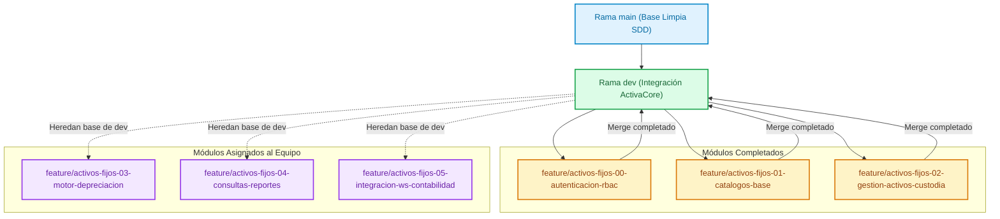

# ActivaCore — Sistema de Gestión de Activos Fijos & Contabilización

> 🎓 **Proyecto Final — Integraciones I**  
> 🏛️ **Universidad APEC (UNAPEC)**  
> 👨‍🏫 **Docente:** Prof. Juan P. Valdez  
> 📦 **Repositorio:** [github.com/JeremyJS20/activa_core-](https://github.com/JeremyJS20/activa_core-)

---

## 📌 1. Visión General del Proyecto

**ActivaCore** es una solución integral y moderna diseñada para la gestión, control físico, cálculo de depreciaciones periódicas e integración contable de los activos fijos institucionales de una organización. Desarrollado bajo la metodología **Spec-Driven Development (SDD)**, el sistema garantiza un desacoplamiento modular, alta trazabilidad operativa y apego estricto a las normativas fiscales y contables de la República Dominicana (DGII y Código Tributario Ley 11-92).

### Capacidades Clave
- **Control de Acceso Relacional (RBAC)**: Gestión de usuarios con roles formales (`ADMIN`, `OPERADOR`, `AUDITOR`) y permisos granulares.
- **Catálogos Maestros Validados**: Departamentos, tipos de activos clasificados por categorías fiscales DGII y empleados custodios con validación aritmética de Cédula JCE (Módulo 10).
- **Inventario y Custodia Trazable**: Asignación correlativa de código (`ACT-YYYY-NNNN`), historial inmutable de traslados departamentales, generación de actas de entrega/recepción en PDF y bajas formales.
- **Motor de Depreciación Periódica**: Cálculo automático mensual por Línea Recta y Categorías DGII (Cat 1: 5%, Cat 2: 25%, Cat 3: 15%) con cierres de período y reversiones auditadas.
- **Consultas Multicriterio & Reportes**: Búsqueda instantánea, auditoría de bienes y exportaciones en Excel (.xlsx) y CSV con UTF-8 BOM.
- **Integración con WS de Contabilidad**: Comunicación desacoplada (Outbox Pattern) con Web Service SOAP/REST de contabilidad general, monitor de asientos y reintentos automáticos.

---

## 🗺️ 2. Hoja de Ruta Modular y Distribución del Equipo

El sistema se divide en **6 sub-módulos independientes y desacoplados**. Cada sub-módulo cuenta con su propia rama de trabajo, especificaciones formales y plan de ejecución:

| Sub-módulo | Rama | Estado | Responsable | Alcance Principal |
|---|---|:---:|---|---|
| **00 - Autenticación y RBAC** | `feature/activos-fijos-00-autenticacion-rbac` | ✅ **Listo** | JeremyJS | NextAuth.js v5, roles relacionales, usuarios, middleware y **Wave 0 (Scaffolding Next.js 15 en `app/`)**. |
| **01 - Catálogos Base** | `feature/activos-fijos-01-catalogos-base` | ✅ **Listo** | JeremyJS | Departamentos, Tipos de Activos (cuentas contables compra/depreciación) y Empleados (Cédula JCE). |
| **02 - Gestión de Activos y Custodia** | `feature/activos-fijos-02-gestion-activos-custodia` | ✅ **Listo** | JeremyJS | Alta de Activos (`ACT-YYYY-NNNN`), `HistorialCustodia` (ACID), Actas de Entrega PDF y Bajas Formales. |
| **03 - Motor de Depreciación** | `feature/activos-fijos-03-motor-depreciacion` | ⏳ **Asignado** | *Compañero de Equipo* | Cálculo mensual de cuotas DGII (5%, 25%, 15%) y Línea Recta, corridas mensuales, cierres y reversiones. |
| **04 - Consultas y Reportes** | `feature/activos-fijos-04-consultas-reportes` | ⏳ **Asignado** | *Compañero de Equipo* | Consultas multicriterio de inventario, reportes de depreciación acumulada y exportaciones. |
| **05 - Integración WS Contabilidad** | `feature/activos-fijos-05-integracion-ws-contabilidad` | ⏳ **Asignado** | *Compañero de Equipo* | Asientos de diario contables, Outbox Pattern, Mock WS, monitor de envíos y reintentos. |

---

## 🌿 3. Estrategia de Ramas y Flujo Git para el Equipo

Para garantizar que nadie sobreescriba el trabajo de otros, el repositorio utiliza una **estrategia de aislamiento estricto por módulo**:



### Convención de Ramas:
1. **`main`**: Rama de producción y gobernanza base limpia. No contiene especificaciones en borrador.
2. **`dev`**: Rama principal de desarrollo donde convergen todos los módulos certificados y listos.
3. **`feature/activos-fijos-XX-<nombre>`**: Rama individual y aislada para cada sub-módulo.

---

## 🛠️ 4. Guía Rápida para los Compañeros de Equipo

Si te corresponde desarrollar el **Sub-módulo 03, 04 o 05**, sigue estos pasos exactos:

### Paso 1: Clonar y ubicarse en tu rama
```bash
# 1. Clonar el repositorio remoto
git clone https://github.com/JeremyJS20/activa_core-.git
cd activa_core-

# 2. Descargar todas las ramas
git fetch --all

# 3. Cambiarte a la rama que te corresponde
git checkout feature/activos-fijos-03-motor-depreciacion
# o si te toca reportes:
# git checkout feature/activos-fijos-04-consultas-reportes
```

### Paso 2: Crear tus especificaciones SDD
En tu rama, crea la carpeta `specs/activos-fijos/XX-<tu-modulo>/` basándote en las plantillas oficiales que están en `specs/_templates/`:
- **`requirements.md`**: Basado en `specs/_templates/requirements-template.md`.
  - *Regla*: Tokens EARS y Gherkin en inglés (`WHEN`, `WHILE`, `WHERE`, `the system SHALL`, `Given`, `When`, `Then`). Contenido y reglas de negocio 100% en español.
- **`design.md`**: Basado en `specs/_templates/design-template.md`.
  - *Regla*: DDL completo de tus tablas, claves foráneas hacia los modelos existentes, índices y contratos de endpoints REST.
- **`tasks.md`**: Basado en `specs/_templates/tasks-template.md`.
  - *Regla*: Tareas atómicas de máximo 4 horas. **OMITE LA WAVE 0 (Scaffolding)** porque la aplicación Next.js y el setup de Prisma ya están provistos por el Sub-módulo 00. Empieza directamente en **Wave 1 (Foundation)**.

### Paso 3: Regla de Commits Convencionales
Todos los commits deben usar formato semántico con el scope de tu módulo:
- `feat(depreciacion): add formula engine for straight line and dgii`
- `docs(depreciacion): complete requirements and design specs`
- `test(depreciacion): add unit tests for monthly cutoff`

### Paso 4: Integración a `dev`
Cuando tu módulo esté completo y probado:
```bash
git push origin feature/activos-fijos-XX-<tu-modulo>
```
Abre un Pull Request hacia la rama **`dev`** para revisión y fusión.

---

## 💻 5. Stack Tecnológico

- **Frontend & Backend**: [Next.js 15](https://nextjs.org/) (App Router, React 19, TypeScript).
- **ORM & Base de Datos**: [Prisma ORM v6](https://www.prisma.io/) + [PostgreSQL 16](https://www.postgresql.org/) (Docker / Supabase).
- **Estilos & UI**: [Tailwind CSS v4](https://tailwindcss.com/) + [shadcn/ui](https://ui.shadcn.com/) (Radix UI, Lucide Icons).
- **Validación de Datos**: [Zod](https://zod.dev/) para validación estricta en cliente y servidor.
- **Generación de Documentos**: [`@react-pdf/renderer`](https://react-pdf.org/) para actas de entrega/recepción en PDF.
- **Exportación de Datos**: [`exceljs`](https://github.com/exceljs/exceljs) para hojas de cálculo Excel (.xlsx) y CSV con UTF-8 BOM.
- **Testing**: [Vitest](https://vitest.dev/) (pruebas unitarias y de integración) + [Playwright](https://playwright.dev/) (pruebas E2E de humo).

---

## 🚀 6. Instalación y Puesta en Marcha Local

### Requisitos Previos
- **Node.js**: v20.x o v22.x LTS instalado.
- **pnpm**: v9+ (o npm v10+).
- **Docker & Docker Compose**: Para la base de datos PostgreSQL local.

### Pasos de Configuración:
```bash
# 1. Instalar dependencias en la aplicación
cd app
pnpm install

# 2. Configurar variables de entorno
cp .env.example .env
# Pega en DATABASE_URL la cadena de conexión de Neon Cloud provista por el equipo.
# (¡Listo! Las tablas y datos de prueba ya están creados y sincronizados en Neon).

# 3. Iniciar servidor de desarrollo
pnpm dev
```

La aplicación estará accesible en: `http://localhost:3000`

---

## ⚖️ 7. Marco Normativo y Reglas Contables (República Dominicana)

### Categorías de Depreciación Fiscal (DGII — Art. 287 Código Tributario)
- **Categoría 1 (5% anual)**: Edificaciones, construcciones e instalaciones estructurales fijas. Vida útil: 240 meses (20 años).
- **Categoría 2 (25% anual)**: Vehículos de motor livianos, equipos de tracción, equipos de transporte, mobiliario y equipos de oficina, computadoras y sistemas de procesamiento de datos. Vida útil: 48 meses (4 años).
- **Categoría 3 (15% anual)**: Cualquier otro bien depreciable no incluido en las Categorías 1 y 2 (maquinaria pesada, transformadores, generadores industriales, etc.). Vida útil: 80 meses (~6.67 años).

### Validación de Cédula de Identidad y Electoral (JCE)
- Formato: `XXX-XXXXXXX-X` (11 dígitos continuos normalizados).
- Algoritmo cripto-aritmético: **Luhn / Módulo 10** con vector de ponderación alternado `[1, 2, 1, 2, 1, 2, 1, 2, 1, 2]`.

---

© 2026 **ActivaCore Team** — Integraciones I, Universidad APEC.
