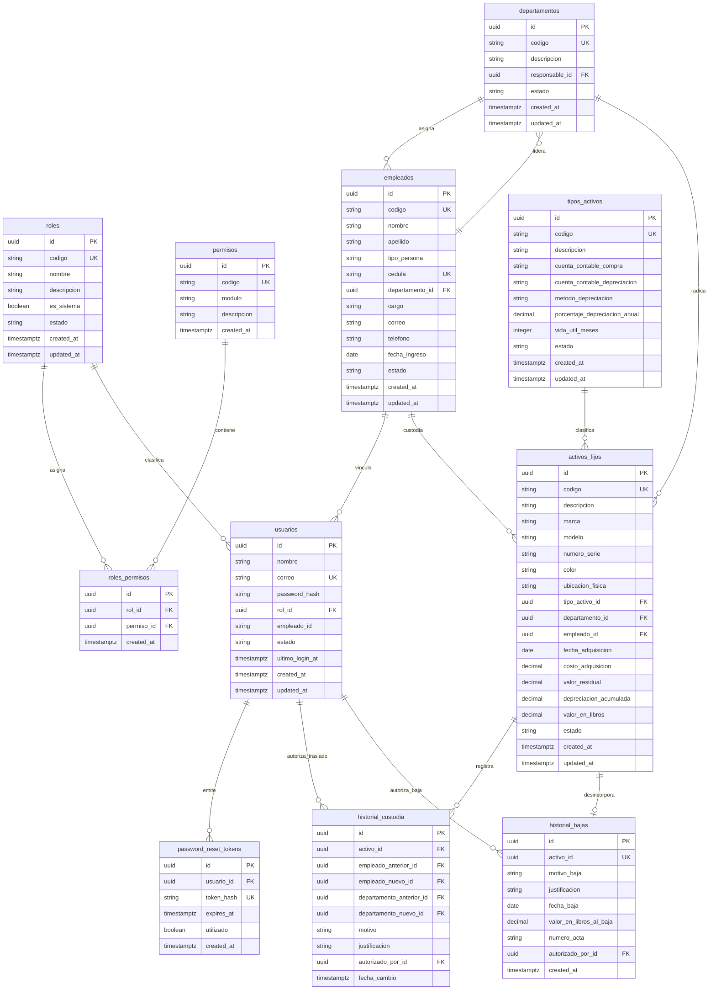

# Database Architecture & Data Model: ActivaCore

> 🗄️ Master Database Architecture Document · Living Data Blueprint
> 🔄 Last Updated: 2026-10-17 · Status: Active / Production Scheme Certified (Sub-00, Sub-01 & Sub-02)
> 👤 Data Authority: Dirección de Tecnología & Finanzas (UNAPEC)
> 🐘 Engine: PostgreSQL 16 (Neon Serverless PostgreSQL / AWS RDS Multi-AZ) · ORM: Prisma 6.19
> ⚠️ **MANDATORY QUALITY GATE (Hard Gate 12)**: Este documento detalla exhaustivamente el DDL físico, tipos SQL exactos, restricciones, índices B-Tree y protocolos de migración determinista.

---

## 1. Engine Specifications & Connection Architecture

### 1.1 Server & Instance Configuration
- **Motor y Versión**: PostgreSQL 16.x (Neon Serverless Pooler / AWS RDS).
- **Codificación Primaria**: UTF-8 · Collation: en_US.UTF-8.
- **Zona Horaria**: UTC (Todas las fechas y timestamps se almacenan estrictamente en UTC).
- **Extensiones Activas**:
  - `uuid-ossp` / `pgcrypto`: Generación criptográfica nativa de UUIDv4 (`gen_random_uuid()`).

### 1.2 Connection Pooling & Client Strategy
- **Cliente ORM**: Prisma ORM 6.19 (`@prisma/client`) configurado como singleton global en `app/lib/prisma.ts`.
- **Límites de Pool**:
  - `connection_limit`: 10 conexiones simultáneas por instancia de aplicación.
  - `pool_timeout`: 10 segundos.
  - `connect_timeout`: 5 segundos.
- **Cadena de Conexión**: Parametrizada vía variable de entorno `DATABASE_URL` en `.env` (no versionada).

---

## 2. Master Entity-Relationship Diagram (Global Domain ERD)



---

## 3. Physical Schema DDL & Data Dictionary

### 3.1 DDL Statements (PostgreSQL 16 Dialect)
```sql
-- ========================================================
-- MODULO 00: SEGURIDAD, RBAC Y CONTROL DE ACCESO
-- ========================================================

-- 1. Tabla: roles
CREATE TABLE roles (
    id UUID PRIMARY KEY DEFAULT gen_random_uuid(),
    codigo VARCHAR(50) NOT NULL,
    nombre VARCHAR(100) NOT NULL,
    descripcion VARCHAR(255),
    es_sistema BOOLEAN NOT NULL DEFAULT false,
    estado VARCHAR(20) NOT NULL DEFAULT 'ACTIVO',
    created_at TIMESTAMPTZ NOT NULL DEFAULT CURRENT_TIMESTAMP,
    updated_at TIMESTAMPTZ NOT NULL DEFAULT CURRENT_TIMESTAMP,
    CONSTRAINT uq_roles_codigo UNIQUE (codigo)
);

-- 2. Tabla: permisos
CREATE TABLE permisos (
    id UUID PRIMARY KEY DEFAULT gen_random_uuid(),
    codigo VARCHAR(50) NOT NULL,
    modulo VARCHAR(50) NOT NULL,
    descripcion VARCHAR(255) NOT NULL,
    created_at TIMESTAMPTZ NOT NULL DEFAULT CURRENT_TIMESTAMP,
    CONSTRAINT uq_permisos_codigo UNIQUE (codigo)
);

-- 3. Tabla relacional: roles_permisos
CREATE TABLE roles_permisos (
    id UUID PRIMARY KEY DEFAULT gen_random_uuid(),
    rol_id UUID NOT NULL,
    permiso_id UUID NOT NULL,
    created_at TIMESTAMPTZ NOT NULL DEFAULT CURRENT_TIMESTAMP,
    CONSTRAINT fk_roles_permisos_rol FOREIGN KEY (rol_id) REFERENCES roles(id) ON DELETE CASCADE,
    CONSTRAINT fk_roles_permisos_permiso FOREIGN KEY (permiso_id) REFERENCES permisos(id) ON DELETE CASCADE,
    CONSTRAINT uq_roles_permisos_rol_permiso UNIQUE (rol_id, permiso_id)
);

-- 4. Tabla: usuarios
CREATE TABLE usuarios (
    id UUID PRIMARY KEY DEFAULT gen_random_uuid(),
    nombre VARCHAR(150) NOT NULL,
    correo VARCHAR(255) NOT NULL,
    password_hash VARCHAR(255) NOT NULL,
    rol_id UUID NOT NULL,
    empleado_id VARCHAR(50),
    estado VARCHAR(20) NOT NULL DEFAULT 'ACTIVO',
    ultimo_login_at TIMESTAMPTZ,
    created_at TIMESTAMPTZ NOT NULL DEFAULT CURRENT_TIMESTAMP,
    updated_at TIMESTAMPTZ NOT NULL DEFAULT CURRENT_TIMESTAMP,
    CONSTRAINT fk_usuarios_rol FOREIGN KEY (rol_id) REFERENCES roles(id) ON DELETE RESTRICT,
    CONSTRAINT uq_usuarios_correo UNIQUE (correo)
);

-- 5. Tabla: password_reset_tokens
CREATE TABLE password_reset_tokens (
    id UUID PRIMARY KEY DEFAULT gen_random_uuid(),
    usuario_id UUID NOT NULL,
    token_hash VARCHAR(64) NOT NULL,
    expires_at TIMESTAMPTZ NOT NULL,
    utilizado BOOLEAN NOT NULL DEFAULT false,
    created_at TIMESTAMPTZ NOT NULL DEFAULT CURRENT_TIMESTAMP,
    CONSTRAINT fk_tokens_usuario FOREIGN KEY (usuario_id) REFERENCES usuarios(id) ON DELETE CASCADE,
    CONSTRAINT uq_tokens_token_hash UNIQUE (token_hash)
);

-- ========================================================
-- MODULO 01: CATALOGOS BASE Y MAESTROS ORGANIZACIONALES
-- ========================================================

-- 6. Tabla: departamentos
CREATE TABLE departamentos (
    id UUID PRIMARY KEY DEFAULT gen_random_uuid(),
    codigo VARCHAR(10) NOT NULL,
    descripcion VARCHAR(120) NOT NULL,
    responsable_id UUID,
    estado VARCHAR(10) NOT NULL DEFAULT 'ACTIVO',
    created_at TIMESTAMPTZ NOT NULL DEFAULT CURRENT_TIMESTAMP,
    updated_at TIMESTAMPTZ NOT NULL DEFAULT CURRENT_TIMESTAMP,
    CONSTRAINT uq_departamentos_codigo UNIQUE (codigo),
    CONSTRAINT chk_departamentos_estado CHECK (estado IN ('ACTIVO', 'INACTIVO'))
);

-- 7. Tabla: tipos_activos
CREATE TABLE tipos_activos (
    id UUID PRIMARY KEY DEFAULT gen_random_uuid(),
    codigo VARCHAR(10) NOT NULL,
    descripcion VARCHAR(150) NOT NULL,
    cuenta_contable_compra VARCHAR(20) NOT NULL,
    cuenta_contable_depreciacion VARCHAR(20) NOT NULL,
    metodo_depreciacion VARCHAR(20) NOT NULL DEFAULT 'LINEA_RECTA',
    porcentaje_depreciacion_anual DECIMAL(5, 2) NOT NULL DEFAULT 0.00,
    vida_util_meses INTEGER NOT NULL DEFAULT 12,
    estado VARCHAR(10) NOT NULL DEFAULT 'ACTIVO',
    created_at TIMESTAMPTZ NOT NULL DEFAULT CURRENT_TIMESTAMP,
    updated_at TIMESTAMPTZ NOT NULL DEFAULT CURRENT_TIMESTAMP,
    CONSTRAINT uq_tipos_activos_codigo UNIQUE (codigo),
    CONSTRAINT chk_tipos_activos_estado CHECK (estado IN ('ACTIVO', 'INACTIVO')),
    CONSTRAINT chk_tipos_activos_metodo CHECK (metodo_depreciacion IN ('DGII_CAT1', 'DGII_CAT2', 'DGII_CAT3', 'LINEA_RECTA')),
    CONSTRAINT chk_tipos_activos_cuentas CHECK (cuenta_contable_compra <> cuenta_contable_depreciacion)
);

-- 8. Tabla: empleados
CREATE TABLE empleados (
    id UUID PRIMARY KEY DEFAULT gen_random_uuid(),
    codigo VARCHAR(10) NOT NULL,
    nombre VARCHAR(100) NOT NULL,
    apellido VARCHAR(100) NOT NULL,
    tipo_persona VARCHAR(10) NOT NULL DEFAULT 'FISICA',
    cedula VARCHAR(15) NOT NULL,
    departamento_id UUID NOT NULL,
    cargo VARCHAR(100) NOT NULL,
    correo VARCHAR(150),
    telefono VARCHAR(20),
    fecha_ingreso DATE NOT NULL,
    estado VARCHAR(10) NOT NULL DEFAULT 'ACTIVO',
    created_at TIMESTAMPTZ NOT NULL DEFAULT CURRENT_TIMESTAMP,
    updated_at TIMESTAMPTZ NOT NULL DEFAULT CURRENT_TIMESTAMP,
    CONSTRAINT uq_empleados_codigo UNIQUE (codigo),
    CONSTRAINT uq_empleados_cedula UNIQUE (cedula),
    CONSTRAINT chk_empleados_tipo_persona CHECK (tipo_persona IN ('FISICA', 'JURIDICA')),
    CONSTRAINT chk_empleados_estado CHECK (estado IN ('ACTIVO', 'INACTIVO')),
    CONSTRAINT fk_empleados_departamento FOREIGN KEY (departamento_id) REFERENCES departamentos(id) ON DELETE RESTRICT
);

-- Restriccion diferida: Referencia de jefe de departamento a empleado
ALTER TABLE departamentos
    ADD CONSTRAINT fk_departamentos_responsable
    FOREIGN KEY (responsable_id) REFERENCES empleados(id) ON DELETE SET NULL;

-- ========================================================
-- MODULO 02: GESTION DE ACTIVOS FIJOS, INVENTARIO Y CUSTODIA
-- ========================================================

-- 9. Tabla: activos_fijos
CREATE TABLE activos_fijos (
    id UUID PRIMARY KEY DEFAULT gen_random_uuid(),
    codigo VARCHAR(20) NOT NULL,
    descripcion VARCHAR(255) NOT NULL,
    marca VARCHAR(100),
    modelo VARCHAR(100),
    numero_serie VARCHAR(100),
    color VARCHAR(50),
    ubicacion_fisica VARCHAR(200),
    tipo_activo_id UUID NOT NULL,
    departamento_id UUID NOT NULL,
    empleado_id UUID NOT NULL,
    fecha_adquisicion DATE NOT NULL,
    costo_adquisicion DECIMAL(14, 2) NOT NULL,
    valor_residual DECIMAL(14, 2) NOT NULL DEFAULT 0.00,
    depreciacion_acumulada DECIMAL(14, 2) NOT NULL DEFAULT 0.00,
    valor_en_libros DECIMAL(14, 2) NOT NULL,
    estado VARCHAR(25) NOT NULL DEFAULT 'ACTIVO',
    created_at TIMESTAMPTZ NOT NULL DEFAULT CURRENT_TIMESTAMP,
    updated_at TIMESTAMPTZ NOT NULL DEFAULT CURRENT_TIMESTAMP,
    CONSTRAINT uq_activos_fijos_codigo UNIQUE (codigo),
    CONSTRAINT fk_activos_tipo_activo FOREIGN KEY (tipo_activo_id) REFERENCES tipos_activos(id) ON DELETE RESTRICT,
    CONSTRAINT fk_activos_departamento FOREIGN KEY (departamento_id) REFERENCES departamentos(id) ON DELETE RESTRICT,
    CONSTRAINT fk_activos_empleado FOREIGN KEY (empleado_id) REFERENCES empleados(id) ON DELETE RESTRICT
);

-- 10. Tabla: historial_custodia (Append-Only)
CREATE TABLE historial_custodia (
    id UUID PRIMARY KEY DEFAULT gen_random_uuid(),
    activo_id UUID NOT NULL,
    empleado_anterior_id UUID,
    empleado_nuevo_id UUID NOT NULL,
    departamento_anterior_id UUID,
    departamento_nuevo_id UUID NOT NULL,
    motivo VARCHAR(30) NOT NULL,
    justificacion TEXT NOT NULL,
    autorizado_por_id UUID NOT NULL,
    fecha_cambio TIMESTAMPTZ NOT NULL DEFAULT CURRENT_TIMESTAMP,
    CONSTRAINT fk_hc_activo FOREIGN KEY (activo_id) REFERENCES activos_fijos(id) ON DELETE CASCADE,
    CONSTRAINT fk_hc_empleado_nuevo FOREIGN KEY (empleado_nuevo_id) REFERENCES empleados(id) ON DELETE RESTRICT,
    CONSTRAINT fk_hc_departamento_nuevo FOREIGN KEY (departamento_nuevo_id) REFERENCES departamentos(id) ON DELETE RESTRICT,
    CONSTRAINT fk_hc_autorizado_por FOREIGN KEY (autorizado_por_id) REFERENCES usuarios(id) ON DELETE RESTRICT
);

-- 11. Tabla: historial_bajas
CREATE TABLE historial_bajas (
    id UUID PRIMARY KEY DEFAULT gen_random_uuid(),
    activo_id UUID NOT NULL,
    motivo_baja VARCHAR(40) NOT NULL,
    justificacion TEXT NOT NULL,
    fecha_baja DATE NOT NULL,
    valor_en_libros_al_baja DECIMAL(14, 2) NOT NULL,
    numero_acta VARCHAR(50) NOT NULL,
    autorizado_por_id UUID NOT NULL,
    created_at TIMESTAMPTZ NOT NULL DEFAULT CURRENT_TIMESTAMP,
    CONSTRAINT uq_historial_bajas_activo UNIQUE (activo_id),
    CONSTRAINT fk_hb_activo FOREIGN KEY (activo_id) REFERENCES activos_fijos(id) ON DELETE RESTRICT,
    CONSTRAINT fk_hb_autorizado_por FOREIGN KEY (autorizado_por_id) REFERENCES usuarios(id) ON DELETE RESTRICT
);
```

---

## 4. Indexing & Performance Strategy

| Index Name | Table | Columns | Type | Purpose |
|------------|-------|---------|------|---------|
| idx_usuarios_correo | usuarios | correo | B-Tree (Unique) | Búsqueda O(1) en autenticación institucional. |
| idx_usuarios_rol_id | usuarios | rol_id | B-Tree | Optimización de joins con catálogo de roles. |
| idx_roles_codigo | roles | codigo | B-Tree (Unique) | Resolución de roles base del sistema. |
| idx_permisos_codigo | permisos | codigo | B-Tree (Unique) | Resolución de verificador RBAC. |
| idx_roles_permisos_lookup | roles_permisos | (rol_id, permiso_id) | B-Tree (Composite) | Resolución instantánea de capacidades en login. |
| idx_tokens_token_hash | password_reset_tokens | token_hash | B-Tree (Unique) | Búsqueda rápida e invalidación de tokens de autoservicio. |
| idx_departamentos_codigo | departamentos | codigo | B-Tree (Unique) | Resolución unívoca de centros de costos institucionales. |
| idx_departamentos_estado | departamentos | estado | B-Tree | Filtrado de unidades activas para asignaciones de activos. |
| idx_tipos_activos_codigo | tipos_activos | codigo | B-Tree (Unique) | Resolución unívoca de clases de activos fijos. |
| idx_tipos_activos_estado | tipos_activos | estado | B-Tree | Filtros de tipos de activos habilitados para nuevas altas. |
| idx_empleados_codigo | empleados | codigo | B-Tree (Unique) | Búsqueda rápida por matrícula institucional de custodio. |
| idx_empleados_cedula | empleados | cedula | B-Tree (Unique) | Verificación O(1) de unicidad en padrón JCE y RNC DGII. |
| idx_empleados_departamento_id | empleados | departamento_id | B-Tree | Joins de empleados adscritos por departamento. |
| idx_empleados_estado | empleados | estado | B-Tree | Filtrado de colaboradores aptos para asignación de bienes. |
| idx_activos_fijos_codigo | activos_fijos | codigo | B-Tree (Unique) | Búsqueda O(1) por código correlativo anual ACT-YYYY-NNNN. |
| idx_activos_fijos_departamento_id | activos_fijos | departamento_id | B-Tree | Filtrado de inventario por centro de costos departamental. |
| idx_activos_fijos_tipo_activo_id | activos_fijos | tipo_activo_id | B-Tree | Filtrado de bienes por categoría fiscal DGII. |
| idx_activos_fijos_empleado_id | activos_fijos | empleado_id | B-Tree | Consulta de activos bajo custodia de un empleado. |
| idx_activos_fijos_estado | activos_fijos | estado | B-Tree | Filtrado rápido por estado operativo o dados de baja. |
| idx_activos_fijos_numero_serie | activos_fijos | numero_serie | B-Tree | Búsqueda por número de serie de fabricante. |
| idx_historial_custodia_activo_fecha | historial_custodia | (activo_id, fecha_cambio DESC) | B-Tree (Composite) | Recuperación cronológica de movimientos de custodia. |
| idx_historial_bajas_fecha_baja | historial_bajas | fecha_baja | B-Tree | Auditoría fiscal de bajas por período contable. |

---

## 5. Multi-Tenancy & Partitioning Architecture

- **Aislamiento**: Arquitectura institucional dedicada con partición lógica basada en esquemas relacionales.
- **Integridad Referencial**: Forzada a nivel motor con claves foráneas estrictas y restricciones `ON DELETE RESTRICT` en entidades críticas (ej. departamentos con custodios adscritos).

---

## 6. Data Integrity & Zero-Downtime Migration Protocols

- **Workflow de Migraciones**: Gestionado exclusivamente vía Prisma Migrate (`app/prisma/migrations/`).
- **Protocolo de Aplicación**:
  1. Desarrollo: `pnpm --dir app exec prisma migrate dev --name <descripcion>`.
  2. Despliegue CI/Prod: `pnpm --dir app exec prisma migrate deploy`.
- **Semilla Idempotente**: `app/prisma/seed.ts` utiliza operaciones upsert para garantizar idempotencia en inicialización y pruebas.

---

## 7. Security, Encryption & Privacy Controls

- **Cero Secretos en Claro**: Las contraseñas se almacenan exclusivamente como hashes Bcrypt (10 rondas de salt).
- **Tokens Efímeros Hash-Only**: Los tokens de restablecimiento se entregan al usuario en texto plano y se persisten en base de datos únicamente como digest SHA-256 de 64 caracteres.
- **Principio de Mínimo Privilegio**: La cuenta de aplicación opera sin permisos de alteración de base de datos fuera de las migraciones controladas.

---

## 8. Disaster Recovery & Backup Topology

- **Respaldos Diarios**: Volcados automáticos pg_dump con compresión gzip en repositorio de seguridad.
- **Point-In-Time Recovery (PITR)**: Habilitado mediante archivado continuo de WAL (Write-Ahead Logging).