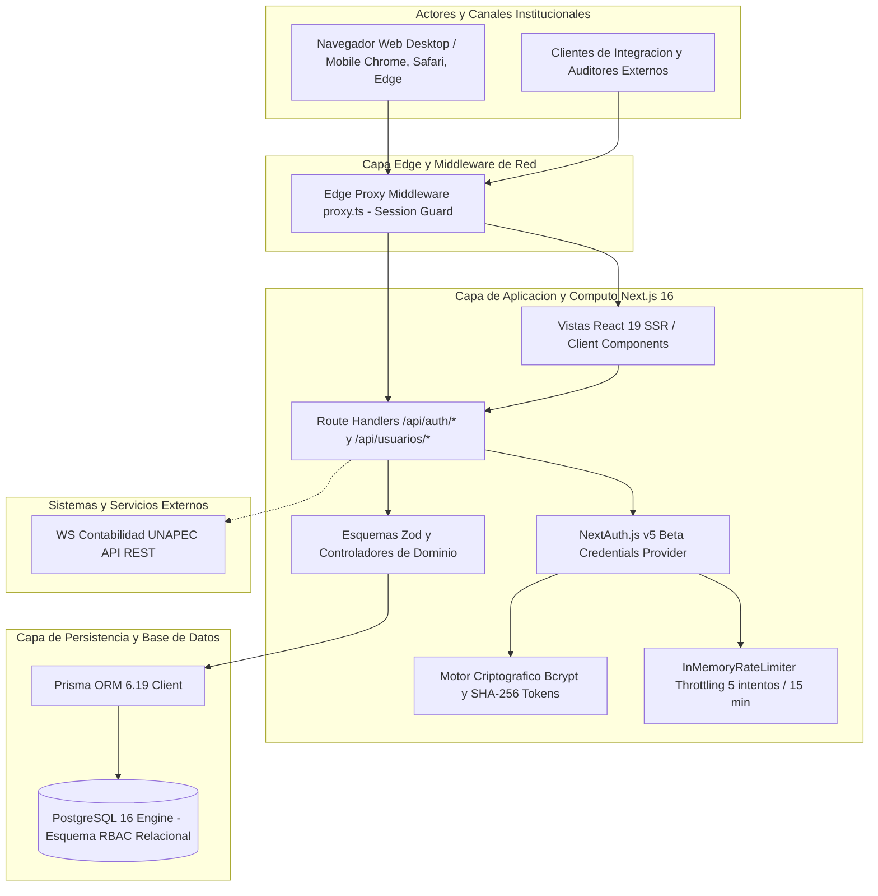

# System Architecture Overview: ActivaCore

> 🏛️ Living System Architecture Document · Master Technical Blueprint
> 🔄 Last Updated: 2026-10-13 · Status: Active / In Production Development
> 👤 Technical Authority: Dirección de Tecnología & Finanzas (UNAPEC)
> 📂 Repository: activos_fijos_system · Stack: Next.js 16 (Turbopack), NextAuth v5 beta, Prisma ORM, PostgreSQL 16
> ⚠️ **MANDATORY QUALITY GATE (Hard Gate 12)**: Este documento detalla con rigor de ingeniería exhaustivo la arquitectura del sistema, topología C4, capas de cómputo, políticas de gobernanza RBAC y protocolos de resiliencia.

---

## 1. Business Context & System Mission

### 1.1 Executive Summary
- **Business Domain**: Gestión Patrimonial, Activos Fijos y Contabilidad Fiscal Universitaria.
- **Target Audience & Core Actors**:
  - **Administrador General (ADMIN)**: Control de gobernanza, configuración institucional, catálogo de usuarios y roles RBAC.
  - **Operador de Activos Fijos (OPERADOR)**: Ciclo de vida de activos, transferencias de custodios y cálculo de depreciación fiscal.
  - **Auditor de Cumplimiento (AUDITOR)**: Trazabilidad inmutable de eventos, reportes multicriterio y conciliación DGII.
  - **Sistema Externo (WS Contabilidad UNAPEC)**: Ingestión de asientos y comprobantes de depreciación mensual.
- **Core Value Proposition**: Automatización integral del inventario de bienes universitarios, cálculo determinista de depreciación DGII por línea recta (Ley 11-92 Art. 287), y eliminación de discrepancias contables con cero multas fiscales.

### 1.2 System Scope & Boundaries
- **In Scope**:
  - Autenticación institucional por credenciales y control de acceso RBAC relacional.
  - Catálogos de departamentos, cuentas contables y tipos de activos DGII.
  - Altas, transferencias entre custodios y bajas de activos con serialización.
  - Motor de depreciación mensual determinista al centavo con cierre de periodo inmutable.
  - Exportación de reportes ejecutivos en PDF/Excel y bitácora de auditoría.
- **Out of Scope**:
  - Liquidación de nómina de colaboradores (delegado a sistema RRHH).
  - Facturación comercial de servicios estudiantiles (delegado a sistema Banner/ERP central).

---

## 2. Architecture Landscape & C4 Container Model

### 2.1 High-Level Architecture Diagram

### 2.2 Layer Responsibilities

| Layer | Technologies | Technical Responsibilities |
|-------|--------------|----------------------------|
| **Presentation (UI/UX)** | Next.js 16, React 19, Tailwind CSS v4, Lucide | Renderizado SSR y cliente, diseño institucional sobrio, breadcrumbs dinámicos, formularios reactivos y validaciones visuales accesibles sin adornos artificiales. |
| **Edge / Security Proxy** | Next.js Edge Middleware (proxy.ts) | Inspección temprana de tokens JWT, redirección automática de rutas protegidas y headers de seguridad HTTP. |
| **Application & API** | TypeScript, NextAuth v5, Route Handlers | Orquestación de casos de uso, autenticación institucional, validación de payloads Zod, protección anti-fuerza bruta y respuestas estructuradas RFC 7807. |
| **Security & Cryptography** | BcryptJS, Node Crypto (SHA-256) | Hashing de claves con 10 rondas de salt, tokens criptográficos pseudo-aleatorios de 32 bytes y rate limiting en memoria. |
| **Persistence** | Prisma ORM 6.19, PostgreSQL 16 | Integridad referencial ACID, migraciones versionadas deterministas, transacciones atómicas y pool de conexiones optimizado. |

---
## 3. Infrastructure, Environments & CI/CD Topology

### 3.1 Environments & Ports
| Environment | Host / Container | Port | Database Target | Purpose |
|-------------|------------------|------|-----------------|---------|
| **Local DEV** | Host Node.js dev server | 3000 | PostgreSQL Container (Port 5433) | Desarrollo interactivo y hot-reload con Turbopack. |
| **Testing / CI** | Vitest Runner & Playwright Headless | 3000 (Ephemeral) | PostgreSQL Test DB (Port 5433) | Validación automatizada unitaria, de integración y E2E. |
| **Production** | Node.js Standalone SSR Container | 3000 / 443 | PostgreSQL Multi-AZ Cluster | Entorno productivo de alta disponibilidad institucional. |

### 3.2 Continuous Integration & Verification Pipeline
- **Linter & Type Checking**: `eslint` y `tsc --noEmit` obligatorios en cada commit.
- **Unit & Integration Testing**: `vitest run` con cobertura mínima del 85% en módulos de seguridad.
- **End-to-End Smoke Testing**: `playwright test` validando flujos completos de inicio de sesión, bloqueo por fuerza bruta y reseteo de claves.
- **Database Migrations**: `prisma migrate deploy` en despliegues automatizados garantizando cero tiempo de inactividad.

---

## 4. Cross-Cutting Architectural Patterns

### 4.1 Relational Role-Based Access Control (RBAC)
- Todo usuario autenticado posee exactamente un rol institucional primario (`ADMIN`, `OPERADOR`, `AUDITOR`).
- Cada rol vincula un conjunto de permisos atómicos a través de la tabla relacional `roles_permisos`.
- La sesión JWT transporta los códigos de permisos del usuario (`USER_ADMIN`, `ACT_CREATE`, etc.), permitiendo evaluación inmediata en frontend y verificación estricta en Route Handlers.
- El rol `ADMIN` goza de bypass autorizado para tareas de gobernanza global.

### 4.2 Error Handling & RFC 7807 Compliance
- Todas las respuestas de error en Route Handlers implementan un formato estandarizado JSON:
  `{ error: ERROR_CODE, message: Mensaje descriptivo en español, details: [...] }`
- Códigos de estado HTTP canónicos: 400 (Validación Zod), 401 (No autenticado), 403 (Permisos insuficientes), 404 (Recurso inexistente), 409 (Conflicto / Duplicado), 429 (Throttling / Bloqueo).

---

## 5. Security, Compliance & Governance

### 5.1 Capa de Autenticación & Gestión de Sesiones
- **NextAuth.js v5 Beta**: Proveedor Credentials con método authorize tipado.
- **Sesiones JWT Encriptadas**: Cookie de sesión con atributos HttpOnly, Secure (en HTTPS) y SameSite=Lax.
- **Protección CSRF**: Tokens anti-CSRF embebidos en el ciclo de vida de peticiones Next.js.

### 5.2 Defensa Anti-Fuerza Bruta (Throttling)
- **`InMemoryRateLimiter`**: Rastrea intentos fallidos por correo institucional.
- **Umbral**: 5 intentos fallidos consecutivos activan bloqueo estricto de 15 minutos (900 segundos).
- **Desbloqueo**: Manual por Administrador General o automático tras expiración de ventana.

### 5.3 Estándares Criptográficos
- **Contraseñas**: Hashing con BcryptJS con salt rounds = 10.
- **Tokens de Reseteo**: 32 bytes pseudo-aleatorios (64 caracteres hex) con digest SHA-256 almacenado en base de datos.

---

## 6. Quality Attributes & SLA Targets

- **Latencia P95**: Rutas de autenticación y lectura de catálogos < 200 ms.
- **Cobertura de Pruebas**: > 85% de líneas en librerías de seguridad (alcanzado 92.72% en Sub-00).
- **Disponibilidad**: Objetivo de 99.9% de operatividad en horario académico institucional.

---

## 7. Architecture Decision Records (ADRs Lineage)

- **ADR-001 (Framework)**: Adopción de Next.js 16 con App Router y Turbopack para rendimiento SSR óptimo.
- **ADR-002 (Autenticación)**: Adopción de NextAuth.js v5 Beta con proveedor Credentials y esquema relacional RBAC.
- **ADR-003 (Persistencia)**: Adopción de PostgreSQL 16 con Prisma ORM 6.19 para tipado de datos estricto de extremo a extremo.
- **ADR-004 (Testing)**: Configuración dual de pruebas con Vitest (unitarias/integración de alta velocidad) y Playwright (pruebas E2E de humo en navegador real).
