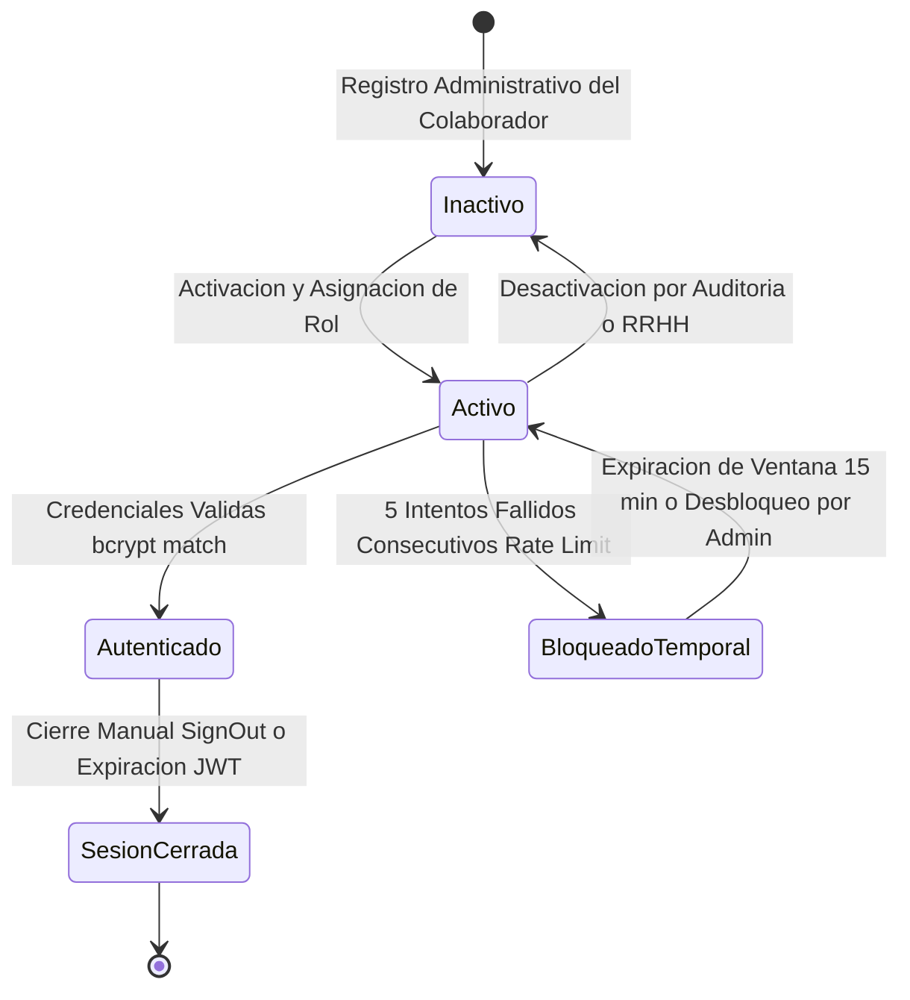
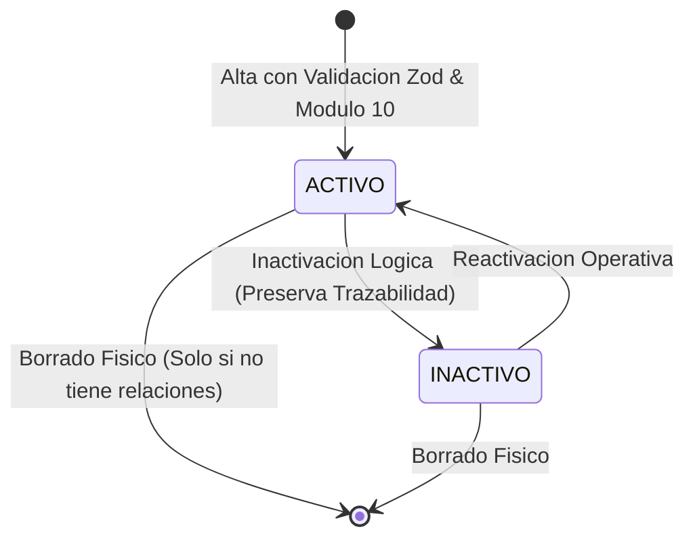
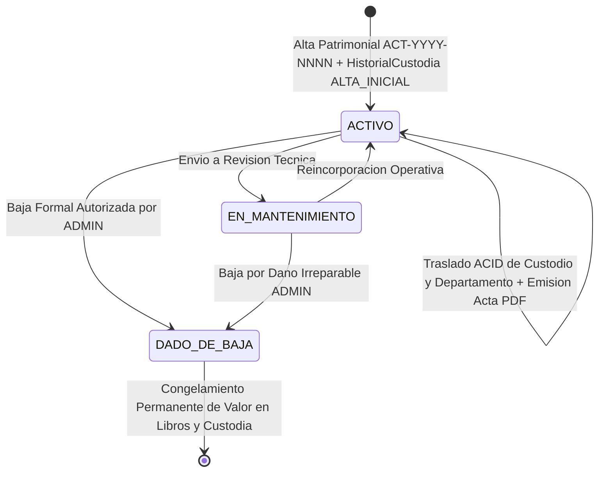
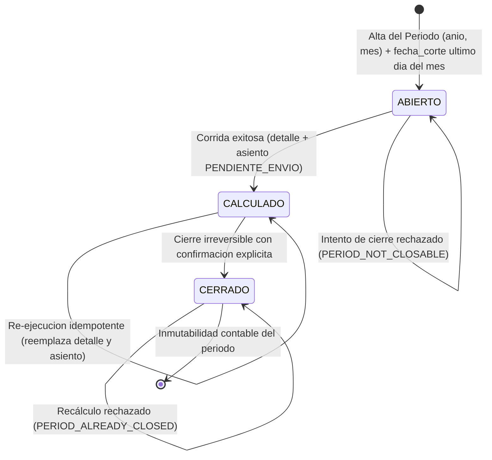
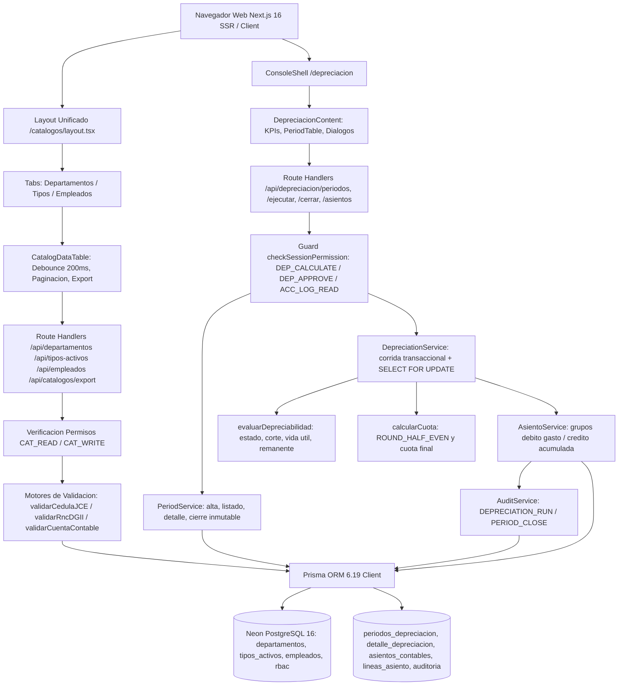
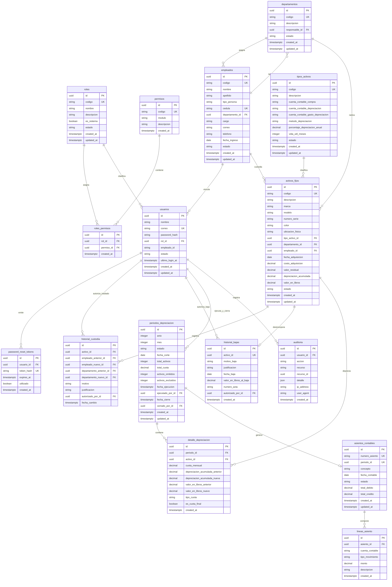

# ActivaCore — Sistema de Gestión de Activos Fijos & Contabilización DGII

> 📖 Master Module Documentation · Living Domain Document
> 🔄 Last Updated: 2026-11-03 · Status: Active / Certified Sub-00, Sub-01, Sub-02 & Sub-03
> 👤 Technical & Functional Lead: Dirección de Tecnología & Finanzas (UNAPEC)
> 📂 Scope: Gestión integral del ciclo de vida de activos fijos institucionales, asignación y transferencias de custodios, motor de cálculo de depreciación por línea recta bajo normativa DGII (Norma General 07-07 / Ley 11-92 Art. 287), integración contable auxiliar y gobernanza de acceso basada en roles relacionales (RBAC).

---

## 1. Executive Summary & Domain Scope

### 1.1 Business Mission & Actors
- **Business Domain**: Gestión Patrimonial, Activos Fijos y Contabilidad Fiscal Universitaria.
- **Target Actors & Boundaries**:
  - **Administrador General (ADMIN)**: Acceso total y configuración de gobernanza institucional, seguridad, gestión de usuarios, catálogo de roles y permisos, auditoría y parámetros contables.
  - **Operador de Activos Fijos (OPERADOR)**: Registro de altas, transferencias entre custodios, catalogación física, cálculo mensual de depreciación y generación de asientos contables para despacho.
  - **Auditor de Cumplimiento (AUDITOR)**: Consulta de solo lectura de fichas patrimoniales, traza de auditoría, bitácora de integraciones contables y reportes ejecutivos fiscales.
  - **Servicio Web Contable Externo (WS Contabilidad UNAPEC)**: Ingestión síncrona o asíncrona de comprobantes y asientos de depreciación mensual vía API REST institucional.
- **Core Value Proposition**: Automatización y exactitud en el control físico-financiero de los activos universitarios, eliminación de discrepancias contables, cálculo determinista de depreciación fiscal DGII al centavo, y trazabilidad inmutable de custodios y transacciones.

### 1.2 Primary Routes & Frontend Navigation
| Route | View / Screen | Target Audience / Role | Status |
|-------|---------------|------------------------|--------|
| /login | Pantalla Institucional de Inicio de Sesión | Todos los colaboradores autenticables | ✅ Certified |
| /recuperar-contrasena | Solicitud de Restablecimiento de Credenciales | Colaboradores con cuenta institucional activa | ✅ Certified |
| /restablecer-contrasena | Ingreso de Nueva Contraseña Tokenizada | Titular del token criptográfico de un solo uso | ✅ Certified |
| /perfil | Gestión de Perfil & Actualización de Contraseña | Usuario autenticado en sesión activa | ✅ Certified |
| /admin/usuarios | Directorio de Usuarios, RBAC & Desbloqueo | Administrador General (ADMIN / USER_ADMIN) | ✅ Certified |
| / | Consola Principal y Tablero Institucional | Usuarios autenticados según matriz RBAC | ✅ Certified |
| /catalogos/departamentos | Estructura Orgánica y Centros de Costos | Operadores y Administradores (CAT_READ, CAT_WRITE) | ✅ Certified |
| /catalogos/tipos-activos | Clasificación Fiscal DGII y Cuentas Contables | Operadores y Administradores (CAT_READ, CAT_WRITE) | ✅ Certified |
| /catalogos/empleados | Directorio de Custodios y Colaboradores | Operadores y Administradores (CAT_READ, CAT_WRITE) | ✅ Certified |
| /api/catalogos/export | Exportación Tabular (.xlsx y .csv) | Operadores, Auditores y Administradores (CAT_READ) | ✅ Certified |
| /activos | Registro Patrimonial, Custodia y Bajas de Activos | Operadores, Auditores y Administradores | ✅ Certified |
| /depreciacion | Corrida Mensual y Asientos de Depreciación DGII | Operadores y Administradores (DEP_CALCULATE) · Consulta de asientos: AUDITOR (ACC_LOG_READ) | ✅ Certified |
| /reportes | Consultas Fiscales y Conciliación DGII | Auditores, Operadores y Administradores (REP_READ) | ⏳ Pending (Sub-04) |

---

## 2. Capabilities & Sub-Features Matrix

| # | Sub-module / Capability | Functional Description | Status | Spec Link | Test Coverage |
|---|-------------------------|------------------------|--------|-----------|---------------|
| **00** | **Autenticación, Usuarios y Control de Acceso Relacional RBAC** | Inicio de sesión NextAuth v5, hashing bcrypt (10 rondas), protección contra fuerza bruta (15 min / 5 intentos), tokens SHA-256 de autoservicio, middleware edge y directorio de roles dinámicos. | ✅ Certified | [specs/activos-fijos/00-autenticacion-rbac/](../../specs/activos-fijos/00-autenticacion-rbac/requirements.md) | Unit: 92.7% (45 pruebas Vitest) · E2E: ✅ (4/4 Playwright) |
| **01** | **Catálogos Base del Sistema** | Mantenimiento de Departamentos, Cuentas Contables Auxiliares, Tipos de Activos con Vida Útil DGII (Cat 1: 5%, Cat 2: 25%, Cat 3: 15%), validación cripto-aritmética Módulo 10 de Cédulas JCE y Módulo 11 de RNC, interfaz unificada con layout de pestañas, búsqueda debounced y exportación a Excel (.xlsx) y CSV con UTF-8 BOM. | ✅ Certified | [specs/activos-fijos/01-catalogos-base/](../../specs/activos-fijos/01-catalogos-base/requirements.md) | Unit & Integration: 94.16% (123 pruebas Vitest) · E2E: ✅ (5/5 Playwright) |
| **02** | **Gestión de Activos Fijos y Custodia** | Altas patrimoniales con código correlativo anual (ACT-YYYY-NNNN), bloqueo contable de campos financieros, traslados ACID de custodio y departamento, emisión de Actas de Entrega en PDF Carta, marbetes imprimibles, bajas formales irreversibles restringidas a ADMIN y ficha técnica de consulta en drawer de solo lectura (identificación, situación financiera, clasificación DGII, custodia e historial de baja). | ✅ Certified | [specs/activos-fijos/02-gestion-activos-custodia/](../../specs/activos-fijos/02-gestion-activos-custodia/requirements.md) | Unit & Integration: 93.33% (207 pruebas Vitest) · E2E: ✅ (6/6 Playwright) |
| **03** | **Motor de Depreciación y Contabilización DGII** | Cálculo mensual determinista por línea recta según Ley 11-92 Art. 287 con redondeo bancario Half Even, universo de activos por estado/fecha/vida útil, corrida transaccional idempotente con bloqueo `FOR UPDATE`, generación del asiento consolidado débito/crédito en estado `PENDIENTE_ENVIO`, cierre mensual inmutable y bitácora `Auditoria`. | ✅ Certified | [specs/activos-fijos/03-motor-depreciacion/](../../specs/activos-fijos/03-motor-depreciacion/requirements.md) | Unit & Integration: 96.44% (363 pruebas Vitest) · E2E: ✅ (1/1 Playwright) |
| **04** | **Reportes, Auditoría e Integración Contable Externa** | Consultas multicriterio, exportación a Excel / PDF, trazabilidad inmutable de eventos y despacho al Web Service Contable de la Universidad. | ⏳ Pending | Planificado Sub-04 | Pendiente de inicio |

---

## 3. Architecture & Domain Lifecycle

### 3.1 Module State Machine (Ciclos de Vida)

#### Seguridad y Sesión

#### Catálogos Base (Departamentos, Tipos de Activos y Custodios)

#### Activos Fijos y Ciclo de Custodia

#### Motor de Depreciación (Período Mensual)

### 3.2 High-Level Component Flow

---

## 4. Consolidated Data Model (Module ERD)

### Key Tables & Data Dictionary
- **`departamentos`**: Unidades organizativas y centros de costos universitarios para custodia patrimonial.
  - `id`: UUID (PK).
  - `codigo`: VARCHAR(10) UNIQUE, clave correlativa institucional (`DEP-XXX`).
  - `descripcion`: VARCHAR(120), denominación oficial del departamento.
  - `responsable_id`: UUID (FK nullable), referencia al colaborador que actúa como titular de la unidad (`onDelete: SetNull`).
  - `estado`: VARCHAR(10), `ACTIVO` o `INACTIVO`.
- **`tipos_activos`**: Catálogo de clasificación física y contable con vida útil estatuida por la DGII.
  - `id`: UUID (PK).
  - `codigo`: VARCHAR(10) UNIQUE, clave correlativa (`TPA-XXX`).
  - `descripcion`: VARCHAR(150), familia o clase de activo.
  - `cuenta_contable_compra`: VARCHAR(20), cuenta de mayor auxiliar formato `X-XX-XX-XXXX`.
  - `cuenta_contable_depreciacion`: VARCHAR(20), cuenta de depreciación acumulada formato `X-XX-XX-XXXX`.
  - `metodo_depreciacion`: VARCHAR(20), método fiscal (`DGII_CAT1`, `DGII_CAT2`, `DGII_CAT3`, `LINEA_RECTA`).
  - `porcentaje_depreciacion_anual`: DECIMAL(5,2), tasa anual oficial (5.00%, 25.00%, 15.00%).
  - `vida_util_meses`: INTEGER, duración contable total en meses (240, 48, 80).
  - `estado`: VARCHAR(10), `ACTIVO` o `INACTIVO`.
- **`empleados`**: Personal universitario habilitado para custodia formal de bienes patrimoniales.
  - `id`: UUID (PK).
  - `codigo`: VARCHAR(10) UNIQUE, clave institucional (`EMP-XXXX`).
  - `nombre`: VARCHAR(100), nombres del colaborador.
  - `apellido`: VARCHAR(100), apellidos del colaborador.
  - `tipo_persona`: VARCHAR(10), `FISICA` o `JURIDICA`.
  - `cedula`: VARCHAR(15) UNIQUE, cédula dominicana validada vía Módulo 10 JCE (o RNC vía Módulo 11).
  - `departamento_id`: UUID (FK), centro de costos de adscripción (`onDelete: Restrict`).
  - `cargo`: VARCHAR(100), posición institucional.
  - `correo`: VARCHAR(150), correo electrónico institucional.
  - `telefono`: VARCHAR(20), extensión o teléfono de contacto.
  - `fecha_ingreso`: DATE, fecha de contratación (no admite fechas futuras).
  - `estado`: VARCHAR(10), `ACTIVO` o `INACTIVO`.
- **`periodos_depreciacion`**: Cabecera del período contable mensual del motor de depreciación.
  - `id`: UUID (PK).
  - `anio` / `mes`: INTEGER, con restricción `@@unique([anio, mes])` (un período por mes).
  - `estado`: VARCHAR(12), `ABIERTO`, `CALCULADO` o `CERRADO` (inmutable al cerrar).
  - `fecha_corte`: DATE, último día del mes; un activo adquirido después queda fuera del universo.
  - `total_activos` / `total_cuota` / `activos_omitidos` / `activos_excluidos`: resumen persistido de la última corrida.
  - `fecha_ejecucion` + `ejecutado_por_id`: traza de la corrida (`onDelete: SetNull`).
  - `fecha_cierre` + `cerrado_por_id`: traza del cierre inmutable.
- **`detalle_depreciacion`**: Cuota por activo de un período; `@@unique([periodoId, activoId])` impide duplicados.
  - `cuota_mensual`: DECIMAL(14,2) tras redondeo bancario.
  - `depreciacion_acumulada_anterior` / `valor_en_libros_anterior`: línea base previa al período; es la que permite la re-ejecución idempotente y la reversión de cargos.
  - `depreciacion_acumulada_nueva` / `valor_en_libros_nuevo`: estado resultante del activo tras la corrida.
  - `tipo_cuota`: VARCHAR(20), `NORMAL`, `ULTIMA` o `NO_DEPRECIABLE`.
  - `es_cuota_final`: BOOLEAN, indica que la cuota absorbió el remanente.
- **`asientos_contables`**: Asiento consolidado del período; `periodo_id` es UNIQUE (un asiento por período).
  - `numero_asiento`: VARCHAR(20) UNIQUE, formato `DEP-YYYYMM-NNN`.
  - `estado`: VARCHAR(20), `PENDIENTE_ENVIO`, `ENVIADO` o `ERROR`. Un asiento distinto de `PENDIENTE_ENVIO` es inmutable.
  - `total_debito` / `total_credito`: DECIMAL(14,2); la creación aborta si no cuadran.
- **`lineas_asiento`**: Líneas débito/crédito del asiento (`onDelete: Cascade` desde `asientos_contables`).
  - `cuenta_contable`: VARCHAR(20), cuenta auxiliar `X-XX-XX-XXXX`.
  - `tipo_movimiento`: VARCHAR(10), `DEBITO` o `CREDITO`.
  - `monto`: DECIMAL(14,2).
- **`auditoria`**: Bitácora inmutable de eventos del módulo.
  - `accion`: VARCHAR(40), p. ej. `DEPRECIATION_RUN`, `PERIOD_CLOSE`, `LOGIN_SUCCESS`, `ACCOUNT_UNLOCK`.
  - `recurso` / `recurso_id`: entidad afectada y su identificador.
  - `detalle`: JSON con el resumen del evento (totales, conteos, montos).
  - `ip_address` / `user_agent`: metadatos de red capturados por `metaSolicitud()`.

---

## 5. Master API Catalog

| Method | Endpoint | Description | Authorized Roles | Request Payload | Response (200/201) |
|--------|----------|-------------|------------------|-----------------|--------------------|
| POST | /api/auth/[...nextauth] | Autenticación institucional por credenciales | Público (Todos) | { correo, password } | Sesión JWT / HttpOnly Cookie |
| POST | /api/auth/forgot-password | Emisión de token de autoservicio de clave | Público (Todos) | { correo } | { success: true, message: "Solicitud procesada" } |
| POST | /api/auth/reset-password | Consumo de token y reseteo de contraseña | Público (Token) | { token, password } | { success: true, message: "Contraseña actualizada" } |
| PUT | /api/auth/change-password | Cambio de contraseña para usuario autenticado | Sesión Activa | { currentPassword, newPassword } | { success: true, message: "Contraseña modificada" } |
| GET | /api/usuarios | Consulta paginada del directorio de usuarios | USER_ADMIN / ADMIN | Query: ?page=1&limit=10 | { usuarios: [...], total, page, totalPages } |
| POST | /api/usuarios | Alta de nuevo colaborador institucional | USER_ADMIN / ADMIN | { nombre, correo, password, rolId } | { success: true, usuario: { id, nombre, correo } } |
| POST | /api/usuarios/[id]/unlock | Desbloqueo administrativo de cuenta throttled | USER_ADMIN / ADMIN | Ninguno (URL param) | { success: true, message: "Usuario desbloqueado" } |
| GET | /api/roles | Consulta del catálogo de roles y permisos | USER_ADMIN / ADMIN | Ninguno | [ { id, codigo, nombre, permisos: [...] } ] |
| GET | /api/departamentos | Listado paginado de departamentos con conteo | CAT_READ / ADMIN / OPERADOR | Query: ?page=1&limit=10&search=&estado= | { data: [...], pagination: { total, page, limit, totalPages } } |
| POST | /api/departamentos | Alta de nuevo departamento institucional | CAT_WRITE / ADMIN / OPERADOR | { descripcion, codigo?, responsableId?, estado? } | { data: { id, codigo, descripcion, ... } } (201) |
| PUT | /api/departamentos/[id] | Modificación de departamento o estado | CAT_WRITE / ADMIN / OPERADOR | { descripcion, codigo?, responsableId?, estado? } | { data: { id, codigo, descripcion, ... } } (200) |
| DELETE | /api/departamentos/[id] | Eliminación física restringida si no hay empleados | CAT_WRITE / ADMIN / OPERADOR | Ninguno (URL param) | { success: true, message: "Departamento eliminado" } |
| GET | /api/tipos-activos | Listado paginado de tipos de activos fiscales | CAT_READ / ADMIN / OPERADOR | Query: ?page=1&limit=10&search=&regimen=&estado= | { data: [...], pagination: { total, page, limit, totalPages } } |
| POST | /api/tipos-activos | Alta de tipo de activo con categoría DGII | CAT_WRITE / ADMIN / OPERADOR | { descripcion, cuentaContableCompra, cuentaContableDepreciacion, metodoDepreciacion, ... } | { data: { id, codigo, ... } } (201) |
| PUT | /api/tipos-activos/[id] | Modificación de tipo de activo y cuentas | CAT_WRITE / ADMIN / OPERADOR | { descripcion, cuentaContableCompra, cuentaContableDepreciacion, ... } | { data: { id, codigo, ... } } (200) |
| DELETE | /api/tipos-activos/[id] | Eliminación física restringida si no hay activos | CAT_WRITE / ADMIN / OPERADOR | Ninguno (URL param) | { success: true, message: "Tipo de activo eliminado" } |
| GET | /api/empleados | Directorio de empleados custodios paginado | CAT_READ / ADMIN / OPERADOR | Query: ?page=1&limit=10&search=&departamentoId=&estado= | { data: [...], pagination: { total, page, limit, totalPages } } |
| POST | /api/empleados | Registro de custodio con validación Módulo 10 | CAT_WRITE / ADMIN / OPERADOR | { nombre, apellido, cedula, tipoPersona, departamentoId, cargo, fechaIngreso, ... } | { data: { id, codigo, ... } } (201) |
| PUT | /api/empleados/[id] | Modificación de custodio o estado operativo | CAT_WRITE / ADMIN / OPERADOR | { nombre, apellido, departamentoId, cargo, estado, ... } | { data: { id, codigo, ... } } (200) |
| DELETE | /api/empleados/[id] | Eliminación o inactivación de custodio | CAT_WRITE / ADMIN / OPERADOR | Ninguno (URL param) | { success: true, message: "Empleado eliminado" } |
| GET | /api/catalogos/export | Exportación tabular Excel (.xlsx) y CSV | CAT_READ / ADMIN / OPERADOR / AUDITOR | Query: ?catalogo=departamentos&format=xlsx | Archivo binario con cabecera Content-Disposition |
| GET | /api/activos | Listado paginado y filtrado multicriterio de activos fijos | ACT_READ / ADMIN / OPERADOR / AUDITOR | Query: ?page=1&limit=10&search=&departamentoId=&tipoActivoId=&estado= | { data: [...], pagination: { total, page, limit, totalPages } } |
| POST | /api/activos | Alta patrimonial con correlativo ACT-YYYY-NNNN y custodia inicial ACID | ACT_OPERATE / ADMIN / OPERADOR | { descripcion, departamentoId, empleadoId, tipoActivoId, costoAdquisicion } | { id, codigo, descripcion } |
| GET | /api/activos/[id] | Ficha técnica detallada, bitácora de custodia y flag de bloqueo contable | ACT_READ / ADMIN / OPERADOR / AUDITOR | Ninguno | { id, codigo, poseeHistorialDepreciacion, historialCustodia: [...] } |
| PUT | /api/activos/[id] | Actualización física y financiera protegida por bloqueo contable | ACT_OPERATE / ADMIN / OPERADOR | { descripcion, estado, marca, modelo, numeroSerie, costoAdquisicion } | { id, codigo } |
| GET | /api/activos/[id]/traslados | Historial cronológico de movimientos de custodia del activo | ACT_READ / ADMIN / OPERADOR / AUDITOR | Ninguno | { data: [...] } |
| POST | /api/activos/[id]/traslados | Reasignación transaccional ACID de custodio y departamento | ACT_OPERATE / ADMIN / OPERADOR | { departamentoNuevoId, empleadoNuevoId, motivo, justificacion } | { activo, movimientoId } |
| POST | /api/activos/[id]/baja | Desincorporación formal e irreversible del activo fijo | Exclusivo ADMIN | { motivoBaja, numeroActa, fechaBaja, justificacion } | { activo, baja } |
| GET | /api/activos/[id]/acta-entrega | Emisión de Acta de Entrega de Custodia en PDF tamaño Carta | ACT_READ / ADMIN / OPERADOR / AUDITOR | Query: ?movimientoId= | Binario application/pdf con membrete UNAPEC y firmas |
| GET | /api/depreciacion/periodos | Listado paginado de períodos con resumen de la última corrida | DEP_CALCULATE / ADMIN | Query: ?page=1&pageSize=10&estado=TODOS&anio= | { data: [...], meta: { page, pageSize, total, totalPages } } |
| POST | /api/depreciacion/periodos | Alta de período mensual en estado `ABIERTO` con fecha de corte | DEP_CALCULATE / ADMIN | { anio, mes } | { data: { id, anio, mes, estado, fechaCorte } } (201) |
| GET | /api/depreciacion/periodos/[id] | Detalle del período con desglose por activo y asiento | DEP_CALCULATE / ADMIN | Ninguno | { data: { ..., detalles: [...], asiento: { lineas: [...] } } } |
| POST | /api/depreciacion/periodos/[id]/ejecutar | Corrida transaccional de depreciación (calcula, persiste y contabiliza) | DEP_CALCULATE / ADMIN | Ninguno | { data: { totalActivos, totalCuota, activosOmitidos, activosExcluidos, asiento } } |
| POST | /api/depreciacion/periodos/[id]/cerrar | Cierre inmutable del período calculado | DEP_CALCULATE / ADMIN | { confirmar: true } | { data: { id, estado: "CERRADO", fechaCierre } } |
| GET | /api/depreciacion/asientos | Consulta paginada de asientos de depreciación por estado | DEP_CALCULATE / DEP_APPROVE / ACC_LOG_READ (AUDITOR) | Query: ?page=1&pageSize=10&estado=PENDIENTE_ENVIO | { data: [...], meta: { page, pageSize, total, totalPages } } |

---

## 6. Universal Business Rules, Formulas & Compliance

### 6.1 Régimen Fiscal de Depreciación DGII (Ley 11-92 Art. 287)
| Categoría Fiscal | Bienes Incluidos | Tasa Anual | Vida Útil | Método de Cálculo |
|------------------|------------------|------------|-----------|-------------------|
| **Categoría 1 DGII** | Edificaciones, componentes estructurales e infraestructura fija | **5.00%** | **240 meses** (20 años) | Línea Recta / Costo Histórico |
| **Categoría 2 DGII** | Equipos de transporte, computación, servidores y mobiliario de oficina | **25.00%** | **48 meses** (4 años) | Línea Recta / Costo Histórico |
| **Categoría 3 DGII** | Maquinaria pesada, transformadores, generadores y otros bienes | **15.00%** | **80 meses** (6.67 años) | Línea Recta / Costo Histórico |

### 6.2 Motor de Validación Cripto-Aritmética de Identidad Dominicana
- **Cédula de Identidad y Electoral JCE (Módulo 10)**:
  - Longitud exacta: 11 dígitos numéricos sin ceros continuos.
  - Multiplicadores cíclicos alternados: `[1, 2, 1, 2, 1, 2, 1, 2, 1, 2]`.
  - Los productos mayores a 9 se reducen sumando sus dígitos o restando 9 (`prod > 9 ? prod - 9 : prod`).
  - El residuo de la suma módulo 10 define el dígito verificador: `residuo === 0 ? 0 : 10 - residuo`.
  - Rechaza documentos falsos o con dígito manipulado con código `CEDULA_INVALID_CHECKSUM` (HTTP 422).
- **Registro Nacional del Contribuyente DGII (Módulo 11)**:
  - Longitud exacta: 9 dígitos numéricos para personas jurídicas.
  - Multiplicadores posicionales: `[7, 9, 8, 6, 5, 4, 3, 2]`.
  - Tratamiento de residuos especiales: `residuo === 0 -> 2`, `residuo === 1 -> 1`, en otros casos `11 - residuo`.
- **Estructura Oficial de Cuentas Contables**:
  - Expresión regular institucional: `^[1-9]-[0-9]{2}-[0-9]{2}-[0-9]{4}$` (formato `X-XX-XX-XXXX`).
  - Validación de incompatibilidad: La cuenta de compra y la cuenta de depreciación acumulada de un mismo tipo de activo no pueden ser idénticas.

### 6.3 Reglas del Motor de Depreciación
- **Fórmula determinista**: `cuotaMensual = ROUND_HALF_EVEN((costoAdquisicion - valorResidual) / vidaUtilMeses, 2)` sobre `Prisma.Decimal` (nunca aritmética de punto flotante).
- **Redondeo bancario**: se usa `ROUND_HALF_EVEN` a dos decimales; no se trunca ni se redondea "medio arriba".
- **Mes de adquisición**: el mes de compra deprecia completo (`mesesTranscurridos` cuenta el mes de adquisición como 1).
- **Estados depreciables**: `ACTIVO` y `EN_MANTENIMIENTO` deprecian; `DADO_DE_BAJA` y `VENDIDO` quedan fuera del universo.
- **Universo del período**: se excluye el activo cuyo tipo está `INACTIVO`, el adquirido después de `fecha_corte`, el dado de baja antes del primer día del período, el de vida útil agotada y el que no tiene remanente depreciable.
- **Cuota final**: cuando `remanente - cuotaTeorica < cuotaTeorica` (equivalente a `remanente < 2 * cuotaTeorica`), la cuota absorbe todo el remanente y deja `valorEnLibros = valorResidual` exacto, sin centavos perdidos.
- **Asiento consolidado**: se agrupa por par `(cuentaGasto, cuentaDepreciacion)`; cada grupo genera un `DEBITO` a la cuenta de gasto y un `CREDITO` a la cuenta de depreciación acumulada por el mismo monto. Si los totales no cuadran se lanza `ASIENTO_UNBALANCED` y la corrida se revierte.
- **Cuenta de gasto**: se toma de `tipos_activos.cuenta_contable_gasto_depreciacion`; si es nula se usa el valor por defecto del método (`DGII_CAT1` → `6-30-01-0001`, `DGII_CAT2`/`LINEA_RECTA` → `6-30-01-0002`, `DGII_CAT3` → `6-30-01-0003`). Sin cuenta resoluble se lanza `DEPRECIATION_EXPENSE_ACCOUNT_MISSING`.
- **Asiento local**: todo asiento nace en `PENDIENTE_ENVIO`; el despacho al Web Service contable es responsabilidad del Sub-04.
- **Idempotencia de la re-ejecución**: si el período ya tiene detalle, la línea base de cada activo es `depreciacion_acumulada_anterior` / `valor_en_libros_anterior` del detalle previo, no la columna actual del activo. Los activos que salen del universo revierten su cargo previo.
- **Concurrencia**: la corrida abre transacción con `SELECT ... FOR UPDATE` sobre `periodos_depreciacion` y timeout de 30 s (`maxWait` 15 s).
- **Cierre inmutable**: solo un período `CALCULADO` con detalle puede cerrarse; después no admite recálculo ni reapertura (`PERIOD_ALREADY_CLOSED` / `PERIOD_IMMUTABLE`).
- **Trazabilidad**: cada corrida y cada cierre registra una fila en `auditoria` (`DEPRECIATION_RUN`, `PERIOD_CLOSE`) con usuario, IP, user-agent y resumen; si la auditoría falla, la transacción se revierte con `AUDIT_LOG_FAILED`.

### 6.4 Module Error Codes (RFC 7807)
| Error Code | HTTP Status | Root Cause | System Action / User Feedback |
|------------|-------------|------------|-------------------------------|
| VALIDATION_ERROR | 400 Bad Request | Payload no supera el esquema Zod | Retorna listado de campos inválidos con mensajes en español. |
| UNAUTHORIZED | 401 Unauthorized | Petición sin token de sesión activo | Redirección a /login con parámetro callbackUrl. |
| FORBIDDEN | 403 Forbidden | Sesión carece del permiso RBAC requerido | Operación rechazada: Acceso denegado. Permisos insuficientes. |
| ACCOUNT_LOCKED | 429 Too Many Requests | Cuenta temporalmente bloqueada por fuerza bruta | Operación bloqueada con tiempo de espera restante en segundos. |
| USER_NOT_FOUND | 404 Not Found | Identificador de usuario inexistente | Retorna mensaje: El usuario solicitado no existe. |
| EMAIL_ALREADY_EXISTS | 409 Conflict | Intento de registrar un correo ya registrado | Rechazo: El correo institucional ya se encuentra registrado. |
| DEPARTMENT_CODE_DUPLICATE | 409 Conflict | Código institucional de departamento duplicado | Rechazo: El código de departamento ya está en uso. |
| DEPT_HAS_ACTIVE_EMPLOYEES | 400 Bad Request | Intento de eliminar departamento con empleados | Rechazo: No se puede eliminar un departamento con colaboradores activos. |
| ASSET_TYPE_CODE_DUPLICATE | 409 Conflict | Código institucional de tipo de activo duplicado | Rechazo: El código de tipo de activo ya está en uso. |
| ASSET_TYPE_ACCOUNTS_MATCH | 400 Bad Request | Cuenta compra igual a cuenta depreciación | Rechazo: Las cuentas contables de compra y depreciación no pueden ser iguales. |
| CEDULA_INVALID_CHECKSUM | 422 Unprocessable | Dígito verificador JCE Módulo 10 incorrecto | Rechazo: El documento de identidad no superó la validación oficial JCE. |
| EMPLOYEE_CEDULA_DUPLICATE | 409 Conflict | Cédula ya registrada en otro colaborador | Rechazo: Ya existe un colaborador con este documento de identidad. |
| EMPLOYEE_IS_DEPARTMENT_HEAD | 400 Bad Request | Baja de empleado que figura como jefe de depto | Rechazo: El colaborador es titular de departamento. Reasigne la titularidad antes de proceder. |
| INVALID_PERIOD_FORMAT | 422 Unprocessable | Año fuera de 2000–2100 o mes fuera de 1–12 | Rechazo con mensaje de rango permitido. |
| PERIOD_ALREADY_EXISTS | 409 Conflict | Ya existe un período para ese año y mes | Rechazo: seleccione otro mes o consulte el período existente. |
| PERIOD_NOT_FOUND | 404 Not Found | Identificador de período inexistente | Rechazo: el período solicitado no existe. |
| PERIOD_ALREADY_CLOSED | 409 Conflict | Corrida sobre un período `CERRADO` | Rechazo: el período está cerrado y no admite recálculo. |
| PERIOD_NOT_CLOSABLE | 409 Conflict | Cierre de un período que no está `CALCULADO` | Rechazo: ejecute la corrida antes de cerrar. |
| PERIOD_HAS_NO_DETAIL | 422 Unprocessable | Período calculado sin filas de detalle | Rechazo: el período no posee detalle de depreciación. |
| PERIOD_IMMUTABLE | 409 Conflict | Segundo cierre del mismo período | Rechazo: el cierre es irreversible; registre un asiento de ajuste en el período abierto. |
| NO_DEPRECIABLE_ASSETS | 422 Unprocessable | Universo del período vacío | Rechazo: no hay activos depreciables; verifique estados, fechas y vida útil. |
| RESIDUAL_EXCEEDS_COST | 422 Unprocessable | Valor residual mayor al costo de adquisición | Rechazo del cálculo para ese activo. |
| ASSET_TYPE_INVALID_LIFE | 422 Unprocessable | Vida útil menor o igual a cero | Rechazo del cálculo: vida útil inválida. |
| DEPRECIATION_OVERFLOW | 422 Unprocessable | Depreciación acumulada superior al monto depreciable | Rechazo del cálculo para ese activo. |
| DEPRECIATION_EXPENSE_ACCOUNT_MISSING | 422 Unprocessable | Sin cuenta de gasto configurada ni valor por defecto del método | Rechazo: complete la cuenta de gasto del tipo de activo. |
| ASIENTO_UNBALANCED | 500 Internal Server Error | La suma de líneas no coincide con el total de la corrida | La corrida se revierte íntegramente. |
| ASIENTO_ALREADY_EXISTS | 409 Conflict | El asiento del período ya fue enviado a contabilidad | Rechazo: un asiento enviado no puede regenerarse. |
| AUDIT_LOG_FAILED | 500 Internal Server Error | Fallo al registrar la auditoría del evento | La corrida o el cierre se revierten para preservar la trazabilidad. |

---

## 7. External Integrations
- **NextAuth.js v5 Beta**: Proveedor de credenciales institucional con sesiones JWT encriptadas en cookies HttpOnly y SameSite Lax.
- **ExcelJS**: Generación nativa de libros `.xlsx` con estilos corporativos UNAPEC y auto-ajuste de columnas.
- **Preámbulo UTF-8 BOM (`\uFEFF`)**: Emisión determinista en archivos `.csv` para compatibilidad inmediata con Microsoft Excel en Windows.
- **Contabilidad General UNAPEC (Sub-04)**: el Sub-03 ya genera los asientos consolidados localmente en `PENDIENTE_ENVIO`; la integración REST con el Web Service de Finanzas de UNAPEC para despacharlos queda en el Sub-04.

---

## 8. Audit Trail & Security Policy
- **Acciones Auditadas Inmutables**: Inicio de sesión exitoso y fallido, bloqueo y desbloqueo de cuenta, creación de usuarios, mutación de roles, altas, modificaciones y bajas de catálogos base (Departamentos, Tipos de Activos, Empleados), corrida mensual de depreciación (`DEPRECIATION_RUN`) y cierre de período (`PERIOD_CLOSE`).
- **Campos de Traza**: usuario_id, ip_address, user_agent, accion, recurso, timestamp_utc.

---

## 9. Change Log & Spec Lineage

| Date | Sub-module / Spec | Milestone Summary | Git Commit | Author / Approver |
|------|-------------------|-------------------|------------|-------------------|
| 2026-10-13 | specs/activos-fijos/00-autenticacion-rbac | Certificación formal del Sub-módulo 00: Arquitectura RBAC relacional, autenticación NextAuth v5, suites completas Vitest (92.7%) y Playwright E2E (4/4). | 246837a | Dirección de Tecnología / SDD Build Agent |
| 2026-10-15 | specs/activos-fijos/01-catalogos-base | Certificación formal del Sub-módulo 01: Catálogos Base (Departamentos, Tipos de Activos DGII, Custodios JCE Módulo 10, exportación Excel/CSV), suite Vitest 100% (123 tests) y suite E2E Playwright 100% (9 tests). | 458ee12 | Dirección de Tecnología & Finanzas / SDD Build Agent |
| 2026-10-17 | specs/activos-fijos/02-gestion-activos-custodia | Certificación formal del Sub-módulo 02: Gestión de Activos Fijos, Inventario y Custodia (correlativo anual ACT-YYYY-NNNN, bloqueo contable, traslados ACID, Actas PDF con pdf-lib, marbetes imprimibles, bajas formales ADMIN), suite Vitest 93.33% (207 tests) y Playwright E2E (3/3). | cbab636 | JeremyJS / SDD Build Agent |
| 2026-11-03 | specs/activos-fijos/03-motor-depreciacion | Certificación formal del Sub-módulo 03: Motor de Depreciación y Contabilización DGII (cuota Half Even, universo por estado/corte/vida útil, corrida transaccional idempotente con `FOR UPDATE`, asiento consolidado en `PENDIENTE_ENVIO`, cierre mensual inmutable, bitácora `Auditoria`, consola `/depreciacion`), Vitest 96.44% de cobertura (363 pruebas) y Playwright E2E (1/1 flujo crear → ejecutar → detalle → cerrar). | ccd53e9 | JeremyJS / SDD Build Agent |
| 2026-11-03 | fix/activos (Sub-01, sin spec) | Corrección del inventario: el icono «Ver Ficha Técnica» abría el formulario de edición (podía alterar el activo desde una acción de consulta). Se añade `AssetDetailSheet`, un drawer lateral de solo lectura con identificación, situación financiera, clasificación fiscal DGII, custodia e historial de baja, sobre `GET /api/activos/{id}`. El lápiz y el botón «Editar activo» del drawer mantienen el formulario de edición. Regresión cubierta con 3 casos Playwright de solo lectura; Vitest 363/363. | c9078e8 | JeremyJS / SDD Build Agent |