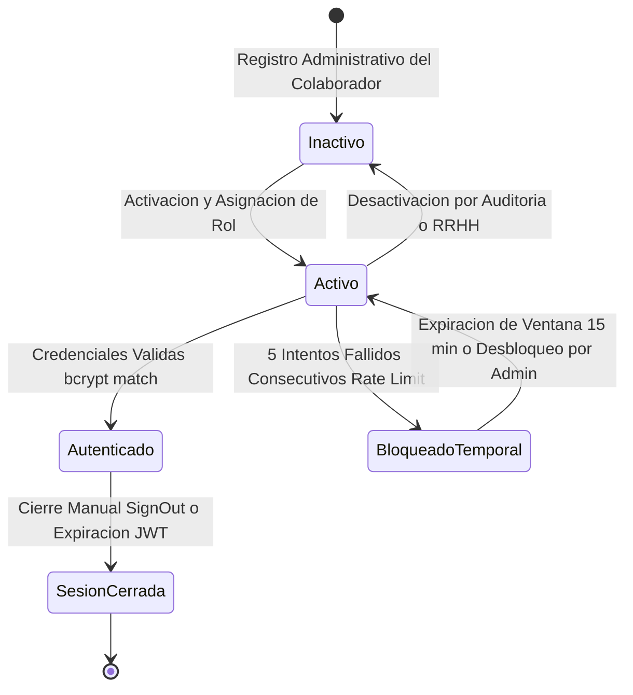
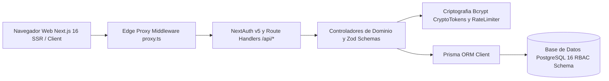
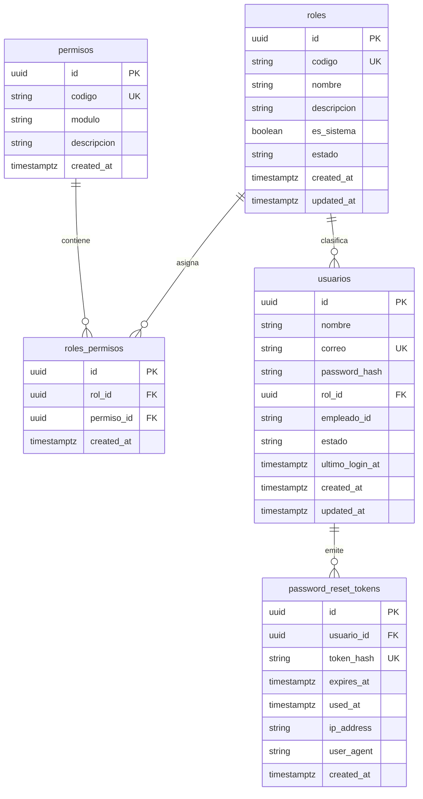

# ActivaCore — Sistema de Gestión de Activos Fijos & Contabilización DGII

> 📖 Master Module Documentation · Living Domain Document
> 🔄 Last Updated: 2026-10-13 · Status: Active / Certified Sub-00
> 👤 Technical & Functional Lead: Dirección de Tecnología & Finanzas (UNAPEC)
> 📂 Scope: Gestión integral del ciclo de vida de activos fijos institucionales, asignación y transferencias de custodios, motor de cálculo de depreciación por línea recta bajo normativa DGII (Norma General 07-07 / Ley 11-92 Art. 287), integración contable auxiliar y gobernanza de acceso basada en roles relacionales (RBAC).

---

## 1. Executive Summary & Domain Scope

### 1.1 Business Mission & Actors
- **Business Domain**: Gestión Patrimonial, Activos Fijos y Contabilidad Fiscal Universitaria.
- **Target Actors & Boundaries**:
  - **Administrador General (ADMIN)**: Acceso total y configuración de gobernanza institucional, seguridad, gestión de usuarios, catálogo de roles y permisos, auditoría y parámetros contables.
  - **Operador de Activos Fijos (OPERADOR)**: Registro de altas, transferencias entre custodios, catalogación física, cálculo mensual de depreciación y generación de asientos contables para despacho.
  - **Auditor de Cumplimiento (AUDITOR)**: Consulta de solo lectura de fichas patrimoniales, traza de auditoría, bitácora de integraciones contables y reportes ejecutivos fiscales.
  - **Servicio Web Contable Externo (WS Contabilidad UNAPEC)**: Ingestión síncrona o asíncrona de comprobantes y asientos de depreciación mensual vía API REST institucional.
- **Core Value Proposition**: Automatización y exactitud en el control físico-financiero de los activos universitarios, eliminación de discrepancias contables, cálculo determinista de depreciación fiscal DGII al centavo, y trazabilidad inmutable de custodios y transacciones.

### 1.2 Primary Routes & Frontend Navigation
| Route | View / Screen | Target Audience / Role | Status |
|-------|---------------|------------------------|--------|
| /login | Pantalla Institucional de Inicio de Sesión | Todos los colaboradores autenticables | ✅ Certified |
| /recuperar-contrasena | Solicitud de Restablecimiento de Credenciales | Colaboradores con cuenta institucional activa | ✅ Certified |
| /restablecer-contrasena | Ingreso de Nueva Contraseña Tokenizada | Titular del token criptográfico de un solo uso | ✅ Certified |
| /perfil | Gestión de Perfil & Actualización de Contraseña | Usuario autenticado en sesión activa | ✅ Certified |
| /admin/usuarios | Directorio de Usuarios, RBAC & Desbloqueo | Administrador General (ADMIN / USER_ADMIN) | ✅ Certified |
| / | Consola Principal y Tablero Institucional | Usuarios autenticados según matriz RBAC | ✅ Certified |
| /catalogos | Mantenimiento de Departamentos, Tipos y Cuentas | Operadores y Administradores (CAT_WRITE) | ⏳ In Progress (Sub-01) |
| /activos | Registro Patrimonial y Fichas de Activos | Operadores y Administradores (ACT_READ, ACT_CREATE) | ⏳ Pending (Sub-02) |
| /depreciacion | Corrida Mensual y Asientos de Depreciación DGII | Operadores y Administradores (DEP_CALCULATE) | ⏳ Pending (Sub-03) |
| /reportes | Consultas Fiscales y Conciliación DGII | Auditores, Operadores y Administradores (REP_READ) | ⏳ Pending (Sub-04) |

---

## 2. Capabilities & Sub-Features Matrix

| # | Sub-module / Capability | Functional Description | Status | Spec Link | Test Coverage |
|---|-------------------------|------------------------|--------|-----------|---------------|
| **00** | **Autenticación, Usuarios y Control de Acceso Relacional RBAC** | Inicio de sesión NextAuth v5, hashing bcrypt (10 rondas), protección contra fuerza bruta (15 min / 5 intentos), tokens SHA-256 de autoservicio, middleware edge y directorio de roles dinámicos. | ✅ Certified | [specs/activos-fijos/00-autenticacion-rbac/](../../specs/activos-fijos/00-autenticacion-rbac/requirements.md) | Unit: 92.7% (45 pruebas Vitest) · E2E: ✅ (4/4 Playwright) |
| **01** | **Catálogos Base del Sistema** | Mantenimiento de Departamentos, Cuentas Contables Auxiliares, Tipos de Activos con Vida Útil DGII y Empleados / Custodios vinculados. | ⏳ In Progress | [specs/activos-fijos/01-catalogos-base/](../../specs/activos-fijos/01-catalogos-base/requirements.md) | En especificación |
| **02** | **Gestión de Activos Fijos y Custodia** | Altas patrimoniales, códigos de barra / serialización única, ficha técnica, asignación a empleados, transferencias de ubicación física y bajas autorizadas. | ⏳ Pending | [specs/activos-fijos/02-gestion-activos-custodia/](../../specs/activos-fijos/02-gestion-activos-custodia/requirements.md) | Pendiente de inicio |
| **03** | **Motor de Depreciación y Contabilización DGII** | Cálculo mensual determinista por línea recta según Ley 11-92 Art. 287 (Categorías 1, 2 y 3), generación de asientos contables débitos/créditos y cierre mensual inmutable. | ⏳ Pending | Planificado Sub-03 | Pendiente de inicio |
| **04** | **Reportes, Auditoría e Integración Contable Externa** | Consultas multicriterio, exportación a Excel / PDF, trazabilidad inmutable de eventos y despacho al Web Service Contable de la Universidad. | ⏳ Pending | Planificado Sub-04 | Pendiente de inicio |

---
## 3. Architecture & Domain Lifecycle

### 3.1 Module State Machine (Ciclo de Vida de Seguridad y Sesión)

### 3.2 High-Level Component Flow

---

## 4. Consolidated Data Model (Module ERD)

### Key Tables & Data Dictionary
- **`roles`**: Almacena los perfiles de acceso institucionales (`ADMIN`, `OPERADOR`, `AUDITOR`).
  - `id`: UUID (PK, por defecto `gen_random_uuid()`).
  - `codigo`: VARCHAR(50), clave única de rol en mayúsculas.
  - `nombre`: VARCHAR(100), denominación oficial del rol institucional.
  - `es_sistema`: BOOLEAN, protege los roles base para evitar su eliminación accidental.
  - `estado`: VARCHAR(20), estado operativo (`ACTIVO`, `INACTIVO`).
- **`permisos`**: Catálogo atómico de capacidades del sistema segmentado por módulos (SEGURIDAD, CATALOGOS, ACTIVOS, DEPRECIACION, REPORTES, CONTABILIDAD).
  - `id`: UUID (PK).
  - `codigo`: VARCHAR(50), identificador único del permiso (ej. USER_ADMIN, ACT_CREATE).
- **`roles_permisos`**: Tabla puente relacional que implementa la matriz de privilegios M:N. Clave única compuesta en (rol_id, permiso_id).
- **`usuarios`**: Entidad central de colaboradores institucionales autorizados para operar la plataforma.
  - `correo`: VARCHAR(255), correo corporativo único (@unapec.edu.do).
  - `password_hash`: VARCHAR(255), digest criptográfico generado mediante Bcrypt con 10 rondas de salt.
  - `estado`: VARCHAR(20), ciclo de vida (ACTIVO, INACTIVO, SUSPENDIDO).
- **`password_reset_tokens`**: Registro de tokens criptográficos de un solo uso para autoservicio de contraseña.
  - `token_hash`: VARCHAR(64), digest SHA-256 del token entregado al usuario.
  - `expires_at`: TIMESTAMPTZ, ventana estricta de validez de 15 minutos.
  - `used_at`: TIMESTAMPTZ, marca temporal de consumo para invalidación inmediata anti-replay.

---
## 5. Master API Catalog

| Method | Endpoint | Description | Authorized Roles | Request Payload | Response (200/201) |
|--------|----------|-------------|------------------|-----------------|--------------------|
| POST | /api/auth/[...nextauth] | Autenticación institucional por credenciales | Público (Todos) | { correo, password } | Sesión JWT / HttpOnly Cookie |
| POST | /api/auth/forgot-password | Emisión de token de autoservicio de clave | Público (Todos) | { correo } | { success: true, message: "Solicitud procesada" } |
| POST | /api/auth/reset-password | Consumo de token y reseteo de contraseña | Público (Token) | { token, password } | { success: true, message: "Contraseña actualizada" } |
| PUT | /api/auth/change-password | Cambio de contraseña para usuario autenticado | Sesión Activa | { currentPassword, newPassword } | { success: true, message: "Contraseña modificada" } |
| GET | /api/usuarios | Consulta paginada del directorio de usuarios | USER_ADMIN / ADMIN | Query: ?page=1&limit=10 | { usuarios: [...], total, page, totalPages } |
| POST | /api/usuarios | Alta de nuevo colaborador institucional | USER_ADMIN / ADMIN | { nombre, correo, password, rolId } | { success: true, usuario: { id, nombre, correo } } |
| POST | /api/usuarios/[id]/unlock | Desbloqueo administrativo de cuenta throttled | USER_ADMIN / ADMIN | Ninguno (URL param) | { success: true, message: "Usuario desbloqueado" } |
| GET | /api/roles | Consulta del catálogo de roles y permisos | USER_ADMIN / ADMIN | Ninguno | [ { id, codigo, nombre, permisos: [...] } ] |

---

## 6. Universal Business Rules, Formulas & Compliance

### 6.1 Políticas de Seguridad y Criptografía
- **Política de Complejidad de Contraseña**:
  - Longitud mínima: 8 caracteres.
  - Debe contener al menos una letra mayúscula [A-Z].
  - Debe contener al menos una letra minúscula [a-z].
  - Debe contener al menos un dígito numérico [0-9].
  - Debe contener al menos un símbolo o carácter especial.
- **Defensa en Profundidad Anti-Fuerza Bruta (Throttling)**:
  - Umbral de bloqueo: 5 intentos fallidos consecutivos por cuenta de correo.
  - Duración del bloqueo: 15 minutos (900 segundos).
  - Los intentos exitosos resetean el contador a cero inmediatamente.
  - Los administradores generales pueden desbloquear manualmente una cuenta bloqueada desde /admin/usuarios.
- **Mitigación de Enumeración de Cuentas**:
  - /api/auth/forgot-password siempre responde 200 OK con mensaje neutro idéntico.
- **Protección de Tokens Criptográficos**:
  - Generación de entropía: 32 bytes pseudo-aleatorios mediante crypto.randomBytes(32).toString("hex").
  - Almacenamiento seguro: Digest SHA-256 antes de persistir.

### 6.2 Precision & Rounding Rules
- **Moneda Base**: DOP (Pesos Dominicanos).
- **Tipos de Datos Financieros**: NUMERIC(14,2) para costos y depreciación acumulada; NUMERIC(5,2) para tasas anuales.
- **Algoritmo de Redondeo**: Symmetric Half-Up Math.round((val + Number.EPSILON) * 100) / 100 a 2 decimales.

### 6.3 Module Error Codes (RFC 7807)
| Error Code | HTTP Status | Root Cause | System Action / User Feedback |
|------------|-------------|------------|-------------------------------|
| VALIDATION_ERROR | 400 Bad Request | Payload no supera el esquema Zod | Retorna listado de campos inválidos con mensajes en español. |
| UNAUTHORIZED | 401 Unauthorized | Petición sin token de sesión activo | Redirección a /login con parámetro callbackUrl. |
| FORBIDDEN | 403 Forbidden | Sesión carece del permiso RBAC requerido | Operación rechazada: Acceso denegado. Permisos insuficientes. |
| ACCOUNT_LOCKED | 429 Too Many Requests | Cuenta temporalmente bloqueada por fuerza bruta | Operación bloqueada con tiempo de espera restante en segundos. |
| USER_NOT_FOUND | 404 Not Found | Identificador de usuario inexistente | Retorna mensaje: El usuario solicitado no existe. |
| EMAIL_ALREADY_EXISTS | 409 Conflict | Intento de registrar un correo ya registrado | Rechazo: El correo institucional ya se encuentra registrado. |

---

## 7. External Integrations
- **NextAuth.js v5 Beta**: Proveedor de credenciales institucional con sesiones JWT encriptadas en cookies HttpOnly y SameSite Lax.
- **Contabilidad General UNAPEC (Futuro Sub-04)**: Integración REST con el Web Service de Finanzas de UNAPEC para asentar comprobantes contables diarios y mensuales.

---

## 8. Audit Trail & Security Policy
- **Acciones Auditadas Inmutables**: Inicio de sesión exitoso y fallido, bloqueo y desbloqueo de cuenta, creación de usuarios, mutación de roles y reseteo de claves.
- **Campos de Traza**: usuario_id, ip_address, user_agent, accion, recurso, timestamp_utc.

---

## 9. Change Log & Spec Lineage

| Date | Sub-module / Spec | Milestone Summary | Git Commit | Author / Approver |
|------|-------------------|-------------------|------------|-------------------|
| 2026-10-13 | specs/activos-fijos/00-autenticacion-rbac | Certificación formal del Sub-módulo 00: Arquitectura RBAC relacional, autenticación NextAuth v5, suites completas Vitest (92.7%) y Playwright E2E (4/4). | 246837a | Dirección de Tecnología / SDD Build Agent |
