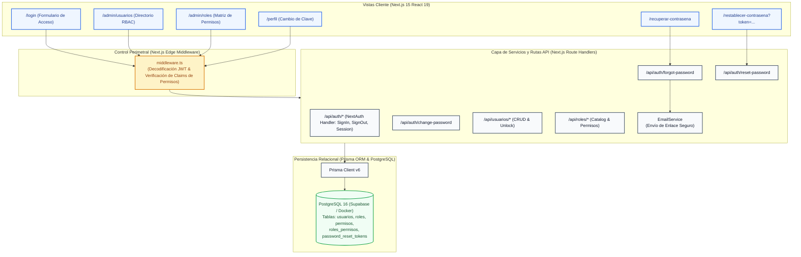
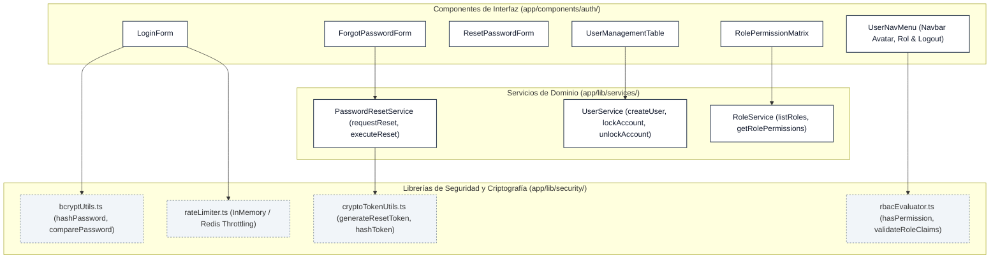

# Design: Autenticación, Usuarios y Control de Acceso Relacional (RBAC)

> 📋 Generated by `solution-designer` · 2026-10-08
> ✅ Approved by: JeremyJS · 2026-10-08
> ⚠️ **MANDATORY QUALITY GATE (Hard Gate 12)**: Technical design MUST explicitly specify DDL schemas with exact SQL data types, foreign keys, and constraints; REST endpoint contracts with real JSON request and response payloads (including RFC 7807 error structures); and renderable Mermaid diagrams. Superficial summaries, placeholders ('TODO', 'TBD'), or truncated lists are strictly prohibited.

## Traceability
- **Work Item**: Sub-módulo 00 (Autenticación, Usuarios y Control de Acceso Relacional RBAC)
- **Parent**: [PROY-UNAPEC-INT1] Proyecto Final Asignatura Integraciones I - Prof. Juan P. Valdez
- **Branch**: `feature/activos-fijos-00-autenticacion-rbac`
- **Requirements**: [requirements.md](./requirements.md)
- **Test Plan**: [test-plan.md](./test-plan.md)
- **Test Cases**: [test-cases.md](./test-cases.md)

## Technology Decisions
- **Frontend**: Next.js 15 (App Router, React 19, TypeScript 5), Tailwind CSS, shadcn/ui (Card, Form, Button, Input, Table, Badge, DropdownMenu, Dialog, Toast), Lucide React, React Hook Form con Zod resolver.
- **Backend & Auth Framework**: NextAuth.js v5 (Auth.js) configurado con `CredentialsProvider`, estrategia de sesión `jwt`, hashing de contraseñas mediante `bcryptjs` con factor de costo 10, y generación de tokens de restablecimiento mediante `node:crypto` (`randomBytes(32)` con digest SHA-256).
- **Perimeter Security**: Next.js Edge Middleware (`middleware.ts`) que intercepta las peticiones entrantes, valida la firma del JWT y evalúa los claims de autorización y permisos antes de conceder acceso a rutas de aplicación o endpoints de API.
- **Database**: PostgreSQL 16 (Supabase / Docker local), administrado mediante Prisma ORM v6 con relaciones normalizadas `Usuario -> Rol -> RolPermiso -> Permiso`, llaves foráneas estrictas `ON DELETE RESTRICT` para roles y `ON DELETE CASCADE` para tokens de recuperación.
- **Email Service**: Abstracción `EmailService` con proveedor de desarrollo `MockConsoleEmailService` (registra el enlace en terminal con URL local) y adaptador `SmtpEmailService` (Nodemailer / Resend) configurable mediante variables de entorno en producción.
- **Theme**: UNAPEC Institutional Theme (Royal Navy `#1e3a8a`, Slate `#475569`, fondos `#f8fafc`, soporte dark mode completo).

## Architecture

### System Overview


### Component Diagram


## Deployment
- **Pattern**: `fullstack-vercel`
- **App**: Vercel Serverless Platform (Edge Runtime para middleware, Node.js 20.x runtime para route handlers).
- **Infra**: Supabase Managed Cloud (PostgreSQL 16 en región AWS us-east-1).
- **CI/CD**: GitHub Actions automatizado con etapas de validación: `lint` -> `type-check` (`tsc --noEmit`) -> `test` (`vitest run`).
- **Justification**: Modelo Serverless de zero-mantenimiento para la entrega académica de Integraciones I, con soporte integrado de variables de entorno seguras (`NEXTAUTH_SECRET`, `DATABASE_URL`).
- **Discarded**: Proveedores de Identity-as-a-Service externos (Auth0, Clerk, Firebase Auth) descartados para preservar la gobernanza institucional y los requisitos de la base de datos relacional exigidos por la cátedra de Integraciones I de UNAPEC.

### Environments
| Environment | URL | Deploy trigger |
|-------------|-----|----------------|
| Development | `http://localhost:3000` | Local checkout en rama `feature/activos-fijos-00-autenticacion-rbac` |
| Staging / QA | `https://activos-fijos-staging.vercel.app` | Push / Merge a rama `develop` |
| Production | `https://activos-fijos-unapec.vercel.app` | Release tag aprobado en rama `main` |

## Database Schema

### Table: roles
Catálogo institucional de perfiles de autorización del sistema.

| Column | Type | Constraints | Default | Description |
|--------|------|------------|---------|-------------|
| `id` | `VARCHAR(36)` | PRIMARY KEY | `gen_random_uuid()` | Identificador universal único UUID v4 |
| `codigo` | `VARCHAR(20)` | UNIQUE, NOT NULL | N/A | Código mnemotécnico del rol (`ADMIN`, `OPERADOR`, `AUDITOR`) |
| `nombre` | `VARCHAR(100)` | NOT NULL | N/A | Denominación formal del rol para visualización en UI |
| `descripcion` | `VARCHAR(255)` | NOT NULL | N/A | Alcance y responsabilidades asignadas al perfil |
| `es_sistema` | `BOOLEAN` | NOT NULL | `true` | Bandera de inmutabilidad (roles base no eliminables) |
| `estado` | `VARCHAR(10)` | NOT NULL, CHECK (`estado IN ('ACTIVO', 'INACTIVO')`) | `'ACTIVO'` | Estado operativo del perfil |
| `created_at` | `TIMESTAMPTZ` | NOT NULL | `CURRENT_TIMESTAMP` | Fecha y hora UTC de registro |
| `updated_at` | `TIMESTAMPTZ` | NOT NULL | `CURRENT_TIMESTAMP` | Fecha y hora UTC de modificación |

### Table: permisos
Catálogo de capacidades atómicas agrupadas por módulo funcional.

| Column | Type | Constraints | Default | Description |
|--------|------|------------|---------|-------------|
| `id` | `VARCHAR(36)` | PRIMARY KEY | `gen_random_uuid()` | Identificador universal único UUID v4 |
| `codigo` | `VARCHAR(50)` | UNIQUE, NOT NULL | N/A | Identificador del permiso (`CAT_READ`, `CAT_WRITE`, `ACT_OPERATE`, `DEP_EXECUTE`, etc.) |
| `modulo` | `VARCHAR(30)` | NOT NULL | N/A | Módulo asociado (`CATALOGOS`, `ACTIVOS`, `DEPRECIACION`, `REPORTES`, `CONTABILIDAD`, `SEGURIDAD`) |
| `descripcion` | `VARCHAR(255)` | NOT NULL | N/A | Descripción legible de la acción autorizada |
| `created_at` | `TIMESTAMPTZ` | NOT NULL | `CURRENT_TIMESTAMP` | Fecha y hora UTC de creación |

### Table: roles_permisos
Tabla intermedia relacional (M:N) que asocia los permisos asignados a cada rol.

| Column | Type | Constraints | Default | Description |
|--------|------|------------|---------|-------------|
| `rol_id` | `VARCHAR(36)` | PRIMARY KEY, FK -> `roles.id` (ON DELETE CASCADE) | N/A | Identificador del rol asociado |
| `permiso_id` | `VARCHAR(36)` | PRIMARY KEY, FK -> `permisos.id` (ON DELETE CASCADE) | N/A | Identificador del permiso concedido |
| `asignado_at` | `TIMESTAMPTZ` | NOT NULL | `CURRENT_TIMESTAMP` | Marca temporal UTC de asignación |

### Table: usuarios
Directorio de cuentas institucionales autorizadas para interactuar con la plataforma.

| Column | Type | Constraints | Default | Description |
|--------|------|------------|---------|-------------|
| `id` | `VARCHAR(36)` | PRIMARY KEY | `gen_random_uuid()` | Identificador universal único UUID v4 |
| `nombre` | `VARCHAR(120)` | NOT NULL | N/A | Nombres y apellidos del usuario |
| `correo` | `VARCHAR(150)` | UNIQUE, NOT NULL | N/A | Correo institucional (índice unique case-insensitive) |
| `password_hash` | `VARCHAR(255)` | NOT NULL | N/A | Hash criptográfico bcrypt (cost 10) |
| `rol_id` | `VARCHAR(36)` | FOREIGN KEY -> `roles.id` (ON DELETE RESTRICT), NOT NULL | N/A | Rol relacional asignado a la cuenta |
| `estado` | `VARCHAR(10)` | NOT NULL, CHECK (`estado IN ('ACTIVO', 'INACTIVO')`) | `'ACTIVO'` | Condición operativa de la cuenta |
| `empleado_id` | `VARCHAR(36)` | FOREIGN KEY -> `empleados.id` (ON DELETE SET NULL), NULL | NULL | Vínculo opcional con el registro de custodio institucional |
| `intentos_fallidos` | `INTEGER` | NOT NULL | `0` | Contador de autenticaciones fallidas consecutivas |
| `bloqueado_hasta` | `TIMESTAMPTZ` | NULL | NULL | Marca temporal UTC de finalización del bloqueo temporal |
| `ultimo_acceso_at` | `TIMESTAMPTZ` | NULL | NULL | Fecha y hora UTC del último inicio de sesión exitoso |
| `created_at` | `TIMESTAMPTZ` | NOT NULL | `CURRENT_TIMESTAMP` | Fecha y hora UTC de registro de la cuenta |
| `updated_at` | `TIMESTAMPTZ` | NOT NULL | `CURRENT_TIMESTAMP` | Fecha y hora UTC de última actualización |

### Table: password_reset_tokens
Tokens unívocos con validez efímera para flujos de recuperación de contraseñas olvidadas.

| Column | Type | Constraints | Default | Description |
|--------|------|------------|---------|-------------|
| `id` | `VARCHAR(36)` | PRIMARY KEY | `gen_random_uuid()` | Identificador universal único UUID v4 |
| `token_hash` | `VARCHAR(64)` | UNIQUE, NOT NULL | N/A | Hash digest SHA-256 del token de 32 bytes emitido |
| `usuario_id` | `VARCHAR(36)` | FOREIGN KEY -> `usuarios.id` (ON DELETE CASCADE), NOT NULL | N/A | Usuario propietario de la solicitud de reseteo |
| `expira_at` | `TIMESTAMPTZ` | NOT NULL | N/A | Fecha y hora UTC de expiración estricta (15 minutos) |
| `utilizado` | `BOOLEAN` | NOT NULL | `false` | Bandera de consumo único para invalidación inmediata |
| `created_at` | `TIMESTAMPTZ` | NOT NULL | `CURRENT_TIMESTAMP` | Marca temporal UTC de generación del token |

### Indexes
| Name | Columns | Type | Justificación |
|------|---------|------|---------------|
| `idx_roles_codigo` | `codigo` | BTREE (UNIQUE) | Búsqueda directa de rol por identificador mnemotécnico |
| `idx_permisos_codigo` | `codigo` | BTREE (UNIQUE) | Verificación rápida de código de permiso en middleware |
| `idx_permisos_modulo` | `modulo` | BTREE | Agrupamiento de matriz de permisos por módulo |
| `idx_roles_permisos_composite` | `(rol_id, permiso_id)` | BTREE (PRIMARY KEY) | Búsqueda directa del par rol-permiso |
| `idx_usuarios_correo_lower` | `LOWER(correo)` | BTREE (UNIQUE) | Unicidad case-insensitive y búsqueda en inicio de sesión |
| `idx_usuarios_rol_id` | `rol_id` | BTREE | JOIN optimizado de usuarios con su rol correspondiente |
| `idx_usuarios_empleado_id` | `empleado_id` | BTREE | Resolución de identidad cruzada con el padrón de empleados |
| `idx_password_reset_token_hash` | `token_hash` | BTREE (UNIQUE) | Búsqueda sub-milisegundo al validar el enlace recibido |
| `idx_password_reset_expira` | `expira_at` | BTREE | Filtrado y depuración periódica de tokens vencidos |

## API Contracts

### POST /api/auth/login
- **Request**:
```json
{
  "correo": "admin@unapec.edu.do",
  "password": "Password123!"
}
```
- **Response** (`200 OK`):
```json
{
  "user": {
    "id": "c1a2b3c4-d5e6-7f8a-9b0c-1d2e3f4a5b6c",
    "nombre": "Administrador Principal",
    "correo": "admin@unapec.edu.do",
    "rol": {
      "id": "r1a2b3c4-d5e6-7f8a-9b0c-1d2e3f4a5b6c",
      "codigo": "ADMIN",
      "nombre": "Administrador General"
    },
    "permisos": ["CAT_READ", "CAT_WRITE", "ACT_OPERATE", "DEP_CLOSE", "ACC_DISPATCH", "USER_ADMIN"]
  },
  "expires": "2026-10-09T04:00:00.000Z"
}
```
- **Auth**: Público
- **Errors**:
  - `401 Unauthorized`: `INVALID_CREDENTIALS` ("Correo o contraseña incorrectos.")
  - `403 Forbidden`: `USER_ACCOUNT_INACTIVE` ("Su cuenta institucional se encuentra inactiva.")
  - `429 Too Many Requests`: `ACCOUNT_LOCKED` ("Cuenta bloqueada temporalmente por 15 minutos.")
- **Maps to**: REQ-AUTH-001

---

### POST /api/auth/logout
- **Request**: `{}`
- **Response** (`200 OK`):
```json
{
  "success": true,
  "message": "Sesión cerrada correctamente"
}
```
- **Auth**: Requerido
- **Errors**: `401 Unauthorized` si no existe sesión válida.
- **Maps to**: REQ-AUTH-003

---

### POST /api/auth/forgot-password
- **Request**:
```json
{
  "correo": "profesor@unapec.edu.do"
}
```
- **Response** (`200 OK`):
```json
{
  "message": "Si el correo ingresado coincide con una cuenta activa, recibirá un enlace para restablecer su contraseña en breve."
}
```
- **Auth**: Público
- **Errors**:
  - `429 Too Many Requests`: `RATE_LIMIT_EXCEEDED` ("Demasiadas solicitudes. Espere 2 minutos antes de reintentar.")
- **Maps to**: REQ-AUTH-005

---

### POST /api/auth/reset-password
- **Request**:
```json
{
  "token": "4a7b9c1d2e3f4a5b6c7d8e9f0a1b2c3d4e5f6a7b8c9d0e1f2a3b4c5d6e7f8a9b",
  "nuevaPassword": "NuevaPassword2026!",
  "confirmarPassword": "NuevaPassword2026!"
}
```
- **Response** (`200 OK`):
```json
{
  "success": true,
  "message": "Contraseña restablecida exitosamente. Inicie sesión con su nueva clave."
}
```
- **Auth**: Público (validación de token criptográfico)
- **Errors**:
  - `400 Bad Request`: `INVALID_OR_EXPIRED_RESET_TOKEN` ("El enlace de recuperación es inválido o ha expirado.")
  - `422 Unprocessable`: `PASSWORD_POLICY_VIOLATION` ("La contraseña debe contener al menos 8 caracteres, una mayúscula y un número.")
- **Maps to**: REQ-AUTH-006

---

### PUT /api/auth/change-password
- **Request**:
```json
{
  "passwordActual": "Password123!",
  "nuevaPassword": "NuevaPasswordSegura2026!",
  "confirmarPassword": "NuevaPasswordSegura2026!"
}
```
- **Response** (`200 OK`):
```json
{
  "success": true,
  "message": "Contraseña actualizada exitosamente"
}
```
- **Auth**: Requerido (sesión activa)
- **Errors**:
  - `400 Bad Request`: `CURRENT_PASSWORD_INCORRECT` ("La contraseña actual no es correcta.")
  - `422 Unprocessable`: `NEW_PASSWORD_INVALID` ("La nueva contraseña no satisface las políticas de seguridad.")
- **Maps to**: REQ-AUTH-007

---

### GET /api/usuarios
- **Request**: `GET /api/usuarios?search=profesor&rolId=r1a2b3c4...&estado=ACTIVO&page=1&limit=20`
- **Response** (`200 OK`):
```json
{
  "data": [
    {
      "id": "u1a2b3c4-d5e6-7f8a-9b0c-1d2e3f4a5b6c",
      "nombre": "Prof. Juan Pérez",
      "correo": "profesor@unapec.edu.do",
      "rol": {
        "id": "r2a2b3c4-d5e6-7f8a-9b0c-1d2e3f4a5b6c",
        "codigo": "OPERADOR",
        "nombre": "Operador de Activos"
      },
      "empleado": {
        "id": "e1a2b3c4-d5e6-7f8a-9b0c-1d2e3f4a5b6c",
        "codigo": "EMP-0012",
        "nombre": "Juan",
        "apellido": "Pérez"
      },
      "estado": "ACTIVO",
      "intentosFallidos": 0,
      "bloqueadoHasta": null,
      "ultimoAccesoAt": "2026-10-08T18:30:00.000Z",
      "createdAt": "2026-10-01T12:00:00.000Z"
    }
  ],
  "pagination": { "page": 1, "limit": 20, "total": 1, "totalPages": 1 }
}
```
- **Auth**: Requerido (Permiso `USER_ADMIN`)
- **Errors**: `403 Forbidden` si el usuario no tiene rol `ADMIN`.
- **Maps to**: REQ-AUTH-004

---

### POST /api/usuarios
- **Request**:
```json
{
  "nombre": "Lic. María Rodríguez",
  "correo": "mrodriguez@unapec.edu.do",
  "password": "PasswordTemporal2026!",
  "rolId": "r2a2b3c4-d5e6-7f8a-9b0c-1d2e3f4a5b6c",
  "empleadoId": "e2a2b3c4-d5e6-7f8a-9b0c-1d2e3f4a5b6c",
  "estado": "ACTIVO"
}
```
- **Response** (`201 Created`): Retorna la entidad del usuario creado omitiendo `passwordHash`.
- **Auth**: Requerido (Permiso `USER_ADMIN`)
- **Errors**:
  - `409 Conflict`: `USER_DUPLICATE_EMAIL` ("Ya existe un usuario con este correo.")
  - `404 Not Found`: `ROLE_NOT_FOUND` ("El rol seleccionado no existe.")
  - `422 Unprocessable`: `WEAK_PASSWORD` ("La contraseña temporal debe ser robusta.")
- **Maps to**: REQ-AUTH-004

---

### PUT /api/usuarios/[id]
- **Request**:
```json
{
  "nombre": "Lic. María Rodríguez de León",
  "rolId": "r3a2b3c4-d5e6-7f8a-9b0c-1d2e3f4a5b6c",
  "empleadoId": "e2a2b3c4-d5e6-7f8a-9b0c-1d2e3f4a5b6c",
  "estado": "ACTIVO"
}
```
- **Response** (`200 OK`): Retorna el usuario actualizado.
- **Auth**: Requerido (Permiso `USER_ADMIN`)
- **Errors**:
  - `400 Bad Request`: `CANNOT_DEACTIVATE_SELF_ADMIN` ("No puede desactivar o degradar su propia cuenta de administrador.")
  - `404 Not Found`: `USER_NOT_FOUND`
- **Maps to**: REQ-AUTH-004

---

### POST /api/usuarios/[id]/unlock
- **Request**: `{}`
- **Response** (`200 OK`):
```json
{
  "success": true,
  "message": "Cuenta desbloqueada exitosamente",
  "user": {
    "id": "u1a2b3c4-d5e6-7f8a-9b0c-1d2e3f4a5b6c",
    "intentosFallidos": 0,
    "bloqueadoHasta": null
  }
}
```
- **Auth**: Requerido (Permiso `USER_ADMIN`)
- **Errors**: `403 Forbidden`, `404 Not Found`
- **Maps to**: REQ-AUTH-008

---

### GET /api/roles
- **Request**: `GET /api/roles`
- **Response** (`200 OK`):
```json
{
  "data": [
    {
      "id": "r1a2b3c4-d5e6-7f8a-9b0c-1d2e3f4a5b6c",
      "codigo": "ADMIN",
      "nombre": "Administrador General",
      "descripcion": "Acceso total y configuración del sistema",
      "esSistema": true,
      "estado": "ACTIVO",
      "totalUsuarios": 2,
      "totalPermisos": 18
    },
    {
      "id": "r2a2b3c4-d5e6-7f8a-9b0c-1d2e3f4a5b6c",
      "codigo": "OPERADOR",
      "nombre": "Operador de Activos",
      "descripcion": "Gestión de inventario y transferencias",
      "esSistema": true,
      "estado": "ACTIVO",
      "totalUsuarios": 5,
      "totalPermisos": 10
    },
    {
      "id": "r3a2b3c4-d5e6-7f8a-9b0c-1d2e3f4a5b6c",
      "codigo": "AUDITOR",
      "nombre": "Auditor Institucional",
      "descripcion": "Consultas analíticas y reportes de solo lectura",
      "esSistema": true,
      "estado": "ACTIVO",
      "totalUsuarios": 1,
      "totalPermisos": 6
    }
  ]
}
```
- **Auth**: Requerido (Permiso `ROLE_READ` o sesión institucional)
- **Maps to**: REQ-AUTH-009

---

### GET /api/roles/[id]/permisos
- **Request**: `GET /api/roles/r2a2b3c4.../permisos`
- **Response** (`200 OK`):
```json
{
  "rol": {
    "codigo": "OPERADOR",
    "nombre": "Operador de Activos"
  },
  "permisos": [
    { "codigo": "CAT_READ", "modulo": "CATALOGOS", "descripcion": "Consultar catálogos" },
    { "codigo": "CAT_WRITE", "modulo": "CATALOGOS", "descripcion": "Crear y editar catálogos" },
    { "codigo": "ACT_READ", "modulo": "ACTIVOS", "descripcion": "Consultar activos fijos" },
    { "codigo": "ACT_OPERATE", "modulo": "ACTIVOS", "descripcion": "Registrar altas y custodios" },
    { "codigo": "DEP_READ", "modulo": "DEPRECIACION", "descripcion": "Consultar historial de depreciación" },
    { "codigo": "REP_EXPORT", "modulo": "REPORTES", "descripcion": "Exportar reportes a Excel y PDF" }
  ]
}
```
- **Auth**: Requerido
- **Maps to**: REQ-AUTH-009

---

## Architecture Updates
- `docs/architecture/system-overview.md`: Registro de la capa perimetral de seguridad, autenticación NextAuth.js y control de acceso relacional RBAC.
- `docs/architecture/database-architecture.md`: Inclusión de las tablas relacionales de seguridad `roles`, `permisos`, `roles_permisos`, `usuarios` y `password_reset_tokens`.
- `docs/modules/activos-fijos.md`: Adición del Sub-módulo 00 (Seguridad y RBAC) en la Matriz de Capacidades y diagramas del sistema.

## Approval
- [ ] Developer: SDD Solution Designer  Date: 2026-10-08
- [x] Approver (User): JeremyJS  Date: 2026-10-08

---
> 📍 [00-autenticacion-rbac] · 🌿 `feature/activos-fijos-00-autenticacion-rbac` · Generated by SDD Standard

