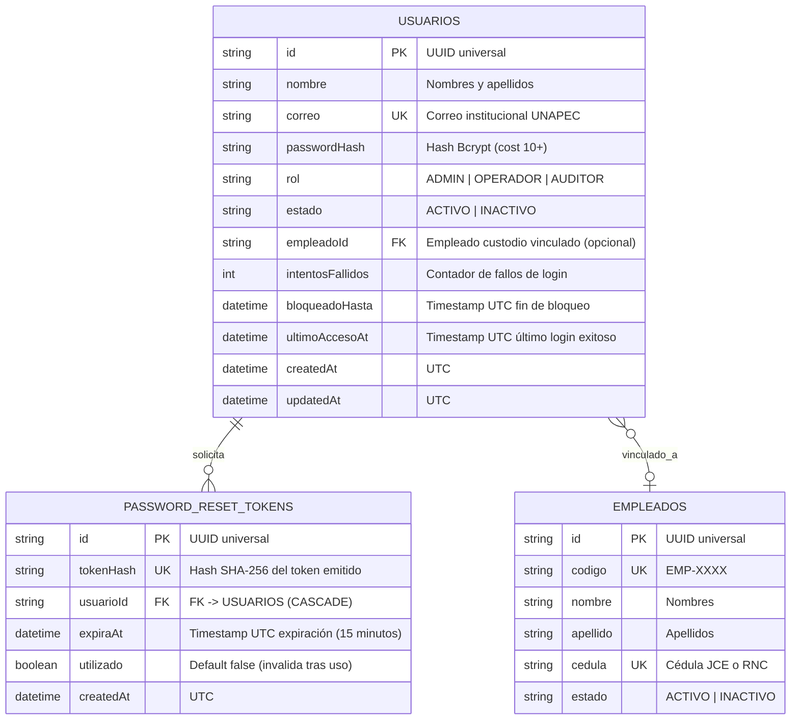

# Requirements: Autenticación, Usuarios y Control de Acceso (RBAC)

> 📋 Generated by `sdd-router / requirements-analyst` · 2026-10-08
> ✅ Approved by: [pending]
> ⚠️ **MANDATORY QUALITY GATE (Hard Gate 12)**: Every user story MUST be authored in formal EARS syntax with complete Given/When/Then acceptance criteria. Summarizing requirements with 'etc.', omitting calculation formulas, or generalizing validations is strictly prohibited. All numeric thresholds, formats, and error conditions must be explicitly detailed.

## Traceability
- **Work Item**: Sub-módulo 00 (Autenticación, Usuarios y Control de Acceso RBAC)
- **Parent**: [PROY-UNAPEC-INT1] Proyecto Final Asignatura Integraciones I - Prof. Juan P. Valdez
- **Branch**: `feature/activos-fijos-00-autenticacion-rbac`
- **Design**: [design.md](./design.md)
- **Test Plan**: [test-plan.md](./test-plan.md)
- **Test Cases**: [test-cases.md](./test-cases.md)

## Overview
El sub-módulo de **Autenticación, Usuarios y Control de Acceso (RBAC)** es la capa transversal de seguridad y gobierno de identidades del Sistema de Gestión de Activos Fijos para la Universidad APEC (UNAPEC). Este componente centraliza el registro, administración y validación de usuarios institucionales, el inicio y cierre de sesión seguro mediante credenciales encriptadas, la emisión de sesiones cifradas JWT, la protección perimetral de rutas y endpoints mediante Next.js Edge Middleware, y los flujos integrales de autoservicio para **recuperación de contraseña olvidada**, **desbloqueo de cuentas** y **actualización de credenciales**. Garantiza una estricta segregación de responsabilidades a través de tres roles fundamentales: `ADMIN` (administración global y configuración contable), `OPERADOR` (registro y custodia de activos fijos) y `AUDITOR` (consultas analíticas y reportes de solo lectura).

## User Stories (EARS Notation)

### REQ-AUTH-001: Inicio de Sesión Institucional y Autenticación Segura
**Type:** Event-Driven  
**Rule:** WHEN a user submits their institutional email and password on the login screen (`/login`), the system SHALL verify the credentials against the stored bcrypt hash (cost >= 10), issue an encrypted `httpOnly` session token, and redirect to the application dashboard.  
**Entities:** `Usuario` (`id`, `nombre`, `correo`, `passwordHash`, `rol`, `estado`, `empleadoId`, `intentosFallidos`, `bloqueadoHasta`, `ultimoAccesoAt`, `createdAt`, `updatedAt`)  
**Error Handling:** Si el correo no existe en el sistema o la contraseña no coincide con el hash almacenado, el sistema SHALL rechazar la autenticación retornando `INVALID_CREDENTIALS` (HTTP 401: "Correo o contraseña incorrectos."). Si la cuenta posee estado `INACTIVO`, SHALL responder con `USER_ACCOUNT_INACTIVE` (HTTP 403: "Su cuenta institucional se encuentra inactiva. Contacte al administrador."). Si el usuario acumula 5 intentos fallidos consecutivos en menos de 15 minutos, el sistema SHALL bloquear la cuenta temporalmente por 15 minutos emitiendo `ACCOUNT_LOCKED` (HTTP 429: "Cuenta bloqueada temporalmente por múltiples intentos fallidos. Intente nuevamente en 15 minutos.").  

**Acceptance Criteria:**  
- [ ] Given un usuario con credenciales válidas y estado "ACTIVO", when ingresa su correo y contraseña en `/login`, then el sistema genera la sesión autenticada, almacena la cookie segura y redirige al usuario a `/dashboard` en menos de 300ms.  
- [ ] Given un usuario que ingresa una contraseña errónea, when envía el formulario, then el sistema incrementa el contador de intentos fallidos en base de datos y muestra: *"Correo o contraseña incorrectos."* sin revelar si el correo existe o no (prevención de enumeración de usuarios).  
- [ ] Given un usuario que acumula 5 intentos fallidos consecutivos, when realiza el sexto intento, then el sistema establece `bloqueadoHasta = NOW() + 15 minutos` e impide cualquier intento de acceso hasta expirar el bloqueo.  
- [ ] Given un usuario con cuenta deshabilitada (`estado = INACTIVO`), when intenta iniciar sesión con la contraseña correcta, then el sistema rechaza el acceso e indica que la cuenta está inactiva.  

**Priority:** Must  
**Dependencies:** None  
**Tracker:** REQ-AUTH-001  

---

### REQ-AUTH-002: Control de Acceso Basado en Roles (RBAC) y Middleware de Protección
**Type:** Ubiquitous  
**Rule:** The system SHALL intercept all incoming application and API requests via Next.js Edge Middleware, verifying token validity and enforcing role-based authorization policies (`ADMIN`, `OPERADOR`, `AUDITOR`) before admitting execution.  
**Entities:** `Usuario`, `Session`  
**Error Handling:** Si una solicitud intenta acceder a una ruta protegida sin cookie de sesión válida o expirada, el middleware SHALL redirigir a `/login?callbackUrl=[ruta_solicitada]` para navegación web, o retornar `UNAUTHORIZED` (HTTP 401) para peticiones a `/api/*`. Si un usuario autenticado intenta ejecutar una acción o ruta no permitida para su rol, el sistema SHALL responder con `FORBIDDEN_INSUFFICIENT_ROLE` (HTTP 403: "No posee permisos suficientes para ejecutar esta acción.") y registrar el evento de violación en el log de seguridad.  

**Acceptance Criteria:**  
- [ ] Given una solicitud HTTP entrante a `/catalogos` o `/api/*` sin sesión activa, when se procesa por el middleware, then se bloquea el acceso redirigiendo a la pantalla de login con el parámetro de retorno.  
- [ ] Given un usuario con rol "AUDITOR", when intenta enviar una solicitud `POST`, `PUT` o `DELETE` a `/api/departamentos` o `/api/tipos-activos`, then el sistema intercepta la petición y responde con HTTP 403 Forbidden.  
- [ ] Given un usuario con rol "OPERADOR", when intenta modificar las cuentas contables de un Tipo de Activo o acceder a la configuración del WS de Contabilidad, then el sistema bloquea la acción restringida exclusivamente a "ADMIN".  
- [ ] Given un usuario con rol "ADMIN", when accede a cualquier ruta o ejecuta cualquier mutación en el sistema, then el sistema autoriza la operación sin restricciones.  

**Priority:** Must  
**Dependencies:** REQ-AUTH-001  
**Tracker:** REQ-AUTH-002  

---

### REQ-AUTH-003: Cierre de Sesión e Invalidación de Tokens
**Type:** Event-Driven  
**Rule:** WHEN an authenticated user triggers the logout action, the system SHALL revoke the session cookie, clear active tokens, and redirect to the public login screen.  
**Entities:** `Usuario`, `Session`  
**Error Handling:** Si la sesión ya se encuentra expirada al solicitar el cierre, el sistema SHALL limpiar las cookies residuales y redirigir limpiamente a `/login` sin emitir errores no controlados.  

**Acceptance Criteria:**  
- [ ] Given un usuario con sesión activa en cualquier vista del sistema, when hace clic en "Cerrar Sesión" en el menú de usuario de la barra superior, then el sistema elimina la cookie de autenticación del navegador y redirige a `/login`.  
- [ ] Given un usuario que cerró sesión, when utiliza el botón "Atrás" del navegador o intenta cargar una ruta privada, then el middleware detecta la ausencia de sesión y previene la visualización de datos privados redirigiendo al login.  

**Priority:** Must  
**Dependencies:** REQ-AUTH-001  
**Tracker:** REQ-AUTH-003  

---

### REQ-AUTH-004: Gestión Administrativa de Cuentas de Usuario
**Type:** Ubiquitous  
**Rule:** The system SHALL provide an administrative directory to register university staff accounts, assign operational roles, link accounts to physical employee records, and govern operational status.  
**Entities:** `Usuario`, `Empleado`  
**Error Handling:** Si el correo institucional ya se encuentra registrado por otro usuario, el sistema SHALL rechazar la creación con `USER_DUPLICATE_EMAIL` (HTTP 409). Si la contraseña proporcionada posee menos de 8 caracteres o carece de mayúsculas y números, SHALL rechazar con `WEAK_PASSWORD` (HTTP 422). Si un usuario administrador intenta desactivar su propia cuenta o quitarse a sí mismo el rol `ADMIN` siendo el único administrador del sistema, SHALL bloquear la operación con `CANNOT_DEACTIVATE_SELF_ADMIN` (HTTP 400: "No puede desactivar o degradar su propia cuenta de administrador principal.").  

**Acceptance Criteria:**  
- [ ] Given un usuario con rol "ADMIN", when registra un nuevo usuario con correo institucional válido (ej. `profesor@unapec.edu.do`), contraseña de al menos 8 caracteres y rol "OPERADOR", then el sistema cifra la contraseña con bcrypt y persiste la cuenta en base de datos.  
- [ ] Given un usuario existente, when el administrador lo vincula a un colaborador del padrón institucional (`empleadoId`), then el sistema asocia la cuenta al registro del empleado para trazabilidad de custodio.  
- [ ] Given un administrador logueado, when intenta cambiar su propio estado a "INACTIVO", then el sistema bloquea la mutación informando que no es posible la autoinactivación.  
- [ ] Given el listado de usuarios, when se visualiza la tabla, then se muestra el nombre, correo, rol asignado, empleado asociado, último acceso y estado operativo.  

**Priority:** Must  
**Dependencies:** REQ-AUTH-001, REQ-AUTH-002  
**Tracker:** REQ-AUTH-004  

---

### REQ-AUTH-005: Solicitud de Recuperación de Contraseña Olvidada
**Type:** Event-Driven  
**Rule:** WHEN a user submits their institutional email address on the forgot password view (`/recuperar-contrasena`), the system SHALL generate a cryptographically random, one-time reset token with 15-minute validity, record its SHA-256 hash in the database, and dispatch an email with the secure recovery link.  
**Entities:** `Usuario`, `PasswordResetToken` (`id`, `tokenHash`, `usuarioId`, `expiraAt`, `utilizado`, `createdAt`)  
**Error Handling:** Para mitigar ataques de enumeración de cuentas, el sistema SHALL responder SIEMPRE con el mismo mensaje neutro de confirmación: *"Si el correo ingresado coincide con una cuenta activa, recibirá un enlace para restablecer su contraseña en breve."*, independientemente de si el correo existe o no en la base de datos. Si la cuenta está inactiva, no se emitirá el correo pero se retornará la respuesta neutra.  

**Acceptance Criteria:**  
- [ ] Given que un usuario no recuerda su clave, when ingresa a `/recuperar-contrasena`, digita su correo institucional y envía el formulario, then el sistema genera un token criptográfico seguro de 32 bytes en formato hexadecimal y almacena su hash con expiración de 15 minutos exactos.  
- [ ] Given que el correo ingresado existe en el sistema, when se procesa la solicitud, then el sistema emite un correo institucional con el enlace `https://activos-fijos.unapec.edu.do/restablecer-contrasena?token=[TOKEN_SEGURO]`.  
- [ ] Given que un usuario ingresa un correo inexistente (ej. `inexistente@unapec.edu.do`), when envía el formulario, then el sistema no genera ningún token en base de datos y muestra la misma pantalla de confirmación neutral sin revelar la inexistencia.  
- [ ] Given una cuenta que ya solicitó un token en los últimos 2 minutos, when solicita otro inmediatamente, then el sistema aplica rate limiting respondiendo HTTP 429 para prevenir saturación de envíos de correo.  

**Priority:** Must  
**Dependencies:** REQ-AUTH-001  
**Tracker:** REQ-AUTH-005  

---

### REQ-AUTH-006: Restablecimiento de Contraseña y Revocación de Sesiones
**Type:** Event-Driven  
**Rule:** WHEN a user accesses the reset password view with a valid token and submits a new password adhering to security policies, the system SHALL update the password hash, invalidate the token, and revoke all existing active sessions for that account.  
**Entities:** `Usuario`, `PasswordResetToken`, `Session`  
**Error Handling:** Si el token no existe, ya fue utilizado (`utilizado = true`), o su marca temporal `expiraAt` es anterior a la hora actual (`NOW() > expiraAt`), el sistema SHALL rechazar la solicitud retornando `INVALID_OR_EXPIRED_RESET_TOKEN` (HTTP 400: "El enlace de recuperación es inválido o ha expirado. Solicite un nuevo enlace."). Si la nueva contraseña no cumple con los requisitos de robustez o es idéntica a la anterior, SHALL rechazar con `PASSWORD_POLICY_VIOLATION` (HTTP 422).  

**Acceptance Criteria:**  
- [ ] Given un usuario con un token válido recibido por correo, when accede a `/restablecer-contrasena?token=[TOKEN]`, then el sistema verifica la validez del token y presenta el formulario de nueva contraseña.  
- [ ] Given el formulario de nueva contraseña, when el usuario ingresa una contraseña robusta (mínimo 8 caracteres, al menos 1 número, 1 mayúscula y 1 carácter especial) y coincide con la confirmación, then el sistema genera el nuevo hash bcrypt, marca el token como `utilizado = true` y actualiza la fecha `updatedAt`.  
- [ ] Given que la contraseña se restablece exitosamente, when el usuario tenía sesiones abiertas en otros navegadores o dispositivos, then el sistema revoca inmediatamente todas las sesiones previas forzando nuevo login con la credencial actualizada.  
- [ ] Given un usuario que intenta utilizar un token expirado (+15 minutos transcurridos) o ya utilizado previamente, when intenta enviar el formulario, then el sistema bloquea el cambio y muestra: *"El enlace de recuperación es inválido o ha expirado. Solicite un nuevo enlace."*  

**Priority:** Must  
**Dependencies:** REQ-AUTH-005  
**Tracker:** REQ-AUTH-006  

---

### REQ-AUTH-007: Cambio Voluntario de Contraseña desde el Perfil de Usuario
**Type:** Ubiquitous  
**Rule:** The system SHALL permit authenticated users to update their access password from their profile view, requiring explicit verification of their current password before committing the update.  
**Entities:** `Usuario`  
**Error Handling:** Si la contraseña actual suministrada no coincide con el hash almacenado, el sistema SHALL rechazar la operación con `CURRENT_PASSWORD_INCORRECT` (HTTP 400: "La contraseña actual no es correcta."). Si la nueva contraseña no cumple las políticas de longitud o coincide con la contraseña actual, SHALL rechazar con `NEW_PASSWORD_INVALID` (HTTP 422).  

**Acceptance Criteria:**  
- [ ] Given un usuario con sesión activa en su vista de Perfil (`/perfil`), when ingresa su contraseña actual correcta y una nueva contraseña válida con confirmación, then el sistema actualiza la contraseña y muestra una notificación toast de éxito.  
- [ ] Given un intento de cambio de contraseña, when el usuario ingresa una contraseña actual incorrecta, then el sistema impide la actualización y notifica: *"La contraseña actual no es correcta."*  

**Priority:** Should  
**Dependencies:** REQ-AUTH-001  
**Tracker:** REQ-AUTH-007  

---

### REQ-AUTH-008: Desbloqueo y Reseteo Administrativo de Cuentas
**Type:** Event-Driven  
**Rule:** WHEN a user account is locked due to brute-force throttling (`bloqueadoHasta IS NOT NULL`), an administrator SHALL be empowered to manually unlock the account and generate a temporary reset link from the user management console.  
**Entities:** `Usuario`, `PasswordResetToken`  
**Error Handling:** Si un operador o auditor intenta desbloquear una cuenta, el sistema SHALL responder con HTTP 403 Forbidden.  

**Acceptance Criteria:**  
- [ ] Given un usuario bloqueado por 5 intentos fallidos, when un administrador presiona el botón "Desbloquear Cuenta" en el directorio de usuarios, then el sistema limpia `intentosFallidos = 0` y `bloqueadoHasta = NULL`, permitiendo el acceso inmediato del colaborador.  
- [ ] Given un usuario que olvidó su clave y no tiene acceso a su correo, when el administrador selecciona "Generar Enlace de Recuperación Manual", then el sistema emite un enlace de uso único para entregarlo formalmente al colaborador institucional.  

**Priority:** Should  
**Dependencies:** REQ-AUTH-001, REQ-AUTH-004  
**Tracker:** REQ-AUTH-008  

---

### REQ-AUTH-009: Interfaz de Usuario y Barra Superior Institucional
**Type:** Ubiquitous  
**Rule:** The system SHALL display an institutional top navigation bar across all authenticated views, showing the UNAPEC brand logo, current module title, user profile badge with active role tag, link to user profile, and quick access to logout.  
**Entities:** `Usuario`  
**Error Handling:** Si la información de sesión no puede ser recuperada en el renderizado cliente, el sistema SHALL renderizar un placeholder esqueleto (Skeleton) mientras se resuelve el estado antes de mostrar datos.  

**Acceptance Criteria:**  
- [ ] Given un usuario autenticado navegando en el sistema, when visualiza cualquier pantalla, then la barra superior muestra el nombre completo del usuario, su rol entre corchetes (ej. `[ADMIN]`) y el menú desplegable con opciones "Mi Perfil" y "Cerrar Sesión".  
- [ ] Given la interfaz en dispositivos móviles o tablets, when se reduce el ancho de pantalla, then el menú de navegación se colapsa en un menú hamburguesa accesible sin perder acceso al perfil ni al botón de cerrar sesión.  

**Priority:** Should  
**Dependencies:** REQ-AUTH-001  
**Tracker:** REQ-AUTH-009  

---

## Non-Functional Requirements

### NFR-AUTH-001: Encriptación y Criptografía de Contraseñas
**Category:** Security  
**Rule:** The system SHALL hash all user passwords using the bcrypt algorithm with a minimum cost factor of 10 rounds, never storing plaintext passwords in application memory, logs, or persistent storage.  
**Metric:** 100% de contraseñas almacenadas como hashes bcrypt unidireccionales; longitud mínima de contraseña de 8 caracteres con entropía forzada (mayúsculas, números y símbolos).  
**Priority:** Must  

### NFR-AUTH-002: Seguridad y Protección de Cookies de Sesión
**Category:** Security  
**Rule:** The system SHALL transmit session tokens exclusively via cookies configured with `HttpOnly`, `SameSite=Lax`, and `Secure` (en entornos productivos HTTPS) flags, completely mitigating Cross-Site Scripting (XSS) token exfiltration and Cross-Site Request Forgery (CSRF).  
**Metric:** 0 tokens JWT expuestos en `localStorage` o `sessionStorage` del navegador.  
**Priority:** Must  

### NFR-AUTH-003: Rendimiento y Latencia de Intercepción de Middleware
**Category:** Performance  
**Rule:** The Next.js Edge Middleware SHALL verify and decode JWT session claims with sub-millisecond cryptographic latency, avoiding heavy database roundtrips on static and cached routes.  
**Metric:** Tiempo de ejecución del middleware < 15ms p95 en peticiones entrantes.  
**Priority:** Must  

### NFR-AUTH-004: Prevención de Ataques de Fuerza Bruta y Rate Limiting
**Category:** Security  
**Rule:** The system SHALL throttle login attempts, automatically locking accounts for 15 minutes after 5 consecutive failed authentication attempts, and rate-limiting password reset requests to 1 request per 2 minutes per IP.  
**Metric:** 100% de cumplimiento del bloqueo tras 5 intentos erróneos; desbloqueo automático tras 15 minutos o por reseteo manual de un Administrador.  
**Priority:** Must  

### NFR-AUTH-005: Tokens Criptográficos de Uso Único y Expiración Estricta
**Category:** Security  
**Rule:** Password reset tokens SHALL be generated with a minimum of 256 bits of cryptographic entropy (`crypto.randomBytes(32)`), stored as SHA-256 hashes, and invalidated immediately upon first use or after 15 minutes.  
**Metric:** Cero reutilizaciones permitidas de tokens de restablecimiento; 100% de tokens expirados rechazados.  
**Priority:** Must  

### NFR-AUTH-006: Auditoría y Marcas Temporales de Acceso
**Category:** Reliability  
**Rule:** The system SHALL automatically maintain immutable `ultimoAccesoAt`, `createdAt` y `updatedAt` timestamps in UTC for all user accounts and token transactions.  
**Metric:** 100% de accesos exitosos y cambios de contraseña actualizan las marcas de tiempo con precisión en milisegundos.  
**Priority:** Should  

---

## Diagrams

### Use Case Diagram

```mermaid
graph TD
    classDef actorStyle fill:#1e3a8a,stroke:#3b82f6,stroke-width:2px,color:#ffffff;
    classDef useCaseStyle fill:#f8fafc,stroke:#475569,stroke-width:1.5px,color:#0f172a;

    Anon["👤 Usuario Anónimo"]:::actorStyle
    UserAuth["👤 Usuario Autenticado"]:::actorStyle
    Admin["👤 Administrador"]:::actorStyle

    subgraph ModuloSeguridad["Sub-módulo 00: Autenticación, Recuperación y RBAC (UNAPEC)"]
        UC1("UC-01: Iniciar Sesión con Credenciales"):::useCaseStyle
        UC2("UC-02: Solicitar Recuperación de Contraseña Olvidada"):::useCaseStyle
        UC3("UC-03: Restablecer Contraseña con Token Seguro"):::useCaseStyle
        UC4("UC-04: Cerrar Sesión Segura"):::useCaseStyle
        UC5("UC-05: Cambiar Contraseña desde Perfil"):::useCaseStyle
        UC6("UC-06: Administrar Usuarios y Asignar Roles"):::useCaseStyle
        UC7("UC-07: Desbloquear Cuenta Manualmente"):::useCaseStyle
        UC8("UC-08: Control Perimetral de Rutas (Middleware)"):::useCaseStyle
        UC9("UC-09: Bloqueo Automático por Fuerza Bruta"):::useCaseStyle
    end

    Anon --> UC1
    Anon --> UC2
    Anon --> UC3
    Anon --> UC8
    Anon --> UC9

    UserAuth --> UC4
    UserAuth --> UC5

    Admin --> UC4
    Admin --> UC6
    Admin --> UC7
```

### Supporting Diagram: Security & RBAC ERD

---

## Dependencies
| Feature | Capability needed | Status | Workaround |
|---------|------------------|--------|------------|
| 01-catalogos-base | Autenticación y roles en APIs de catálogos | Este sub-módulo | Desarrollar primero este sub-módulo 00 |
| 02-gestion-activos-custodia | Identificación del usuario creador/custodio | Este sub-módulo | Usar sesión inyectada por Middleware |
| 03-motor-depreciacion | Autorización de rol ADMIN para cierre contable | Este sub-módulo | Rol ADMIN requerido |
| 05-integracion-ws-contabilidad | Autorización de rol ADMIN para reintentos y envíos | Este sub-módulo | Rol ADMIN requerido |

---

## Assumptions
| # | Assumption | Temporary stub | Replaced when |
|---|-----------|----------------|---------------|
| 1 | Las cuentas de usuario iniciales son generadas por seed institucional (Administrador por defecto). | Seed inicial de usuario Administrador | Panel administrativo de creación de usuarios |
| 2 | En desarrollo local, los correos de recuperación se simulan en consola o vía previsualización local (Mock Email Service / Ethereal Email) hasta configurar el servidor SMTP o servicio transaccional (Resend/SendGrid). | Mock Email Logger en consola | Configuración de credenciales SMTP en `.env` |
| 3 | La sesión se gestiona mediante JSON Web Tokens (JWT) cifrados con un secreto institucional seguro (`NEXTAUTH_SECRET`). | Clave de desarrollo generada | Variable de entorno segura en producción |
| 4 | Los correos pertenecen al dominio institucional `@unapec.edu.do` o formato corporativo autorizado. | Validación de expresión regular de email | Servidor SMTP institucional activo |

---

## Out of Scope
- Auto-registro público abierto para estudiantes o externos (el sistema es de uso interno del departamento de activos fijos).
- Integración SAML / Single Sign-On (SSO) universitario mediante Azure AD institucional (corresponde a una fase de integración corporativa posterior).
- Doble factor de autenticación (2FA / MFA vía SMS o TOTP) en esta versión académica.

---

## Approval
- [ ] Analyst: SDD Requirements Analyst  Date: 2026-10-08
- [ ] Approver (User): ___________________ Date: ___________

---
> 📍 [00-autenticacion-rbac] · 🌿 `feature/activos-fijos-00-autenticacion-rbac` · Generated by SDD Standard
