# Tasks: Autenticación, Usuarios y Control de Acceso Relacional (RBAC)

> 📋 Generated by `task-planner` · 2026-10-08
> ✅ Approved by: JeremyJS · 2026-10-08

## Traceability
- **Work Item**: Sub-módulo 00 (Autenticación, Usuarios y Control de Acceso Relacional RBAC)
- **Branch**: `feature/activos-fijos-00-autenticacion-rbac`

## Metadata
- **Based on:** [design.md](./design.md)
- **Total estimate:** ~26h (incluye 20% de margen para imprevistos)
- **Number of waves:** 5 (Wave 0 a Wave 4)
- **Number of tasks:** 17 tareas atómicas
- **Sprint:** Sprint 1 (Activos Fijos UNAPEC - Integraciones I)
- **Assignee:** JeremyJS

## Estimation Rules
- Máximo **4 horas** por tarea (tareas complejas descompuestas en pasos atómicos).
- Las estimaciones cubren implementación, pruebas unitarias integradas y revisión de código.
- Se incorpora un **buffer del 20%** para contingencias técnicas o ajustes de dependencias.
- Las tareas respetan las reglas de desarrollo Greenfield (scaffolding aislado en subdirectorio `app/`).

## Dependency Graph

```mermaid
graph TD
    classDef setupStyle fill:#e0f2fe,stroke:#0284c7,stroke-width:2px,color:#0369a1;
    classDef fdnStyle fill:#fef3c7,stroke:#d97706,stroke-width:2px,color:#92400e;
    classDef coreStyle fill:#dcfce7,stroke:#16a34a,stroke-width:2px,color:#166534;
    classDef uiStyle fill:#f3e8ff,stroke:#9333ea,stroke-width:2px,color:#6b21a8;
    classDef testStyle fill:#fee2e2,stroke:#dc2626,stroke-width:2px,color:#991b1b;

    T0_1["Task 0.1: Scaffolding en app/"]:::setupStyle --> T0_2["Task 0.2: Prisma & DB Setup"]:::setupStyle
    T0_2 --> T0_3["Task 0.3: Seed de Seguridad"]:::setupStyle

    T0_2 --> T1_1["Task 1.1: Prisma Schema RBAC"]:::fdnStyle
    T0_1 --> T1_2["Task 1.2: Motor Criptográfico"]:::fdnStyle
    T1_1 --> T1_3["Task 1.3: Zod Schemas & DTOs"]:::fdnStyle

    T1_1 --> T2_1["Task 2.1: NextAuth.js v5 Config"]:::coreStyle
    T1_2 --> T2_1
    T2_1 --> T2_2["Task 2.2: Edge Middleware RBAC"]:::coreStyle
    T1_2 --> T2_3["Task 2.3: API Recuperación Clave"]:::coreStyle
    T1_1 --> T2_4["Task 2.4: API Usuarios & Roles"]:::coreStyle
    T1_3 --> T2_4

    T0_1 --> T3_1["Task 3.1: Vista Login (/login)"]:::uiStyle
    T2_1 --> T3_1
    T2_3 --> T3_2["Task 3.2: Vistas Recuperación"]:::uiStyle
    T2_4 --> T3_3["Task 3.3: Directorio Usuarios"]:::uiStyle
    T2_1 --> T3_4["Task 3.4: Shell & UserNavMenu"]:::uiStyle

    T2_1 --> T4_1["Task 4.1: Pruebas Unitarias Vitest"]:::testStyle
    T2_3 --> T4_1
    T2_4 --> T4_1
    T3_1 --> T4_2["Task 4.2: Smoke Tests Playwright"]:::testStyle
    T3_2 --> T4_2
    T3_3 --> T4_2
    T4_1 --> T4_3["Task 4.3: Documentación Viva Sync"]:::testStyle
    T4_2 --> T4_3
```

---

## Wave 0: Project Setup (~6h)

### Task 0.1: Scaffolding de la Aplicación Next.js en `app/` (~2.5h) ✅
- **Description:** Inicializar el proyecto Next.js 15 dentro de la subcarpeta `app/` respetando la regla Greenfield de aislamiento de dependencias respecto a la raíz SDD. Configurar TypeScript, Tailwind CSS, componentes base de shadcn/ui y actualizar `.sdd-config.json` con `"app_dir": "app"`.
- **Status:** COMPLETED (Commit `2e69e41`)
- **Acceptance criteria:**
  - [x] Proyecto Next.js 15 (React 19, TypeScript) creado dentro de `app/`.
  - [x] Tailwind CSS configurado con la paleta de colores institucional UNAPEC.
  - [x] Componentes shadcn/ui (`card`, `button`, `form`, `input`, `table`, `badge`, `dropdown-menu`, `toast`) inicializados.
  - [x] Archivo `.sdd-config.json` actualizado con `"app_dir": "app"`.
  - [x] Archivo `.gitignore` de la raíz protege `app/node_modules/`, `app/.next/` y `app/.env`.
- **Dependencies:** None
- **Files to create/modify:** `app/package.json`, `app/tsconfig.json`, `app/tailwind.config.ts`, `.sdd-config.json`, `.gitignore`

### Task 0.2: Inicialización de Prisma ORM y Conexión PostgreSQL (~1.5h) ✅
- **Description:** Configurar Prisma ORM dentro de `app/`, generar el cliente `@prisma/client`, configurar el proveedor PostgreSQL (`postgresql`) y documentar las variables de conexión en `app/.env.example` y `app/.env`.
- **Status:** COMPLETED
- **Acceptance criteria:**
  - [x] Prisma v6 instalado e inicializado (`app/prisma/schema.prisma`).
  - [x] Cadena de conexión `DATABASE_URL` configurada apuntando a PostgreSQL (Supabase / Docker).
  - [x] Archivo `app/lib/prisma.ts` implementa el patrón singleton para evitar múltiples instancias en desarrollo.
  - [x] Comando `pnpm prisma db push` o `pnpm prisma migrate dev` valida conexión exitosa.
- **Dependencies:** Task 0.1
- **Files to create/modify:** `app/prisma/schema.prisma`, `app/lib/prisma.ts`, `app/.env.example`

### Task 0.3: Script de Semillas Deterministas de Seguridad (`seed.ts`) (~2h) ✅
- **Description:** Crear el script de seeding de seguridad (`app/prisma/seed.ts`). Registrar los 3 roles predefinidos (`ADMIN`, `OPERADOR`, `AUDITOR`), el catálogo de permisos por módulo (`CAT_READ`, `CAT_WRITE`, `ACT_OPERATE`, `DEP_EXECUTE`, `DEP_CLOSE`, `USER_ADMIN`, etc.), vincular los permisos a cada rol y crear la cuenta inicial del Administrador General (`admin@unapec.edu.do` / hash bcrypt seguro).
- **Status:** COMPLETED
- **Acceptance criteria:**
  - [x] Roles precargados con bandera `esSistema = true`.
  - [x] Matriz de permisos vinculada en `roles_permisos`.
  - [x] Usuario administrador creado con rol `ADMIN` y contraseña inicial hasheada con bcrypt.
  - [x] Comando `pnpm prisma db seed` ejecuta la inserción idempotente sin duplicar registros.
- **Dependencies:** Task 0.2, Task 1.1
- **Files to create/modify:** `app/prisma/seed.ts`, `app/package.json`

---

## Wave 1: Foundation & Setup (~5h)

### Task 1.1: Esquema de Base de Datos Prisma RBAC (`schema.prisma`) (~1.5h) ✅
- **Description:** Definir los modelos Prisma para `Usuario`, `Rol`, `Permiso`, `RolPermiso` y `PasswordResetToken`, estableciendo las claves primarias UUID, códigos únicos, índices B-Tree, constraints de chequeo y relaciones foráneas estrictas.
- **Status:** COMPLETED
- **Acceptance criteria:**
  - [x] Modelo `Rol` con campos `codigo`, `nombre`, `descripcion`, `esSistema`, `estado`.
  - [x] Modelo `Permiso` con `codigo`, `modulo`, `descripcion`.
  - [x] Modelo `RolPermiso` con clave primaria compuesta `@@id([rolId, permisoId])`.
  - [x] Modelo `Usuario` con relación `rolId -> Rol` (`onDelete: Restrict`) y relación opcional con `Empleado`.
  - [x] Modelo `PasswordResetToken` con `tokenHash` único, `expiraAt` y `utilizado`.
  - [x] Migración inicial generada y aplicada con éxito (`prisma migrate dev --name init_security_rbac`).
- **Dependencies:** Task 0.2
- **Files to create/modify:** `app/prisma/schema.prisma`, `app/prisma/migrations/*`

### Task 1.2: Motor Criptográfico y Utilidades de Seguridad (~2h) ✅
- **Description:** Implementar las librerías de seguridad: funciones de hashing con `bcryptjs` (`hashPassword`, `comparePassword`), generador de tokens de 256 bits y digest SHA-256 (`cryptoTokenUtils.ts`), y mecanismo de control de fuerza bruta y rate limiting en memoria (`rateLimiter.ts`).
- **Status:** COMPLETED
- **Acceptance criteria:**
  - [x] `hashPassword` genera hashes con factor de costo 10.
  - [x] `generateResetToken` emite tokens de 32 bytes hexadecimales y computa su hash SHA-256.
  - [x] `rateLimiter` bloquea solicitudes tras 5 intentos fallidos consecutivos en ventana de 15 minutos.
  - [x] Cobertura de pruebas unitarias mínimas para hashing, verificación y expiración de tokens.
- **Dependencies:** Task 0.1
- **Files to create/modify:** `app/lib/security/bcrypt.ts`, `app/lib/security/tokens.ts`, `app/lib/security/rate-limiter.ts`

### Task 1.3: Schemas de Validación Zod y Tipos DTO de Autenticación (~1.5h)
- **Description:** Crear schemas de validación Zod para login, creación/edición de usuarios, solicitud de recuperación y restablecimiento de contraseña con políticas de robustez forzada (8+ caracteres, mayúsculas, números y símbolos).
- **Acceptance criteria:**
  - [ ] `LoginSchema` valida formato de correo institucional y presencia de contraseña.
  - [ ] `CreateUserSchema` valida robustez de contraseña, selección de `rolId` válido y estado.
  - [ ] `ResetPasswordSchema` valida coincidencia de `nuevaPassword` y `confirmarPassword`.
  - [ ] Tipos TypeScript inferidos exportados para uso universal en cliente y servidor.
- **Dependencies:** Task 1.2
- **Files to create/modify:** `app/lib/schemas/auth.schema.ts`, `app/lib/schemas/user.schema.ts`

---

## Wave 2: Core Implementation (~6h)

### Task 2.1: Configuración de NextAuth.js v5 (Auth.js) y CredentialsProvider (~2h)
- **Description:** Configurar el handler de NextAuth.js v5 en `app/app/api/auth/[...nextauth]/route.ts`, implementando `CredentialsProvider` con validación de credenciales en base de datos, verificación de cuenta inactiva o bloqueada, e inyección del rol y permisos en el token JWT y sesión.
- **Acceptance criteria:**
  - [ ] Flujo de login valida email y contraseña contra la tabla `usuarios` vía Prisma.
  - [ ] Autenticación rechaza cuentas con `estado = INACTIVO` o `bloqueadoHasta > NOW()`.
  - [ ] Callback `jwt` incluye `id`, `rol`, `permisos` y `nombre` en el token.
  - [ ] Callback `session` expone la información del usuario autenticado en `auth()`.
- **Dependencies:** Task 1.1, Task 1.2, Task 1.3
- **Files to create/modify:** `app/auth.ts`, `app/app/api/auth/[...nextauth]/route.ts`

### Task 2.2: Next.js Edge Middleware de Protección y RBAC (`middleware.ts`) (~1.5h)
- **Description:** Implementar el middleware perimetral en la raíz de `app/` para interceptar todas las peticiones entrantes, verificar la validez del token JWT y validar que el rol del usuario contenga los permisos exigidos según la ruta solicitada.
- **Acceptance criteria:**
  - [ ] Rutas públicas (`/login`, `/recuperar-contrasena`, `/restablecer-contrasena`, `/_next`, `/api/auth`) quedan exentas de bloqueo.
  - [ ] Solicitudes no autenticadas a rutas privadas se redirigen a `/login?callbackUrl=...`.
  - [ ] Solicitudes de mutación a APIs (`POST`, `PUT`, `DELETE`) verifican el permiso específico del módulo respondiendo 403 Forbidden ante ausencia de privilegios.
  - [ ] Latencia de ejecución del middleware < 15ms p95.
- **Dependencies:** Task 2.1
- **Files to create/modify:** `app/middleware.ts`

### Task 2.3: Endpoints de Recuperación, Reseteo y Cambio de Contraseña (~1.5h)
- **Description:** Implementar los Route Handlers para recuperación de contraseña olvidada (`/api/auth/forgot-password`), restablecimiento con token (`/api/auth/reset-password`) y cambio voluntario autenticado (`/api/auth/change-password`).
- **Acceptance criteria:**
  - [ ] `POST /api/auth/forgot-password` emite token SHA-256 de 15 minutos y responde con mensaje neutro.
  - [ ] `POST /api/auth/reset-password` valida token no expirado, actualiza hash bcrypt y marca `utilizado = true`.
  - [ ] `PUT /api/auth/change-password` exige verificación de contraseña actual antes de actualizar.
  - [ ] `MockConsoleEmailService` imprime el enlace de recuperación en terminal durante desarrollo local.
- **Dependencies:** Task 1.1, Task 1.2, Task 1.3
- **Files to create/modify:** `app/app/api/auth/forgot-password/route.ts`, `app/app/api/auth/reset-password/route.ts`, `app/app/api/auth/change-password/route.ts`, `app/lib/services/email.service.ts`

### Task 2.4: Endpoints de Directorio de Usuarios, Roles y Desbloqueo (~1h)
- **Description:** Implementar los Route Handlers para listar usuarios, registrar cuentas, actualizar perfiles, desbloquear cuentas administrativamente y consultar el catálogo de roles y permisos.
- **Acceptance criteria:**
  - [ ] `GET /api/usuarios` retorna lista paginada con rol y empleado asociado (restringido a `USER_ADMIN`).
  - [ ] `POST /api/usuarios` valida unicidad de correo y asigna `rolId`.
  - [ ] `POST /api/usuarios/[id]/unlock` limpia el contador de intentos fallidos y el bloqueo.
  - [ ] `GET /api/roles` y `GET /api/roles/[id]/permisos` listan perfiles y capacidades.
- **Dependencies:** Task 1.1, Task 1.3
- **Files to create/modify:** `app/app/api/usuarios/route.ts`, `app/app/api/usuarios/[id]/route.ts`, `app/app/api/usuarios/[id]/unlock/route.ts`, `app/app/api/roles/route.ts`

---

## Wave 3: UI & Integration (~6h)

### Task 3.1: Pantalla Institucional de Inicio de Sesión (`/login`) (~1.5h)
- **Description:** Diseñar e integrar la página de inicio de sesión con branding institucional UNAPEC, formulario reactivo con React Hook Form + Zod, feedback de errores (credenciales erróneas, cuenta bloqueada) y enlace a recuperación de contraseña.
- **Acceptance criteria:**
  - [ ] Ruta `/login` renderiza diseño institucional con tarjeta centrada y logotipo.
  - [ ] Envío de formulario invoca `signIn('credentials', ...)` de NextAuth.
  - [ ] Manejo visual de errores con alertas claras en español.
  - [ ] Redirección automática al dashboard o `callbackUrl` tras autenticación exitosa.
- **Dependencies:** Task 2.1
- **Files to create/modify:** `app/app/login/page.tsx`, `app/components/auth/login-form.tsx`

### Task 3.2: Vistas de Autoservicio de Recuperación y Reseteo (~1.5h)
- **Description:** Implementar las páginas de solicitud de recuperación (`/recuperar-contrasena`) con confirmación neutral, y la página de ingreso de nueva contraseña (`/restablecer-contrasena?token=...`) con indicador de robustez.
- **Acceptance criteria:**
  - [ ] Ruta `/recuperar-contrasena` captura correo y muestra mensaje neutral de éxito.
  - [ ] Ruta `/restablecer-contrasena` lee el token de los searchParams y valida su estado.
  - [ ] Validación interactiva de requisitos de contraseña mientras el usuario escribe.
  - [ ] Notificación toast y redirección a `/login` al restablecer la clave con éxito.
- **Dependencies:** Task 2.3
- **Files to create/modify:** `app/app/recuperar-contrasena/page.tsx`, `app/app/restablecer-contrasena/page.tsx`, `app/components/auth/forgot-password-form.tsx`, `app/components/auth/reset-password-form.tsx`

### Task 3.3: Directorio Administrativo de Usuarios y Matriz de Roles (~1.5h)
- **Description:** Diseñar e integrar la interfaz de administración de usuarios (`/admin/usuarios`), con tabla de colaboradores, selector de rol relacional, modal de creación de usuario, y botón de desbloqueo de cuenta.
- **Acceptance criteria:**
  - [ ] Ruta `/admin/usuarios` muestra tabla paginada con nombre, correo, rol y estado.
  - [ ] Diálogo de creación permite seleccionar rol desde el catálogo relacional `roles`.
  - [ ] Botón "Desbloquear" visible y funcional para cuentas throttled.
  - [ ] Diálogo para visualizar la matriz de permisos de los roles institucionales.
- **Dependencies:** Task 2.4
- **Files to create/modify:** `app/app/admin/usuarios/page.tsx`, `app/components/auth/user-table.tsx`, `app/components/auth/user-dialog.tsx`, `app/components/auth/role-matrix-dialog.tsx`

### Task 3.4: Shell Institucional y Menú de Usuario en Barra Superior (~1.5h)
- **Description:** Construir la barra superior unificada de la aplicación (`TopNavbar`), incorporando el branding universitario, indicador de rol activo (`[ADMIN]`, `[OPERADOR]`), avatar de usuario, acceso a la vista de perfil (`/perfil`) y botón de cerrar sesión.
- **Acceptance criteria:**
  - [ ] Barra superior visible en todas las rutas autenticadas del sistema.
  - [ ] Componente `UserNavMenu` renderiza nombre del usuario y badge con su rol relacional.
  - [ ] Opción "Cerrar Sesión" invoca `signOut()` y limpia cookies de navegación.
  - [ ] Vista `/perfil` permite actualizar la contraseña validando la clave actual.
- **Dependencies:** Task 2.1, Task 2.3
- **Files to create/modify:** `app/components/layout/top-navbar.tsx`, `app/components/auth/user-nav-menu.tsx`, `app/app/perfil/page.tsx`, `app/components/auth/change-password-form.tsx`

---

## Wave 4: Testing & Polish (~5h)

### Task 4.1: Pruebas Unitarias y de Integración con Vitest (~2h)
- **Description:** Configurar Vitest y escribir suite completa de pruebas unitarias para hashing bcrypt, generación y verificación de tokens SHA-256, schemas Zod, evaluador RBAC y endpoints de autenticación.
- **Acceptance criteria:**
  - [ ] Pruebas unitarias para `bcryptUtils` validan hashing y comparación segura.
  - [ ] Pruebas unitarias para `cryptoTokenUtils` validan longitud, unicidad y expiración.
  - [ ] Pruebas de integración para endpoints de login y recuperación validan respuestas 200, 400, 401, 403 y 429.
  - [ ] Cobertura de código superior al 85% en librerías de seguridad.
- **Dependencies:** Task 2.1, Task 2.3, Task 2.4
- **Files to create/modify:** `app/tests/security/auth.test.ts`, `app/tests/security/tokens.test.ts`, `app/vitest.config.ts`

### Task 4.2: Pruebas End-to-End de Humo con Playwright (~2h)
- **Description:** Implementar prueba E2E de humo en Playwright que verifique el flujo completo: login exitoso con usuario administrador, rechazo de credenciales incorrectas, bloqueo tras 5 intentos fallidos, y flujo de solicitud de recuperación de contraseña.
- **Acceptance criteria:**
  - [ ] Flujo de login exitoso navega al dashboard y renderiza el menú de usuario.
  - [ ] Flujo de contraseña incorrecta muestra alerta en pantalla sin romper la sesión.
  - [ ] Flujo de bloqueo temporal responde con mensaje de throttling tras 5 fallos.
  - [ ] Flujo de recuperación de contraseña muestra confirmación neutra.
- **Dependencies:** Task 3.1, Task 3.2, Task 3.4
- **Files to create/modify:** `app/e2e/auth-smoke.spec.ts`, `app/playwright.config.ts`

### Task 4.3: Sincronización de Documentación Viva de Arquitectura (~1h)
- **Description:** Actualizar los documentos vivos del repositorio (`docs/modules/activos-fijos.md`, `docs/architecture/system-overview.md` y `docs/architecture/database-architecture.md`) reflejando la incorporación formal del Sub-módulo 00 de Seguridad, sus tablas relacionales RBAC y el catálogo de endpoints certificados.
- **Acceptance criteria:**
  - [ ] `docs/modules/activos-fijos.md` incorpora el sub-módulo 00 en la Matriz de Capacidades.
  - [ ] `docs/architecture/database-architecture.md` documenta las tablas `roles`, `permisos`, `roles_permisos`, `usuarios` y `password_reset_tokens`.
  - [ ] Sin tablas rotas ni caracteres mojibake.
- **Dependencies:** Task 4.1, Task 4.2
- **Files to create/modify:** `docs/modules/activos-fijos.md`, `docs/architecture/system-overview.md`, `docs/architecture/database-architecture.md`

---

## Implementation Order Summary
| Order | Wave | Task | Description | Est. | Depends On |
|-------|------|------|-------------|------|------------|
| 1 | Wave 0 | Task 0.1 | Scaffolding en subdirectorio `app/` | ~2.5h | — |
| 2 | Wave 0 | Task 0.2 | Prisma ORM y Conexión PostgreSQL | ~1.5h | 0.1 |
| 3 | Wave 1 | Task 1.1 | Esquema Prisma DDL RBAC y Migración Inicial | ~1.5h | 0.2 |
| 4 | Wave 0 | Task 0.3 | Seed de Seguridad con Roles y Admin (`seed.ts`) | ~2.0h | 0.2, 1.1 |
| 5 | Wave 1 | Task 1.2 | Motor Criptográfico (Bcrypt, Tokens SHA-256) | ~2.0h | 0.1 |
| 6 | Wave 1 | Task 1.3 | Zod Schemas y DTOs de Autenticación | ~1.5h | 1.2 |
| 7 | Wave 2 | Task 2.1 | Configuración NextAuth.js v5 Credentials | ~2.0h | 1.1, 1.2, 1.3 |
| 8 | Wave 2 | Task 2.2 | Edge Middleware de Protección y RBAC | ~1.5h | 2.1 |
| 9 | Wave 2 | Task 2.3 | API Recuperación, Reseteo y Cambio de Clave | ~1.5h | 1.1, 1.2, 1.3 |
| 10 | Wave 2 | Task 2.4 | API Directorio Usuarios, Roles y Desbloqueo | ~1.0h | 1.1, 1.3 |
| 11 | Wave 3 | Task 3.1 | Vista Institucional de Login (`/login`) | ~1.5h | 2.1 |
| 12 | Wave 3 | Task 3.2 | Vistas Recuperación y Reseteo de Clave | ~1.5h | 2.3 |
| 13 | Wave 3 | Task 3.3 | Directorio Administrativo de Usuarios | ~1.5h | 2.4 |
| 14 | Wave 3 | Task 3.4 | Shell Institucional y `UserNavMenu` | ~1.5h | 2.1, 2.3 |
| 15 | Wave 4 | Task 4.1 | Pruebas Unitarias Vitest | ~2.0h | 2.1, 2.3, 2.4 |
| 16 | Wave 4 | Task 4.2 | Smoke Tests Playwright E2E | ~2.0h | 3.1, 3.2, 3.4 |
| 17 | Wave 4 | Task 4.3 | Sincronización Documentación Viva | ~1.0h | 4.1, 4.2 |

## Total Estimate: ~26h (incluye 20% buffer de contingencia)

## Completion Checklist
- [ ] Todas las 17 tareas completadas y verificadas.
- [ ] Base de datos PostgreSQL conectada y migrada con esquema RBAC.
- [ ] Roles precargados (`ADMIN`, `OPERADOR`, `AUDITOR`) con matriz de permisos funcional.
- [ ] Autenticación NextAuth.js operativa con sesiones JWT seguras.
- [ ] Edge Middleware protege rutas privadas y rechaza accesos no autorizados.
- [ ] Flujo de recuperación de contraseña olvidada funcional con tokens SHA-256 de 15 minutos.
- [ ] Protección contra ataques de fuerza bruta activa tras 5 intentos fallidos.
- [ ] Shell institucional renderiza avatar, rol activo y menú de cierre de sesión.
- [ ] Pruebas unitarias en verde con cobertura > 85% en motores criptográficos.
- [ ] Pruebas E2E de humo en Playwright completadas satisfactoriamente.
- [ ] Documentación viva de arquitectura sincronizada.

---
> 📍 [00-autenticacion-rbac] · 🌿 `feature/activos-fijos-00-autenticacion-rbac` · Generated by SDD Standard

