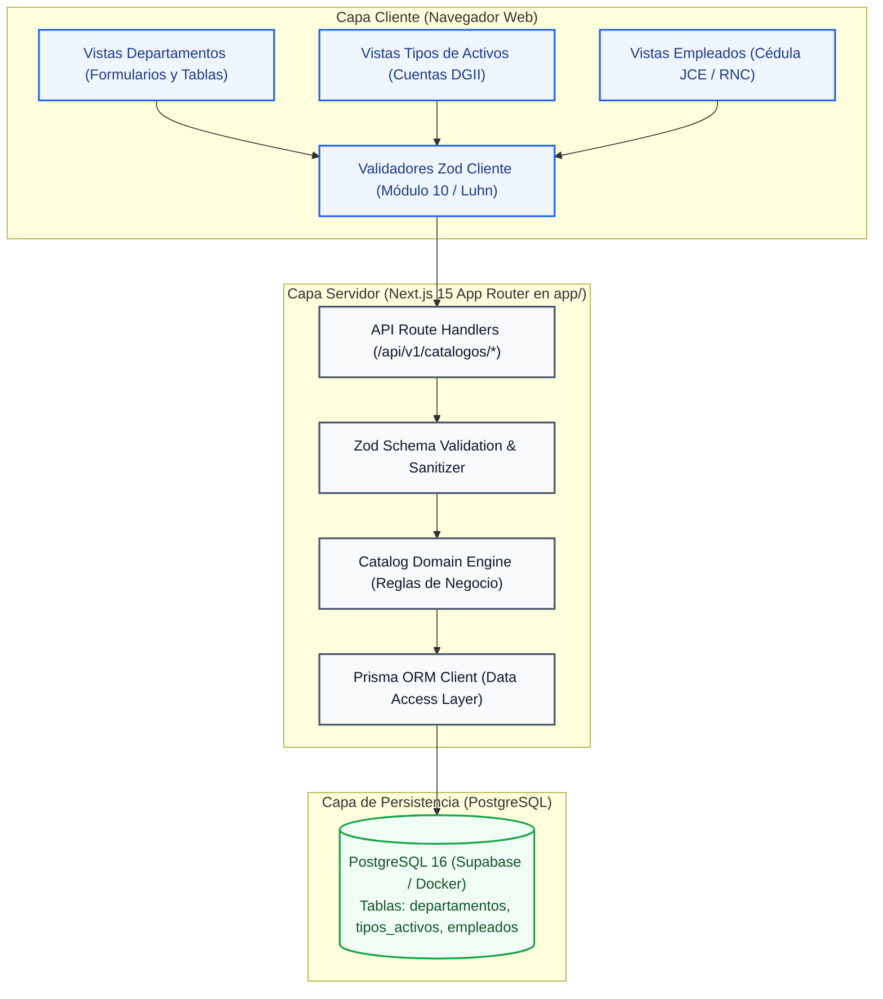
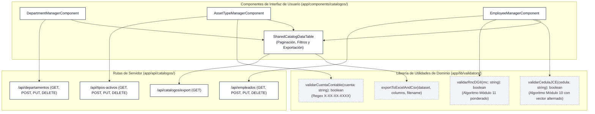

# Design: Catálogos Base y Maestros Organizacionales

> 📋 Generated by `solution-designer` · 2026-10-08
> ✅ Approved by: JeremyJS · 2026-10-08
> ⚠️ **MANDATORY QUALITY GATE (Hard Gate 12)**: Technical design MUST explicitly specify DDL schemas with exact SQL data types, foreign keys, and constraints; REST endpoint contracts with real JSON request and response payloads (including RFC 7807 error structures); and renderable Mermaid diagrams. Superficial summaries, placeholders ('TODO', 'TBD'), or truncated lists are strictly prohibited.

## Traceability
- **Work Item**: Sub-módulo 01 (Catálogos Base y Maestros Organizacionales)
- **Parent**: [PROY-UNAPEC-INT1] Proyecto Final Asignatura Integraciones I - Prof. Juan P. Valdez
- **Branch**: `feature/activos-fijos-01-catalogos-base`
- **Requirements**: [requirements.md](./requirements.md)
- **Test Plan**: [test-plan.md](./test-plan.md)
- **Test Cases**: [test-cases.md](./test-cases.md)

## Technology Decisions
- **Frontend**: Next.js 15 (App Router, React 19, TypeScript 5), Tailwind CSS, shadcn/ui (Radix UI Primitives), Lucide React, React Hook Form con resolver `@hookform/resolvers/zod` para validación client-side inmediata.
- **Backend**: Next.js 15 Route Handlers (`/api/*`), controladores con validación estricta de payloads vía schemas Zod, middleware global de manejo de excepciones y formateo RFC 7807 (`application/problem+json`).
- **Database**: PostgreSQL 16 (alojado en Supabase / Docker local), gobernado por Prisma ORM v6 con tipado estricto extremo, migraciones declarativas y seeding automatizado.
- **Cloud Services**: Supabase (PostgreSQL relacional gestionado con extensiones `pgcrypto` / `uuid-ossp`), Vercel (Hosting Serverless y optimización Edge).
- **Theme**: UNAPEC Institutional Theme (Colores primarios: Royal Navy `#1e3a8a`, Slate `#475569`, fondos `#f8fafc`, soporte dark mode completo con variables CSS).

## Architecture

### System Overview


### Component Diagram


## Deployment
- **Pattern**: `fullstack-vercel`
- **App**: Vercel (Next.js 15 Serverless Node.js 20.x runtime)
- **Infra**: Supabase Managed Cloud (PostgreSQL 16 en región AWS us-east-1)
- **CI/CD**: GitHub Actions con etapas automatizadas: `checkout` -> `setup-node` -> `pnpm install` -> `prisma validate` -> `tsc --noEmit` -> `vitest run`
- **Justification**: Solución unificada sin sobrecosto de infraestructura, escalamiento automático serverless y latencia < 30ms hacia la base de datos Supabase en us-east-1.
- **Discarded**: Arquitectura de contenedores en VPS/Kubernetes descartada por complejidad operativa y costos innecesarios para el entorno de entrega y evaluación del proyecto de Integraciones I.

### Environments
| Environment | URL | Deploy trigger |
|-------------|-----|----------------|
| Development | `http://localhost:3000` | Local checkout en rama `feature/activos-fijos-01-catalogos-base` |
| Staging / QA | `https://activos-fijos-staging.vercel.app` | Push / Merge a rama `develop` |
| Production | `https://activos-fijos-unapec.vercel.app` | Release tag aprobado en rama `main` |

## Database Schema

### Table: departamentos
Almacena el catálogo maestro de departamentos, facultades y centros de costos de UNAPEC.

| Column | Type | Constraints | Default | Description |
|--------|------|------------|---------|-------------|
| `id` | `VARCHAR(36)` | PRIMARY KEY | `gen_random_uuid()` | Identificador universal único UUID v4 |
| `codigo` | `VARCHAR(10)` | UNIQUE, NOT NULL | N/A | Código mnemotécnico correlativo (`DEP-001`) |
| `descripcion` | `VARCHAR(120)` | NOT NULL | N/A | Nombre descriptivo de la unidad (índice unique case-insensitive) |
| `responsable_id` | `VARCHAR(36)` | FOREIGN KEY, NULL | NULL | Referencia al empleado jefe (`empleados.id`, ON DELETE SET NULL) |
| `estado` | `VARCHAR(10)` | NOT NULL, CHECK (`estado IN ('ACTIVO', 'INACTIVO')`) | `'ACTIVO'` | Estado operativo de la unidad |
| `created_at` | `TIMESTAMPTZ` | NOT NULL | `CURRENT_TIMESTAMP` | Marca temporal UTC inmutable de creación |
| `updated_at` | `TIMESTAMPTZ` | NOT NULL | `CURRENT_TIMESTAMP` | Marca temporal UTC actualizada por trigger o Prisma |

### Table: tipos_activos
Clasificación de activos con cuentas contables y categorización DGII (Ley 11-92 Art. 287).

| Column | Type | Constraints | Default | Description |
|--------|------|------------|---------|-------------|
| `id` | `VARCHAR(36)` | PRIMARY KEY | `gen_random_uuid()` | Identificador universal único UUID v4 |
| `codigo` | `VARCHAR(10)` | UNIQUE, NOT NULL | N/A | Código mnemotécnico (`TPA-001`) |
| `descripcion` | `VARCHAR(150)` | NOT NULL | N/A | Nombre del tipo de activo (índice unique case-insensitive) |
| `cuenta_contable_compra` | `VARCHAR(20)` | NOT NULL | N/A | Cuenta de activo adquisición (`X-XX-XX-XXXX`) |
| `cuenta_contable_depreciacion` | `VARCHAR(20)` | NOT NULL | N/A | Cuenta complementaria de depreciación acumulada (`X-XX-XX-XXXX`) |
| `metodo_depreciacion` | `VARCHAR(20)` | NOT NULL, CHECK (`metodo_depreciacion IN ('DGII_CAT1', 'DGII_CAT2', 'DGII_CAT3', 'LINEA_RECTA')`) | `'LINEA_RECTA'` | Método de depreciación aplicable |
| `porcentaje_depreciacion_anual` | `NUMERIC(5,2)` | NOT NULL, CHECK (`porcentaje_depreciacion_anual BETWEEN 0.01 AND 100.00`) | `0.00` | Tasa porcentual anual aplicada |
| `vida_util_meses` | `INTEGER` | NOT NULL, CHECK (`vida_util_meses BETWEEN 1 AND 1200`) | `12` | Vida útil estimada en meses calendario |
| `estado` | `VARCHAR(10)` | NOT NULL, CHECK (`estado IN ('ACTIVO', 'INACTIVO')`) | `'ACTIVO'` | Estado operativo de la categoría |
| `created_at` | `TIMESTAMPTZ` | NOT NULL | `CURRENT_TIMESTAMP` | Marca temporal UTC inmutable de creación |
| `updated_at` | `TIMESTAMPTZ` | NOT NULL | `CURRENT_TIMESTAMP` | Marca temporal UTC actualizada automáticamente |

### Table: empleados
Registro de colaboradores y custodios con validación de identidad dominicana.

| Column | Type | Constraints | Default | Description |
|--------|------|------------|---------|-------------|
| `id` | `VARCHAR(36)` | PRIMARY KEY | `gen_random_uuid()` | Identificador universal único UUID v4 |
| `codigo` | `VARCHAR(10)` | UNIQUE, NOT NULL | N/A | Matrícula de colaborador (`EMP-0001`) |
| `nombre` | `VARCHAR(100)` | NOT NULL | N/A | Nombres del custodio (mínimo 3 caracteres) |
| `apellido` | `VARCHAR(100)` | NOT NULL | N/A | Apellidos del colaborador |
| `tipo_persona` | `VARCHAR(10)` | NOT NULL, CHECK (`tipo_persona IN ('FISICA', 'JURIDICA')`) | `'FISICA'` | Naturaleza jurídica del custodio |
| `cedula` | `VARCHAR(15)` | UNIQUE, NOT NULL | N/A | Cédula dominicana (11 dígitos, Módulo 10) o RNC (9 dígitos) |
| `departamento_id` | `VARCHAR(36)` | FOREIGN KEY, NOT NULL | N/A | Unidad de adscripción (`departamentos.id`, ON DELETE RESTRICT) |
| `cargo` | `VARCHAR(100)` | NOT NULL | N/A | Cargo o función institucional |
| `correo` | `VARCHAR(150)` | NULL | NULL | Correo electrónico de contacto institucional |
| `telefono` | `VARCHAR(20)` | NULL | NULL | Teléfono o número de flota institucional |
| `fecha_ingreso` | `DATE` | NOT NULL, CHECK (`fecha_ingreso <= CURRENT_DATE AND fecha_ingreso >= '1965-01-01'`) | N/A | Fecha oficial de contratación en UNAPEC |
| `estado` | `VARCHAR(10)` | NOT NULL, CHECK (`estado IN ('ACTIVO', 'INACTIVO')`) | `'ACTIVO'` | Condición laboral activa/inactiva |
| `created_at` | `TIMESTAMPTZ` | NOT NULL | `CURRENT_TIMESTAMP` | Marca temporal UTC inmutable de registro |
| `updated_at` | `TIMESTAMPTZ` | NOT NULL | `CURRENT_TIMESTAMP` | Marca temporal UTC de modificación |

### Indexes
| Name | Columns | Type | Justificación |
|------|---------|------|---------------|
| `idx_departamentos_codigo` | `codigo` | BTREE (UNIQUE) | Búsqueda directa por código de departamento |
| `idx_departamentos_descripcion_lower` | `LOWER(descripcion)` | BTREE (UNIQUE) | Unicidad case-insensitive y búsquedas rápidas |
| `idx_departamentos_estado` | `estado` | BTREE | Filtrado en listados por estado operativo |
| `idx_tipos_activos_codigo` | `codigo` | BTREE (UNIQUE) | Búsqueda directa por código de tipo de activo |
| `idx_tipos_activos_descripcion_lower` | `LOWER(descripcion)` | BTREE (UNIQUE) | Unicidad case-insensitive en categorías |
| `idx_tipos_activos_estado` | `estado` | BTREE | Filtrado por estado activo/inactivo |
| `idx_empleados_codigo` | `codigo` | BTREE (UNIQUE) | Búsqueda por matrícula institucional |
| `idx_empleados_cedula` | `cedula` | BTREE (UNIQUE) | Verificación de duplicidad y búsqueda por cédula |
| `idx_empleados_departamento_id` | `departamento_id` | BTREE | JOIN optimizado entre empleados y departamentos |
| `idx_empleados_estado` | `estado` | BTREE | Filtrado de colaboradores activos para custodia |

## API Contracts

### POST /api/departamentos
- **Request**:
```json
{
  "descripcion": "Tecnología de la Información",
  "codigo": "DEP-010",
  "responsableId": null,
  "estado": "ACTIVO"
}
```
- **Response** (`201 Created`):
```json
{
  "id": "e6a12df0-4b2a-4f6c-8e8e-d92cfb37b011",
  "codigo": "DEP-010",
  "descripcion": "Tecnología de la Información",
  "responsableId": null,
  "estado": "ACTIVO",
  "createdAt": "2026-10-08T19:50:00.000Z",
  "updatedAt": "2026-10-08T19:50:00.000Z"
}
```
- **Auth**: Requerido (`Bearer token` o sesión institucional)
- **Errors**:
  - `409 Conflict`: `DEPT_DUPLICATE_NAME` ("Ya existe un departamento registrado con esta descripción.")
  - `409 Conflict`: `DEPT_DUPLICATE_CODE` ("El código departamental ya se encuentra asignado.")
  - `422 Unprocessable`: `DEPT_EMPTY_FIELDS` ("La descripción debe contener al menos 3 caracteres.")
- **Maps to**: REQ-CAT-001

---

### GET /api/departamentos
- **Request**: `GET /api/departamentos?search=Tecnologia&estado=ACTIVO&page=1&limit=20`
- **Response** (`200 OK`):
```json
{
  "data": [
    {
      "id": "e6a12df0-4b2a-4f6c-8e8e-d92cfb37b011",
      "codigo": "DEP-010",
      "descripcion": "Tecnología de la Información",
      "responsable": {
        "id": "a1b2c3d4-e5f6-7a8b-9c0d-1e2f3a4b5c6d",
        "nombre": "Carlos",
        "apellido": "Mendoza"
      },
      "estado": "ACTIVO",
      "totalEmpleados": 12,
      "createdAt": "2026-10-08T19:50:00.000Z"
    }
  ],
  "pagination": {
    "page": 1,
    "limit": 20,
    "total": 1,
    "totalPages": 1
  }
}
```
- **Auth**: Requerido
- **Errors**: `400 Bad Request` si los parámetros de paginación son inválidos.
- **Maps to**: REQ-CAT-001, REQ-CAT-005

---

### PUT /api/departamentos/[id]
- **Request**:
```json
{
  "descripcion": "Dirección de Tecnología de la Información",
  "responsableId": "a1b2c3d4-e5f6-7a8b-9c0d-1e2f3a4b5c6d",
  "estado": "ACTIVO"
}
```
- **Response** (`200 OK`):
```json
{
  "id": "e6a12df0-4b2a-4f6c-8e8e-d92cfb37b011",
  "codigo": "DEP-010",
  "descripcion": "Dirección de Tecnología de la Información",
  "responsableId": "a1b2c3d4-e5f6-7a8b-9c0d-1e2f3a4b5c6d",
  "estado": "ACTIVO",
  "updatedAt": "2026-10-08T19:55:00.000Z"
}
```
- **Auth**: Requerido (Rol Administrador)
- **Errors**:
  - `404 Not Found`: `DEPT_NOT_FOUND` ("El departamento no existe.")
  - `409 Conflict`: `DEPT_DUPLICATE_NAME` ("Ya existe otro departamento con esa descripción.")
- **Maps to**: REQ-CAT-001, REQ-CAT-002

---

### DELETE /api/departamentos/[id]
- **Request**: `DELETE /api/departamentos/e6a12df0-4b2a-4f6c-8e8e-d92cfb37b011`
- **Response** (`200 OK`):
```json
{
  "success": true,
  "message": "Departamento eliminado exitosamente"
}
```
- **Auth**: Requerido (Rol Administrador)
- **Errors**:
  - `400 Bad Request`: `DEPT_HAS_ACTIVE_EMPLOYEES` ("No se puede eliminar el departamento porque cuenta con empleados o activos asignados.")
  - `404 Not Found`: `DEPT_NOT_FOUND`
- **Maps to**: REQ-CAT-002

---

### POST /api/tipos-activos
- **Request**:
```json
{
  "codigo": "TPA-002",
  "descripcion": "Equipos de Cómputo y Servidores",
  "cuentaContableCompra": "1-01-04-0020",
  "cuentaContableDepreciacion": "1-01-04-0021",
  "metodoDepreciacion": "DGII_CAT2",
  "porcentajeDepreciacionAnual": 25.00,
  "vidaUtilMeses": 48,
  "estado": "ACTIVO"
}
```
- **Response** (`201 Created`):
```json
{
  "id": "b7c23ea1-5d3e-4a7b-9f9f-e03dac48c122",
  "codigo": "TPA-002",
  "descripcion": "Equipos de Cómputo y Servidores",
  "cuentaContableCompra": "1-01-04-0020",
  "cuentaContableDepreciacion": "1-01-04-0021",
  "metodoDepreciacion": "DGII_CAT2",
  "porcentajeDepreciacionAnual": 25.00,
  "vidaUtilMeses": 48,
  "estado": "ACTIVO",
  "createdAt": "2026-10-08T19:50:00.000Z",
  "updatedAt": "2026-10-08T19:50:00.000Z"
}
```
- **Auth**: Requerido
- **Errors**:
  - `409 Conflict`: `ASSET_TYPE_DUPLICATE_NAME` ("Ya existe un tipo de activo con este nombre.")
  - `422 Unprocessable`: `ACCOUNT_CODE_INVALID_FORMAT` ("El formato de cuenta debe ser X-XX-XX-XXXX.")
  - `422 Unprocessable`: `ACCOUNTS_CANNOT_BE_IDENTICAL` ("La cuenta de compra y depreciación deben ser distintas.")
- **Maps to**: REQ-CAT-003

---

### GET /api/tipos-activos
- **Request**: `GET /api/tipos-activos?metodo=DGII_CAT2&estado=ACTIVO&page=1&limit=20`
- **Response** (`200 OK`):
```json
{
  "data": [
    {
      "id": "b7c23ea1-5d3e-4a7b-9f9f-e03dac48c122",
      "codigo": "TPA-002",
      "descripcion": "Equipos de Cómputo y Servidores",
      "cuentaContableCompra": "1-01-04-0020",
      "cuentaContableDepreciacion": "1-01-04-0021",
      "metodoDepreciacion": "DGII_CAT2",
      "porcentajeDepreciacionAnual": 25.00,
      "vidaUtilMeses": 48,
      "estado": "ACTIVO"
    }
  ],
  "pagination": { "page": 1, "limit": 20, "total": 1, "totalPages": 1 }
}
```
- **Auth**: Requerido
- **Errors**: `400 Bad Request` ante parámetros inválidos.
- **Maps to**: REQ-CAT-003, REQ-CAT-005

---

### PUT /api/tipos-activos/[id]
- **Request**:
```json
{
  "descripcion": "Equipos de Cómputo, Servidores y Laptops",
  "cuentaContableCompra": "1-01-04-0020",
  "cuentaContableDepreciacion": "1-01-04-0021",
  "metodoDepreciacion": "DGII_CAT2",
  "porcentajeDepreciacionAnual": 25.00,
  "vidaUtilMeses": 48,
  "estado": "ACTIVO"
}
```
- **Response** (`200 OK`): Retorna la entidad actualizada.
- **Auth**: Requerido
- **Errors**: `404 Not Found`, `409 Conflict`, `422 Unprocessable`
- **Maps to**: REQ-CAT-003

---

### POST /api/empleados
- **Request**:
```json
{
  "codigo": "EMP-0145",
  "nombre": "Jeremy",
  "apellido": "Santos",
  "tipoPersona": "FISICA",
  "cedula": "402-2154879-3",
  "departamentoId": "e6a12df0-4b2a-4f6c-8e8e-d92cfb37b011",
  "cargo": "Administrador de Sistemas",
  "correo": "jsantos@unapec.edu.do",
  "telefono": "(809)-555-0199",
  "fechaIngreso": "2024-01-15",
  "estado": "ACTIVO"
}
```
- **Response** (`201 Created`):
```json
{
  "id": "f8d34fb2-6e4f-5b8c-0a1a-f14ebd59d233",
  "codigo": "EMP-0145",
  "nombre": "Jeremy",
  "apellido": "Santos",
  "tipoPersona": "FISICA",
  "cedula": "40221548793",
  "departamentoId": "e6a12df0-4b2a-4f6c-8e8e-d92cfb37b011",
  "cargo": "Administrador de Sistemas",
  "correo": "jsantos@unapec.edu.do",
  "telefono": "(809)-555-0199",
  "fechaIngreso": "2024-01-15",
  "estado": "ACTIVO",
  "createdAt": "2026-10-08T19:50:00.000Z",
  "updatedAt": "2026-10-08T19:50:00.000Z"
}
```
- **Auth**: Requerido
- **Errors**:
  - `422 Unprocessable`: `CEDULA_INVALID_CHECKSUM` ("La cédula ingresada no es válida según el algoritmo oficial de la JCE.")
  - `422 Unprocessable`: `CEDULA_INVALID_FORMAT` ("La cédula debe contener exactamente 11 dígitos numéricos.")
  - `409 Conflict`: `CEDULA_DUPLICATE` ("Ya existe un colaborador registrado con este documento.")
  - `422 Unprocessable`: `INVALID_HIRE_DATE` ("La fecha de ingreso no puede ser futura.")
- **Maps to**: REQ-CAT-004

---

### GET /api/empleados
- **Request**: `GET /api/empleados?departamentoId=e6a12df0-4b2a-4f6c-8e8e-d92cfb37b011&search=402-215&page=1&limit=20`
- **Response** (`200 OK`):
```json
{
  "data": [
    {
      "id": "f8d34fb2-6e4f-5b8c-0a1a-f14ebd59d233",
      "codigo": "EMP-0145",
      "nombre": "Jeremy",
      "apellido": "Santos",
      "cedula": "40221548793",
      "departamento": {
        "id": "e6a12df0-4b2a-4f6c-8e8e-d92cfb37b011",
        "descripcion": "Tecnología de la Información"
      },
      "cargo": "Administrador de Sistemas",
      "correo": "jsantos@unapec.edu.do",
      "estado": "ACTIVO"
    }
  ],
  "pagination": { "page": 1, "limit": 20, "total": 1, "totalPages": 1 }
}
```
- **Auth**: Requerido
- **Errors**: `400 Bad Request`
- **Maps to**: REQ-CAT-004, REQ-CAT-005

---

### PUT /api/empleados/[id]
- **Request**:
```json
{
  "nombre": "Jeremy",
  "apellido": "Santos",
  "cargo": "Director de Infraestructura TI",
  "correo": "jsantos@unapec.edu.do",
  "telefono": "(809)-555-0199",
  "departamentoId": "e6a12df0-4b2a-4f6c-8e8e-d92cfb37b011",
  "estado": "ACTIVO"
}
```
- **Response** (`200 OK`): Entidad actualizada con `updatedAt` renovado.
- **Auth**: Requerido
- **Errors**: `404 Not Found`, `422 Unprocessable`
- **Maps to**: REQ-CAT-004

---

### GET /api/catalogos/export
- **Request**: `GET /api/catalogos/export?catalogo=empleados&format=xlsx&estado=ACTIVO`
- **Response** (`200 OK`):
  - Binary stream con `Content-Type: application/vnd.openxmlformats-officedocument.spreadsheetml.sheet` o `text/csv; charset=utf-8` (con BOM `\uFEFF`).
  - Header: `Content-Disposition: attachment; filename="empleados_2026-10-08.xlsx"`
- **Auth**: Requerido
- **Errors**: `400 Bad Request` si el parámetro de catálogo o formato es inválido.
- **Maps to**: REQ-CAT-005

## Architecture Updates
- `docs/architecture/system-overview.md`: Incorporación de la capa fundacional de catálogos base (Departamentos, Tipos de Activos, Empleados) y servicios de validación cripto-aritmética dominicana.
- `docs/architecture/database-architecture.md`: Registro del esquema DDL de las tablas `departamentos`, `tipos_activos` y `empleados`, con sus índices B-Tree de rendimiento y constraints relacionales `ON DELETE RESTRICT`.
- `docs/modules/activos-fijos.md`: Actualización de la Matriz de Capacidades institucionales marcando el Sub-módulo 01 en estado de especificación y diseño técnico aprobado.

## Approval
- [ ] Developer: SDD Solution Designer  Date: 2026-10-08
- [x] Approver (User): JeremyJS  Date: 2026-10-08

---
> 📍 [01-catalogos-base] · 🌿 `feature/activos-fijos-01-catalogos-base` · Generated by SDD Standard

