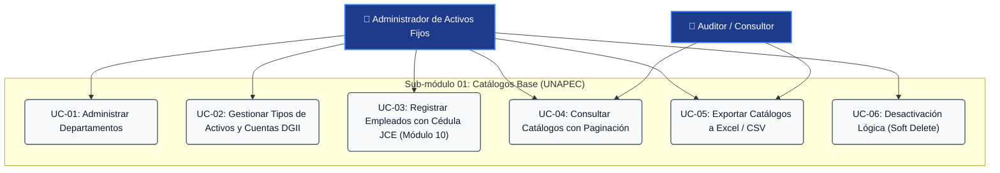
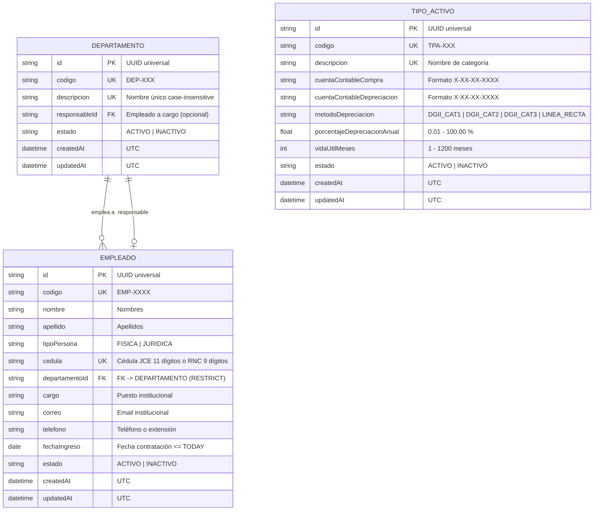

# Requirements: Catálogos Base y Maestros Organizacionales

> 📋 Generated by `sdd-router / requirements-analyst` · 2026-10-08
> ✅ Approved by: JeremyJS · 2026-10-08
> ⚠️ **MANDATORY QUALITY GATE (Hard Gate 12)**: Every user story MUST be authored in formal EARS syntax with complete Given/When/Then acceptance criteria. Summarizing requirements with 'etc.', omitting calculation formulas, or generalizing validations is strictly prohibited. All numeric thresholds, formats, and error conditions must be explicitly detailed.

## Traceability
- **Work Item**: Sub-módulo 01 (Catálogos Base y Maestros Organizacionales)
- **Parent**: [PROY-UNAPEC-INT1] Proyecto Final Asignatura Integraciones I - Prof. Juan P. Valdez
- **Branch**: `feature/activos-fijos-01-catalogos-base`
- **Design**: [design.md](./design.md)
- **Test Plan**: [test-plan.md](./test-plan.md)
- **Test Cases**: [test-cases.md](./test-cases.md)

## Overview
El sub-módulo de **Catálogos Base y Maestros Organizacionales** constituye el núcleo de datos fundacional del Sistema de Gestión de Activos Fijos para la Universidad APEC (UNAPEC). Este componente administra la estructura organizativa institucional: Departamentos (centros de costos y unidades académicas/administrativas), Clasificación de Tipos de Activos (con cuentas contables de compra y depreciación conforme a la Ley 11-92 Art. 287 de la DGII), y el Padrón de Empleados custodios con verificación algorítmica obligatoria de documentos de identidad dominicana (Cédula JCE mediante Módulo 10 y RNC para personas jurídicas). Garantiza la integridad referencial, políticas de baja lógica y provee capacidades de búsqueda y exportación.

## User Stories (EARS Notation)

### REQ-CAT-001: Gestión y Validación del Catálogo de Departamentos
**Type:** Ubiquitous  
**Rule:** The system SHALL maintain a centralized catalog of university departments, enforcing automatic code assignment (`DEP-XXX`), case-insensitive description uniqueness, and operational status control (`ACTIVO` / `INACTIVO`).  
**Entities:** `Departamento` (`id`, `codigo`, `descripcion`, `responsableId`, `estado`, `createdAt`, `updatedAt`)  
**Error Handling:** Si el usuario intenta registrar una descripción vacía o menor a 3 caracteres, el sistema SHALL retornar `DEPT_EMPTY_FIELDS` (HTTP 422). Si ya existe un departamento con la misma descripción (sin distinguir mayúsculas/minúsculas), el sistema SHALL rechazar el guardado con `DEPT_DUPLICATE_NAME` (HTTP 409: "Ya existe un departamento registrado con esta descripción."). Si el código manual ingresado ya existe, SHALL retornar `DEPT_DUPLICATE_CODE` (HTTP 409).  

**Acceptance Criteria:**  
- [ ] Given que un administrador accede a la vista de Departamentos, when ingresa la descripción "Tecnología de la Información", then el sistema autogenera el código correlativo `DEP-001` (o el siguiente disponible), asigna estado "ACTIVO" y persiste el registro en base de datos.  
- [ ] Given que existe un departamento con descripción "Finanzas", when se intenta crear otro con descripción "finanzas" o "FINANZAS", then el sistema bloquea el guardado e indica: *"Ya existe un departamento registrado con esta descripción."*  
- [ ] Given un departamento existente, when el usuario modifica su descripción o asigna un empleado activo como responsable de área, then el sistema guarda los cambios y actualiza la marca de tiempo `updatedAt` en UTC.  
- [ ] Given un departamento activo, when el usuario alterna su estado a "INACTIVO", then el sistema deshabilita la unidad para nuevas asignaciones conservando su historial.  

**Priority:** Must  
**Dependencies:** None  
**Tracker:** REQ-CAT-001  

---

### REQ-CAT-002: Ciclo de Vida y Restricciones de Baja Departamental
**Type:** State-Driven  
**Rule:** WHILE a department has active employees or linked fixed assets, the system SHALL prohibit hard deletion and restrict operational inactivation unless confirmed by the administrator.  
**Entities:** `Departamento`, `Empleado`  
**Error Handling:** Si se solicita la eliminación física de un departamento que cuenta con empleados o activos asociados en base de datos, el sistema SHALL bloquear la operación retornando `DEPT_HAS_ACTIVE_EMPLOYEES` (HTTP 400: "No se puede eliminar el departamento porque cuenta con empleados o activos asignados.").  

**Acceptance Criteria:**  
- [ ] Given un departamento con empleados asignados, when el usuario hace clic en "Eliminar", then el sistema bloquea la acción e informa que no es posible la eliminación física debido a dependencias asociadas.  
- [ ] Given un departamento con empleados asignados, when el usuario solicita desactivarlo (`estado = INACTIVO`), then el sistema muestra un diálogo de advertencia indicando que los colaboradores adscritos no podrán recibir nuevos activos en custodia.  
- [ ] Given un departamento recién registrado que no posee ningún empleado ni activo asociado, when el usuario confirma su eliminación, then el sistema realiza la eliminación física (`DELETE`) en base de datos.  

**Priority:** Must  
**Dependencies:** REQ-CAT-001  
**Tracker:** REQ-CAT-002  

---

### REQ-CAT-003: Catálogo de Tipos de Activos y Cuentas Contables DGII
**Type:** Ubiquitous  
**Rule:** The system SHALL maintain asset classification types, linking each type to valid purchase and accumulated depreciation ledger accounts (`X-XX-XX-XXXX`), and applying statutory DGII depreciation parameters (Cat 1: 5% anual / 240 meses; Cat 2: 25% anual / 48 meses; Cat 3: 15% anual / 80 meses) or custom Straight-Line parameters.  
**Entities:** `TipoActivo` (`id`, `codigo`, `descripcion`, `cuentaContableCompra`, `cuentaContableDepreciacion`, `metodoDepreciacion`, `porcentajeDepreciacionAnual`, `vidaUtilMeses`, `estado`, `createdAt`, `updatedAt`)  
**Error Handling:** Si las cuentas contables no satisfacen la máscara `^[1-9]-[0-9]{2}-[0-9]{2}-[0-9]{4}$`, el sistema SHALL responder con `ACCOUNT_CODE_INVALID_FORMAT` (HTTP 422). Si la cuenta de compra y de depreciación son idénticas, SHALL responder con `ACCOUNTS_CANNOT_BE_IDENTICAL` (HTTP 422). Si se intenta suprimir físicamente un tipo de activo que posee bienes inventariados, SHALL responder con `ASSET_TYPE_IN_USE` (HTTP 400).  

**Acceptance Criteria:**  
- [ ] Given que el usuario crea un Tipo de Activo "Equipos de Cómputo" y selecciona "Categoría 2 DGII", then el sistema auto-asigna la tasa de depreciación anual en 25.00% y la vida útil en 48 meses.  
- [ ] Given que el usuario crea "Edificaciones Universitarias" y selecciona "Categoría 1 DGII", then el sistema auto-asigna la tasa en 5.00% y la vida útil en 240 meses.  
- [ ] Given que el usuario selecciona "Línea Recta Personalizada", when ingresa vida útil de 120 meses y tasa del 10.00% anual, then el sistema valida que sea consistente con la fórmula `(12 / vidaUtilMeses) * 100` y almacena la regla.  
- [ ] Given el formulario de Tipo de Activo, when el usuario introduce Cuenta Compra "1-01-04-0010" y Cuenta Depreciación "1-01-04-0011", then el sistema valida sintácticamente el formato contable.  
- [ ] Given un tipo de activo con activos asociados en el inventario, when se solicita su baja, then el sistema restringe la operación a cambio de estado `INACTIVO`, bloqueando el borrado físico.  

**Priority:** Must  
**Dependencies:** None  
**Tracker:** REQ-CAT-003  

---

### REQ-CAT-004: Registro de Empleados y Validación de Identidad Dominicana
**Type:** Ubiquitous  
**Rule:** The system SHALL manage institutional custodians, validating that physical persons possess an 11-digit Dominican national identity document (Cédula) verified via the Luhn / Modulo 10 checksum algorithm (using weight vector `P = [1, 2, 1, 2, 1, 2, 1, 2, 1, 2]`), or a 9-digit RNC verified via Modulo 11 for corporate entities.  
**Entities:** `Empleado` (`id`, `codigo`, `nombre`, `apellido`, `tipoPersona`, `cedula`, `departamentoId`, `cargo`, `correo`, `telefono`, `fechaIngreso`, `estado`, `createdAt`, `updatedAt`), `Departamento`  
**Error Handling:** Si la cédula no cuenta con 11 dígitos numéricos, el sistema SHALL rechazar con `CEDULA_INVALID_FORMAT` (HTTP 422). Si el dígito 11 no coincide con el dígito verificador calculado por Módulo 10, SHALL responder con `CEDULA_INVALID_CHECKSUM` (HTTP 422: "La cédula ingresada no es válida según el algoritmo oficial de la JCE."). Si la cédula ya existe registrada, SHALL retornar `CEDULA_DUPLICATE` (HTTP 409). Si la fecha de contratación es posterior a la fecha actual, SHALL retornar `INVALID_HIRE_DATE` (HTTP 422).  

**Acceptance Criteria:**  
- [ ] Given un usuario registrando un custodio de tipo "Física", when ingresa una cédula dominicana matemáticamente válida (ej. `402-2154879-3`), then el sistema normaliza la cadena eliminando guiones, comprueba el algoritmo Módulo 10 y guarda el registro asociado al departamento seleccionado.  
- [ ] Given un usuario registrando un empleado, when introduce una cédula con dígito verificador corrompido, then el sistema bloquea el registro en el cliente y servidor mostrando: *"La cédula ingresada no es válida según el algoritmo oficial de la JCE."*  
- [ ] Given un custodio de tipo "Jurídica" (contratista/proveedor), when se ingresa un RNC de 9 dígitos verificado por Módulo 11 con ponderación `[7,9,8,6,5,4,3,2]`, then el sistema acepta el documento de identidad.  
- [ ] Given un empleado registrado que posee activos bajo su custodia, when se solicita su inactivación laboral, then el sistema permite cambiar su estado a `INACTIVO` e impide que se le asignen nuevos bienes hasta que se descarguen o transfieran los existentes.  

**Priority:** Must  
**Dependencies:** REQ-CAT-001  
**Tracker:** REQ-CAT-004  

---

### REQ-CAT-005: Búsqueda Multicriterio, Paginación y Exportación Tabular
**Type:** Ubiquitous  
**Rule:** The system SHALL provide indexed server-side pagination (default 20 records/page), real-time substring filtering by code, name, description, or ID, and structured export to Excel (`.xlsx`) and CSV with UTF-8 BOM preamble.  
**Entities:** `Departamento`, `TipoActivo`, `Empleado`  
**Error Handling:** Si el término de búsqueda no arroja resultados, el sistema SHALL mostrar una vista vacía sin errores. Si no hay registros que exportar bajo los filtros activos, SHALL alertar al usuario sin emitir archivos corruptos.  

**Acceptance Criteria:**  
- [ ] Given la tabla de Empleados o Departamentos, when el usuario ingresa un fragmento de búsqueda (ej. "Tecnología" o "402-"), then la lista filtra reactivamente los resultados en menos de 150ms.  
- [ ] Given una vista de catálogo con filtros de estado aplicados (ej. "Solo Inactivos"), when el usuario presiona "Exportar a Excel (.xlsx)", then el sistema descarga un archivo Excel con las filas visibles formateadas y cabeceras legibles.  
- [ ] Given la descarga en formato CSV, when el usuario abre el archivo en Microsoft Excel para Windows, then el sistema incluye el preámbulo UTF-8 BOM (`\uFEFF`) garantizando que los acentos y la letra ñ se visualicen sin corrupción (zero mojibake).  

**Priority:** Should  
**Dependencies:** REQ-CAT-001, REQ-CAT-003, REQ-CAT-004  
**Tracker:** REQ-CAT-005  

---

## Non-Functional Requirements

### NFR-001: Integridad Referencial Estricta (ON DELETE RESTRICT)
**Category:** Reliability  
**Rule:** The system SHALL enforce foreign key constraints with `ON DELETE RESTRICT` at the PostgreSQL engine level for all relationships between Departments, Employees, and Asset Types.  
**Metric:** 0 registros huérfanos permitidos en base de datos; 100% de operaciones de eliminación física bloqueadas por el motor ante dependencias activas.  
**Priority:** Must  

### NFR-002: Verificación Cripto-Aritmética Dual de Identidad
**Category:** Security  
**Rule:** The system SHALL validate Dominican identity numbers (Cédula JCE Módulo 10 y RNC Módulo 11) synchronously in form inputs (Zod/React Hook Form) and strictly on API Route endpoints prior to database execution.  
**Metric:** 100% de rechazo de documentos con sumas de verificación erróneas; latencia de validación en cliente < 5ms.  
**Priority:** Must  

### NFR-003: Rendimiento y Latencia de Consultas P95
**Category:** Performance  
**Rule:** The system SHALL respond to paginated catalog listing and search queries with sub-second response times supported by B-Tree indexes on `codigo`, `descripcion`, `cedula` y `estado`.  
**Metric:** Tiempo de respuesta P95 < 150ms en consultas de hasta 10,000 registros.  
**Priority:** Must  

### NFR-004: Inmutabilidad de Auditoría y Marcas Temporales UTC
**Category:** Reliability  
**Rule:** The system SHALL automatically maintain immutable `createdAt` and auto-updated `updatedAt` timestamps in UTC ISO-8601 for all catalog entities.  
**Metric:** 100% de entidades con marcas temporales persistidas en UTC y formateadas a horario local dominicano (AST, UTC-4) en la interfaz de usuario.  
**Priority:** Must  

### NFR-005: Accesibilidad y Diseño Responsivo
**Category:** Accessibility  
**Rule:** The system SHALL comply with WCAG 2.1 Level AA across all form dialogs, data tables, and input controls.  
**Metric:** Contraste mínimo de 4.5:1, navegación por teclado integral (Tab, Enter, Escape) y atributos `aria-invalid` en validaciones.  
**Priority:** Should  

### NFR-006: Codificación UTF-8 Limpia en Exportaciones
**Category:** Compatibility  
**Rule:** The system SHALL stream tabular export files (.xlsx, .csv) with strict UTF-8 encoding and UTF-8 BOM preamble.  
**Metric:** 0 caracteres corrompidos (mojibake) en nombres de colaboradores o descripciones con tildes y eñes al abrir en Excel en Windows.  
**Priority:** Must  

---

## Diagrams

### Use Case Diagram

### Supporting Diagram: Master Catalogs ERD

---

## Dependencies
| Feature | Capability needed | Status | Workaround |
|---------|------------------|--------|------------|
| REQ-CAT-004 (Empleados) | REQ-CAT-001 (Departamentos) | Same sub-module | Crear departamento inicial por defecto |
| 02-gestion-activos-custodia | REQ-CAT-001, REQ-CAT-003, REQ-CAT-004 | Sub-módulo 01 | Completar primero este sub-módulo antes del inventario |
| 03-motor-depreciacion | REQ-CAT-003 (Cuentas y métodos de depreciación) | Sub-módulo 01 | Utilizar cuentas y parámetros configurados en Tipos de Activos |
| 05-integracion-ws-contabilidad | REQ-CAT-003 (Mapeo de cuentas contables) | Sub-módulo 01 | Cuentas deben ser válidas en el catálogo contable de UNAPEC |

---

## Assumptions
| # | Assumption | Temporary stub | Replaced when |
|---|-----------|----------------|---------------|
| 1 | Las cuentas contables son validadas sintácticamente por formato regex `X-XX-XX-XXXX` hasta que el Web Service de Contabilidad exponga un catálogo en línea. | Validación sintáctica regex | Se conecte el catálogo en línea del WS Contabilidad en Sub-módulo 05 |
| 2 | La base de datos es PostgreSQL accesible mediante Prisma ORM (local Docker o Supabase). | Migraciones locales Prisma | Despliegue en ambiente cloud |
| 3 | El rol de usuario 'Administrador' posee permisos globales para todas las operaciones CRUD y configuración de porcentajes DGII. | Control de roles en middleware | Integración con sistema de autenticación institucional |

---

## Out of Scope
- Registro, etiquetado con código de barras/QR o asignación física de bienes patrimoniales (corresponde a `02-gestion-activos-custodia`).
- Cálculo mensual acumulado de cuotas de depreciación y generación de asientos periódicos (corresponde a `03-motor-depreciacion`).
- Consultas analíticas consolidadas de activos y valor en libros (corresponde a `04-consultas-reportes`).
- Despacho y sincronización de comprobantes de diario al Web Service de Contabilidad (corresponde a `05-integracion-ws-contabilidad`).

---

## Approval
- [ ] Analyst: SDD Requirements Analyst  Date: 2026-10-08
- [x] Approver (User): JeremyJS  Date: 2026-10-08

---
> 📍 [01-catalogos-base] · 🌿 `feature/activos-fijos-01-catalogos-base` · Generated by SDD Standard

