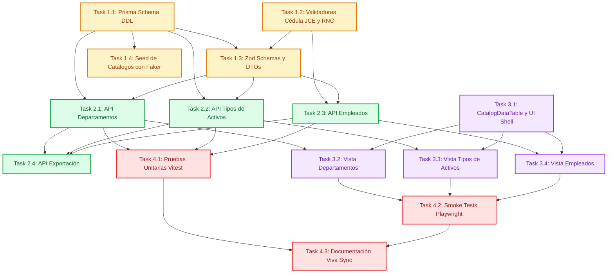

# Tasks: Catálogos Base y Maestros Organizacionales

> 📋 Generated by `task-planner` · 2026-10-08
> ✅ Approved by: JeremyJS · 2026-10-08

## Traceability
- **Work Item**: Sub-módulo 01 (Catálogos Base y Maestros Organizacionales)
- **Branch**: `feature/activos-fijos-01-catalogos-base`

## Metadata
- **Based on:** [design.md](./design.md)
- **Total estimate:** ~22h (incluye 20% de margen para imprevistos)
- **Number of waves:** 4 (Wave 1 a Wave 4 — Wave 0 omitida por infraestructura previa en Sub-módulo 00)
- **Number of tasks:** 15 tareas atómicas
- **Sprint:** Sprint 1 (Activos Fijos UNAPEC - Integraciones I)
- **Assignee:** JeremyJS

## Estimation Rules
- Máximo **4 horas** por tarea (las tareas más complejas se descomponen en subtareas atómicas).
- Las estimaciones cubren implementación, pruebas unitarias integradas y revisión de código.
- Se incorpora un **buffer del 20%** para contingencias técnicas o ajustes de dependencias.
- Las tareas operan sobre la infraestructura base de `app/` (Next.js 15, Prisma ORM, Tailwind, shadcn/ui) provista por la Wave 0 del Sub-módulo 00.

## Dependency Graph

---

## Wave 1: Foundation & Setup (~6h)

### Task 1.1: Esquema de Base de Datos Prisma (`schema.prisma`) (~1.5h) [COMPLETED]
- **Description:** Extender el modelo Prisma existente para incorporar las entidades `Departamento`, `TipoActivo` y `Empleado`, estableciendo claves primarias UUID, códigos correlativos únicos, índices B-Tree para búsquedas frecuentes, y relaciones foráneas restrictivas (`onDelete: Restrict`).
- **Acceptance criteria:**
  -[x] Modelo `Departamento` implementado con campos `id`, `codigo`, `descripcion`, `responsableId`, `estado`, timestamps.
  -[x] Modelo `TipoActivo` implementado con `cuentaContableCompra`, `cuentaContableDepreciacion`, `metodoDepreciacion`, `porcentajeDepreciacionAnual`, `vidaUtilMeses`.
  -[x] Modelo `Empleado` implementado con `codigo`, `nombre`, `apellido`, `tipoPersona`, `cedula`, `departamentoId`, `cargo`, `fechaIngreso`.
  -[x] Migración generada y aplicada con éxito (`prisma migrate dev --name add_catalogos_base`).
- **Dependencies:** Sub-módulo 00 (Base de datos e inicialización de Prisma)
- **Files to create/modify:** `app/prisma/schema.prisma`, `app/prisma/migrations/*`

### Task 1.2: Motor de Validación de Identidad (Cédula JCE y RNC) (~1.5h) [COMPLETED]
- **Description:** Implementar la librería de utilidades `app/lib/validators/identity.ts` con los algoritmos matemáticos Módulo 10 (Luhn con vector alternado `[1,2,1,2,1,2,1,2,1,2]`), Módulo 11 para RNC institucional con pesos `[7,9,8,6,5,4,3,2]` y validador de cuentas contables `^[1-9]-[0-9]{2}-[0-9]{2}-[0-9]{4}$`.
- **Acceptance criteria:**
  - [x] Función `validarCedulaJCE(cedula: string): boolean` comprueba longitud de 11 dígitos, normaliza guiones y valida el dígito verificador exacto.
  - [x] Función `validarRncDGII(rnc: string): boolean` comprueba 9 dígitos y verifica el residuo Módulo 11 con excepciones para 0 y 1.
  - [x] Función `validarCuentaContable(cuenta: string): boolean` valida la máscara `X-XX-XX-XXXX`.
  - [x] Pruebas unitarias integradas comprobando casos válidos, inválidos y caracteres alfanuméricos espurios.
- **Dependencies:** None
- **Files to create/modify:** `app/lib/validators/identity.ts`, `app/lib/validators/accounting.ts`

### Task 1.3: Schemas de Validación Zod y Tipos DTO Compartidos (~1.5h) [COMPLETED]
- **Description:** Crear schemas de validación Zod reutilizables en cliente y servidor para creación y actualización de Departamentos, Tipos de Activos y Empleados, integrando los refinamientos de validación de cédula y formato contable.
- **Acceptance criteria:**
  - [x] `DepartmentSchema` valida descripción requerida (min 3 caracteres) y código opcional.
  - [x] `AssetTypeSchema` valida cuentas contables, coherencia de porcentajes y método DGII.
  - [x] `EmployeeSchema` incluye refinamiento `.refine(validarCedulaJCE)` para personas físicas y validación de fecha de contratación no futura.
  - [x] Tipos TypeScript inferidos (`CreateDepartmentDTO`, `CreateEmployeeDTO`, etc.) exportados para uso universal.
- **Dependencies:** Task 1.2
- **Files to create/modify:** `app/lib/schemas/department.schema.ts`, `app/lib/schemas/asset-type.schema.ts`, `app/lib/schemas/employee.schema.ts`

### Task 1.4: Script de Semillas con Faker para Catálogos y Empleados (`seed.ts`) (~1.5h) [COMPLETED]
- **Description:** Extender el script de seeding automatizado (`app/prisma/seed.ts`) utilizando `@faker-js/faker` con semilla determinista (`42`). Generar 10 departamentos universitarios, 4 tipos de activos base (DGII Cat 1, 2, 3 y Línea Recta) y al menos 25 empleados custodios con cédulas matemáticamente válidas.
- **Acceptance criteria:**
  - [x] Script genera Departamentos con códigos correlativos `DEP-001` a `DEP-010`.
  - [x] Script registra Tipos de Activos oficiales con cuentas contables válidas (`1-01-04-XXXX`).
  - [x] Script genera 25 empleados con cédulas dominicanas válidas bajo algoritmo Módulo 10 exacto.
  - [x] Comando `pnpm prisma db seed` ejecuta la inserción de catálogos sin conflictos foráneos.
- **Dependencies:** Task 1.1
- **Files to create/modify:** `app/prisma/seed.ts`

---

## Wave 2: Core Implementation (~6h)

### Task 2.1: Endpoints API de Departamentos (`/api/departamentos`) (~1.5h) [COMPLETED]
- **Description:** Implementar los Route Handlers Next.js para operaciones CRUD de departamentos, con soporte de paginación server-side, búsqueda por coincidencia parcial en descripción y código, autogeneración correlativa de código (`DEP-XXX`), y validación de borrado físico restringido si existen dependencias.
- **Acceptance criteria:**
  - [x] `GET /api/departamentos` retorna lista paginada con conteo de empleados asociados.
  - [x] `POST /api/departamentos` valida payload con Zod, comprueba unicidad case-insensitive y responde 201 Created.
  - [x] `PUT /api/departamentos/[id]` permite actualizar descripción, responsable y alternar estado Activo/Inactivo.
  - [x] `DELETE /api/departamentos/[id]` rechaza la eliminación con `DEPT_HAS_ACTIVE_EMPLOYEES` (HTTP 400) si posee relaciones foráneas.
- **Dependencies:** Task 1.1, Task 1.3
- **Files to create/modify:** `app/app/api/departamentos/route.ts`, `app/app/api/departamentos/[id]/route.ts`

### Task 2.2: Endpoints API de Tipos de Activos (`/api/tipos-activos`) (~1.5h) [COMPLETED]
- **Description:** Implementar los Route Handlers para la gestión de tipos de activos, validando formato de cuentas contables, autocompletado de tasas según categorías DGII (Cat 1: 5%, Cat 2: 25%, Cat 3: 15%), control de unicidad de descripción y código, y protección de borrado lógico.
- **Acceptance criteria:**
  - [x] `GET /api/tipos-activos` permite filtrar por método de depreciación y estado.
  - [x] `POST /api/tipos-activos` valida cuentas contables con regex institucional y calcula consistencia de tasa/vida útil.
  - [x] `PUT /api/tipos-activos/[id]` persiste modificaciones actualizando `updatedAt`.
  - [x] `DELETE /api/tipos-activos/[id]` restringe la baja a inactivación lógica si existen activos en inventario.
- **Dependencies:** Task 1.1, Task 1.3
- **Files to create/modify:** `app/app/api/tipos-activos/route.ts`, `app/app/api/tipos-activos/[id]/route.ts`

### Task 2.3: Endpoints API de Empleados (`/api/empleados`) (~1.5h) [COMPLETED]
- **Description:** Implementar los Route Handlers para registro y consulta de custodios, incorporando la validación del algoritmo Módulo 10 para cédulas dominicanas (o Módulo 11 para RNC), prevención de duplicados, y filtro por departamento o término de búsqueda.
- **Acceptance criteria:**
  - [x] `GET /api/empleados` retorna listado paginado filtrable por nombre, código, cédula o departamento.
  - [x] `POST /api/empleados` ejecuta la validación cripto-aritmética de la cédula JCE, rechazando documentos no conformes con `CEDULA_INVALID_CHECKSUM` (HTTP 422).
  - [x] `PUT /api/empleados/[id]` actualiza datos del colaborador, advirtiendo si es responsable de departamento al inactivarlo.
- **Dependencies:** Task 1.1, Task 1.2, Task 1.3
- **Files to create/modify:** `app/app/api/empleados/route.ts`, `app/app/api/empleados/[id]/route.ts`

### Task 2.4: Endpoint API de Exportación Tabular (`/api/catalogos/export`) (~1.5h) [COMPLETED]
- **Description:** Implementar el servicio unificado de exportación para generar archivos en formato Excel (`.xlsx`) mediante `exceljs` y archivos planos `.csv` con preámbulo UTF-8 BOM (`\uFEFF`) para compatibilidad directa con Microsoft Excel en Windows.
- **Acceptance criteria:**
  - [x] Endpoint `GET /api/catalogos/export` recibe query params `catalogo` (`departamentos`, `tipos-activos`, `empleados`) y `format` (`xlsx`, `csv`).
  - [x] Exportación a Excel genera columnas auto-ajustadas con estilos de encabezado institucionales.
  - [x] Exportación a CSV emite `\uFEFF` asegurando visualización limpia de acentos y caracteres dominicanos (cero mojibake).
- **Dependencies:** Task 2.1, Task 2.2, Task 2.3
- **Files to create/modify:** `app/app/api/catalogos/export/route.ts`, `app/lib/services/export.service.ts`

---

## Wave 3: UI & Integration (~6h)

### Task 3.1: Componentes Base de Tablas y UI Shell (`CatalogDataTable`) (~1.5h) [COMPLETED]
- **Description:** Construir los componentes de presentación reutilizables: contenedor de navegación institucional con pestañas para los catálogos, barra de búsqueda reactiva con debounce de 200ms, paginador server-side y botón de exportación desplegable (Excel / CSV).
- **Acceptance criteria:**
  - [x] Componente `CatalogDataTable` maneja estados de carga (Skeleton), lista vacía y paginación reactiva.
  - [x] Input de búsqueda con debounce filtra resultados en tiempo real sin congelar la interfaz.
  - [x] Menú desplegable "Exportar" dispara la descarga del archivo seleccionado con notificación toast de éxito.
- **Dependencies:** Sub-módulo 00 (Componentes base shadcn/ui)
- **Files to create/modify:** `app/components/catalogos/catalog-data-table.tsx`, `app/components/catalogos/catalog-nav.tsx`

### Task 3.2: Vista de Gestión de Departamentos (`/catalogos/departamentos`) (~1.5h) [COMPLETED]
- **Description:** Diseñar e integrar la página de administración de departamentos, con tabla de datos, modal de creación/edición con React Hook Form + Zod, selector de responsable y diálogo de confirmación para desactivación o eliminación.
- **Acceptance criteria:**
  - [x] Ruta `/catalogos/departamentos` renderiza la lista reactiva de departamentos.
  - [x] Diálogo modal permite crear nuevo departamento o editar existentes con validaciones visuales en rojo.
  - [x] Mensajes de error específicos en español cuando ocurre duplicidad o campos vacíos.
  - [x] Diálogo de confirmación protege contra borrado accidental.
- **Dependencies:** Task 2.1, Task 3.1
- **Files to create/modify:** `app/app/catalogos/departamentos/page.tsx`, `app/components/catalogos/department-dialog.tsx`

### Task 3.3: Vista de Gestión de Tipos de Activos (`/catalogos/tipos-activos`) (~1.5h)
- **Description:** Diseñar e integrar la interfaz de tipos de activos, permitiendo seleccionar la categoría fiscal DGII y auto-completando la vida útil y tasa de depreciación en el formulario, junto a la captura de cuentas contables.
- **Acceptance criteria:**
  - [ ] Ruta `/catalogos/tipos-activos` renderiza la tabla de categorías con sus cuentas contables.
  - [ ] Al seleccionar "Categoría 2 DGII", el formulario fija automáticamente 25% anual y 48 meses.
  - [ ] Máscara de entrada para formato `X-XX-XX-XXXX` en campos de cuenta compra y depreciación.
  - [ ] Botón de alternar estado Activo / Inactivo con feedback visual inmediato (Badge verde/gris).
- **Dependencies:** Task 2.2, Task 3.1
- **Files to create/modify:** `app/app/catalogos/tipos-activos/page.tsx`, `app/components/catalogos/asset-type-dialog.tsx`

### Task 3.4: Vista de Gestión de Empleados (`/catalogos/empleados`) (~1.5h)
- **Description:** Implementar la vista del directorio de colaboradores/custodios, integrando feedback visual en vivo mientras el usuario teclea la cédula (indicador de verificación Módulo 10 válido/inválido), selector de departamento y formulario accesible.
- **Acceptance criteria:**
  - [ ] Ruta `/catalogos/empleados` muestra la lista de colaboradores con badges de estado y departamento.
  - [ ] Formulario ejecuta validación Módulo 10 mientras el usuario ingresa la cédula (verde si es válida, advertencia roja si el checksum falla).
  - [ ] Selector dinámico de departamentos alimentado por el endpoint de departamentos activos.
  - [ ] Datepicker accesible para fecha de ingreso con bloqueo de fechas futuras.
- **Dependencies:** Task 2.3, Task 3.1
- **Files to create/modify:** `app/app/catalogos/empleados/page.tsx`, `app/components/catalogos/employee-dialog.tsx`

---

## Wave 4: Testing & Polish (~5h)

### Task 4.1: Pruebas Unitarias y de Integración con Vitest (~2h)
- **Description:** Escribir suite completa de pruebas unitarias para el motor de validación cripto-aritmética (cédula JCE y RNC), pruebas de schemas Zod y pruebas de integración de los Route Handlers de catálogos.
- **Acceptance criteria:**
  - [ ] Pruebas unitarias para `validarCedulaJCE` cubren cédulas válidas reales, inválidas y casos borde.
  - [ ] Pruebas unitarias para `validarRncDGII` cubren algoritmos con residuos 0, 1 y estándar.
  - [ ] Pruebas de integración sobre endpoints validan códigos de error 400, 404, 409 y 422.
  - [ ] Cobertura de código superior al 85% en librerías de validación (`app/lib/validators/*`).
- **Dependencies:** Task 2.1, Task 2.2, Task 2.3
- **Files to create/modify:** `app/tests/validators/identity.test.ts`, `app/tests/api/catalogos.test.ts`

### Task 4.2: Pruebas End-to-End de Humo con Playwright (~2h)
- **Description:** Implementar prueba E2E de humo en Playwright que navegue por los tres catálogos, cree un departamento, configure un tipo de activo, registre un empleado con cédula válida y verifique la descarga del archivo Excel exportado.
- **Acceptance criteria:**
  - [ ] Playwright ejecutando en modo headless.
  - [ ] Flujo completo de registro de catálogos pasa exitosamente en ambiente local.
  - [ ] Verificación de mensajes de error cuando se ingresa una cédula inválida en la interfaz.
  - [ ] Confirmación de descarga del archivo `.xlsx` generado.
- **Dependencies:** Task 3.2, Task 3.3, Task 3.4
- **Files to create/modify:** `app/e2e/catalogos-smoke.spec.ts`

### Task 4.3: Sincronización de Documentación Viva de Arquitectura (~1h)
- **Description:** Actualizar los documentos vivos del repositorio (`docs/modules/activos-fijos.md`, `docs/architecture/system-overview.md` y `docs/architecture/database-architecture.md`) reflejando la certificación del Sub-módulo 01, registrando los modelos relacionales y el catálogo de endpoints certificados.
- **Acceptance criteria:**
  - [ ] `docs/modules/activos-fijos.md` actualiza la Matriz de Capacidades marcando el sub-módulo 01 como implementado y probado.
  - [ ] Diagrama ERD maestro consolidado con las 3 tablas base.
  - [ ] Sin filas rotas en tablas Markdown ni caracteres mojibake.
- **Dependencies:** Task 4.1, Task 4.2
- **Files to create/modify:** `docs/modules/activos-fijos.md`, `docs/architecture/database-architecture.md`

---

## Implementation Order Summary
| Order | Wave | Task | Description | Est. | Depends On |
|-------|------|------|-------------|------|------------|
| 1 | Wave 1 | Task 1.1 | Esquema Prisma DDL y Migración de Catálogos | ~1.5h | Sub-módulo 00 |
| 2 | Wave 1 | Task 1.2 | Motor Validación Identidad (Cédula JCE / RNC) | ~1.5h | — |
| 3 | Wave 1 | Task 1.3 | Zod Schemas y DTOs Compartidos | ~1.5h | 1.2 |
| 4 | Wave 1 | Task 1.4 | Seed con Faker de Catálogos y Empleados | ~1.5h | 1.1 |
| 5 | Wave 2 | Task 2.1 | API Routes Departamentos | ~1.5h | 1.1, 1.3 |
| 6 | Wave 2 | Task 2.2 | API Routes Tipos de Activos | ~1.5h | 1.1, 1.3 |
| 7 | Wave 2 | Task 2.3 | API Routes Empleados | ~1.5h | 1.1, 1.2, 1.3 |
| 8 | Wave 2 | Task 2.4 | API Route Exportación Tabular | ~1.5h | 2.1, 2.2, 2.3 |
| 9 | Wave 3 | Task 3.1 | Shared UI Shell y `CatalogDataTable` | ~1.5h | Sub-módulo 00 |
| 10 | Wave 3 | Task 3.2 | Vista Gestión Departamentos | ~1.5h | 2.1, 3.1 |
| 11 | Wave 3 | Task 3.3 | Vista Gestión Tipos de Activos | ~1.5h | 2.2, 3.1 |
| 12 | Wave 3 | Task 3.4 | Vista Gestión Empleados | ~1.5h | 2.3, 3.1 |
| 13 | Wave 4 | Task 4.1 | Pruebas Unitarias Vitest | ~2.0h | 2.1, 2.2, 2.3 |
| 14 | Wave 4 | Task 4.2 | Smoke Tests Playwright E2E | ~2.0h | 3.2, 3.3, 3.4 |
| 15 | Wave 4 | Task 4.3 | Sincronización Documentación Viva | ~1.0h | 4.1, 4.2 |

## Total Estimate: ~22h (incluye 20% buffer de contingencia)

## Completion Checklist
- [ ] Todas las 15 tareas completadas y verificadas.
- [ ] Base de datos PostgreSQL conectada y migrada vía Prisma con modelos de catálogos.
- [ ] Validación de Cédula JCE (Módulo 10) rechaza 100% de cédulas inválidas en cliente y servidor.
- [ ] Validación de RNC (Módulo 11) funcional para personas jurídicas.
- [ ] Vistas UI accesibles, responsivas y estilizadas con tema institucional UNAPEC.
- [ ] Exportación a Excel (.xlsx) y CSV con UTF-8 BOM funcionando sin mojibake.
- [ ] Pruebas unitarias en verde con cobertura > 85% en motores de validación.
- [ ] Pruebas E2E de humo en Playwright completadas satisfactoriamente.
- [ ] Documentación viva de módulos y arquitectura sincronizada.

---
> 📍 [01-catalogos-base] · 🌿 `feature/activos-fijos-01-catalogos-base` · Generated by SDD Standard
