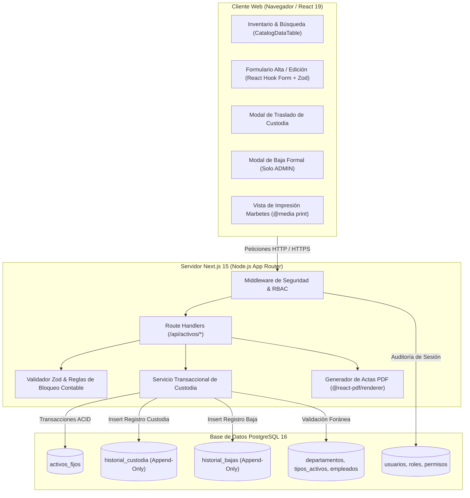
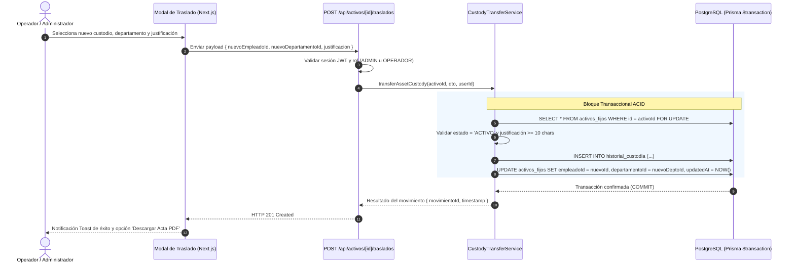

# Design: Gestión de Activos Fijos, Inventario y Custodia

> 📋 Generated by `solution-designer` · 2026-10-08
> ✅ Approved by: JeremyJS · 2026-10-08
> ⚠️ **MANDATORY QUALITY GATE (Hard Gate 12)**: Technical design MUST explicitly specify DDL schemas with exact SQL data types, foreign keys, and constraints; REST endpoint contracts with real JSON request and response payloads (including RFC 7807 error structures); and renderable Mermaid diagrams. Superficial summaries, placeholders ('TODO', 'TBD'), or truncated lists are strictly prohibited.

## Traceability
- **Work Item**: Sub-módulo 02 (Gestión de Activos Fijos, Inventario y Custodia)
- **Parent**: Sistema de Gestión de Activos Fijos (UNAPEC - Integraciones I)
- **Branch**: `feature/activos-fijos-02-gestion-activos-custodia`
- **Requirements**: [requirements.md](./requirements.md)
- **Test Plan**: [test-plan.md](./test-plan.md)
- **Test Cases**: [test-cases.md](./test-cases.md)

## Technology Decisions
- **Frontend**: Next.js 15 (App Router, React 19, TypeScript), Tailwind CSS, componentes UI de shadcn/ui (`table`, `dialog`, `badge`, `dropdown-menu`, `card`, `toast`). Provee renderizado server-side reactivo con paginación y búsqueda instantánea con debounce.
- **Backend**: Route Handlers de Next.js 15 ejecutando en Node.js runtime, validación estricta de payloads con Zod en cliente y servidor, y transacciones indivisibles con Prisma ORM (`prisma.$transaction`).
- **Database**: PostgreSQL 16 con Prisma ORM. Claves primarias UUID v4, campos monetarios con tipo `Decimal(14,2)`, constraints de chequeo SQL y claves foráneas con políticas de integridad referencial restrictivas (`onDelete: Restrict`).
- **Cloud Services**: Despliegue sobre contenedor Docker PostgreSQL local. Generación de documentos PDF en tiempo real sin almacenamiento en la nube para respetar la privacidad y simplicidad del entorno académico.
- **Theme**: Tema Institucional Universidad APEC (UNAPEC) con paleta corporativa: Azul Principal (`#003366`), Rojo Acento (`#CC0000`), fondos neutros y bordes Slate.
- **Document Generation**: Librería `@react-pdf/renderer` para la emisión en servidor del Acta Digital de Asignación y Responsabilidad de Activo Fijo en formato PDF tamaño Carta.
- **Print Layout**: Reglas de estilo CSS `@media print` para renderizado e impresión de marbetes autoadhesivos de 50mm x 25mm.

## Architecture

### System Overview


### Component Diagram: Flujo Transaccional de Traslado de Custodia


## Deployment
- **Pattern**: monorepo-isolated (la aplicación reside en la subcarpeta `app/` para aislar código y dependencias de la gobernanza SDD).
- **App**: Servidor Node.js 20+ ejecutando Next.js en modo standalone.
- **Infra**: Contenedor Docker con imagen oficial `postgres:16-alpine` en red local.
- **CI/CD**: Scripts de verificación local con Vitest (unitarias e integración) y Playwright (pruebas E2E de humo).
- **Justification**: Modelo estándar y portable para evaluación académica en UNAPEC, facilitando la ejecución con `pnpm dev` y `docker compose up -d`.
- **Discarded**: Escaneo de QR mediante cámara web (descartado por decisión de usuario `decision-omit-qr-scanning` para evitar complejidad innecesaria en la interfaz).

### Environments
| Environment | URL | Deploy trigger |
|-------------|-----|----------------|
| local | `http://localhost:3000` | Manual (`pnpm dev`) |
| dev | `https://dev-activos.unapec.edu.do` | Push a rama `develop` |
| cert | `https://cert-activos.unapec.edu.do` | Tag release candidate |
| prod | `https://activos.unapec.edu.do` | Aprobación explícita (Gate 3) |

## Database Schema

### Table: activos_fijos
Entidad principal que almacena los bienes institucionales de la universidad.
| Column | Type | Constraints | Default | Description |
|--------|------|------------|---------|-------------|
| `id` | `UUID` | PRIMARY KEY | `gen_random_uuid()` | Identificador único del activo |
| `codigo` | `VARCHAR(20)` | NOT NULL, UNIQUE | — | Código correlativo (`ACT-YYYY-NNNN`) |
| `descripcion` | `VARCHAR(255)` | NOT NULL | — | Descripción detallada del activo |
| `tipoActivoId` | `UUID` | NOT NULL, FK `tipos_activos.id` | — | Clasificación contable y fiscal DGII |
| `departamentoId` | `UUID` | NOT NULL, FK `departamentos.id` | — | Departamento o área de radicación física |
| `empleadoId` | `UUID` | NOT NULL, FK `empleados.id` | — | Custodio responsable del bien |
| `fechaAdquisicion` | `DATE` | NOT NULL, CHECK (`fechaAdquisicion <= CURRENT_DATE`) | — | Fecha de compra o alta |
| `costoAdquisicion` | `DECIMAL(14,2)` | NOT NULL, CHECK (`costoAdquisicion > 0.00`) | — | Costo de adquisición en DOP |
| `valorResidual` | `DECIMAL(14,2)` | NOT NULL, CHECK (`valorResidual >= 0.00 AND valorResidual <= costoAdquisicion`) | `0.00` | Valor de salvamento estimado |
| `depreciacionAcumulada` | `DECIMAL(14,2)` | NOT NULL, CHECK (`depreciacionAcumulada >= 0.00`) | `0.00` | Depreciación acumulada histórica |
| `valorEnLibros` | `DECIMAL(14,2)` | NOT NULL, CHECK (`valorEnLibros >= 0.00`) | — | Valor en libros actual (Costo - Dep. Acum.) |
| `estado` | `VARCHAR(20)` | NOT NULL, CHECK (`estado IN ('ACTIVO', 'EN_MANTENIMIENTO', 'DADO_DE_BAJA', 'VENDIDO')`) | `'ACTIVO'` | Estado operativo del bien |
| `marca` | `VARCHAR(100)` | NULL | — | Marca del fabricante |
| `modelo` | `VARCHAR(100)` | NULL | — | Modelo comercial del activo |
| `numeroSerie` | `VARCHAR(100)` | NULL | — | Número de serie físico de fábrica |
| `ubicacionFisica` | `VARCHAR(255)` | NULL | — | Edificio, aula u oficina específica |
| `color` | `VARCHAR(50)` | NULL | — | Color del bien |
| `createdAt` | `TIMESTAMPTZ` | NOT NULL | `CURRENT_TIMESTAMP` | Marca de tiempo de registro inicial |
| `updatedAt` | `TIMESTAMPTZ` | NOT NULL | `CURRENT_TIMESTAMP` | Marca de tiempo de última modificación |

### Table: historial_custodia
Bitácora inmutable (append-only) que registra cada movimiento físico y asignación de custodio.
| Column | Type | Constraints | Default | Description |
|--------|------|------------|---------|-------------|
| `id` | `UUID` | PRIMARY KEY | `gen_random_uuid()` | Identificador único del movimiento |
| `activoId` | `UUID` | NOT NULL, FK `activos_fijos.id` ON DELETE CASCADE | — | Activo fijo trasladado |
| `empleadoAnteriorId` | `UUID` | NULL, FK `empleados.id` ON DELETE RESTRICT | — | Custodio previo (NULL en alta) |
| `empleadoNuevoId` | `UUID` | NOT NULL, FK `empleados.id` ON DELETE RESTRICT | — | Nuevo custodio asignado |
| `departamentoAnteriorId` | `UUID` | NULL, FK `departamentos.id` ON DELETE RESTRICT | — | Departamento previo (NULL en alta) |
| `departamentoNuevoId` | `UUID` | NOT NULL, FK `departamentos.id` ON DELETE RESTRICT | — | Nuevo departamento asignado |
| `motivo` | `VARCHAR(30)` | NOT NULL, CHECK (`motivo IN ('ALTA_INICIAL', 'ROTACION_INTERNA', 'CAMBIO_DEPARTAMENTO', 'MANTENIMIENTO', 'OTRO')`) | — | Tipo de movimiento |
| `justificacion` | `TEXT` | NOT NULL, CHECK (`length(justificacion) >= 10`) | — | Motivo descriptivo obligatorio |
| `autorizadoPorId` | `UUID` | NOT NULL, FK `usuarios.id` ON DELETE RESTRICT | — | Usuario auditor que ejecutó el traslado |
| `createdAt` | `TIMESTAMPTZ` | NOT NULL | `CURRENT_TIMESTAMP` | Fecha y hora exacta del traslado |

### Table: historial_bajas
Registro formal e inmutable de desincorporación de activos de la universidad.
| Column | Type | Constraints | Default | Description |
|--------|------|------------|---------|-------------|
| `id` | `UUID` | PRIMARY KEY | `gen_random_uuid()` | Identificador único del registro de baja |
| `activoId` | `UUID` | NOT NULL, UNIQUE, FK `activos_fijos.id` ON DELETE RESTRICT | — | Activo dado de baja |
| `motivoBaja` | `VARCHAR(30)` | NOT NULL, CHECK (`motivoBaja IN ('OBSOLESCENCIA_TECNOLOGICA', 'DANO_IRREPARABLE', 'PERDIDA_ROBO', 'VENTA_DESECHO', 'DONACION')`) | — | Razón fiscal/técnica de baja |
| `justificacion` | `TEXT` | NOT NULL, CHECK (`length(justificacion) >= 20`) | — | Dictamen técnico detallado |
| `numeroActa` | `VARCHAR(50)` | NOT NULL | — | Número de acta o expediente administrativo |
| `fechaBaja` | `DATE` | NOT NULL, CHECK (`fechaBaja <= CURRENT_DATE`) | — | Fecha legal de desincorporación |
| `valorEnLibrosAlBaja` | `DECIMAL(14,2)` | NOT NULL, CHECK (`valorEnLibrosAlBaja >= 0.00`) | — | Valor remanente en libros al dar de baja |
| `autorizadoPorId` | `UUID` | NOT NULL, FK `usuarios.id` ON DELETE RESTRICT | — | Usuario Administrador responsable |
| `createdAt` | `TIMESTAMPTZ` | NOT NULL | `CURRENT_TIMESTAMP` | Fecha y hora de asentamiento de baja |

### Indexes
| Name | Columns | Type | Description |
|------|---------|------|-------------|
| `idx_activos_codigo` | `codigo` | B-Tree (UNIQUE) | Búsqueda por código institucional correlativo |
| `idx_activos_departamento` | `departamentoId` | B-Tree | Filtro por departamento universitario |
| `idx_activos_empleado` | `empleadoId` | B-Tree | Filtro por custodio asignado |
| `idx_activos_tipo` | `tipoActivoId` | B-Tree | Filtro por categoría DGII |
| `idx_activos_estado` | `estado` | B-Tree | Filtrado de inventario activo vs bajas |
| `idx_activos_serial` | `numeroSerie` | B-Tree (Partial WHERE `numeroSerie IS NOT NULL`) | Búsqueda rápida por serial de fabricante |
| `idx_custodia_activo_fecha` | `activoId, createdAt DESC` | B-Tree | Consulta cronológica de movimientos de custodia |
| `idx_bajas_activo` | `activoId` | B-Tree (UNIQUE) | Localización inmediata del acta de baja |

---

## API Contracts

### GET /api/activos
Retorna el listado paginado y filtrable del inventario de activos fijos institucionales.
- **Request**: Query parameters:
  - `page`: integer (default: 1)
  - `pageSize`: integer (default: 10, max: 100)
  - `search`: string (opcional, busca en código, descripción o número de serie)
  - `departamentoId`: UUID (opcional)
  - `tipoActivoId`: UUID (opcional)
  - `empleadoId`: UUID (opcional)
  - `estado`: `ACTIVO` | `EN_MANTENIMIENTO` | `DADO_DE_BAJA` | `VENDIDO` (opcional)
- **Response**: HTTP 200 OK
```json
{
  "data": [
    {
      "id": "e7b1a23c-4d5e-6f7a-8b9c-0d1e2f3a4b5c",
      "codigo": "ACT-2026-0001",
      "descripcion": "Laptop Dell Latitude 5440 i7 16GB",
      "costoAdquisicion": 85000.00,
      "valorResidual": 8500.00,
      "depreciacionAcumulada": 0.00,
      "valorEnLibros": 85000.00,
      "estado": "ACTIVO",
      "marca": "Dell",
      "modelo": "Latitude 5440",
      "numeroSerie": "DL-99887766",
      "departamento": {
        "id": "a1b2c3d4-e5f6-7a8b-9c0d-1e2f3a4b5c6d",
        "codigo": "DEP-001",
        "descripcion": "Tecnología de la Información"
      },
      "tipoActivo": {
        "id": "b2c3d4e5-f6a7-8b9c-0d1e-2f3a4b5c6d7e",
        "codigo": "CAT-DGII-02",
        "descripcion": "Equipos de Cómputo",
        "porcentajeDepreciacionAnual": 25.00
      },
      "empleado": {
        "id": "c3d4e5f6-a7b8-9c0d-1e2f-3a4b5c6d7e8f",
        "codigo": "EMP-001",
        "nombre": "Juan",
        "apellido": "Pérez",
        "cedula": "001-0000001-9",
        "cargo": "Administrador de Redes"
      },
      "createdAt": "2026-10-08T10:00:00.000Z"
    }
  ],
  "pagination": {
    "total": 1,
    "page": 1,
    "pageSize": 10,
    "totalPages": 1
  }
}
```
- **Auth**: Requerida (Cualquier rol: `ADMIN`, `OPERADOR`, `AUDITOR`).
- **Errors**:
  - `401 Unauthorized`: Sesión no provista o inválida.
- **Maps to**: REQ-ACT-007

### POST /api/activos
Registra un nuevo activo fijo institucional con generación correlativa de código e inicialización de custodia.
- **Request**: Payload JSON
```json
{
  "descripcion": "Proyector Epson PowerLite E20",
  "tipoActivoId": "b2c3d4e5-f6a7-8b9c-0d1e-2f3a4b5c6d7e",
  "departamentoId": "a1b2c3d4-e5f6-7a8b-9c0d-1e2f3a4b5c6d",
  "empleadoId": "c3d4e5f6-a7b8-9c0d-1e2f-3a4b5c6d7e8f",
  "fechaAdquisicion": "2026-10-08",
  "costoAdquisicion": 45000.00,
  "valorResidual": 4500.00,
  "marca": "Epson",
  "modelo": "PowerLite E20",
  "numeroSerie": "EP-334455",
  "ubicacionFisica": "Edificio B, Aula 204",
  "color": "Blanco"
}
```
- **Response**: HTTP 201 Created
```json
{
  "id": "f8c2b34d-5e6f-7a8b-9c0d-1e2f3a4b5c6d",
  "codigo": "ACT-2026-0002",
  "descripcion": "Proyector Epson PowerLite E20",
  "costoAdquisicion": 45000.00,
  "valorResidual": 4500.00,
  "depreciacionAcumulada": 0.00,
  "valorEnLibros": 45000.00,
  "estado": "ACTIVO",
  "createdAt": "2026-10-08T15:30:00.000Z"
}
```
- **Auth**: Requerida (`ADMIN` u `OPERADOR`).
- **Errors**:
  - `400 Bad Request`: `EMPLOYEE_NOT_ELIGIBLE` (custodio inactivo o inexistente) o `DEPARTMENT_INACTIVE`.
  - `422 Unprocessable Entity`: `ASSET_INVALID_COST` (costo <= 0) o `ASSET_INVALID_RESIDUAL_VALUE` (residual > costo).
- **Maps to**: REQ-ACT-001

### GET /api/activos/[id]
Retorna el detalle completo de un activo fijo, incluyendo su ficha técnica, cuentas contables y resumen de custodia.
- **Request**: Path param `id` (UUID).
- **Response**: HTTP 200 OK
```json
{
  "id": "e7b1a23c-4d5e-6f7a-8b9c-0d1e2f3a4b5c",
  "codigo": "ACT-2026-0001",
  "descripcion": "Laptop Dell Latitude 5440 i7 16GB",
  "costoAdquisicion": 85000.00,
  "valorResidual": 8500.00,
  "depreciacionAcumulada": 0.00,
  "valorEnLibros": 85000.00,
  "estado": "ACTIVO",
  "marca": "Dell",
  "modelo": "Latitude 5440",
  "numeroSerie": "DL-99887766",
  "ubicacionFisica": "Torre A, Piso 3",
  "color": "Gris",
  "fechaAdquisicion": "2026-10-01",
  "departamento": {
    "id": "a1b2c3d4-e5f6-7a8b-9c0d-1e2f3a4b5c6d",
    "codigo": "DEP-001",
    "descripcion": "Tecnología de la Información"
  },
  "tipoActivo": {
    "id": "b2c3d4e5-f6a7-8b9c-0d1e-2f3a4b5c6d7e",
    "codigo": "CAT-DGII-02",
    "descripcion": "Equipos de Cómputo",
    "cuentaContableCompra": "1-01-04-0002",
    "cuentaContableDepreciacion": "1-01-04-0003"
  },
  "empleado": {
    "id": "c3d4e5f6-a7b8-9c0d-1e2f-3a4b5c6d7e8f",
    "codigo": "EMP-001",
    "nombre": "Juan",
    "apellido": "Pérez",
    "cedula": "001-0000001-9",
    "cargo": "Administrador de Redes"
  },
  "poseeHistorialDepreciacion": false
}
```
- **Auth**: Requerida (`ADMIN`, `OPERADOR`, `AUDITOR`).
- **Errors**:
  - `404 Not Found`: `ASSET_NOT_FOUND`.
- **Maps to**: REQ-ACT-001, REQ-ACT-006

### PUT /api/activos/[id]
Actualiza metadatos físicos descriptivos del activo. Si el activo tiene historial de depreciación, bloquea cambios contables.
- **Request**: Path param `id` (UUID), Payload JSON:
```json
{
  "descripcion": "Laptop Dell Latitude 5440 i7 32GB RAM Upgrade",
  "marca": "Dell",
  "modelo": "Latitude 5440",
  "numeroSerie": "DL-99887766-REV2",
  "ubicacionFisica": "Torre A, Laboratorio 102",
  "color": "Gris Oscuro"
}
```
- **Response**: HTTP 200 OK
```json
{
  "id": "e7b1a23c-4d5e-6f7a-8b9c-0d1e2f3a4b5c",
  "codigo": "ACT-2026-0001",
  "descripcion": "Laptop Dell Latitude 5440 i7 32GB RAM Upgrade",
  "updatedAt": "2026-10-08T16:00:00.000Z"
}
```
- **Auth**: Requerida (`ADMIN` u `OPERADOR`).
- **Errors**:
  - `404 Not Found`: `ASSET_NOT_FOUND`.
  - `409 Conflict`: `FINANCIAL_FIELDS_LOCKED` (intento de mutar costo, valor residual o fecha en activo con depreciación).
- **Maps to**: REQ-ACT-006

### POST /api/activos/[id]/traslados
Registra transaccionalmente la reasignación de custodio o traslado departamental del activo.
- **Request**: Path param `id` (UUID), Payload JSON:
```json
{
  "nuevoEmpleadoId": "d4e5f6a7-b8c9-0d1e-2f3a-4b5c6d7e8f9a",
  "nuevoDepartamentoId": "b1c2d3e4-f5a6-7b8c-9d0e-1f2a3b4c5d6e",
  "motivo": "ROTACION_INTERNA",
  "justificacion": "Reasignación formal por cambio de funciones hacia el área de Contabilidad General"
}
```
- **Response**: HTTP 201 Created
```json
{
  "movimientoId": "a9b8c7d6-e5f4-3a2b-1c0d-9e8f7a6b5c4d",
  "activoId": "e7b1a23c-4d5e-6f7a-8b9c-0d1e2f3a4b5c",
  "empleadoAnteriorId": "c3d4e5f6-a7b8-9c0d-1e2f-3a4b5c6d7e8f",
  "empleadoNuevoId": "d4e5f6a7-b8c9-0d1e-2f3a-4b5c6d7e8f9a",
  "departamentoAnteriorId": "a1b2c3d4-e5f6-7a8b-9c0d-1e2f3a4b5c6d",
  "departamentoNuevoId": "b1c2d3e4-f5a6-7b8c-9d0e-1f2a3b4c5d6e",
  "createdAt": "2026-10-08T16:15:00.000Z"
}
```
- **Auth**: Requerida (`ADMIN` u `OPERADOR`).
- **Errors**:
  - `400 Bad Request`: `ASSET_DISPOSED_CANNOT_TRANSFER` (activo dado de baja o vendido).
  - `422 Unprocessable Entity`: `NO_CUSTODY_CHANGE_DETECTED` o `TRANSFER_JUSTIFICATION_TOO_SHORT`.
- **Maps to**: REQ-ACT-003

### GET /api/activos/[id]/traslados
Retorna el historial cronológico completo de asignaciones de custodia del bien.
- **Request**: Path param `id` (UUID).
- **Response**: HTTP 200 OK
```json
{
  "activoId": "e7b1a23c-4d5e-6f7a-8b9c-0d1e2f3a4b5c",
  "historial": [
    {
      "id": "a9b8c7d6-e5f4-3a2b-1c0d-9e8f7a6b5c4d",
      "motivo": "ROTACION_INTERNA",
      "justificacion": "Reasignación formal por cambio de funciones...",
      "empleadoAnterior": { "id": "c3...", "nombre": "Juan Pérez" },
      "empleadoNuevo": { "id": "d4...", "nombre": "María Rodríguez" },
      "departamentoAnterior": { "id": "a1...", "descripcion": "Tecnología" },
      "departamentoNuevo": { "id": "b1...", "descripcion": "Contabilidad" },
      "autorizadoPor": { "id": "u1...", "nombre": "JeremyJS" },
      "createdAt": "2026-10-08T16:15:00.000Z"
    }
  ]
}
```
- **Auth**: Requerida (`ADMIN`, `OPERADOR`, `AUDITOR`).
- **Maps to**: REQ-ACT-003

### GET /api/activos/[id]/acta-entrega
Genera y transmite en streaming el archivo binario PDF del Acta de Asignación y Responsabilidad.
- **Request**: Path param `id` (UUID), Query param opcional `movimientoId` (UUID).
- **Response**: HTTP 200 OK (`Content-Type: application/pdf`, `Content-Disposition: attachment; filename="Acta-Custodia-ACT-2026-0001.pdf"`).
- **Auth**: Requerida (`ADMIN`, `OPERADOR`, `AUDITOR`).
- **Errors**:
  - `404 Not Found`: `ASSET_NOT_FOUND` o `TRANSFER_RECORD_NOT_FOUND`.
- **Maps to**: REQ-ACT-004

### POST /api/activos/[id]/baja
Ejecuta la desincorporación y baja permanente del activo (exclusivo para rol `ADMIN`).
- **Request**: Path param `id` (UUID), Payload JSON:
```json
{
  "motivoBaja": "DANO_IRREPARABLE",
  "justificacion": "Falla técnica catastrófica del compresor principal sin repuestos disponibles en el mercado dominicano",
  "numeroActa": "ACTA-BAJA-2026-004",
  "fechaBaja": "2026-10-08"
}
```
- **Response**: HTTP 200 OK
```json
{
  "activoId": "e7b1a23c-4d5e-6f7a-8b9c-0d1e2f3a4b5c",
  "estado": "DADO_DE_BAJA",
  "motivoBaja": "DANO_IRREPARABLE",
  "valorEnLibrosAlBaja": 12500.00,
  "fechaBaja": "2026-10-08",
  "numeroActa": "ACTA-BAJA-2026-004"
}
```
- **Auth**: Requerida (Exclusivo rol `ADMIN`).
- **Errors**:
  - `403 Forbidden`: `FORBIDDEN_ADMIN_REQUIRED`.
  - `404 Not Found`: `ASSET_NOT_FOUND`.
  - `409 Conflict`: `ASSET_ALREADY_DISPOSED`.
  - `422 Unprocessable Entity`: `DISPOSAL_JUSTIFICATION_TOO_SHORT`.
- **Maps to**: REQ-ACT-005

### GET /api/activos/marbete/[id]
Retorna los datos de formato para la vista de marbete imprimible (50mm x 25mm).
- **Request**: Path param `id` (UUID).
- **Response**: HTTP 200 OK
```json
{
  "codigo": "ACT-2026-0001",
  "descripcion": "Laptop Dell Latitude 5440 i7 16GB",
  "marca": "Dell",
  "modelo": "Latitude 5440",
  "numeroSerie": "DL-99887766",
  "departamento": "Tecnología de la Información",
  "custodio": "Juan Pérez",
  "institucion": "Universidad APEC (UNAPEC)"
}
```
- **Auth**: Requerida (`ADMIN`, `OPERADOR`, `AUDITOR`).
- **Errors**:
  - `404 Not Found`: `ASSET_NOT_FOUND`.
- **Maps to**: REQ-ACT-002

---

## Architecture Updates
- `docs/modules/activos-fijos.md`: Incorporación de las tablas `activos_fijos`, `historial_custodia` e `historial_bajas` en el modelo de datos maestro del módulo, actualizando el catálogo de endpoints REST certificados.
- `docs/architecture/database-architecture.md`: Extensión del diagrama ERD principal conectando el núcleo de activos fijos con los catálogos organizacionales (`departamentos`, `tipos_activos`, `empleados`) y el esquema de seguridad (`usuarios`).

## Approval
- [x] Developer: JeremyJS Date: 2026-10-08

---
> 📍 [02-gestion-activos-custodia] · 🌿 `feature/activos-fijos-02-gestion-activos-custodia` · Generated by SDD Standard
