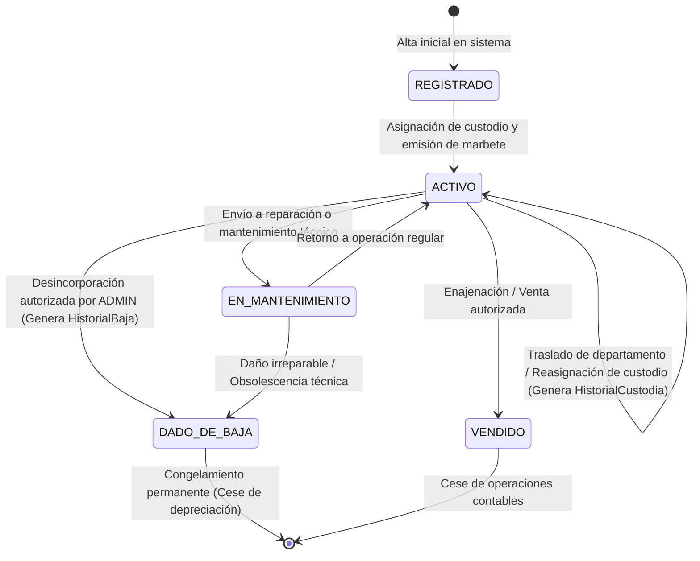

# Requirements: Gestión de Activos Fijos, Inventario y Custodia

> 📋 Generated by `requirements-analyst` · 2026-10-08
> ✅ Approved by: JeremyJS · 2026-10-08
> ⚠️ **MANDATORY QUALITY GATE (Hard Gate 12)**: Every user story MUST be authored in formal EARS syntax with complete Given/When/Then acceptance criteria. Summarizing requirements with 'etc.', omitting calculation formulas, or generalizing validations is strictly prohibited. All numeric thresholds, formats, and error conditions must be explicitly detailed.

## Traceability
- **Work Item**: Sub-módulo 02 (Gestión de Activos Fijos, Inventario y Custodia)
- **Parent**: Sistema de Gestión de Activos Fijos (UNAPEC - Integraciones I)
- **Branch**: `feature/activos-fijos-02-gestion-activos-custodia`
- **Design**: [design.md](./design.md)
- **Test Plan**: [test-plan.md](./test-plan.md)
- **Test Cases**: [test-cases.md](./test-cases.md)

## Overview
El sub-módulo de Gestión de Activos Fijos, Inventario y Custodia constituye el núcleo operativo del sistema para la Universidad APEC (UNAPEC). Provee el registro integral de los bienes institucionales, control estricto de custodios mediante validación de identidad dominicana, trazabilidad inmutable de traslados entre dependencias, generación e impresión de marbetes y etiquetas de identificación física, y el procedimiento formal de desincorporación y baja de bienes con bloqueo permanente de depreciaciones futuras.

## User Stories (EARS Notation)

### REQ-ACT-001: Alta y Registro de Activo Fijo Institucional
**Type:** Event-Driven
**Rule:** WHEN un usuario con rol `ADMIN` u `OPERADOR` envíe el formulario de registro de un nuevo bien institucional con descripción, tipo de activo, departamento, custodio, fecha de adquisición, costo de compra y valor residual, the system SHALL validar que el costo de adquisición sea mayor a cero (RD$ > 0.00), que el valor residual sea mayor o igual a cero y menor o igual al costo de adquisición, que el custodio pertenezca a un colaborador activo con cédula validada y que el departamento se encuentre activo, asignando automáticamente un código institucional correlativo único bajo el formato `ACT-YYYY-NNNN` (donde YYYY es el año de registro y NNNN es un secuencial de 4 dígitos relleno con ceros a la izquierda), inicializando el valor en libros igual al costo de adquisición, la depreciación acumulada en RD$ 0.00, el estado operativo en `ACTIVO` y registrando la primera entrada en la bitácora de custodia con motivo 'ALTA_INICIAL'.
**Entities:** `ActivoFijo`, `TipoActivo`, `Departamento`, `Empleado`, `HistorialCustodia`
**Error Handling:** Si el costo de adquisición es menor o igual a cero, el sistema rechaza la solicitud con `ASSET_INVALID_COST` (HTTP 422). Si el valor residual es negativo o supera el costo de compra, rechaza con `ASSET_INVALID_RESIDUAL_VALUE` (HTTP 422). Si el empleado custodio está inactivo o inexistente, rechaza con `EMPLOYEE_NOT_ELIGIBLE` (HTTP 400). Si el departamento está inactivo, rechaza con `DEPARTMENT_INACTIVE` (HTTP 400). Si la fecha de adquisición es futura respecto a la fecha actual, rechaza con `ACQUISITION_DATE_FUTURE` (HTTP 422).

**Acceptance Criteria:**
- [ ] Given que el operador completó los campos con costo de RD$ 85,000.00, valor residual de RD$ 8,500.00, departamento 'Tecnología' y custodio activo, When presiona 'Guardar Activo', Then the system genera el código correlativo `ACT-2026-0001`, persiste el activo en estado `ACTIVO` con valor en libros de RD$ 85,000.00 y genera automáticamente el primer registro en `HistorialCustodia` con motivo 'ALTA_INICIAL'.
- [ ] Given un formulario donde el costo de compra es RD$ 0.00 o negativo, When se envía la solicitud, Then the system bloquea el guardado, resalta el campo de costo en rojo y emite el mensaje 'El costo de adquisición debe ser estrictamente mayor a RD$ 0.00'.
- [ ] Given un valor residual de RD$ 90,000.00 sobre un costo de RD$ 50,000.00, When se valida el formulario, Then the system rechaza la operación informando 'El valor residual no puede ser superior al costo de compra del activo'.
- [ ] Given un intento de seleccionar una fecha de adquisición posterior a la fecha del sistema, When se envía el formulario, Then the system rechaza la transacción con código 422 e impide registrar fechas futuras.

**Priority:** Must
**Dependencies:** Sub-módulo 01 (Catálogos Base: Departamento, TipoActivo, Empleado)
**Tracker:** Sub-módulo 02

### REQ-ACT-002: Generación e Impresión de Marbetes y Etiquetas de Inventario
**Type:** State-Driven
**Rule:** WHILE un activo fijo registrado se encuentre en estado `ACTIVO` o `EN_MANTENIMIENTO`, the system SHALL proveer una plantilla visual de marbete/etiqueta imprimible conteniendo el código institucional (`ACT-YYYY-NNNN`), logotipo de UNAPEC, descripción del bien, marca, modelo, número de serie, custodio actual y departamento asignado, optimizada mediante reglas CSS de impresión (`@media print`) para etiquetas adhesivas estándar de 50mm x 25mm.
**Entities:** `ActivoFijo`, `Empleado`, `Departamento`
**Error Handling:** Si el identificador del activo no existe, el sistema retorna `ASSET_NOT_FOUND` (HTTP 404). Si el activo se encuentra en estado `DADO_DE_BAJA`, la vista de ficha técnica muestra un banner visual prominente advirtiendo 'ACTIVO DESINCORPORADO - FUERA DE SERVICIO'.

**Acceptance Criteria:**
- [ ] Given un activo registrado con código `ACT-2026-0015`, When el usuario presiona 'Imprimir Marbete', Then the system presenta una vista previa limpia y dispara el diálogo de impresión configurado para tamaño 50mm x 25mm con el logotipo de UNAPEC, código visible, serial y custodio.
- [ ] Given un activo desincorporado en estado `DADO_DE_BAJA`, When se consulta su ficha técnica, Then the system muestra el sello visual 'DESINCORPORADO' y la fecha oficial de baja.

**Priority:** Must
**Dependencies:** REQ-ACT-001
**Tracker:** Sub-módulo 02

### REQ-ACT-003: Reasignación de Custodio y Traslado Departamental
**Type:** Event-Driven
**Rule:** WHEN un usuario con rol `ADMIN` u `OPERADOR` registre el traslado físico de un activo hacia un nuevo departamento o nuevo empleado custodio, the system SHALL verificar que el activo esté en estado `ACTIVO`, que el nuevo empleado custodio se encuentre en estado activo, registrar de manera transaccional e indivisible (ACID) la entrada en `HistorialCustodia` con el custodio anterior, nuevo custodio, departamento anterior, nuevo departamento, fecha/hora exacta, justificación obligatoria (mínimo 10 caracteres) y usuario autenticado responsable, actualizando los punteros de custodio y departamento en el registro maestro del activo fijo.
**Entities:** `ActivoFijo`, `HistorialCustodia`, `Empleado`, `Departamento`, `Usuario`
**Error Handling:** Si el activo se encuentra en estado `DADO_DE_BAJA` o `VENDIDO`, el sistema rechaza el traslado con `ASSET_DISPOSED_CANNOT_TRANSFER` (HTTP 400). Si el nuevo custodio y departamento son idénticos a los actuales, rechaza con `NO_CUSTODY_CHANGE_DETECTED` (HTTP 422). Si la justificación del movimiento tiene menos de 10 caracteres, rechaza con `TRANSFER_JUSTIFICATION_TOO_SHORT` (HTTP 422).

**Acceptance Criteria:**
- [ ] Given un activo fijo asignado al empleado 'Juan Pérez' en el departamento 'Tecnología', When el operador selecciona nuevo custodio 'María Rodríguez' en 'Contabilidad' con justificación 'Reasignación por rotación de puesto de trabajo', Then the system actualiza en una sola transacción el custodio y departamento del activo, y genera un registro inmutable en `HistorialCustodia`.
- [ ] Given un intento de traslado sobre un activo en estado `DADO_DE_BAJA`, When se envía la solicitud, Then the system bloquea la transacción con código 400 y notifica 'Un activo desincorporado no puede ser transferido ni reasignado'.
- [ ] Given un formulario de traslado donde no se modificó ni el custodio ni el departamento, When se presiona 'Confirmar Traslado', Then the system advierte 'Debe seleccionar un custodio o departamento diferente al actual'.
- [ ] Given un intento de guardar un traslado con justificación de 5 caracteres, When se valida el formulario, Then the system impide el envío indicando 'La justificación debe contener al menos 10 caracteres explicativos'.

**Priority:** Must
**Dependencies:** REQ-ACT-001
**Tracker:** Sub-módulo 02

### REQ-ACT-004: Emisión de Acta Digital de Entrega y Recepción de Activo
**Type:** Event-Driven
**Rule:** WHEN se confirme una reasignación de custodia o alta inicial de activo, the system SHALL generar un documento imprimible y descargable en formato PDF denominado 'Acta de Asignación y Responsabilidad de Activo Fijo', conteniendo membrete oficial de UNAPEC, fecha y hora de emisión, código del activo, descripción, marca, modelo, número de serie, costo histórico, departamento destino, datos completos del empleado custodio (nombre completo, cédula JCE formateada y cargo), y los bloques de firma para entrega conforme (Administración de Activos) y recepción conforme (Custodio).
**Entities:** `ActivoFijo`, `HistorialCustodia`, `Empleado`, `Departamento`
**Error Handling:** Si el identificador de traslado o activo no es localizado, retorna `TRANSFER_RECORD_NOT_FOUND` (HTTP 404). Si ocurre fallo interno durante la compilación del binario PDF, the system retorna `PDF_GENERATION_FAILED` (HTTP 500) garantizando que la transacción previa del traslado en base de datos permanezca intacta.

**Acceptance Criteria:**
- [ ] Given un traslado o alta de activo confirmado, When el usuario hace clic en 'Descargar Acta de Entrega', Then the system compila y descarga un archivo PDF tamaño Carta con membrete institucional UNAPEC, cláusula legal de custodia y líneas de firma formal.
- [ ] Given el documento PDF generado, When se inspecciona el bloque del empleado custodio, Then the system normaliza la cédula JCE bajo formato `001-XXXXXXX-X` coincidiendo con el registro del empleado.
- [ ] Given un error temporal de generación de PDF, When falla la descarga, Then the system preserva intacto el registro del activo en base de datos permitiendo reintentar la descarga en cualquier momento desde el historial.

**Priority:** Should
**Dependencies:** REQ-ACT-003
**Tracker:** Sub-módulo 02

### REQ-ACT-005: Desincorporación y Baja Formal de Activo Fijo
**Type:** Event-Driven
**Rule:** WHEN un usuario con rol `ADMIN` ejecute la desincorporación de un activo fijo, the system SHALL exigir la selección de un motivo de baja válido (`OBSOLESCENCIA_TECNOLOGICA`, `DANO_IRREPARABLE`, `PERDIDA_ROBO`, `VENTA_DESECHO`, `DONACION`), una justificación descriptiva obligatoria (mínimo 20 caracteres), el número de acta o informe técnico de soporte y la fecha de desincorporación, actualizando el estado del activo de forma irreversible a `DADO_DE_BAJA`, registrando la entrada en `HistorialBaja` y excluyendo de inmediato al bien de cualquier ejecución de cálculo de depreciación mensual posterior a la fecha de corte.
**Entities:** `ActivoFijo`, `HistorialBaja`, `Usuario`
**Error Handling:** Si un usuario con rol distinto de `ADMIN` (como `OPERADOR` o `AUDITOR`) intenta dar de baja un bien, el sistema rechaza la operación con `FORBIDDEN_ADMIN_REQUIRED` (HTTP 403). Si el activo ya se encuentra en estado `DADO_DE_BAJA`, rechaza con `ASSET_ALREADY_DISPOSED` (HTTP 409). Si la justificación descriptiva tiene menos de 20 caracteres, rechaza con `DISPOSAL_JUSTIFICATION_TOO_SHORT` (HTTP 422).

**Acceptance Criteria:**
- [ ] Given un activo en estado `ACTIVO` con valor en libros de RD$ 15,000.00, When un Administrador completa el formulario de baja con motivo 'DANO_IRREPARABLE', informe técnico 'INF-TEC-2026-04' y justificación 'Falla catastrófica de compresor sin repuesto en el mercado', Then the system cambia irreversiblemente el activo a estado `DADO_DE_BAJA` y lo excluye permanentemente de futuros cierres de depreciación.
- [ ] Given un usuario autenticado con rol `OPERADOR`, When intenta invocar el endpoint o botón de baja de activo, Then the system bloquea la acción respondiendo HTTP 403 Forbidden y mostrando 'Acceso denegado: solo el Administrador puede autorizar la baja de activos fijos'.
- [ ] Given un activo previamente dado de baja, When se intenta enviar una segunda solicitud de desincorporación, Then the system responde HTTP 409 Conflict notificando 'El activo ya se encuentra desincorporado'.

**Priority:** Must
**Dependencies:** REQ-ACT-001
**Tracker:** Sub-módulo 02

### REQ-ACT-006: Actualización Controlada de Datos Físicos y Bloqueo Financiero
**Type:** State-Driven
**Rule:** WHILE un activo fijo se encuentre registrado, the system SHALL permitir la actualización de sus metadatos físicos descriptivos (marca, modelo, número de serie, color, ubicación física detallada); WHERE el activo ya cuenta con registros históricos de depreciación calculados o transferidos a contabilidad, the system SHALL bloquear estrictamente la edición de los campos financieros críticos (`costoAdquisicion`, `fechaAdquisicion`, `tipoActivoId`, `valorResidual`) para salvaguardar la consistencia contable y la inmutabilidad de los estados financieros.
**Entities:** `ActivoFijo`, `TipoActivo`
**Error Handling:** Si una solicitud de modificación intenta alterar campos financieros bloqueados en un activo con depreciaciones registradas, el sistema rechaza la operación con `FINANCIAL_FIELDS_LOCKED` (HTTP 409) detallando los campos inmutables.

**Acceptance Criteria:**
- [ ] Given un activo nuevo que no posee ningún registro histórico de depreciación, When el operador edita el costo de compra de RD$ 40,000.00 a RD$ 42,000.00 por ajuste de factura de entrada, Then the system persiste el cambio y recalcula el valor en libros inicial.
- [ ] Given un activo con períodos de depreciación ya procesados, When el usuario abre la pantalla de edición, Then the system muestra deshabilitados (read-only) los campos de costo, valor residual, tipo de activo y fecha de compra con la etiqueta informativa 'Campos bloqueados por historial contable'.
- [ ] Given un payload malicioso o directo por API que intente mutar el costo de un activo con historial de depreciación, When el backend procesa la petición, Then the system rechaza la operación con HTTP 409 Conflict y aborta la mutación.

**Priority:** Must
**Dependencies:** REQ-ACT-001
**Tracker:** Sub-módulo 02

### REQ-ACT-007: Búsqueda y Filtrado Multicriterio de Inventario
**Type:** Event-Driven
**Rule:** WHEN el usuario consulte el inventario de activos fijos, the system SHALL proveer una vista tabular reactiva con soporte de búsqueda instantánea por coincidencia parcial en código institucional (`ACT-YYYY-NNNN`), descripción textual o número de serie del fabricante, filtros combinados por Departamento, Tipo de Activo, Empleado Custodio y Estado Operativo (`ACTIVO`, `EN_MANTENIMIENTO`, `DADO_DE_BAJA`), paginación en servidor (10, 25, 50 registros por página), y exportación de datos tabulares a Excel y CSV.
**Entities:** `ActivoFijo`, `Departamento`, `TipoActivo`, `Empleado`
**Error Handling:** Si el término de búsqueda no arroja coincidencias, el sistema muestra un estado visual vacío amigable con botón 'Restablecer filtros' sin producir excepciones.

**Acceptance Criteria:**
- [ ] Given un catálogo con más de 1,000 activos fijos registrados, When el usuario digita un número de serie o código 'ACT-2026-0042', Then the system filtra y localiza el activo correspondiente en menos de 200ms.
- [ ] Given el uso de filtros combinados de 'Departamento = Ciencias Jurídicas' y 'Estado = ACTIVO', When se aplica la consulta, Then the system muestra exclusivamente los activos que satisfacen ambas condiciones simultáneamente con paginación server-side exacta.
- [ ] Given el botón 'Exportar Inventario', When el usuario solicita la descarga en formato Excel (`.xlsx`), Then the system exporta las filas filtradas con sus valores en libros y datos de custodia formateados.

**Priority:** Must
**Dependencies:** REQ-ACT-001, REQ-ACT-002
**Tracker:** Sub-módulo 02

---

## Non-Functional Requirements

### NFR-001: Rendimiento en Consultas de Inventario
**Category:** Performance
**Rule:** The system SHALL return filtered asset inventory listings within acceptable latency thresholds.
**Metric:** Tiempo de respuesta del endpoint de inventario filtrado p95 < 250ms para catálogos de hasta 10,000 activos.
**Priority:** Must

### NFR-002: Integridad Transaccional ACID en Movimientos de Custodia
**Category:** Reliability
**Rule:** The system SHALL execute asset custody reassignments and initial registrations within an atomic transaction.
**Metric:** Cero inconsistencias en traslados; si la inserción en `HistorialCustodia` falla, la mutación en `ActivoFijo` se revierte al 100% mediante transacciones de base de datos.
**Priority:** Must

### NFR-003: Inmutabilidad de la Bitácora Histórica de Custodia y Bajas
**Category:** Security
**Rule:** The system SHALL enforce an append-only architecture on asset custody and disposal logs.
**Metric:** Cero sentencias `UPDATE` o `DELETE` permitidas sobre las tablas `historial_custodia` e `historial_bajas`.
**Priority:** Must

### NFR-004: Precisión Aritmética y Normativa Fiscal en Valores Monetarios
**Category:** Reliability
**Rule:** The system SHALL maintain monetary values in Dominican Pesos (DOP) using fixed-point precision.
**Metric:** Todos los campos monetarios (`costoAdquisicion`, `valorResidual`, `depreciacionAcumulada`, `valorEnLibros`) almacenados con precisión `Decimal(14,2)` redondeados con método Bankers Rounding (Half Even).
**Priority:** Must

### NFR-005: Control de Acceso Basado en Roles (RBAC)
**Category:** Security
**Rule:** The system SHALL restrict asset lifecycle mutations according to relational user roles.
**Metric:** Roles `ADMIN` autorizados para altas, traslados y bajas; `OPERADOR` autorizado para altas, traslados y edición física; `AUDITOR` limitado a lectura e impresión de marbetes y actas (100% de violaciones rechazadas con HTTP 403 Forbidden).
**Priority:** Must

---

## Diagrams

### Use Case Diagram

```mermaid
graph TD
    classDef actorStyle fill:#e0f2fe,stroke:#0284c7,stroke-width:2px,color:#0369a1;
    classDef usecaseStyle fill:#fef3c7,stroke:#d97706,stroke-width:2px,color:#92400e;
    classDef adminStyle fill:#fee2e2,stroke:#dc2626,stroke-width:2px,color:#991b1b;

    Admin["Administrador"]:::actorStyle
    Operador["Operador de Activos"]:::actorStyle
    Auditor["Auditor / Consulta"]:::actorStyle

    UC1(["Alta y Registro de Activo Fijo"]):::usecaseStyle
    UC2(["Impresión de Marbete de Inventario"]):::usecaseStyle
    UC3(["Reasignación de Custodio y Traslado"]):::usecaseStyle
    UC4(["Descarga de Acta Digital de Entrega PDF"]):::usecaseStyle
    UC5(["Búsqueda y Filtrado Multicriterio"]):::usecaseStyle
    UC6(["Desincorporación y Baja de Activo"]):::adminStyle
    UC7(["Actualización de Metadatos Físicos"]):::usecaseStyle

    Admin --> UC1
    Admin --> UC2
    Admin --> UC3
    Admin --> UC4
    Admin --> UC5
    Admin --> UC6
    Admin --> UC7

    Operador --> UC1
    Operador --> UC2
    Operador --> UC3
    Operador --> UC4
    Operador --> UC5
    Operador --> UC7

    Auditor --> UC2
    Auditor --> UC4
    Auditor --> UC5
```

### Supporting Diagram: State Machine del Ciclo de Vida del Activo Fijo

---

## Dependencies
| Feature | Capability needed | Status | Workaround |
|---------|------------------|--------|------------|
| Sub-módulo 00 (Autenticación y RBAC) | Sesión de usuario autenticado, roles `ADMIN`, `OPERADOR`, `AUDITOR` y auditoría | En rama `feature/activos-fijos-00-autenticacion-rbac` | Mock de sesión con middleware local en pruebas aisladas |
| Sub-módulo 01 (Catálogos Base) | Entidades `Departamento`, `TipoActivo` y `Empleado` con validación de Cédula JCE | En rama `feature/activos-fijos-01-catalogos-base` | Semillas Prisma con datos sintéticos deterministas para pruebas |

## Assumptions
| # | Assumption | Temporary stub | Replaced when |
|---|-----------|----------------|---------------|
| 1 | La moneda operativa del sistema es exclusivamente Peso Dominicano (RD$ / DOP) | Formateador numérico fijo en DOP (`Intl.NumberFormat('es-DO')`) | Soporte multimoneda si se requiere en fases futuras |
| 2 | La impresión de marbetes se ejecuta mediante hojas de estilo CSS `@media print` en el navegador del cliente | Vista de marbete HTML con dimensiones fijas de 50mm x 25mm | Integración con controladores térmicos ZPL si la institución lo incorpora |
| 3 | La desincorporación de un activo es una operación irreversible a nivel contable y fiscal | Validación lógica de estado `DADO_DE_BAJA` | Procedimiento especial de reactivación auditada en secretaría general |

## Out of Scope
- Escaneo óptico de códigos QR mediante cámara web o dispositivos externos en la aplicación (la búsqueda y consulta se realiza mediante campos de texto estándar y filtros combinados).
- Cálculo automático periódico de cuotas de depreciación contable mensual (corresponde a la especificación del Sub-módulo 03: Motor de Depreciación).
- Generación de asientos de diario contables y transmisión mediante Web Service SOAP/REST al sistema de Contabilidad externa (corresponde al Sub-módulo 05).
- Módulo de compras, licitaciones o recepción de órdenes de compra con proveedores externos.

## Approval
- [x] Analyst: JeremyJS Date: 2026-10-08

---
> 📍 [02-gestion-activos-custodia] · 🌿 `feature/activos-fijos-02-gestion-activos-custodia` · Generated by SDD Standard
