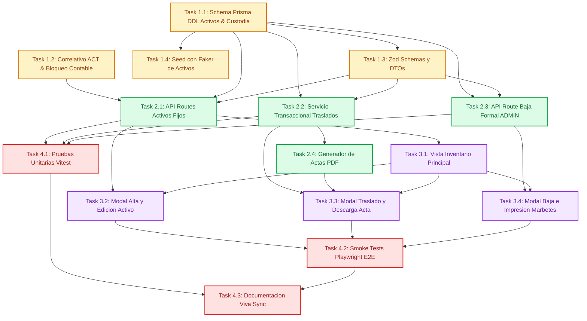

# Tasks: Gestión de Activos Fijos, Inventario y Custodia

> 📋 Generated by `task-planner` · 2026-10-08
> ✅ Approved by: JeremyJS · 2026-10-08

## Traceability
- **Work Item**: Sub-módulo 02 (Gestión de Activos Fijos, Inventario y Custodia)
- **Branch**: `feature/activos-fijos-02-gestion-activos-custodia`

## Metadata
- **Based on:** [design.md](./design.md)
- **Total estimate:** ~23h (incluye 20% de margen para imprevistos)
- **Number of waves:** 4 (Wave 1 a Wave 4 — Wave 0 omitida por infraestructura previa en Sub-módulo 00)
- **Number of tasks:** 15 tareas atómicas
- **Sprint:** Sprint 1 (Activos Fijos UNAPEC - Integraciones I)
- **Assignee:** JeremyJS

## Estimation Rules
- Máximo **4 horas** por tarea (las tareas más complejas se descomponen en subtareas atómicas).
- Las estimaciones cubren implementación, pruebas unitarias integradas y revisión de código.
- Se incorpora un **buffer del 20%** para contingencias técnicas o ajustes de dependencias.
- Las tareas operan sobre la infraestructura base de `app/` provista por la Wave 0 del Sub-módulo 00 (`decision-scaffolding-ownership-module-00`).

## Dependency Graph

---

## Wave 1: Foundation & Setup (~5h)

### Task 1.1: Esquema de Base de Datos Prisma (`schema.prisma`) y Migración DDL (~1.5h)
- **Description:** Extender el esquema Prisma (`app/prisma/schema.prisma`) incorporando los modelos `ActivoFijo`, `HistorialCustodia` e `HistorialBaja`, definiendo claves foráneas hacia `TipoActivo`, `Departamento`, `Empleado` y `Usuario`, tipos monetarios `Decimal(14,2)` y los 8 índices B-Tree de consulta rápida.
- **Acceptance criteria:**
  - [x] Modelo `ActivoFijo` implementado con campos obligatorios (`codigo`, `descripcion`, `costoAdquisicion`, `valorResidual`, `depreciacionAcumulada`, `valorEnLibros`, `estado`) y metadatos físicos (`marca`, `modelo`, `numeroSerie`).
  - [x] Modelo `HistorialCustodia` implementado con estructura append-only (`empleadoAnteriorId`, `empleadoNuevoId`, `departamentoAnteriorId`, `departamentoNuevoId`, `motivo`, `justificacion`, `autorizadoPorId`).
  - [x] Modelo `HistorialBaja` implementado con `activoId` único, `motivoBaja`, `justificacion`, `numeroActa`, `fechaBaja` y `autorizadoPorId`.
  - [x] Migración generada y aplicada con éxito (`prisma migrate dev --name add_gestion_activos_custodia`).
- **Dependencies:** Sub-módulo 00 (Prisma & DB setup) y Sub-módulo 01 (Catálogos base)
- **Files to create/modify:** `app/prisma/schema.prisma`, `app/prisma/migrations/*`

### Task 1.2: Generador de Código Correlativo y Motor de Bloqueo Contable (~1.5h)
- **Description:** Implementar la utilidad `app/lib/services/asset-code.service.ts` para generar códigos institucionales atómicos bajo el formato `ACT-YYYY-NNNN` con secuencia correlativa anual protegida contra condiciones de carrera, y la utilidad `app/lib/validators/asset-lock.ts` para verificar si un bien posee períodos contables de depreciación cerrados, bloqueando la alteración de campos financieros críticos.
- **Acceptance criteria:**
  - [x] Función `generarCodigoActivo(tx: PrismaClient): Promise<string>` genera la secuencia correlativa rellenada con 4 ceros (ej. `ACT-2026-0001`) garantizando unicidad.
  - [x] Función `validarBloqueoFinanciero(activoId: string): Promise<boolean>` determina si el activo ha sido depreciado previamente.
  - [x] Pruebas unitarias comprobando concurrencia de códigos y detección de bloqueo contable.
- **Dependencies:** Task 1.1
- **Files to create/modify:** `app/lib/services/asset-code.service.ts`, `app/lib/validators/asset-lock.ts`

### Task 1.3: Schemas de Validación Zod y Tipos DTO Compartidos (~1h)
- **Description:** Diseñar los schemas de validación Zod en `app/lib/schemas/asset.schema.ts` para la creación, actualización física, traslados de custodia y desincorporación formal de activos, integrando validación de importes positivos, longitud mínima de justificaciones y reglas de fechas no futuras.
- **Acceptance criteria:**
  - [x] `CreateAssetSchema` valida costo > 0, valor residual <= costo y fechaAdquisicion no futura.
  - [x] `UpdateAssetSchema` restringe campos modificables a metadatos físicos y ubicación.
  - [x] `TransferCustodySchema` exige nuevo custodio o departamento y justificación >= 10 caracteres.
  - [x] `DisposeAssetSchema` exige motivo válido, número de acta y justificación >= 20 caracteres.
  - [x] Tipos TypeScript inferidos (`CreateAssetDTO`, `TransferCustodyDTO`, etc.) exportados.
- **Dependencies:** None
- **Files to create/modify:** `app/lib/schemas/asset.schema.ts`

### Task 1.4: Extensión de Semillas Deterministas con Faker (`seed.ts`) (~1h)
- **Description:** Extender `app/prisma/seed.ts` con semilla determinista (`42`) para generar 30 activos institucionales distribuidos entre los departamentos y empleados creados en el Sub-módulo 01, con marcas reales (Dell, HP, Epson, Cisco), números de serie y registros iniciales en `HistorialCustodia`.
- **Acceptance criteria:**
  - [x] Script registra 30 activos fijos en estado `ACTIVO` con códigos `ACT-2026-0001` a `ACT-2026-0030`.
  - [x] Cada activo cuenta con su respectiva entrada en `HistorialCustodia` con motivo 'ALTA_INICIAL'.
  - [x] Se incluye al menos 1 activo en estado `DADO_DE_BAJA` con su respectivo `HistorialBaja` de prueba.
  - [x] Comando `pnpm prisma db seed` ejecuta la inserción sin errores de integridad referencial.
- **Dependencies:** Task 1.1, Task 1.3
- **Files to create/modify:** `app/prisma/seed.ts`

---

## Wave 2: Core Implementation (~6.5h)

### Task 2.1: Endpoints API de Gestión de Activos Fijos (`/api/activos`) (~2h)
- **Description:** Implementar los Route Handlers para operaciones CRUD de activos fijos, integrando paginación server-side, búsqueda instantánea por código, descripción o número de serie, filtrado multicriterio por departamento, tipo, custodio y estado, creación con código correlativo automático y actualización con bloqueo contable.
- **Acceptance criteria:**
  - [x] `GET /api/activos` retorna listado paginado con relaciones embebidas y filtros combinados.
  - [x] `POST /api/activos` valida payload con Zod, crea el activo e inserta la primera entrada en `HistorialCustodia` bajo transacción atómica.
  - [x] `GET /api/activos/[id]` retorna ficha técnica completa y bandera `poseeHistorialDepreciacion`.
  - [x] `PUT /api/activos/[id]` actualiza metadatos físicos y rechaza con 409 Conflict si se intentan modificar campos financieros en un activo depreciado.
- **Dependencies:** Task 1.1, Task 1.2, Task 1.3
- **Files to create/modify:** `app/app/api/activos/route.ts`, `app/app/api/activos/[id]/route.ts`

### Task 2.2: Servicio Transaccional de Custodia y Endpoint de Traslados (~1.5h)
- **Description:** Implementar el servicio `app/lib/services/custody-transfer.service.ts` y los Route Handlers `/api/activos/[id]/traslados` para registrar reasignaciones departamentales y de custodio mediante transacción ACID en Prisma (`prisma.$transaction`), bloqueando traslados en activos dados de baja o sin cambios reales de custodia.
- **Acceptance criteria:**
  - [ ] `POST /api/activos/[id]/traslados` ejecuta la actualización del activo y la inserción en `HistorialCustodia` en una única transacción atómica.
  - [ ] Rechaza con HTTP 400 (`ASSET_DISPOSED_CANNOT_TRANSFER`) si el bien está desincorporado.
  - [ ] Rechaza con HTTP 422 (`NO_CUSTODY_CHANGE_DETECTED`) si el custodio y departamento destino son idénticos a los actuales.
  - [ ] `GET /api/activos/[id]/traslados` retorna el historial cronológico descendente del activo.
- **Dependencies:** Task 1.1, Task 1.3
- **Files to create/modify:** `app/app/api/activos/[id]/traslados/route.ts`, `app/lib/services/custody-transfer.service.ts`

### Task 2.3: Endpoint de Desincorporación y Baja Formal de Activo Fijo (~1.5h)
- **Description:** Implementar el Route Handler `POST /api/activos/[id]/baja` para la desincorporación formal de bienes institucionales, restringiendo la operación exclusivamente a usuarios con rol `ADMIN`, actualizando el estado de forma irreversible a `DADO_DE_BAJA` y generando el registro en `HistorialBaja`.
- **Acceptance criteria:**
  - [ ] Verifica que el usuario autenticado posea rol `ADMIN` (rechaza con HTTP 403 Forbidden para otros roles).
  - [ ] Valida payload con `DisposeAssetSchema` (motivo válido, número de acta y justificación >= 20 caracteres).
  - [ ] Actualiza estado a `DADO_DE_BAJA` y registra `HistorialBaja` en transacción ACID.
  - [ ] Rechaza con HTTP 409 Conflict si el activo ya fue desincorporado previamente.
- **Dependencies:** Task 1.1, Task 1.3
- **Files to create/modify:** `app/app/api/activos/[id]/baja/route.ts`

### Task 2.4: Servicio de Emisión y Descarga de Actas Digitales en PDF (~1.5h)
- **Description:** Implementar el generador de actas de entrega/recepción de custodia con `@react-pdf/renderer` en `app/lib/services/pdf-receipt.service.ts` y el Route Handler `GET /api/activos/[id]/acta-entrega`, emitiendo un documento PDF tamaño Carta membretado con formato institucional UNAPEC y bloques de firmas.
- **Acceptance criteria:**
  - [ ] Genera documento PDF con membrete oficial UNAPEC, detalles técnicos del activo, fecha/hora y datos del custodio con cédula formateada.
  - [ ] Incorpora cláusula formal de responsabilidad de custodia y líneas de firma para entrega y recepción.
  - [ ] Endpoint transmite el binario con cabeceras HTTP `Content-Type: application/pdf` y `Content-Disposition`.
- **Dependencies:** Task 2.2
- **Files to create/modify:** `app/app/api/activos/[id]/acta-entrega/route.ts`, `app/lib/services/pdf-receipt.service.tsx`

---

## Wave 3: UI & Integration (~6.5h)

### Task 3.1: Vista Principal de Inventario de Activos Fijos (`/activos`) (~2h)
- **Description:** Desarrollar la interfaz principal de inventario en `app/app/activos/page.tsx`, utilizando la tabla de datos reutilizable con barra de búsqueda instantánea (debounce de 200ms), filtros combinados por Departamento, Tipo de Activo, Custodio y Estado, badges de estado de color diferenciado, paginador server-side y botones de acción.
- **Acceptance criteria:**
  - [ ] Ruta `/activos` renderiza la grilla de inventario con paginación server-side reactiva.
  - [ ] Búsqueda por texto filtra en tiempo real por código, descripción o número de serie.
  - [ ] Badges visuales identifican claramente estados (`ACTIVO` en verde, `EN_MANTENIMIENTO` en amarillo, `DADO_DE_BAJA` en rojo).
  - [ ] Menú de acciones por fila permite: Ver Detalle, Editar, Trasladar, Imprimir Marbete y Dar de Baja (condicional a rol).
- **Dependencies:** Task 2.1
- **Files to create/modify:** `app/app/activos/page.tsx`, `app/components/activos/asset-table.tsx`

### Task 3.2: Modal de Formulario de Alta y Edición de Activos (~1.5h)
- **Description:** Implementar el diálogo modal `app/components/activos/asset-dialog.tsx` utilizando React Hook Form y Zod resolver para registrar nuevos activos y editar bienes existentes, con selectores dinámicos para catálogos y bloqueo visual de campos financieros si el activo ya fue depreciado.
- **Acceptance criteria:**
  - [ ] Formulario de alta valida en tiempo real importes numéricos y campos obligatorios.
  - [ ] Selectores alimentados dinámicamente con departamentos, tipos de activo y custodios activos.
  - [ ] Modo edición deshabilita campos financieros con tooltip explicativo si `poseeHistorialDepreciacion` es verdadero.
  - [ ] Notificación Toast de confirmación al guardar exitosamente.
- **Dependencies:** Task 2.1, Task 3.1
- **Files to create/modify:** `app/components/activos/asset-dialog.tsx`

### Task 3.3: Modal Transaccional de Traslado y Descarga de Acta PDF (~1.5h)
- **Description:** Construir el modal de reasignación de custodia `app/components/activos/transfer-dialog.tsx` que permite seleccionar el nuevo custodio y departamento, ingresar la justificación obligatoria y, tras confirmar la transacción, ofrece la descarga inmediata del acta de entrega en PDF.
- **Acceptance criteria:**
  - [ ] Muestra custodio y departamento actual como referencia en modo solo lectura.
  - [ ] Valida que el nuevo custodio o departamento difiera del actual y que la justificación tenga al menos 10 caracteres.
  - [ ] Al completar el traslado, despliega botón directo 'Descargar Acta de Entrega (PDF)'.
  - [ ] Refresca la tabla de inventario automáticamente.
- **Dependencies:** Task 2.2, Task 2.4, Task 3.1
- **Files to create/modify:** `app/components/activos/transfer-dialog.tsx`

### Task 3.4: Modal de Baja Formal y Vista de Impresión de Marbetes (~1.5h)
- **Description:** Desarrollar el modal de desincorporación formal `app/components/activos/disposal-dialog.tsx` (visible y ejecutable únicamente para usuarios `ADMIN`) y la plantilla de marbete imprimible `app/components/activos/asset-badge-print.tsx` con estilos `@media print` para etiquetas de 50mm x 25mm.
- **Acceptance criteria:**
  - [ ] Modal de baja exige motivo formal, justificación técnica (mínimo 20 caracteres) y número de acta con confirmación de alerta destructiva.
  - [ ] Botón de baja permanece deshabilitado/oculto para usuarios con rol distinto de `ADMIN`.
  - [ ] Vista de marbete formatea código correlativo visible, logotipo UNAPEC, descripción, serial y custodio lista para imprimir.
- **Dependencies:** Task 2.1, Task 2.3, Task 3.1
- **Files to create/modify:** `app/components/activos/disposal-dialog.tsx`, `app/components/activos/asset-badge-print.tsx`

---

## Wave 4: Testing & Polish (~5h)

### Task 4.1: Pruebas Unitarias e Integración con Vitest (~2h)
- **Description:** Implementar la suite completa de pruebas unitarias para el generador de código correlativo, reglas de bloqueo contable, validaciones Zod y pruebas de integración de los Route Handlers de activos, traslados y bajas.
- **Acceptance criteria:**
  - [ ] Pruebas unitarias para `generarCodigoActivo` validan formato `ACT-YYYY-NNNN` y unicidad.
  - [ ] Pruebas de integración sobre traslados comprueban atomicidad ACID y rechazo de activos dados de baja.
  - [ ] Pruebas sobre endpoint de baja comprueban restricción estricta de rol `ADMIN` (HTTP 403 para `OPERADOR`).
  - [ ] Cobertura de código superior al 85% en librerías de servicio y validadores (`app/lib/*`).
- **Dependencies:** Task 2.1, Task 2.2, Task 2.3
- **Files to create/modify:** `app/tests/services/asset.test.ts`, `app/tests/api/activos.test.ts`

### Task 4.2: Pruebas End-to-End de Humo con Playwright (~2h)
- **Description:** Desarrollar pruebas E2E de humo en Playwright simulando el flujo operativo completo: alta de un activo institucional, búsqueda y filtrado en la grilla de inventario, reasignación de custodio con descarga de acta PDF, e intento y ejecución de baja formal por un administrador.
- **Acceptance criteria:**
  - [ ] Flujo E2E de registro de activo y verificación en tabla ejecutando en modo headless.
  - [ ] Prueba de traslado valida actualización inmediata del custodio y verifica respuesta del PDF.
  - [ ] Prueba de baja valida bloqueo permanente del activo y cambio visual del badge a 'DADO_DE_BAJA'.
- **Dependencies:** Task 3.2, Task 3.3, Task 3.4
- **Files to create/modify:** `app/e2e/activos-custodia-smoke.spec.ts`

### Task 4.3: Sincronización de Documentación Viva de Arquitectura (~1h)
- **Description:** Actualizar la documentación viva del proyecto (`docs/modules/activos-fijos.md` y `docs/architecture/database-architecture.md`) integrando el modelo de datos de activos fijos, bitácoras de custodia y bajas, y el catálogo de endpoints certificados del Sub-módulo 02.
- **Acceptance criteria:**
  - [ ] `docs/modules/activos-fijos.md` actualiza la Matriz de Capacidades marcando el Sub-módulo 02 en progreso/especificado.
  - [ ] Diagrama ERD maestro consolidado con las entidades `ActivoFijo`, `HistorialCustodia` e `HistorialBaja`.
  - [ ] Sin filas rotas en tablas Markdown ni caracteres mojibake.
- **Dependencies:** Task 4.1, Task 4.2
- **Files to create/modify:** `docs/modules/activos-fijos.md`, `docs/architecture/database-architecture.md`

---

## Implementation Order Summary
| Order | Wave | Task | Description | Est. | Depends On |
|-------|------|------|-------------|------|------------|
| 1 | Wave 1 | Task 1.1 | Schema Prisma DDL Activos & Custodia | ~1.5h | Sub-módulo 00, 01 |
| 2 | Wave 1 | Task 1.2 | Correlativo ACT & Bloqueo Contable | ~1.5h | 1.1 |
| 3 | Wave 1 | Task 1.3 | Zod Schemas y DTOs Compartidos | ~1.0h | — |
| 4 | Wave 1 | Task 1.4 | Seed con Faker de Activos y Custodia | ~1.0h | 1.1, 1.3 |
| 5 | Wave 2 | Task 2.1 | API Routes Activos Fijos | ~2.0h | 1.1, 1.2, 1.3 |
| 6 | Wave 2 | Task 2.2 | Servicio Transaccional de Traslados | ~1.5h | 1.1, 1.3 |
| 7 | Wave 2 | Task 2.3 | API Route Baja Formal (Solo ADMIN) | ~1.5h | 1.1, 1.3 |
| 8 | Wave 2 | Task 2.4 | Generador de Actas PDF (@react-pdf) | ~1.5h | 2.2 |
| 9 | Wave 3 | Task 3.1 | Vista Principal de Inventario (/activos) | ~2.0h | 2.1 |
| 10 | Wave 3 | Task 3.2 | Modal Alta y Edición de Activo | ~1.5h | 2.1, 3.1 |
| 11 | Wave 3 | Task 3.3 | Modal Traslado y Descarga de Acta PDF | ~1.5h | 2.2, 2.4, 3.1 |
| 12 | Wave 3 | Task 3.4 | Modal Baja Formal e Impresión Marbetes | ~1.5h | 2.1, 2.3, 3.1 |
| 13 | Wave 4 | Task 4.1 | Pruebas Unitarias e Integración Vitest | ~2.0h | 2.1, 2.2, 2.3 |
| 14 | Wave 4 | Task 4.2 | Smoke Tests Playwright E2E | ~2.0h | 3.2, 3.3, 3.4 |
| 15 | Wave 4 | Task 4.3 | Sincronización Documentación Viva | ~1.0h | 4.1, 4.2 |

## Total Estimate: ~23h (incluye 20% buffer de contingencia)

## Completion Checklist
- [ ] Todas las 15 tareas completadas y verificadas.
- [ ] Modelos de datos `ActivoFijo`, `HistorialCustodia` e `HistorialBaja` migrados en PostgreSQL vía Prisma.
- [ ] Generación correlativa de código `ACT-YYYY-NNNN` funcionando con concurrencia segura.
- [ ] Reasignación de custodia ejecutando en bloque transaccional atómico ACID.
- [ ] Descarga de Acta de Asignación en formato PDF tamaño Carta funcionando correctamente.
- [ ] Proceso de baja formal restringido a rol `ADMIN` con congelamiento irreversible.
- [ ] Pruebas unitarias e integración en verde con cobertura superior al 85%.
- [ ] Suite E2E en Playwright ejecutando satisfactoriamente en modo headless.
- [ ] Documentación viva de módulos y arquitectura sincronizada.

---
> 📍 [02-gestion-activos-custodia] · 🌿 `feature/activos-fijos-02-gestion-activos-custodia` · Generated by SDD Standard
