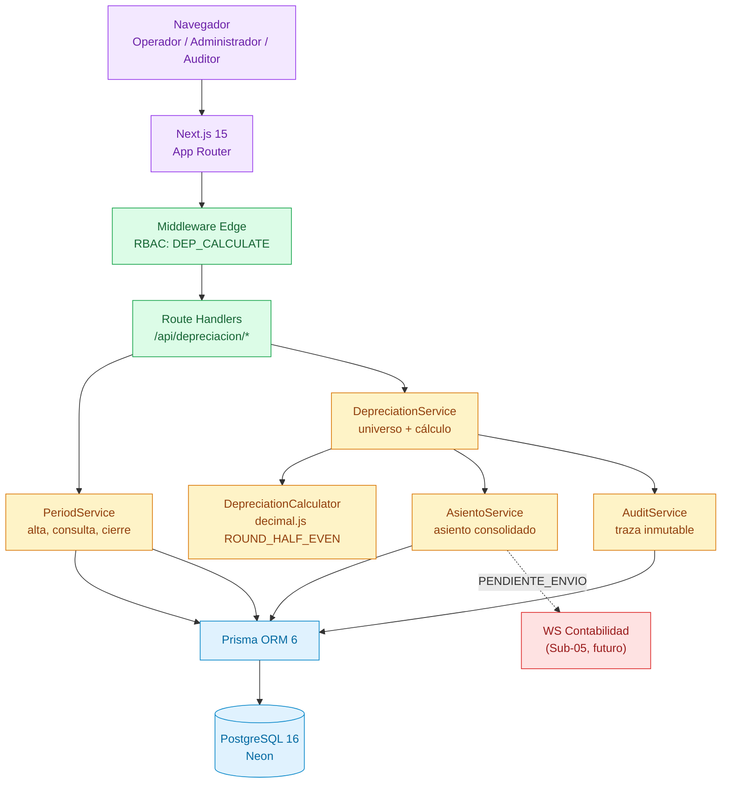
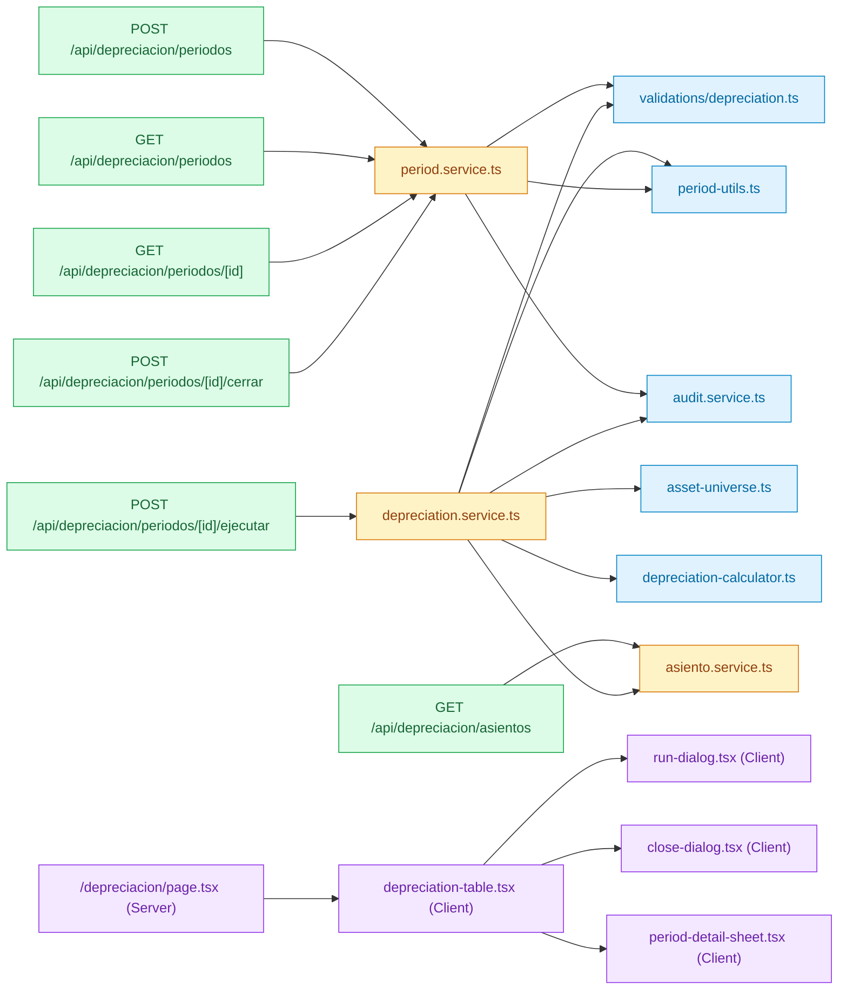
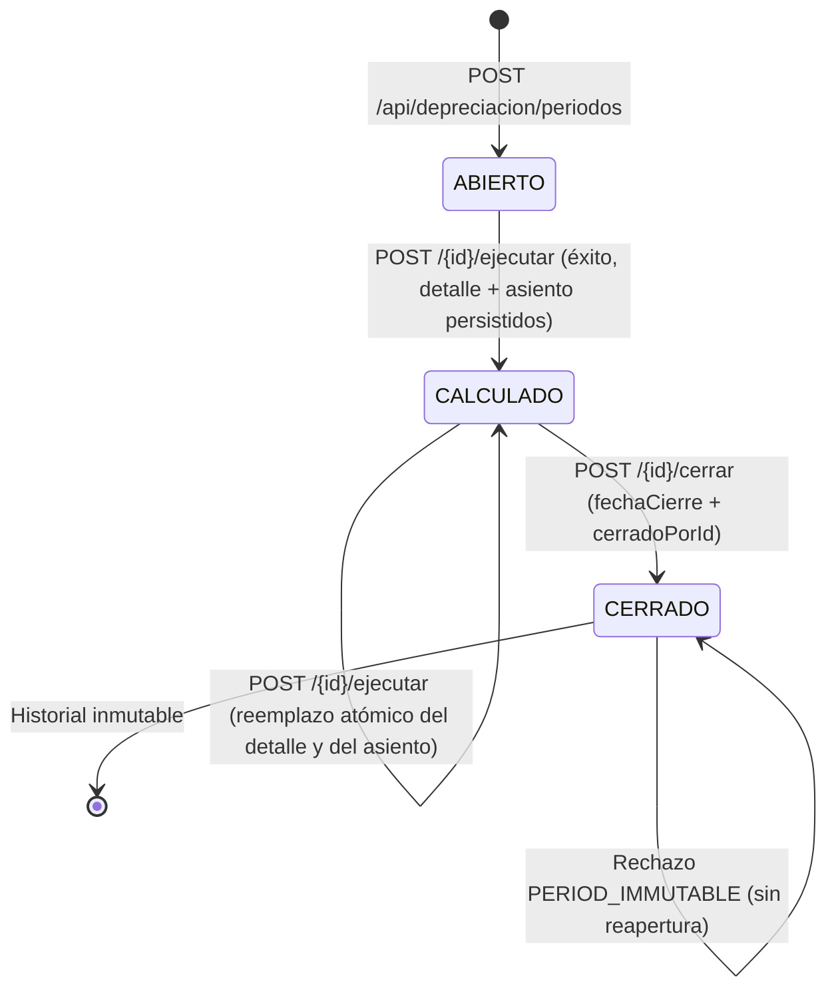

# Design: Motor de Depreciación y Contabilización DGII

> 📋 Generated by `solution-designer` · 2026-11-02
> ✅ Approved by: JeremyJS (Developer) · 2026-11-02
> ⚠️ **MANDATORY QUALITY GATE (Hard Gate 12)**: Technical design MUST explicitly specify DDL schemas with exact SQL data types, foreign keys, and constraints; REST endpoint contracts with real JSON request and response payloads (including RFC 7807 error structures); and renderable Mermaid diagrams. Superficial summaries, placeholders ('TODO', 'TBD'), or truncated lists are strictly prohibited.

## Traceability
- **Work Item**: Sub-módulo 03 (Motor de Depreciación y Contabilización DGII) — modo standalone, sin Work Item en Azure DevOps
- **Parent**: [ActivaCore — Sistema de Gestión de Activos Fijos & Contabilización DGII](../../../docs/modules/activos-fijos.md)
- **Branch**: `feature/activos-fijos-03-motor-depreciacion`
- **Requirements**: [requirements.md](./requirements.md)
- **Test Plan**: [test-plan.md](./test-plan.md)
- **Test Cases**: [test-cases.md](./test-cases.md)

## Technology Decisions

- **Frontend**: Next.js 15 (App Router, React 19, Server Components) + TailwindCSS v4 + shadcn/ui — continúa la base ya certificada en los Sub-módulos 00, 01 y 02; el listado de períodos se resuelve como Server Component con paginación en servidor y el detalle como Client Component interactivo.
- **Backend**: Route Handlers de Next.js sobre Node.js runtime (no Edge) — la corrida requiere acceso a PostgreSQL vía Prisma, transacciones interactivas y `decimal.js`; el Edge runtime no soporta el driver TCP.
- **Database**: PostgreSQL 16 (Neon Cloud) con Prisma ORM 6 — ya provisionado; se requieren transacciones `Serializable`/`ReadCommitted` con bloqueo `SELECT ... FOR UPDATE` sobre el período para serializar corridas concurrentes.
- **Aritmética monetaria**: `decimal.js` con configuración `{ precision: 28, rounding: Decimal.ROUND_HALF_EVEN }` — prohibido el uso de `number` nativo para montos; `Prisma.Decimal` en la frontera de persistencia (NFR-001).
- **Cloud Services**: Neon PostgreSQL (base de datos gestionada); sin servicios adicionales en este sub-módulo. El despacho al Web Service de Contabilidad queda diferido al Sub-05.
- **Theme**: Identidad institucional UNAPEC — consola administrativa bajo el sistema de diseño `DESIGN.md` (regla No-Line, sidebar 240px, triada tipográfica con monoespaciada para cifras).

### Decisión técnica: cuenta de gasto por depreciación

`TipoActivo` modela `cuentaContableCompra` y `cuentaContableDepreciacion`, pero el asiento exige una cuenta de **gasto** (débito). Se adopta la alternativa de **agregar el campo `cuentaContableGastoDepreciacion` (VARCHAR(20), nullable)** al modelo `TipoActivo`, con backfill por categoría fiscal:

| Método | Cuenta de gasto por defecto |
|--------|-----------------------------|
| `DGII_CAT1` | `6-30-01-0001` (Gasto depreciación edificaciones) |
| `DGII_CAT2` | `6-30-01-0002` (Gasto depreciación equipos) |
| `DGII_CAT3` | `6-30-01-0003` (Gasto depreciación maquinaria) |
| `LINEA_RECTA` | `6-30-01-0002` (Gasto depreciación equipos, por defecto) |

Alternativas descartadas: cuenta global única en parámetros del sistema (pierde granularidad contable por tipo) y asiento de una sola línea (descuadra débito/crédito). Es una decisión **técnica** que no altera ninguna regla funcional aprobada en `requirements.md`.

**Alcance del cambio:** la columna se agrega mediante la migración del propio Sub-03 (`20261102000000_add_motor_depreciacion`) y **no modifica código del Sub-01**: no se tocan sus endpoints, formularios, validadores, exportación ni pruebas. La cuenta se resuelve en el `AsientoService` como `tipoActivo.cuentaContableGastoDepreciacion ?? valorPorDefecto(metodoDepreciacion)`, por lo que el catálogo del Sub-01 sigue funcionando sin cambios. La edición manual del override queda fuera de alcance de este sub-módulo.

## Architecture

### System Overview



### Component Diagram



## Deployment

- **Pattern**: fullstack-vercel
- **App**: Next.js 15 desplegado como aplicación fullstack única (Route Handlers + Server Components en el mismo artefacto)
- **Infra**: Neon PostgreSQL 16 (base de datos gestionada, connection pooling con PgBouncer)
- **CI/CD**: GitHub Actions → `dev` despliega a Vercel Preview/Development; `qa` a entorno QA; `main` a producción. Migraciones ejecutadas con `prisma migrate deploy` como paso previo al build.
- **Justification**: el sub-módulo no introduce servicios externos nuevos; reutiliza la infraestructura ya certificada y mantiene el aislamiento de la subcarpeta `app/`.
- **Discarded**: worker asíncrono dedicado (el volumen de 1,000 activos se procesa en menos de 5 s dentro del request); Edge runtime (sin soporte de driver TCP de PostgreSQL); job programado con cron (fuera de alcance).

### Environments

| Environment | URL | Deploy trigger |
|-------------|-----|----------------|
| Local | `http://localhost:3000` | `npm run dev` en `app/` |
| Development | Pendiente de configuración (`environments.dev.url` vacío) | Merge a `dev` |
| QA | Pendiente de configuración (`environments.qa.url` vacío) | Merge de `release/corte-*` a `qa` |
| Production | Pendiente de configuración (`environments.prod.url` vacío) | Merge de `release/prod-*` a `main` |

## Database Schema

### Table: periodos_depreciacion

| Column | Type | Constraints | Default | Description |
|--------|------|------------|---------|-------------|
| `id` | `VARCHAR(36)` | PK | `uuid()` | Identificador del período |
| `anio` | `INTEGER` | NOT NULL, CHECK (`anio BETWEEN 2000 AND 2100`) | — | Año fiscal del período |
| `mes` | `INTEGER` | NOT NULL, CHECK (`mes BETWEEN 1 AND 12`) | — | Mes del período |
| `estado` | `VARCHAR(20)` | NOT NULL, CHECK (`estado IN ('ABIERTO','CALCULADO','CERRADO')`) | `'ABIERTO'` | Estado del ciclo de vida |
| `fecha_corte` | `DATE` | NOT NULL | — | Último día del mes del período |
| `total_activos` | `INTEGER` | NOT NULL | `0` | Activos procesados con cuota > 0 |
| `total_cuota` | `DECIMAL(14,2)` | NOT NULL | `0.00` | Suma de cuotas de la corrida |
| `activos_omitidos` | `INTEGER` | NOT NULL | `0` | Activos con vida útil agotada o no depreciables |
| `activos_excluidos` | `INTEGER` | NOT NULL | `0` | Activos excluidos por estado o baja |
| `fecha_ejecucion` | `TIMESTAMPTZ` | NULL | — | Momento de la última corrida exitosa |
| `ejecutado_por_id` | `VARCHAR(36)` | FK → `usuarios(id)` ON DELETE RESTRICT, NULL | — | Usuario que ejecutó la corrida |
| `fecha_cierre` | `TIMESTAMPTZ` | NULL | — | Momento del cierre inmutable |
| `cerrado_por_id` | `VARCHAR(36)` | FK → `usuarios(id)` ON DELETE RESTRICT, NULL | — | Usuario que cerró el período |
| `created_at` | `TIMESTAMPTZ` | NOT NULL | `now()` | Auditoría de creación |
| `updated_at` | `TIMESTAMPTZ` | NOT NULL | `now()` | Auditoría de actualización |

Restricciones adicionales: `UNIQUE (anio, mes)`, `CHECK (fecha_cierre IS NULL OR estado = 'CERRADO')`, `CHECK (total_debito_equilibrio)` no aplica en esta tabla.

### Table: detalle_depreciacion

| Column | Type | Constraints | Default | Description |
|--------|------|------------|---------|-------------|
| `id` | `VARCHAR(36)` | PK | `uuid()` | Identificador del detalle |
| `periodo_id` | `VARCHAR(36)` | FK → `periodos_depreciacion(id)` ON DELETE CASCADE, NOT NULL | — | Período al que pertenece |
| `activo_id` | `VARCHAR(36)` | FK → `activos_fijos(id)` ON DELETE RESTRICT, NOT NULL | — | Activo depreciado |
| `cuota_mensual` | `DECIMAL(14,2)` | NOT NULL, CHECK (`cuota_mensual >= 0`) | — | Cuota calculada del mes |
| `depreciacion_acumulada_anterior` | `DECIMAL(14,2)` | NOT NULL | — | Acumulada antes de la cuota |
| `depreciacion_acumulada_nueva` | `DECIMAL(14,2)` | NOT NULL | — | Acumulada después de la cuota |
| `valor_en_libros_anterior` | `DECIMAL(14,2)` | NOT NULL | — | Valor en libros antes de la cuota |
| `valor_en_libros_nuevo` | `DECIMAL(14,2)` | NOT NULL | — | Valor en libros después de la cuota |
| `tipo_cuota` | `VARCHAR(20)` | NOT NULL, CHECK (`tipo_cuota IN ('NORMAL','ULTIMA','NO_DEPRECIABLE')`) | `'NORMAL'` | Clasificación de la cuota |
| `es_cuota_final` | `BOOLEAN` | NOT NULL | `false` | Marca de cierre de vida útil |
| `created_at` | `TIMESTAMPTZ` | NOT NULL | `now()` | Auditoría de creación |

Restricciones adicionales: `UNIQUE (periodo_id, activo_id)` (REQ-DEP-004), `CHECK (valor_en_libros_nuevo = valor_en_libros_anterior - cuota_mensual)`.

### Table: asientos_contables

| Column | Type | Constraints | Default | Description |
|--------|------|------------|---------|-------------|
| `id` | `VARCHAR(36)` | PK | `uuid()` | Identificador del asiento |
| `numero_asiento` | `VARCHAR(20)` | UNIQUE, NOT NULL | — | Correlativo `DEP-{anio}{mes}-{seq}` |
| `periodo_id` | `VARCHAR(36)` | FK → `periodos_depreciacion(id)` ON DELETE RESTRICT, UNIQUE, NOT NULL | — | Período origen |
| `concepto` | `VARCHAR(150)` | NOT NULL | — | `Depreciación {mes}/{anio}` |
| `fecha_contable` | `DATE` | NOT NULL | — | Último día del período |
| `estado` | `VARCHAR(20)` | NOT NULL, CHECK (`estado IN ('PENDIENTE_ENVIO','ENVIADO','ERROR')`) | `'PENDIENTE_ENVIO'` | Estado de despacho |
| `total_debito` | `DECIMAL(14,2)` | NOT NULL, CHECK (`total_debito >= 0`) | `0.00` | Suma de débitos |
| `total_credito` | `DECIMAL(14,2)` | NOT NULL, CHECK (`total_credito >= 0`) | `0.00` | Suma de créditos |
| `created_at` | `TIMESTAMPTZ` | NOT NULL | `now()` | Auditoría de creación |
| `updated_at` | `TIMESTAMPTZ` | NOT NULL | `now()` | Auditoría de actualización |

Restricción adicional: `CHECK (total_debito = total_credito)`.

### Table: lineas_asiento

| Column | Type | Constraints | Default | Description |
|--------|------|------------|---------|-------------|
| `id` | `VARCHAR(36)` | PK | `uuid()` | Identificador de la línea |
| `asiento_id` | `VARCHAR(36)` | FK → `asientos_contables(id)` ON DELETE CASCADE, NOT NULL | — | Asiento contenedor |
| `cuenta_contable` | `VARCHAR(20)` | NOT NULL, CHECK (`cuenta_contable ~ '^[1-9]-[0-9]{2}-[0-9]{2}-[0-9]{4}$'`) | — | Cuenta afectada |
| `tipo_movimiento` | `VARCHAR(10)` | NOT NULL, CHECK (`tipo_movimiento IN ('DEBITO','CREDITO')`) | — | Naturaleza del movimiento |
| `monto` | `DECIMAL(14,2)` | NOT NULL, CHECK (`monto >= 0`) | — | Importe de la línea |
| `descripcion` | `VARCHAR(150)` | NOT NULL | — | Glosa de la línea |
| `created_at` | `TIMESTAMPTZ` | NOT NULL | `now()` | Auditoría de creación |

### Table: tipos_activos (ALTER)

| Column | Type | Constraints | Default | Description |
|--------|------|------------|---------|-------------|
| `cuenta_contable_gasto_depreciacion` | `VARCHAR(20)` | NULL (nullable en migración; requerida por validación de aplicación) | `NULL` | Cuenta de gasto por depreciación (débito) |

### Indexes

| Name | Columns | Type |
|------|---------|------|
| `periodos_depreciacion_anio_mes_key` | `(anio, mes)` | UNIQUE B-Tree |
| `periodos_depreciacion_estado_idx` | `(estado)` | B-Tree |
| `periodos_depreciacion_ejecutado_por_id_idx` | `(ejecutado_por_id)` | B-Tree |
| `detalle_depreciacion_periodo_activo_key` | `(periodo_id, activo_id)` | UNIQUE B-Tree |
| `detalle_depreciacion_activo_idx` | `(activo_id)` | B-Tree |
| `detalle_depreciacion_periodo_idx` | `(periodo_id)` | B-Tree |
| `asientos_contables_periodo_id_key` | `(periodo_id)` | UNIQUE B-Tree |
| `asientos_contables_estado_idx` | `(estado)` | B-Tree |
| `lineas_asiento_asiento_id_idx` | `(asiento_id)` | B-Tree |
| `tipos_activos_cuenta_gasto_idx` | `(cuenta_contable_gasto_depreciacion)` | B-Tree |

### Prisma Model (referencia de implementación)

```prisma
model PeriodoDepreciacion {
  id               String    @id @default(uuid()) @db.VarChar(36)
  anio             Int
  mes              Int
  estado           String    @default("ABIERTO") @db.VarChar(20)
  fechaCorte       DateTime  @map("fecha_corte") @db.Date
  totalActivos     Int       @default(0) @map("total_activos")
  totalCuota       Decimal   @default(0.00) @map("total_cuota") @db.Decimal(14, 2)
  activosOmitidos  Int       @default(0) @map("activos_omitidos")
  activosExcluidos Int       @default(0) @map("activos_excluidos")
  fechaEjecucion   DateTime? @map("fecha_ejecucion") @db.Timestamptz
  ejecutadoPorId   String?   @map("ejecutado_por_id") @db.VarChar(36)
  fechaCierre      DateTime? @map("fecha_cierre") @db.Timestamptz
  cerradoPorId     String?   @map("cerrado_por_id") @db.VarChar(36)
  createdAt        DateTime  @default(now()) @map("created_at") @db.Timestamptz
  updatedAt        DateTime  @updatedAt @map("updated_at") @db.Timestamptz

  ejecutadoPor Usuario? @relation("PeriodoEjecutadoPor", fields: [ejecutadoPorId], references: [id], onDelete: Restrict)
  cerradoPor   Usuario? @relation("PeriodoCerradoPor", fields: [cerradoPorId], references: [id], onDelete: Restrict)
  detalles     DetalleDepreciacion[]
  asiento      AsientoContable?

  @@unique([anio, mes])
  @@index([estado])
  @@map("periodos_depreciacion")
}

model DetalleDepreciacion {
  id                          String   @id @default(uuid()) @db.VarChar(36)
  periodoId                   String   @map("periodo_id") @db.VarChar(36)
  activoId                    String   @map("activo_id") @db.VarChar(36)
  cuotaMensual                Decimal  @map("cuota_mensual") @db.Decimal(14, 2)
  depreciacionAcumuladaAnterior Decimal @map("depreciacion_acumulada_anterior") @db.Decimal(14, 2)
  depreciacionAcumuladaNueva  Decimal  @map("depreciacion_acumulada_nueva") @db.Decimal(14, 2)
  valorEnLibrosAnterior       Decimal  @map("valor_en_libros_anterior") @db.Decimal(14, 2)
  valorEnLibrosNuevo          Decimal  @map("valor_en_libros_nuevo") @db.Decimal(14, 2)
  tipoCuota                   String   @default("NORMAL") @map("tipo_cuota") @db.VarChar(20)
  esCuotaFinal                Boolean  @default(false) @map("es_cuota_final")
  createdAt                   DateTime @default(now()) @map("created_at") @db.Timestamptz

  periodo PeriodoDepreciacion @relation(fields: [periodoId], references: [id], onDelete: Cascade)
  activo  ActivoFijo          @relation(fields: [activoId], references: [id], onDelete: Restrict)

  @@unique([periodoId, activoId])
  @@index([activoId])
  @@map("detalle_depreciacion")
}

model AsientoContable {
  id            String   @id @default(uuid()) @db.VarChar(36)
  numeroAsiento String   @unique @map("numero_asiento") @db.VarChar(20)
  periodoId     String   @unique @map("periodo_id") @db.VarChar(36)
  concepto      String   @db.VarChar(150)
  fechaContable DateTime @map("fecha_contable") @db.Date
  estado        String   @default("PENDIENTE_ENVIO") @db.VarChar(20)
  totalDebito   Decimal  @default(0.00) @map("total_debito") @db.Decimal(14, 2)
  totalCredito  Decimal  @default(0.00) @map("total_credito") @db.Decimal(14, 2)
  createdAt     DateTime @default(now()) @map("created_at") @db.Timestamptz
  updatedAt     DateTime @updatedAt @map("updated_at") @db.Timestamptz

  periodo PeriodoDepreciacion @relation(fields: [periodoId], references: [id], onDelete: Restrict)
  lineas  LineaAsiento[]

  @@index([estado])
  @@map("asientos_contables")
}

model LineaAsiento {
  id             String   @id @default(uuid()) @db.VarChar(36)
  asientoId      String   @map("asiento_id") @db.VarChar(36)
  cuentaContable String   @map("cuenta_contable") @db.VarChar(20)
  tipoMovimiento String   @map("tipo_movimiento") @db.VarChar(10)
  monto          Decimal  @db.Decimal(14, 2)
  descripcion    String   @db.VarChar(150)
  createdAt      DateTime @default(now()) @map("created_at") @db.Timestamptz

  asiento AsientoContable @relation(fields: [asientoId], references: [id], onDelete: Cascade)

  @@index([asientoId])
  @@map("lineas_asiento")
}
```

### DDL de migración (PostgreSQL)

```sql
-- 1) Cuenta de gasto por depreciación en el catálogo
ALTER TABLE tipos_activos
  ADD COLUMN cuenta_contable_gasto_depreciacion VARCHAR(20);

UPDATE tipos_activos SET cuenta_contable_gasto_depreciacion = CASE metodo_depreciacion
  WHEN 'DGII_CAT1'   THEN '6-30-01-0001'
  WHEN 'DGII_CAT2'   THEN '6-30-01-0002'
  WHEN 'DGII_CAT3'   THEN '6-30-01-0003'
  ELSE '6-30-01-0002'
END
WHERE cuenta_contable_gasto_depreciacion IS NULL;

CREATE INDEX tipos_activos_cuenta_gasto_idx
  ON tipos_activos (cuenta_contable_gasto_depreciacion);

-- 2) Períodos
CREATE TABLE periodos_depreciacion (
  id                 VARCHAR(36) PRIMARY KEY,
  anio               INTEGER NOT NULL,
  mes                INTEGER NOT NULL,
  estado             VARCHAR(20) NOT NULL DEFAULT 'ABIERTO',
  fecha_corte        DATE NOT NULL,
  total_activos      INTEGER NOT NULL DEFAULT 0,
  total_cuota        NUMERIC(14,2) NOT NULL DEFAULT 0.00,
  activos_omitidos   INTEGER NOT NULL DEFAULT 0,
  activos_excluidos  INTEGER NOT NULL DEFAULT 0,
  fecha_ejecucion    TIMESTAMPTZ,
  ejecutado_por_id   VARCHAR(36),
  fecha_cierre       TIMESTAMPTZ,
  cerrado_por_id     VARCHAR(36),
  created_at         TIMESTAMPTZ NOT NULL DEFAULT now(),
  updated_at         TIMESTAMPTZ NOT NULL DEFAULT now(),
  CONSTRAINT periodos_depreciacion_anio_mes_key UNIQUE (anio, mes),
  CONSTRAINT periodos_depreciacion_anio_check CHECK (anio BETWEEN 2000 AND 2100),
  CONSTRAINT periodos_depreciacion_mes_check CHECK (mes BETWEEN 1 AND 12),
  CONSTRAINT periodos_depreciacion_estado_check
    CHECK (estado IN ('ABIERTO','CALCULADO','CERRADO')),
  CONSTRAINT periodos_depreciacion_cierre_check
    CHECK (fecha_cierre IS NULL OR estado = 'CERRADO'),
  CONSTRAINT periodos_depreciacion_ejecutado_fk
    FOREIGN KEY (ejecutado_por_id) REFERENCES usuarios(id) ON DELETE RESTRICT,
  CONSTRAINT periodos_depreciacion_cerrado_fk
    FOREIGN KEY (cerrado_por_id) REFERENCES usuarios(id) ON DELETE RESTRICT
);

CREATE INDEX periodos_depreciacion_estado_idx ON periodos_depreciacion (estado);
CREATE INDEX periodos_depreciacion_ejecutado_por_id_idx ON periodos_depreciacion (ejecutado_por_id);

-- 3) Detalle
CREATE TABLE detalle_depreciacion (
  id                              VARCHAR(36) PRIMARY KEY,
  periodo_id                      VARCHAR(36) NOT NULL,
  activo_id                       VARCHAR(36) NOT NULL,
  cuota_mensual                   NUMERIC(14,2) NOT NULL,
  depreciacion_acumulada_anterior NUMERIC(14,2) NOT NULL,
  depreciacion_acumulada_nueva    NUMERIC(14,2) NOT NULL,
  valor_en_libros_anterior        NUMERIC(14,2) NOT NULL,
  valor_en_libros_nuevo           NUMERIC(14,2) NOT NULL,
  tipo_cuota                      VARCHAR(20) NOT NULL DEFAULT 'NORMAL',
  es_cuota_final                  BOOLEAN NOT NULL DEFAULT false,
  created_at                      TIMESTAMPTZ NOT NULL DEFAULT now(),
  CONSTRAINT detalle_depreciacion_periodo_activo_key UNIQUE (periodo_id, activo_id),
  CONSTRAINT detalle_depreciacion_cuota_check CHECK (cuota_mensual >= 0),
  CONSTRAINT detalle_depreciacion_tipo_cuota_check
    CHECK (tipo_cuota IN ('NORMAL','ULTIMA','NO_DEPRECIABLE')),
  CONSTRAINT detalle_depreciacion_valor_check
    CHECK (valor_en_libros_nuevo = valor_en_libros_anterior - cuota_mensual),
  CONSTRAINT detalle_depreciacion_periodo_fk
    FOREIGN KEY (periodo_id) REFERENCES periodos_depreciacion(id) ON DELETE CASCADE,
  CONSTRAINT detalle_depreciacion_activo_fk
    FOREIGN KEY (activo_id) REFERENCES activos_fijos(id) ON DELETE RESTRICT
);

CREATE INDEX detalle_depreciacion_activo_idx ON detalle_depreciacion (activo_id);
CREATE INDEX detalle_depreciacion_periodo_idx ON detalle_depreciacion (periodo_id);

-- 4) Asientos
CREATE TABLE asientos_contables (
  id             VARCHAR(36) PRIMARY KEY,
  numero_asiento VARCHAR(20) NOT NULL,
  periodo_id     VARCHAR(36) NOT NULL,
  concepto       VARCHAR(150) NOT NULL,
  fecha_contable DATE NOT NULL,
  estado         VARCHAR(20) NOT NULL DEFAULT 'PENDIENTE_ENVIO',
  total_debito   NUMERIC(14,2) NOT NULL DEFAULT 0.00,
  total_credito  NUMERIC(14,2) NOT NULL DEFAULT 0.00,
  created_at     TIMESTAMPTZ NOT NULL DEFAULT now(),
  updated_at     TIMESTAMPTZ NOT NULL DEFAULT now(),
  CONSTRAINT asientos_contables_numero_key UNIQUE (numero_asiento),
  CONSTRAINT asientos_contables_periodo_key UNIQUE (periodo_id),
  CONSTRAINT asientos_contables_estado_check
    CHECK (estado IN ('PENDIENTE_ENVIO','ENVIADO','ERROR')),
  CONSTRAINT asientos_contables_balance_check
    CHECK (total_debito = total_credito),
  CONSTRAINT asientos_contables_periodo_fk
    FOREIGN KEY (periodo_id) REFERENCES periodos_depreciacion(id) ON DELETE RESTRICT
);

CREATE INDEX asientos_contables_estado_idx ON asientos_contables (estado);

-- 5) Líneas de asiento
CREATE TABLE lineas_asiento (
  id              VARCHAR(36) PRIMARY KEY,
  asiento_id      VARCHAR(36) NOT NULL,
  cuenta_contable VARCHAR(20) NOT NULL,
  tipo_movimiento VARCHAR(10) NOT NULL,
  monto           NUMERIC(14,2) NOT NULL,
  descripcion     VARCHAR(150) NOT NULL,
  created_at      TIMESTAMPTZ NOT NULL DEFAULT now(),
  CONSTRAINT lineas_asiento_cuenta_check
    CHECK (cuenta_contable ~ '^[1-9]-[0-9]{2}-[0-9]{2}-[0-9]{4}$'),
  CONSTRAINT lineas_asiento_movimiento_check
    CHECK (tipo_movimiento IN ('DEBITO','CREDITO')),
  CONSTRAINT lineas_asiento_monto_check CHECK (monto >= 0),
  CONSTRAINT lineas_asiento_asiento_fk
    FOREIGN KEY (asiento_id) REFERENCES asientos_contables(id) ON DELETE CASCADE
);

CREATE INDEX lineas_asiento_asiento_id_idx ON lineas_asiento (asiento_id);
```

## API Contracts

### POST /api/depreciacion/periodos

- **Request**:
```json
{ "anio": 2026, "mes": 3 }
```
- **Response** (201):
```json
{
  "data": {
    "id": "6f2c1a90-4b7e-4c1e-9a51-0f7d2e3b8c11",
    "anio": 2026,
    "mes": 3,
    "estado": "ABIERTO",
    "fechaCorte": "2026-03-31",
    "totalActivos": 0,
    "totalCuota": "0.00",
    "activosOmitidos": 0,
    "activosExcluidos": 0,
    "fechaEjecucion": null,
    "fechaCierre": null
  }
}
```
- **Auth**: `DEP_CALCULATE`
- **Errors**: `VALIDATION_ERROR` (400), `INVALID_PERIOD_FORMAT` (422), `PERIOD_ALREADY_EXISTS` (409), `FORBIDDEN` (403)
- **Maps to**: REQ-DEP-003

### GET /api/depreciacion/periodos

- **Request**: query params `page` (default 1), `pageSize` (default 10, máx 50), `estado` (`ABIERTO|CALCULADO|CERRADO`), `anio`
- **Response** (200):
```json
{
  "data": [
    {
      "id": "6f2c1a90-4b7e-4c1e-9a51-0f7d2e3b8c11",
      "anio": 2026,
      "mes": 3,
      "estado": "CERRADO",
      "totalActivos": 30,
      "totalCuota": "47812.50",
      "activosOmitidos": 4,
      "activosExcluidos": 2,
      "fechaEjecucion": "2026-04-01T14:22:07.000Z",
      "ejecutadoPor": { "id": "…", "nombre": "Ana Pérez" },
      "fechaCierre": "2026-04-02T09:10:44.000Z",
      "cerradoPor": { "id": "…", "nombre": "Luis Gómez" }
    }
  ],
  "meta": { "page": 1, "pageSize": 10, "total": 12, "totalPages": 2 }
}
```
- **Auth**: lectura de depreciación (autenticado)
- **Errors**: `FORBIDDEN` (403)
- **Maps to**: REQ-DEP-008

### GET /api/depreciacion/periodos/{id}

- **Request**: path param `id`
- **Response** (200):
```json
{
  "data": {
    "id": "6f2c1a90-4b7e-4c1e-9a51-0f7d2e3b8c11",
    "anio": 2026,
    "mes": 3,
    "estado": "CALCULADO",
    "fechaCorte": "2026-03-31",
    "totalActivos": 30,
    "totalCuota": "47812.50",
    "detalles": [
      {
        "activoId": "a1b2c3d4-…",
        "codigo": "ACT-2026-0001",
        "descripcion": "Laptop Dell Latitude 5450",
        "cuotaMensual": "1593.75",
        "depreciacionAcumuladaNueva": "4781.25",
        "valorEnLibrosNuevo": "80218.75",
        "tipoCuota": "NORMAL",
        "esCuotaFinal": false
      }
    ],
    "asiento": {
      "numeroAsiento": "DEP-202603-001",
      "estado": "PENDIENTE_ENVIO",
      "totalDebito": "47812.50",
      "totalCredito": "47812.50"
    }
  }
}
```
- **Auth**: lectura de depreciación (autenticado)
- **Errors**: `PERIOD_NOT_FOUND` (404), `FORBIDDEN` (403)
- **Maps to**: REQ-DEP-008

### POST /api/depreciacion/periodos/{id}/ejecutar

- **Request**: sin cuerpo
- **Response** (200):
```json
{
  "data": {
    "periodoId": "6f2c1a90-4b7e-4c1e-9a51-0f7d2e3b8c11",
    "estado": "CALCULADO",
    "totalActivos": 30,
    "totalCuota": "47812.50",
    "activosOmitidos": 4,
    "activosExcluidos": 2,
    "asiento": { "numeroAsiento": "DEP-202603-001", "estado": "PENDIENTE_ENVIO" }
  }
}
```
- **Auth**: `DEP_CALCULATE`
- **Errors**: `PERIOD_NOT_FOUND` (404), `PERIOD_ALREADY_CLOSED` (409), `DEPRECIATION_RUN_IN_PROGRESS` (409), `NO_DEPRECIABLE_ASSETS` (422), `ASSET_TYPE_INVALID_LIFE` (422), `RESIDUAL_EXCEEDS_COST` (422), `ASSET_TYPE_METHOD_UNSUPPORTED` (422), `DEPRECIATION_EXPENSE_ACCOUNT_MISSING` (422), `DEPRECIATION_RUN_FAILED` (500), `FORBIDDEN` (403)
- **Maps to**: REQ-DEP-001, REQ-DEP-002, REQ-DEP-003, REQ-DEP-004, REQ-DEP-005, REQ-DEP-007

### POST /api/depreciacion/periodos/{id}/cerrar

- **Request**:
```json
{ "confirmar": true }
```
- **Response** (200):
```json
{
  "data": {
    "id": "6f2c1a90-4b7e-4c1e-9a51-0f7d2e3b8c11",
    "estado": "CERRADO",
    "fechaCierre": "2026-04-02T09:10:44.000Z",
    "cerradoPor": { "id": "…", "nombre": "Luis Gómez" },
    "totalCuota": "47812.50"
  }
}
```
- **Auth**: `DEP_CALCULATE`
- **Errors**: `PERIOD_NOT_FOUND` (404), `PERIOD_NOT_CLOSABLE` (409), `PERIOD_HAS_NO_DETAIL` (422), `PERIOD_IMMUTABLE` (409), `VALIDATION_ERROR` (400), `FORBIDDEN` (403)
- **Maps to**: REQ-DEP-006

### GET /api/depreciacion/asientos

- **Request**: query params `estado` (default `PENDIENTE_ENVIO`), `page`, `pageSize`
- **Response** (200):
```json
{
  "data": [
    {
      "id": "d9e8f7a6-…",
      "numeroAsiento": "DEP-202603-001",
      "concepto": "Depreciación 3/2026",
      "fechaContable": "2026-03-31",
      "estado": "PENDIENTE_ENVIO",
      "totalDebito": "47812.50",
      "totalCredito": "47812.50",
      "lineas": [
        { "cuentaContable": "6-30-01-0002", "tipoMovimiento": "DEBITO", "monto": "47812.50" },
        { "cuentaContable": "1-01-04-0011", "tipoMovimiento": "CREDITO", "monto": "47812.50" }
      ]
    }
  ],
  "meta": { "page": 1, "pageSize": 10, "total": 3, "totalPages": 1 }
}
```
- **Auth**: lectura de depreciación (autenticado; AUDITOR habilitado)
- **Errors**: `FORBIDDEN` (403)
- **Maps to**: REQ-DEP-007, REQ-DEP-008

### RFC 7807 — Estructura de error estándar

```json
{
  "type": "https://activacore.unapex.edu.do/errors/period-already-closed",
  "title": "El período ya está cerrado",
  "status": 409,
  "detail": "El período 3/2026 fue cerrado el 2026-04-02 y no admite recálculo. Registre un asiento de ajuste en el período abierto.",
  "instance": "/api/depreciacion/periodos/6f2c1a90-4b7e-4c1e-9a51-0f7d2e3b8c11/ejecutar",
  "code": "PERIOD_ALREADY_CLOSED"
}
```

## State Machine



## Calculation Engine (algoritmo determinista)

```ts
// app/lib/depreciation/depreciation-calculator.ts
import Decimal from "decimal.js";

Decimal.set({ precision: 28, rounding: Decimal.ROUND_HALF_EVEN });

export interface CalcInput {
  costoAdquisicion: Decimal;
  valorResidual: Decimal;
  depreciacionAcumulada: Decimal;
  vidaUtilMeses: number;
}

export interface CalcOutput {
  cuota: Decimal;
  acumuladaNueva: Decimal;
  valorEnLibrosNuevo: Decimal;
  esCuotaFinal: boolean;
  tipoCuota: "NORMAL" | "ULTIMA" | "NO_DEPRECIABLE";
}

export function calcularCuota(input: CalcInput): CalcOutput {
  const depreciable = input.costoAdquisicion.minus(input.valorResidual);

  if (depreciable.lte(0) || input.vidaUtilMeses <= 0) {
    return {
      cuota: new Decimal(0),
      acumuladaNueva: input.depreciacionAcumulada,
      valorEnLibrosNuevo: input.costoAdquisicion.minus(input.depreciacionAcumulada),
      esCuotaFinal: true,
      tipoCuota: "NO_DEPRECIABLE",
    };
  }

  const remanente = depreciable.minus(input.depreciacionAcumulada);
  if (remanente.lte(0)) {
    return {
      cuota: new Decimal(0),
      acumuladaNueva: input.depreciacionAcumulada,
      valorEnLibrosNuevo: input.valorResidual,
      esCuotaFinal: true,
      tipoCuota: "ULTIMA",
    };
  }

  const cuotaTeorica = depreciable.dividedBy(input.vidaUtilMeses).toDecimalPlaces(2);
  const esFinal = remanente.minus(cuotaTeorica).lessThan(cuotaTeorica); // remanente < 2 × cuotaTeórica
  const cuota = esFinal ? remanente.toDecimalPlaces(2) : cuotaTeorica;
  const acumuladaNueva = input.depreciacionAcumulada.plus(cuota);

  return {
    cuota,
    acumuladaNueva,
    valorEnLibrosNuevo: input.costoAdquisicion.minus(acumuladaNueva),
    esCuotaFinal: esFinal,
    tipoCuota: esFinal ? "ULTIMA" : "NORMAL",
  };
}
```

Reglas derivadas:
- `cuotaTeorica` se redondea Half Even **antes** de comparar contra el remanente.
- Si `remanente < 2 × cuotaTeorica`, la cuota es el remanente exacto → `valorEnLibros = valorResidual` (REQ-DEP-005). Esta regla absorbe el desfase de centavos que produciría la comparación directa `cuotaTeorica >= remanente`.
- `residual = costo` produce `tipoCuota = NO_DEPRECIABLE` y cuota 0 (REQ-DEP-001).
- La corrida se ejecuta en `prisma.$transaction(async (tx) => …)` con `SELECT … FOR UPDATE` sobre `periodos_depreciacion` para serializar ejecuciones concurrentes (REQ-DEP-004).

## UI / UX & Frontend Design

### Rutas

| Ruta | Tipo | Descripción |
|------|------|-------------|
| `/depreciacion` | Server Component + `Suspense` | Consola de períodos: cabecera, KPIs, tabla paginada |
| `/depreciacion?periodo={id}` | Server Component con `searchParams` | Panel de detalle del período seleccionado |

### Layout (DESIGN.md — regla No-Line)

- Shell existente `ConsoleShell`: sidebar 240px (colapsable a 64px) + topbar 64px con migas `ActivaCore / Operaciones / Depreciación`.
- Separación de bloques por **cambio tonal** (`#F9F9FF` canvas, `#F2F3FF` surface-inset, `#FFFFFF` surface-card) y sombra difusa `shadow-sm shadow-slate-900/5`. Sin bordes de 1px negros.
- Sin badges decorativos, sin iconos dentro de inputs, sin gradientes ni blobs (Correction `correction-ai-ui-cliches`).

### Tipografía (triada)

- **Display (Manrope)**: título `Depreciación` (24px/600) y cifras KPI.
- **Sans (Inter)**: etiquetas, encabezados de tabla, acciones.
- **Mono (JetBrains Mono)**: montos alineados a la derecha, `ACT-YYYY-NNNN`, `DEP-{AAAAMM}-{SEQ}`, códigos de cuenta `X-XX-XX-XXXX`.

### Estados de la tabla de períodos

| Estado del período | Pill tonal | Acciones habilitadas |
|--------------------|-----------|----------------------|
| `ABIERTO` | `bg-slate-100 text-slate-700` | Ejecutar corrida |
| `CALCULADO` | `bg-amber-50 text-amber-700` | Re-ejecutar · Cerrar período · Ver detalle |
| `CERRADO` | `bg-emerald-50 text-emerald-700` | Ver detalle (solo lectura) |

### Componentes

| Componente | Responsabilidad | Estados |
|------------|-----------------|---------|
| `DepreciationKpiCards` | Total del período, activos procesados, omitidos, excluidos | default, loading (skeleton shimmer) |
| `PeriodTable` | Tabla paginada server-side (10/25/50) | default, hover `+2px`, vacío, error |
| `RunDepreciationDialog` | Confirmación de corrida con resumen previo | idle, submitting, error, success |
| `ClosePeriodDialog` | Confirmación irreversible con advertencia explícita | idle, submitting, error (`PERIOD_IMMUTABLE`) |
| `PeriodDetailSheet` | Detalle por activo + asiento generado | loading, vacío, error |
| `AsientoPreview` | Líneas débito/crédito con totales balanceados | default |

### Micro-interacciones

- Hover de fila: desplazamiento horizontal `+2px`, fondo `#F2F3FF`, transición 150 ms.
- Botón primario: `bg-slate-900 text-white`, hover `bg-slate-800`, `active` escala 0.98, `disabled` 40% opacidad.
- El diálogo de cierre exige marcar una casilla de confirmación ("Entiendo que el cierre es irreversible") antes de habilitar el botón.

### Accesibilidad

- Contraste mínimo AA (4.5:1) en texto y cifras.
- `aria-label` en acciones de fila, `role="dialog"` con `aria-modal` y foco atrapado en los modales.
- Navegación completa por teclado; el foco retorna al disparador al cerrar un modal.

## Error Handling

| Código | HTTP | Causa | Acción del sistema |
|--------|------|-------|--------------------|
| `VALIDATION_ERROR` | 400 | Payload no supera el esquema Zod | Retorna campos inválidos con mensajes en español |
| `INVALID_PERIOD_FORMAT` | 422 | `mes` fuera de 1–12 o `anio` fuera de 2000–2100 | Rechaza sin crear el período |
| `PERIOD_ALREADY_EXISTS` | 409 | Ya existe período para `(anio, mes)` | Retorna el período existente en el mensaje |
| `PERIOD_NOT_FOUND` | 404 | Identificador de período inexistente | Rechaza la operación |
| `PERIOD_NOT_CLOSABLE` | 409 | Cierre sobre período `ABIERTO` | Indica ejecutar la corrida primero |
| `PERIOD_HAS_NO_DETAIL` | 422 | Cierre sin detalles calculados | Rechaza el cierre |
| `PERIOD_ALREADY_CLOSED` | 409 | Corrida sobre período `CERRADO` | Rechaza sin modificar montos |
| `PERIOD_IMMUTABLE` | 409 | Intento de reapertura | Indica registrar asiento de ajuste |
| `DEPRECIATION_RUN_IN_PROGRESS` | 409 | Corrida concurrente en el mismo período | Rechaza la segunda solicitud |
| `NO_DEPRECIABLE_ASSETS` | 422 | Universo vacío | No crea el período, informa el motivo |
| `ASSET_TYPE_INVALID_LIFE` | 422 | `vidaUtilMeses` ≤ 0 o nulo | Aborta la corrida |
| `ASSET_TYPE_METHOD_UNSUPPORTED` | 422 | Método fuera del dominio DGII | Aborta la corrida |
| `ASSET_TYPE_INACTIVE` | 422 | Tipo de activo inactivo | Excluye el activo y registra la omisión |
| `RESIDUAL_EXCEEDS_COST` | 422 | `valorResidual > costoAdquisicion` | Aborta la corrida |
| `DEPRECIATION_OVERFLOW` | 422 | Acumulada mayor al monto depreciable | Excluye el activo y registra anomalía |
| `DEPRECIATION_DETAIL_DUPLICATE` | 409 | Violación de unicidad `(periodo, activo)` | Revierte la transacción |
| `DEPRECIATION_EXPENSE_ACCOUNT_MISSING` | 422 | `TipoActivo` sin cuenta de gasto | Impide generar el asiento y el cierre |
| `ASIENTO_UNBALANCED` | 500 | Débitos ≠ créditos | No persiste el asiento, revierte |
| `ASIENTO_ALREADY_EXISTS` | 409 | Asiento duplicado para el período | Retorna el asiento existente |
| `ASSET_FINANCIALS_LOCKED` | 409 | Edición financiera con historial | Rechaza la actualización |
| `AUDIT_LOG_FAILED` | 500 | Fallo al persistir auditoría | Revierte corrida o cierre |
| `DEPRECIATION_RUN_FAILED` | 500 | Fallo transaccional genérico | Rollback completo |
| `FORBIDDEN` | 403 | Permiso RBAC insuficiente | Acceso denegado |

## Architecture Updates

- `docs/modules/activos-fijos.md`: estado del Sub-03 a ✅ Certified, nueva ruta `/depreciacion` en la matriz, ERD con `periodos_depreciacion`, `detalle_depreciacion`, `asientos_contables`, `lineas_asiento`, catálogo maestro de endpoints de depreciación y reglas del motor en §6.
- `docs/architecture/database-architecture.md`: nuevas tablas, índices, restricciones `CHECK` y la columna `cuenta_contable_gasto_depreciacion`.
- `docs/architecture/system-overview.md`: componente `DepreciationService` y flujo de generación de asientos hacia el Sub-05.
- Sin cambios de código en el Sub-01: el nuevo campo `cuenta_contable_gasto_depreciacion` se documenta en el ERD global y en el diccionario de datos, pero sus endpoints, formularios y pruebas permanecen intactos.

## Approval

- [x] Developer: JeremyJS Date: 2026-11-02

---
> 📍 Sub-03 · 🌿 `feature/activos-fijos-03-motor-depreciacion` · Generated by SDD Standard
