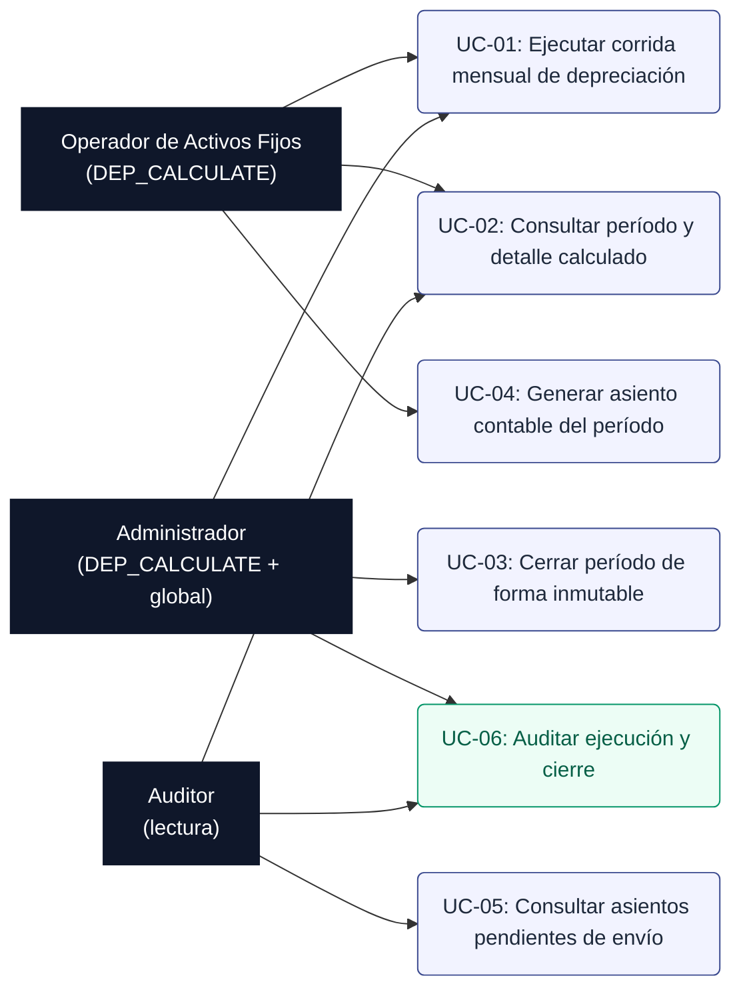
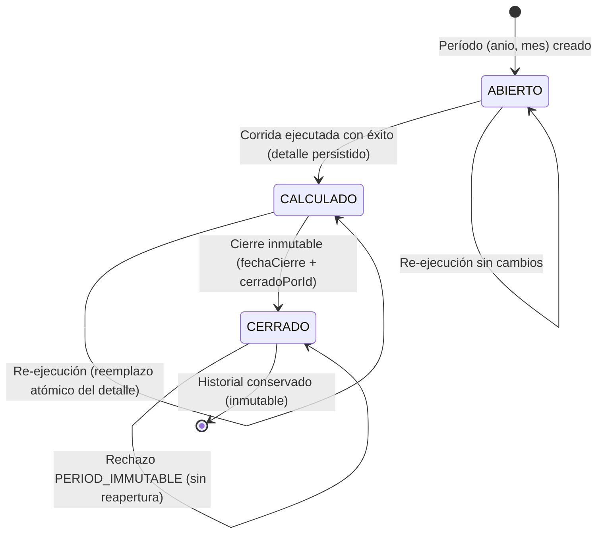
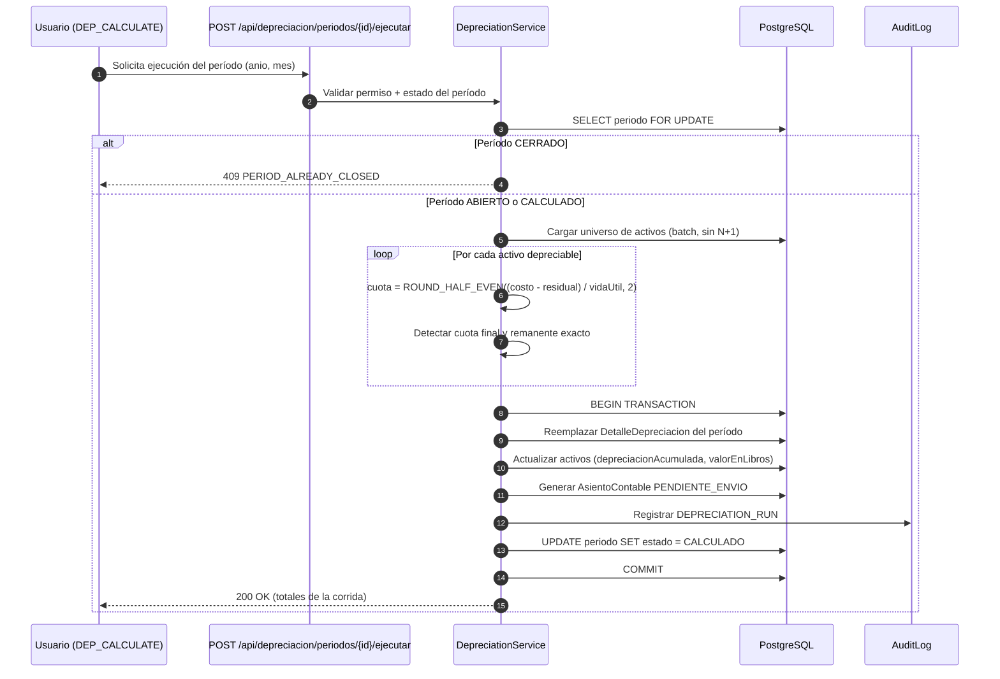

# Requirements: Motor de Depreciación y Contabilización DGII

> 📋 Generated by `requirements-analyst` · 2026-11-02
> ✅ Approved by: JeremyJS (Developer / Responsable Funcional) · 2026-11-02
> ⚠️ **MANDATORY QUALITY GATE (Hard Gate 12)**: Every user story MUST be authored in formal EARS syntax with complete Given/When/Then acceptance criteria. Summarizing requirements with 'etc.', omitting calculation formulas, or generalizing validations is strictly prohibited. All numeric thresholds, formats, and error conditions must be explicitly detailed.

## Traceability
- **Work Item**: Sub-módulo 03 (Motor de Depreciación y Contabilización DGII) — modo standalone, sin Work Item en Azure DevOps
- **Parent**: [ActivaCore — Sistema de Gestión de Activos Fijos & Contabilización DGII](../../../docs/modules/activos-fijos.md)
- **Branch**: `feature/activos-fijos-03-motor-depreciacion`
- **Design**: [design.md](./design.md)
- **Test Plan**: [test-plan.md](./test-plan.md)
- **Test Cases**: [test-cases.md](./test-cases.md)

## Overview

El **Motor de Depreciación y Contabilización DGII** ejecuta el cálculo mensual determinista de la depreciación de los activos fijos institucionales de UNAPEC bajo el método de **Línea Recta sobre costo histórico**, conforme a la **Ley 11-92 Art. 287** y la **Norma General 07-07** de la DGII (Categoría 1: 5.00% anual / 240 meses; Categoría 2: 25.00% anual / 48 meses; Categoría 3: 15.00% anual / 80 meses; y Línea Recta Personalizada), y genera los **asientos contables** de débito a gasto por depreciación y crédito a depreciación acumulada, dejándolos en estado `PENDIENTE_ENVIO` para su despacho posterior por el Web Service de Contabilidad (Sub-módulo 05).

El módulo garantiza **exactitud al centavo** (redondeo bancario Half Even sobre `Decimal(14,2)`), **idempotencia de la corrida**, **cierre mensual inmutable sin reapertura**, exclusión automática de bienes desincorporados y trazabilidad completa de quién ejecutó y quién cerró cada período. Sirve a Operadores y Administradores (ejecución y cierre) y a Auditores (consulta), y constituye la base del reporte fiscal de conciliación DGII del Sub-módulo 04.

## User Stories (EARS Notation)

### REQ-DEP-001: Cálculo de la Cuota Mensual por Línea Recta
**Type:** Ubiquitous
**Rule:** The system SHALL calcular la cuota mensual de depreciación de cada activo depreciable mediante la fórmula `cuotaMensual = ROUND_HALF_EVEN((costoAdquisicion − valorResidual) ÷ vidaUtilMeses, 2)`, donde `costoAdquisicion` y `valorResidual` provienen del registro maestro del activo con precisión `Decimal(14,2)` y `vidaUtilMeses` proviene del `TipoActivo` asociado (entero entre 1 y 1200), aplicando redondeo bancario Half Even a dos decimales en cada cuota individual.
**Entities:** `ActivoFijo` (`costoAdquisicion`, `valorResidual`, `depreciacionAcumulada`, `valorEnLibros`, `fechaAdquisicion`, `estado`, `tipoActivoId`), `TipoActivo` (`metodoDepreciacion`, `porcentajeDepreciacionAnual`, `vidaUtilMeses`), `DetalleDepreciacion`.
**Error Handling:** Si `vidaUtilMeses` es nulo, cero o negativo, el sistema SHALL rechazar la corrida con `ASSET_TYPE_INVALID_LIFE` (HTTP 422). Si `valorResidual > costoAdquisicion`, SHALL rechazar con `RESIDUAL_EXCEEDS_COST` (HTTP 422). Si `metodoDepreciacion` no pertenece al dominio `{DGII_CAT1, DGII_CAT2, DGII_CAT3, LINEA_RECTA}`, SHALL rechazar con `ASSET_TYPE_METHOD_UNSUPPORTED` (HTTP 422). Si el `TipoActivo` asociado está en estado `INACTIVO`, SHALL rechazar el cálculo de ese activo con `ASSET_TYPE_INACTIVE` (HTTP 422) y excluirlo del detalle.

**Acceptance Criteria:**
- [ ] Given un activo con costo RD$ 85,000.00, valor residual RD$ 8,500.00 y vida útil 48 meses, when se ejecuta la corrida de un período válido, then la cuota mensual calculada es RD$ 1,593.75 y el detalle la persiste como `Decimal(14,2)`.
- [ ] Given un activo con costo RD$ 10,000.00, residual RD$ 0.00 y vida útil 3 meses, when se calcula la cuota, then el resultado es RD$ 3,333.33 (3,333.333… redondeado Half Even).
- [ ] Given un activo con costo RD$ 1,000.00, residual RD$ 0.00 y vida útil 3 meses, when se calcula la cuota, then el resultado es RD$ 333.33 (333.333… redondeado Half Even).
- [ ] Given un `TipoActivo` con método `DGII_CAT2`, when se valida la coherencia fiscal, then `porcentajeDepreciacionAnual` = 25.00 y `vidaUtilMeses` = 48, cumpliendo `porcentaje ≈ (12 ÷ vidaUtilMeses) × 100` con tolerancia ±0.01.
- [ ] Given un activo cuyo `valorResidual` es igual a su `costoAdquisicion`, when se calcula, then la cuota mensual es RD$ 0.00 y el activo se marca como `NO_DEPRECIABLE` en el detalle.

**Priority:** Must
**Dependencies:** None
**Tracker:** Sub-03

### REQ-DEP-002: Determinación del Universo de Activos Depreciables
**Type:** State-Driven
**Rule:** WHILE se ejecuta la corrida de un período `(anio, mes)`, the system SHALL incluir exclusivamente los activos que cumplan simultáneamente: (a) `estado ∈ {ACTIVO, EN_MANTENIMIENTO}`; (b) `fechaAdquisicion ≤ último día del mes del período`; (c) el período sea igual o posterior al mes de `fechaAdquisicion`; (d) no exista registro en `HistorialBaja` con `fechaBaja` anterior a la fecha de corte del período; (e) `depreciacionAcumulada < (costoAdquisicion − valorResidual)`; (f) el `TipoActivo` asociado esté en estado `ACTIVO`.
**Entities:** `ActivoFijo`, `TipoActivo`, `HistorialBaja`, `DetalleDepreciacion`.
**Error Handling:** Si el universo resultante está vacío, el sistema SHALL responder con `NO_DEPRECIABLE_ASSETS` (HTTP 422) sin crear el período. Si un activo en estado `DADO_DE_BAJA` o `VENDIDO` aparece en la evaluación, SHALL excluirlo y registrar la omisión en el log de la corrida con `ASSET_EXCLUDED_BY_STATE`. Si un activo fue dado de baja con `fechaBaja` posterior a la fecha de corte del período, SHALL incluirlo y registrar `ASSET_INCLUDED_PRIOR_TO_DISPOSAL`.

**Acceptance Criteria:**
- [ ] Given un activo `ACTIVO` adquirido el 2026-03-15, when se ejecuta la corrida de marzo 2026, then el activo se incluye y recibe una cuota completa (mes de adquisición completo).
- [ ] Given un activo `ACTIVO` adquirido el 2026-04-02, when se ejecuta la corrida de marzo 2026, then el activo NO se incluye.
- [ ] Given un activo `ACTIVO` adquirido el 2026-01-31, when se ejecuta la corrida de enero 2026, then el activo se incluye con cuota completa.
- [ ] Given un activo en `DADO_DE_BAJA` con `fechaBaja` = 2026-05-10, when se ejecuta la corrida de junio 2026, then el activo NO se incluye.
- [ ] Given un activo en `DADO_DE_BAJA` con `fechaBaja` = 2026-07-20, when se ejecuta la corrida de junio 2026, then el activo SÍ se incluye porque la baja es posterior al corte.
- [ ] Given un activo en `EN_MANTENIMIENTO`, when se ejecuta la corrida del período, then el activo se incluye y deprecia normalmente.
- [ ] Given un activo cuya `depreciacionAcumulada` ya iguala `(costoAdquisicion − valorResidual)`, when se ejecuta la corrida, then el activo se omite con cuota RD$ 0.00 y no altera acumulados.

**Priority:** Must
**Dependencies:** REQ-DEP-001
**Tracker:** Sub-03

### REQ-DEP-003: Ejecución de la Corrida Mensual de Depreciación
**Type:** Event-Driven
**Rule:** WHEN un usuario con permiso `DEP_CALCULATE` solicite la ejecución de la corrida de un período `(anio, mes)` en estado `ABIERTO` o `CALCULADO`, the system SHALL procesar en una única transacción ACID todos los activos del universo, persistiendo por cada uno un registro en `DetalleDepreciacion` con `periodoId`, `activoId`, `cuotaMensual`, `depreciacionAcumuladaAnterior`, `depreciacionAcumuladaNueva`, `valorEnLibrosAnterior`, `valorEnLibrosNuevo` y `esCuotaFinal`, actualizando el activo maestro (`depreciacionAcumulada`, `valorEnLibros`) y totalizando la corrida (`totalCuota`, `totalActivos`, `activosOmitidos`, `activosExcluidos`). Si la corrida ya existía en estado `CALCULADO`, SHALL reemplazar el detalle previo de forma atómica (borrado e inserción dentro de la misma transacción) antes de recalcular.
**Entities:** `PeriodoDepreciacion`, `DetalleDepreciacion`, `ActivoFijo`.
**Error Handling:** Si el período no existe, SHALL responder `PERIOD_NOT_FOUND` (HTTP 404). Si el período está `CERRADO`, SHALL responder `PERIOD_ALREADY_CLOSED` (HTTP 409) sin modificar datos. Si ya existe una corrida en progreso para el mismo período, SHALL responder `DEPRECIATION_RUN_IN_PROGRESS` (HTTP 409). Si el formato del período es inválido (`mes` fuera de 1–12 o `anio` fuera de 2000–2100), SHALL responder `INVALID_PERIOD_FORMAT` (HTTP 422). Si la transacción falla, SHALL revertir por completo (rollback) y responder `DEPRECIATION_RUN_FAILED` (HTTP 500) sin dejar detalles parciales.

**Acceptance Criteria:**
- [ ] Given un período marzo 2026 en estado `ABIERTO` con 30 activos depreciables, when un Operador ejecuta la corrida, then se crean exactamente 30 registros en `DetalleDepreciacion` y el período pasa a `CALCULADO` con `totalActivos` = 30.
- [ ] Given un período en estado `CALCULADO` con 30 detalles, when se re-ejecuta la corrida, then el detalle previo se reemplaza (siguen existiendo 30 registros, sin duplicados) y los acumulados del activo no se duplican.
- [ ] Given un período en estado `CERRADO`, when se intenta ejecutar la corrida, then el sistema responde HTTP 409 con `PERIOD_ALREADY_CLOSED` y ningún monto del activo cambia.
- [ ] Given una falla simulada en el activo número 17 de 30, when se ejecuta la corrida, then la transacción se revierte, `DetalleDepreciacion` queda sin registros y los activos conservan sus acumulados originales.
- [ ] Given un usuario sin permiso `DEP_CALCULATE`, when intenta ejecutar la corrida, then el sistema responde HTTP 403 con `FORBIDDEN`.

**Priority:** Must
**Dependencies:** REQ-DEP-001, REQ-DEP-002
**Tracker:** Sub-03

### REQ-DEP-004: Idempotencia y Unicidad del Detalle por Período y Activo
**Type:** Unwanted
**Rule:** IF se intenta persistir más de un registro de `DetalleDepreciacion` para la misma combinación `(periodoId, activoId)`, THEN the system SHALL rechazar la operación mediante la restricción única de base de datos y responder `DEPRECIATION_DETAIL_DUPLICATE` (HTTP 409), garantizando que un activo nunca se deprecie dos veces en el mismo período.
**Entities:** `DetalleDepreciacion`.
**Error Handling:** La restricción única `@@unique([periodoId, activoId])` a nivel de PostgreSQL es la última línea de defensa; cualquier violación se traduce a `DEPRECIATION_DETAIL_DUPLICATE` (HTTP 409) y revierte la transacción completa.

**Acceptance Criteria:**
- [ ] Given un período con el activo `ACT-2026-0001` ya registrado, when se intenta insertar un segundo detalle para el mismo activo y período, then PostgreSQL rechaza la inserción y el sistema responde HTTP 409.
- [ ] Given dos solicitudes concurrentes de corrida sobre el mismo período, when ambas llegan simultáneamente, then solo una adquiere el bloqueo y la otra responde HTTP 409 con `DEPRECIATION_RUN_IN_PROGRESS`.
- [ ] Given un período recalculado tres veces consecutivas, when se consulta el detalle, then existen exactamente N registros (uno por activo), no 3N.

**Priority:** Must
**Dependencies:** REQ-DEP-003
**Tracker:** Sub-03

### REQ-DEP-005: Ajuste de la Cuota Final al Agotar la Vida Útil
**Type:** Event-Driven
**Rule:** WHEN la suma de `depreciacionAcumulada` más la `cuotaMensual` calculada supere `(costoAdquisicion − valorResidual)`, the system SHALL sustituir la cuota por el remanente exacto `cuotaFinal = (costoAdquisicion − valorResidual) − depreciacionAcumulada`, marcar el detalle con `esCuotaFinal = true` y dejar `valorEnLibros` exactamente igual a `valorResidual`, sin residuos de centavos.
**Entities:** `ActivoFijo`, `TipoActivo`, `DetalleDepreciacion`.
**Error Handling:** Si por inconsistencia de datos `depreciacionAcumulada > (costoAdquisicion − valorResidual)`, SHALL responder `DEPRECIATION_OVERFLOW` (HTTP 422) y excluir el activo del detalle, registrando la anomalía en el log de la corrida. Si el remanente calculado es negativo, SHALL tratarlo como RD$ 0.00 y marcar `esCuotaFinal = true`.

**Acceptance Criteria:**
- [ ] Given un activo con costo RD$ 10,000.00, residual RD$ 0.00, vida útil 3 meses y acumulada de RD$ 6,666.66 tras dos cuotas de RD$ 3,333.33, when se ejecuta la tercera corrida, then la cuota es RD$ 3,333.34, `esCuotaFinal` = true y `valorEnLibros` = RD$ 0.00.
- [ ] Given un activo con costo RD$ 85,000.00 y residual RD$ 8,500.00 en su mes 48, when se ejecuta la corrida final, then `valorEnLibros` queda exactamente en RD$ 8,500.00.
- [ ] Given un activo cuya `depreciacionAcumulada` ya iguala el monto depreciable, when se ejecuta un período posterior, then no se genera cuota y `valorEnLibros` permanece igual a `valorResidual`.

**Priority:** Must
**Dependencies:** REQ-DEP-001, REQ-DEP-003
**Tracker:** Sub-03

### REQ-DEP-006: Cierre Mensual Inmutable del Período
**Type:** State-Driven
**Rule:** WHEN un usuario con permiso `DEP_CALCULATE` solicite el cierre de un período en estado `CALCULADO`, the system SHALL validar que el detalle no esté vacío, registrar `fechaCierre`, `cerradoPorId` y los totales consolidados, y transicionar el período a `CERRADO` de forma irreversible, quedando prohibida cualquier recalculación, reapertura o modificación posterior de sus detalles.
**Entities:** `PeriodoDepreciacion`, `DetalleDepreciacion`, `Usuario`.
**Error Handling:** Si el período no está en estado `CALCULADO`, SHALL responder `PERIOD_NOT_CLOSABLE` (HTTP 409). Si el detalle está vacío, SHALL responder `PERIOD_HAS_NO_DETAIL` (HTTP 422). Si se intenta reabrir un período `CERRADO`, SHALL responder `PERIOD_IMMUTABLE` (HTTP 409) indicando que la corrección debe registrarse como asiento de ajuste en el período abierto.

**Acceptance Criteria:**
- [ ] Given un período marzo 2026 en estado `CALCULADO` con 30 detalles, when se cierra, then el período queda en `CERRADO` con `fechaCierre` y `cerradoPorId` persistidos.
- [ ] Given un período en estado `CERRADO`, when se intenta reabrir, then el sistema responde HTTP 409 con `PERIOD_IMMUTABLE` y el estado no cambia.
- [ ] Given un período en estado `ABIERTO` sin corrida ejecutada, when se intenta cerrar, then el sistema responde HTTP 409 con `PERIOD_NOT_CLOSABLE`.
- [ ] Given un período `CERRADO`, when se intenta modificar cualquier `DetalleDepreciacion` asociado, then la operación es rechazada y no se altera ningún monto.

**Priority:** Must
**Dependencies:** REQ-DEP-003
**Tracker:** Sub-03

### REQ-DEP-007: Generación de Asientos Contables por Período
**Type:** Event-Driven
**Rule:** WHEN se complete exitosamente la corrida de un período, the system SHALL generar un asiento contable consolidado en estado `PENDIENTE_ENVIO`, agrupando los importes por par de cuentas contables del `TipoActivo` (`cuentaContableDepreciacion` como crédito y su cuenta de gasto por depreciación como débito), con `numeroAsiento` correlativo único por período, `concepto` = `"Depreciación {mes}/{anio}"`, `periodoId`, `totalDebito` = `totalCredito` = `totalCuota` de la corrida, y fecha contable igual al último día del período.
**Entities:** `AsientoContable`, `LineaAsiento`, `PeriodoDepreciacion`, `DetalleDepreciacion`, `TipoActivo`.
**Error Handling:** Si un `TipoActivo` no posee cuenta de gasto por depreciación configurada, SHALL responder `DEPRECIATION_EXPENSE_ACCOUNT_MISSING` (HTTP 422) y abortar la generación del asiento (la corrida de cálculo puede completarse, pero el período no podrá cerrarse hasta resolver la configuración). Si la suma de débitos no iguala la suma de créditos, SHALL responder `ASIENTO_UNBALANCED` (HTTP 500) y no persistir el asiento. Si ya existe un asiento para el mismo período, SHALL responder `ASIENTO_ALREADY_EXISTS` (HTTP 409).

**Acceptance Criteria:**
- [ ] Given una corrida con `totalCuota` = RD$ 47,812.50, when finaliza el cálculo, then se crea un `AsientoContable` con `totalDebito` = `totalCredito` = RD$ 47,812.50 en estado `PENDIENTE_ENVIO`.
- [ ] Given activos de tres `TipoActivo` distintos, when se genera el asiento, then existen exactamente tres pares de líneas (débito y crédito) agrupados por cuentas contables, y la suma de cada lado coincide con el total de la corrida.
- [ ] Given un `TipoActivo` sin cuenta de gasto configurada, when se intenta generar el asiento, then el sistema responde HTTP 422 con `DEPRECIATION_EXPENSE_ACCOUNT_MISSING` y no persiste el asiento.
- [ ] Given un período ya cerrado con asiento generado, when se consulta, then el asiento conserva estado `PENDIENTE_ENVIO` hasta que el Sub-módulo 05 lo despache.

**Priority:** Must
**Dependencies:** REQ-DEP-003, REQ-DEP-006
**Tracker:** Sub-03

### REQ-DEP-008: Consulta de Períodos y Detalle de Depreciación
**Type:** Ubiquitous
**Rule:** The system SHALL proveer consulta paginada de períodos de depreciación ordenada por `anio` y `mes` descendente, mostrando `anio`, `mes`, `estado`, `totalActivos`, `totalCuota`, `activosExcluidos`, `fechaEjecucion`, `ejecutadoPor` y `fechaCierre`, junto al detalle por activo con `codigo` institucional (`ACT-YYYY-NNNN`), `descripcion`, `cuotaMensual`, `depreciacionAcumuladaNueva` y `valorEnLibrosNuevo`, con filtros combinados por período y estado.
**Entities:** `PeriodoDepreciacion`, `DetalleDepreciacion`, `ActivoFijo`.
**Error Handling:** Si el período solicitado no existe, SHALL responder `PERIOD_NOT_FOUND` (HTTP 404). Si el usuario carece del permiso de lectura de depreciación, SHALL responder `FORBIDDEN` (HTTP 403). Si el período no tiene detalles, SHALL retornar lista vacía con `total` = 0 en lugar de error.

**Acceptance Criteria:**
- [ ] Given 12 períodos históricos, when se consulta la lista sin filtros, then se retorna la primera página ordenada por `anio` y `mes` descendente con metadatos de paginación.
- [ ] Given el período marzo 2026 con 30 detalles, when se consulta su detalle, then se listan 30 filas con código institucional, cuota y valor en libros posterior.
- [ ] Given un usuario autenticado sin permiso de lectura de depreciación, when consulta el período, then el sistema responde HTTP 403.
- [ ] Given un período inexistente, when se consulta, then el sistema responde HTTP 404 con `PERIOD_NOT_FOUND`.

**Priority:** Must
**Dependencies:** REQ-DEP-003
**Tracker:** Sub-03

### REQ-DEP-009: Bloqueo de Campos Financieros con Historial de Depreciación
**Type:** Unwanted
**Rule:** IF un activo posee al menos un registro en `DetalleDepreciacion`, THEN the system SHALL rechazar cualquier intento de modificar `costoAdquisicion`, `valorResidual`, `fechaAdquisicion` o `tipoActivoId`, respondiendo `ASSET_FINANCIALS_LOCKED` (HTTP 409), en coherencia con la regla de bloqueo contable ya vigente del Sub-módulo 02.
**Entities:** `ActivoFijo`, `DetalleDepreciacion`.
**Error Handling:** La validación ocurre en el servidor antes de la actualización; los campos descriptivos (`marca`, `modelo`, `numeroSerie`, `color`, `ubicacionFisica`) permanecen editables. Ningún cambio parcial se persiste.

**Acceptance Criteria:**
- [ ] Given un activo con historial de depreciación, when se intenta cambiar `costoAdquisicion`, then el sistema responde HTTP 409 con `ASSET_FINANCIALS_LOCKED`.
- [ ] Given un activo con historial de depreciación, when se actualiza `ubicacionFisica`, then el cambio se persiste correctamente.
- [ ] Given un activo sin historial de depreciación, when se modifica `valorResidual`, then el cambio se persiste correctamente.

**Priority:** Must
**Dependencies:** REQ-DEP-003
**Tracker:** Sub-03

### REQ-DEP-010: Trazabilidad y Auditoría de la Corrida y el Cierre
**Type:** Ubiquitous
**Rule:** The system SHALL registrar de forma inmutable, por cada ejecución de corrida y por cada cierre de período, los campos `usuarioId`, `ipAddress`, `userAgent`, `accion` (`DEPRECIATION_RUN` o `PERIOD_CLOSE`), `periodoId`, `totalActivos`, `totalCuota` y `timestampUtc`, garantizando la reconstrucción de quién ejecutó, quién cerró y con qué resultados.
**Entities:** `AuditLog`, `PeriodoDepreciacion`, `Usuario`.
**Error Handling:** Si el registro de auditoría no puede persistirse, SHALL revertir la operación completa (la corrida o el cierre no se consideran exitosos) y responder `AUDIT_LOG_FAILED` (HTTP 500).

**Acceptance Criteria:**
- [ ] Given una corrida ejecutada por el Operador X, when se consulta la auditoría del período, then existe un registro `DEPRECIATION_RUN` con usuario, IP, total y timestamp.
- [ ] Given un período cerrado por el Administrador Y, when se consulta la auditoría, then existe un registro `PERIOD_CLOSE` con usuario, IP y timestamp.
- [ ] Given una falla forzada en el registro de auditoría, when se ejecuta la corrida, then la transacción se revierte y no queda período en estado `CALCULADO`.

**Priority:** Must
**Dependencies:** REQ-DEP-003, REQ-DEP-006
**Tracker:** Sub-03

## Non-Functional Requirements

### NFR-001: Precisión Monetaria y Redondeo Determinista
**Category:** Reliability
**Rule:** The system SHALL almacenar y calcular todos los importes monetarios (`cuotaMensual`, `depreciacionAcumulada`, `valorEnLibros`, `totalCuota`, `totalDebito`, `totalCredito`) con precisión `Decimal(14,2)` y redondeo bancario Half Even, prohibiendo el uso de tipos de punto flotante nativo en cualquier etapa del cálculo.
**Metric:** 100% de los importes persistidos con exactamente 2 decimales; 0 casos de desviación por coma flotante en la suite de pruebas de cálculo (mínimo 30 casos límite: `0.005`, `0.015`, `1/3`, `2/3`, montos con residual, cuota final).
**Priority:** Must

### NFR-002: Atomicidad e Integridad Transaccional
**Category:** Reliability
**Rule:** The system SHALL ejecutar cada corrida y cada cierre dentro de una transacción ACID única, de modo que ante cualquier fallo no queden detalles parciales, acumulados inconsistentes ni asientos descuadrados.
**Metric:** 0 registros huérfanos o parciales tras 100% de las pruebas de fallo inyectado; invariante verificada `valorEnLibros = costoAdquisicion − depreciacionAcumulada` en el 100% de los activos procesados.
**Priority:** Must

### NFR-003: Rendimiento de la Corrida Mensual
**Category:** Performance
**Rule:** The system SHALL procesar la corrida mensual completa dentro de un tiempo aceptable para el volumen institucional, evitando consultas N+1 mediante carga por lotes y actualizaciones agrupadas.
**Metric:** Corrida de 1,000 activos depreciables completada en menos de 5 segundos en entorno local; consulta del detalle paginado en menos de 500 ms p95.
**Priority:** Should

### NFR-004: Seguridad y Control de Acceso
**Category:** Security
**Rule:** The system SHALL restringir la ejecución de la corrida y el cierre de períodos al permiso `DEP_CALCULATE`, y la consulta al permiso de lectura de depreciación, aplicando validación tanto en el middleware de rutas como en el handler de cada endpoint.
**Metric:** 100% de los endpoints protegidos; 0 accesos no autorizados en pruebas de matriz RBAC (ADMIN, OPERADOR, AUDITOR, usuario sin rol).
**Priority:** Must

### NFR-005: Inmutabilidad y Retención del Historial
**Category:** Reliability
**Rule:** The system SHALL impedir por diseño (estado `CERRADO` más restricciones de aplicación) la alteración de períodos cerrados, conservando el detalle histórico íntegro durante toda la vida del activo.
**Metric:** 0 modificaciones exitosas sobre períodos `CERRADO` en la suite de pruebas de inmutabilidad; 100% de los períodos cerrados consultables tras 5 años simulados.
**Priority:** Must

### NFR-006: Cobertura de Pruebas del Motor de Cálculo
**Category:** Reliability
**Rule:** The system SHALL contar con pruebas automatizadas unitarias e integrales que cubran las fórmulas de cuota, el ajuste de cuota final, la selección del universo, la idempotencia y el cierre inmutable, además de pruebas E2E de humo del flujo completo.
**Metric:** Cobertura de líneas ≥ 90% en el módulo de depreciación; 100% de los escenarios de aceptación de este documento automatizados; suite E2E de humo verde al 100%.
**Priority:** Must

## Diagrams

### Use Case Diagram

### Supporting Diagram

## Dependencies

| Feature | Capability needed | Status | Workaround |
|---------|------------------|--------|------------|
| Sub-módulo 00 — Autenticación y RBAC | Sesión autenticada, permiso `DEP_CALCULATE` y matriz de roles relacional | ✅ Certified | Ninguno requerido |
| Sub-módulo 01 — Catálogos Base | `TipoActivo` con `metodoDepreciacion`, `porcentajeDepreciacionAnual`, `vidaUtilMeses` y cuentas contables | ✅ Certified | Ninguno requerido |
| Sub-módulo 02 — Gestión de Activos y Custodia | `ActivoFijo` con `costoAdquisicion`, `valorResidual`, `fechaAdquisicion`, estados y `HistorialBaja` | ✅ Certified | Ninguno requerido |
| Sub-módulo 04 — Consultas y Reportes | Consumo del histórico de depreciación para reportes fiscales | ⏳ Pending | El Sub-03 expone consulta propia de período y detalle |
| Sub-módulo 05 — Integración WS Contabilidad | Despacho de asientos `PENDIENTE_ENVIO` al Web Service | ⏳ Pending | El Sub-03 deja los asientos persistidos en estado `PENDIENTE_ENVIO` |

## Assumptions

| # | Assumption | Temporary stub | Replaced when |
|---|-----------|----------------|---------------|
| 1 | Base de cálculo aprobada por el usuario el 2026-11-02: `cuotaMensual = (costoAdquisicion − valorResidual) ÷ vidaUtilMeses` con redondeo Half Even. | Ninguno | Cambio formal de regla funcional por la Dirección de Finanzas |
| 2 | El mes de adquisición se deprecia completo (cuota íntegra), sin prorrateo por días. Aprobado el 2026-11-02. | Ninguno | Cambio formal de regla funcional |
| 3 | Los activos en estado `EN_MANTENIMIENTO` continúan depreciando; solo `DADO_DE_BAJA` y `VENDIDO` se excluyen. Aprobado el 2026-11-02. | Ninguno | Cambio formal de regla funcional |
| 4 | El cierre de período es inmutable y no admite reapertura; las correcciones se registran como asiento de ajuste en el período abierto. Aprobado el 2026-11-02. | Ninguno | Cambio formal de regla funcional |
| 5 | La cuota final absorbe el remanente por redondeo para que `valorEnLibros` iguale exactamente `valorResidual`. Aprobado el 2026-11-02. | Ninguno | Cambio formal de regla funcional |
| 6 | El Sub-03 genera los asientos contables localmente en estado `PENDIENTE_ENVIO`; el Sub-05 solo los despacha. Aprobado el 2026-11-02. | Asiento consolidado por período | Certificación del Sub-05 |
| 7 | El campo `cuentaContableGastoDepreciacion` se agrega a `TipoActivo` en la migración del Sub-03 con backfill por método DGII. El Sub-01 no se modifica y la cuenta se resuelve como `valor configurado ?? valor por defecto del método`. | Valor por defecto por método DGII | Se habilite la edición manual del campo en el catálogo del Sub-01 |
| 8 | Todos los montos operan en pesos dominicanos (RD$) sin conversión de moneda ni revaluación por inflación. | Ninguno | Se requiera multimoneda |
| 9 | El volumen institucional de activos depreciables no supera 5,000 registros por período. | Ninguno | Se supere el umbral y requiera procesamiento asíncrono por lotes |

## Out of Scope

- Cálculo o registro de revaluación de activos, ajuste por inflación y deterioro (impairment).
- Métodos de depreciación distintos de Línea Recta (saldo decreciente, suma de dígitos, unidades producidas).
- Depreciación retroactiva de períodos ya cerrados o reapertura de cierres.
- Envío efectivo de asientos al Web Service de Contabilidad, reintentos y monitoreo de despacho (corresponde al Sub-módulo 05).
- Reportes fiscales consolidados, conciliación DGII y exportación a Excel/CSV (corresponde al Sub-módulo 04).
- Gestión de activos, traslados de custodia, bajas formales y generación de PDF (corresponde al Sub-módulo 02).
- Administración de catálogos, tipos de activos y cuentas contables (corresponde al Sub-módulo 01).
- Creación automática de períodos futuros o programación (scheduling) de corridas por cron.

## Approval
- [x] Analyst: SDD Build Agent Date: 2026-11-02
- [x] Responsable Funcional (Finanzas / Contabilidad): JeremyJS Date: 2026-11-02

---
> 📍 Sub-03 · 🌿 `feature/activos-fijos-03-motor-depreciacion` · Generated by SDD Standard
