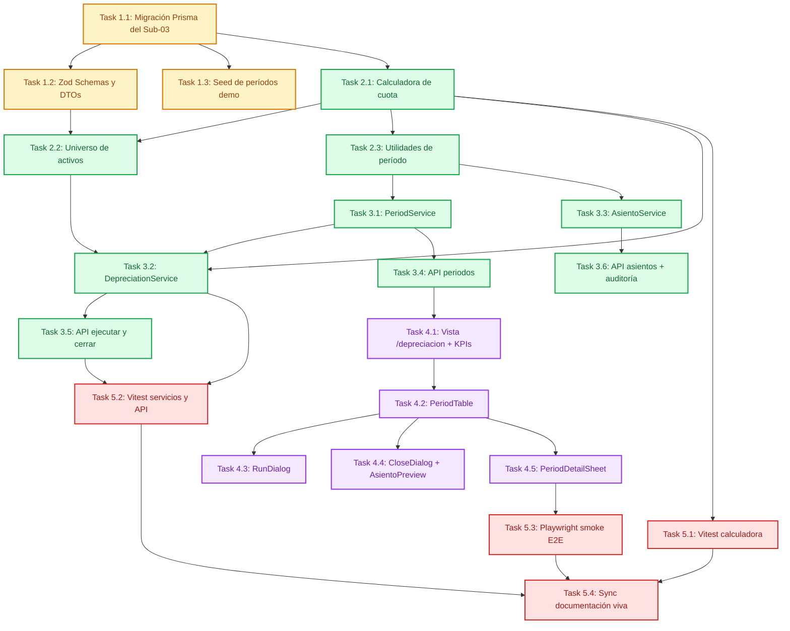

# Tasks: Motor de Depreciación y Contabilización DGII

> 📋 Generated by `task-planner` · 2026-11-02
> ✅ Approved by: JeremyJS (Developer) · 2026-11-02

## Traceability
- **Work Item**: Sub-módulo 03 (Motor de Depreciación y Contabilización DGII) — modo standalone, sin Work Item en Azure DevOps
- **Branch**: `feature/activos-fijos-03-motor-depreciacion`

## Metadata
- **Based on:** [design.md](./design.md)
- **Total estimate:** ~50h (incluye 20% de margen para imprevistos)
- **Number of waves:** 5 (Wave 1 a Wave 5 — Wave 0 omitida por infraestructura previa de los Sub-módulos 00, 01 y 02)
- **Number of tasks:** 21 tareas atómicas
- **Sprint:** Sprint 1 (Activos Fijos UNAPEC — Integraciones I)
- **Assignee:** JeremyJS

## Estimation Rules

See `estimation-strategy.md` for full estimation rules, AI multipliers, and architecture impact.

**Quick reference:**
- Maximum **4 hours** per task (break larger tasks into subtasks)
- Estimates include implementation + unit tests + code review
- If a task exceeds 4h during implementation, split it immediately
- Add **20% buffer** to total estimate for unknowns
- If using agentic IDEs + SDD: apply multipliers from `estimation-strategy.md` §Scenario B
- Track actual vs estimated for future calibration (see `estimation-strategy.md` §Calibration)

## Scope Rule

Todo el trabajo de este sub-módulo se ejecuta en **una sola rama** (`feature/activos-fijos-03-motor-depreciacion`). No se crean ramas paralelas ni se modifica código del Sub-01: la columna `cuenta_contable_gasto_depreciacion` se incorpora mediante la migración del Sub-03 y la cuenta se resuelve en el `AsientoService` como `valor configurado ?? valor por defecto del método DGII`.

## Dependency Graph

---

## Wave 1: Foundation & Setup (~5.5h)

### Task 1.1: Migración Prisma del Sub-03 — períodos, detalle, asientos y cuenta de gasto (~2.5h)
- **Description:** Crear los modelos `PeriodoDepreciacion`, `DetalleDepreciacion`, `AsientoContable` y `LineaAsiento` con sus relaciones hacia `Usuario` y `ActivoFijo`, y generar la migración DDL con índices únicos, `CHECK` de dominio y `CHECK` de cuadre contable. La misma migración incorpora la columna nullable `cuenta_contable_gasto_depreciacion` en `tipos_activos` con backfill por método DGII, sin tocar endpoints, validadores, formularios ni pruebas del Sub-01.
- **Acceptance criteria:**
  - [ ] Los 4 modelos existen con los tipos exactos de `design.md` (`Decimal(14,2)`, `@db.Date`, `@db.Timestamptz`).
  - [ ] `@@unique([anio, mes])`, `@@unique([periodoId, activoId])`, `@@unique([periodoId])` en asientos y `@@unique([numeroAsiento])` aplicados.
  - [ ] Relaciones `ejecutadoPor` / `cerradoPor` hacia `Usuario` con `onDelete: Restrict` y alias de relación únicos.
  - [ ] `ActivoFijo` expone la relación inversa `detallesDepreciacion`.
  - [ ] `tipos_activos.cuenta_contable_gasto_depreciacion` creada y poblada por categoría (CAT1 `6-30-01-0001`, CAT2 `6-30-01-0002`, CAT3 `6-30-01-0003`, LINEA_RECTA `6-30-01-0002`).
  - [ ] Migración `20261102000000_add_motor_depreciacion` aplicable con `prisma migrate deploy` sobre base limpia.
  - [ ] `npx prisma generate` produce el cliente sin advertencias.
  - [ ] `npx tsc --noEmit` sin errores y suite Vitest existente (Sub-00/01/02) en verde.
- **Dependencies:** None
- **Files to create/modify:** `app/prisma/schema.prisma`, `app/prisma/migrations/20261102000000_add_motor_depreciacion/migration.sql`

### Task 1.2: Schemas Zod y DTOs de depreciación (~1.5h)
- **Description:** Implementar `app/lib/schemas/depreciation.ts` con los esquemas de creación de período, ejecución, cierre y filtros, más los tipos DTO inferidos, incluyendo validación de rango `anio` 2000–2100 y `mes` 1–12.
- **Acceptance criteria:**
  - [ ] `CreatePeriodSchema` valida `anio` y `mes` con mensajes en español.
  - [ ] `ClosePeriodSchema` exige `confirmar === true` para permitir el cierre.
  - [ ] `PeriodFilterSchema` valida `page`, `pageSize` (máx 50), `estado` y `anio`.
  - [ ] Tipos `CreatePeriodDTO`, `ClosePeriodDTO`, `PeriodFilterDTO` exportados.
  - [ ] Pruebas unitarias de los 3 esquemas (válidos, inválidos, límites) en verde.
- **Dependencies:** Task 1.1
- **Files to create/modify:** `app/lib/schemas/depreciation.ts`, `app/tests/schemas/depreciation.test.ts`

### Task 1.3: Seed determinista de períodos de demostración (~1.5h)
- **Description:** Extender `app/prisma/seed.ts` para generar períodos de depreciación de ejemplo (12 meses del ejercicio anterior y el mes en curso en estado `ABIERTO`) con detalles calculados, manteniendo la semilla determinista `42` y el orden de ejecución existente.
- **Acceptance criteria:**
  - [ ] El seed crea 13 períodos sin duplicar registros al re-ejecutarse (upsert por `anio`+`mes`).
  - [ ] Cada período de ejemplo contiene detalles coherentes con la fórmula aprobada.
  - [ ] El seed respeta el orden de pasos existente y no rompe las entidades de los Sub-módulos 00/01/02.
  - [ ] `npm run seed` ejecuta sin errores sobre base limpia.
- **Dependencies:** Task 1.1
- **Files to create/modify:** `app/prisma/seed.ts`, `app/package.json`

---

## Wave 2: Core Calculation Engine (~4.5h)

### Task 2.1: Calculadora determinista de cuota (`depreciation-calculator.ts`) (~2h)
- **Description:** Implementar el motor puro de cálculo con `decimal.js` configurado en `precision: 28` y `ROUND_HALF_EVEN`, cubriendo cuota teórica, remanente, cuota final exacta, activo no depreciable y tipo de cuota.
- **Acceptance criteria:**
  - [ ] `calcularCuota()` reproduce exactamente el algoritmo de `design.md` § *Calculation Engine*.
  - [ ] Cuota RD$ 85,000.00 / residual RD$ 8,500.00 / 48 meses ⇒ RD$ 1,593.75.
  - [ ] 3,333.333… ⇒ RD$ 3,333.33 (Half Even) y la última cuota ajusta a RD$ 3,333.34.
  - [ ] `valorEnLibros` final iguala `valorResidual` exactamente (0 residuos).
  - [ ] `residual = costo` ⇒ `tipoCuota = NO_DEPRECIABLE`, cuota RD$ 0.00.
  - [ ] No se usa `number` nativo en ninguna operación monetaria.
  - [ ] Pruebas unitarias con mínimo 30 casos límite en verde.
- **Dependencies:** Task 1.1
- **Files to create/modify:** `app/lib/depreciation/depreciation-calculator.ts`, `app/tests/depreciation/calculator.test.ts`

### Task 2.2: Selección del universo de activos depreciables (`asset-universe.ts`) (~1.5h)
- **Description:** Implementar la función pura que determina si un activo pertenece al universo del período, evaluando estado, fecha de adquisición, baja anterior al corte, tipo de activo activo y remanente depreciable.
- **Acceptance criteria:**
  - [ ] `esDepreciableEnPeriodo()` devuelve `true` para `ACTIVO` y `EN_MANTENIMIENTO` y `false` para `DADO_DE_BAJA` / `VENDIDO`.
  - [ ] Un activo adquirido el 2026-04-02 no entra en marzo 2026; uno adquirido el 2026-01-31 sí entra en enero 2026.
  - [ ] Un activo con `fechaBaja` posterior al corte del período sí se incluye.
  - [ ] Un tipo de activo `INACTIVO` excluye al activo con motivo `ASSET_TYPE_INACTIVE`.
  - [ ] La función retorna un motivo tipado de exclusión (`as const`) sin efectos secundarios.
  - [ ] Pruebas unitarias de todas las ramas en verde.
- **Dependencies:** Task 2.1
- **Files to create/modify:** `app/lib/depreciation/asset-universe.ts`, `app/tests/depreciation/universe.test.ts`

### Task 2.3: Utilidades de período (`period-utils.ts`) (~1h)
- **Description:** Implementar helpers deterministas para fecha de corte (último día del mes), validación de rango de período, comparación `(anio, mes)` y generación del correlativo de asiento `DEP-{AAAAMM}-{SEQ}`.
- **Acceptance criteria:**
  - [ ] `fechaCorte(2026, 2)` ⇒ `2026-02-28`; `fechaCorte(2024, 2)` ⇒ `2024-02-29`.
  - [ ] `esPeriodoValido()` rechaza `mes` 0, 13 y `anio` 1999, 2101.
  - [ ] `generarNumeroAsiento(2026, 3, 1)` ⇒ `DEP-202603-001`.
  - [ ] Todas las funciones operan en UTC y no dependen de la zona horaria del servidor.
  - [ ] Pruebas unitarias en verde.
- **Dependencies:** Task 2.1
- **Files to create/modify:** `app/lib/depreciation/period-utils.ts`, `app/tests/depreciation/period-utils.test.ts`

---

## Wave 3: Services & API (~14.5h)

### Task 3.1: `PeriodService` — alta, consulta y cierre (~3h)
- **Description:** Implementar el servicio de períodos con creación idempotente por `(anio, mes)`, listado paginado, detalle con asiento y cierre inmutable (validaciones de estado y persistencia de `fechaCierre`/`cerradoPorId`).
- **Acceptance criteria:**
  - [ ] `crearPeriodo()` rechaza duplicados con `PERIOD_ALREADY_EXISTS` y valida el rango de período.
  - [ ] `listarPeriodos()` pagina en servidor y ordena por `anio` y `mes` descendente.
  - [ ] `obtenerPeriodo()` incluye detalles y asiento, o lanza `PERIOD_NOT_FOUND`.
  - [ ] `cerrarPeriodo()` solo opera sobre `CALCULADO` con detalle no vacío; deja el período `CERRADO`.
  - [ ] Cualquier intento de reapertura lanza `PERIOD_IMMUTABLE`.
  - [ ] Pruebas de servicio con base de datos de prueba en verde.
- **Dependencies:** Task 2.3
- **Files to create/modify:** `app/lib/services/period.service.ts`, `app/tests/services/period.service.test.ts`

### Task 3.2: `DepreciationService` — corrida transaccional (~4h)
- **Description:** Implementar la corrida mensual completa: bloqueo del período, carga por lotes del universo (sin N+1), cálculo por activo, reemplazo atómico del detalle, actualización de acumulados del activo, totalización y delegación de la generación del asiento.
- **Acceptance criteria:**
  - [ ] La corrida se ejecuta dentro de `prisma.$transaction` con `SELECT … FOR UPDATE` sobre el período.
  - [ ] Re-ejecución sobre `CALCULADO` reemplaza el detalle sin duplicar ni duplicar acumulados.
  - [ ] Corrida sobre `CERRADO` lanza `PERIOD_ALREADY_CLOSED` sin mutaciones.
  - [ ] Universo vacío lanza `NO_DEPRECIABLE_ASSETS`.
  - [ ] Un fallo inyectado en el activo 17 de 30 revierte todo (0 detalles persistidos).
  - [ ] `valorEnLibros = costoAdquisicion − depreciacionAcumulada` se cumple en el 100% de los activos procesados.
  - [ ] Corrida de 1,000 activos completa en menos de 5 segundos en local.
- **Dependencies:** Task 2.1, Task 2.2, Task 3.1
- **Files to create/modify:** `app/lib/services/depreciation.service.ts`, `app/tests/services/depreciation.service.test.ts`

### Task 3.3: `AsientoService` — asiento contable consolidado (~2h)
- **Description:** Implementar la generación del asiento consolidado agrupado por par de cuentas (débito gasto / crédito depreciación acumulada), resolviendo la cuenta de gasto como `tipoActivo.cuentaContableGastoDepreciacion ?? valorPorDefecto(metodoDepreciacion)`, con correlativo, validación de cuadre y estado `PENDIENTE_ENVIO`.
- **Acceptance criteria:**
  - [ ] Agrupa por cuenta de gasto resuelta y `cuentaContableDepreciacion` del `TipoActivo`.
  - [ ] `totalDebito === totalCredito === totalCuota` de la corrida; en caso contrario lanza `ASIENTO_UNBALANCED`.
  - [ ] Si no hay cuenta configurada ni valor por defecto aplicable, lanza `DEPRECIATION_EXPENSE_ACCOUNT_MISSING`.
  - [ ] Segundo asiento para el mismo período lanza `ASIENTO_ALREADY_EXISTS`.
  - [ ] `numeroAsiento` es correlativo y único.
  - [ ] Pruebas de cuadre y de error en verde.
- **Dependencies:** Task 2.3
- **Files to create/modify:** `app/lib/services/asiento.service.ts`, `app/tests/services/asiento.service.test.ts`

### Task 3.4: Route Handlers — períodos (~2h)
- **Description:** Implementar `POST /api/depreciacion/periodos` y `GET /api/depreciacion/periodos` y `GET /api/depreciacion/periodos/[id]` con validación Zod, guardia `DEP_CALCULATE`, respuestas `{ data, meta }` y errores RFC 7807.
- **Acceptance criteria:**
  - [ ] `POST` devuelve 201 con el período creado; `GET` lista paginada con `meta`.
  - [ ] `GET /[id]` devuelve detalles y asiento; 404 con `PERIOD_NOT_FOUND` si no existe.
  - [ ] Usuario sin permiso recibe 403 `FORBIDDEN`.
  - [ ] Payload inválido recibe 400 `VALIDATION_ERROR` con campos en español.
  - [ ] Todas las respuestas de error usan la estructura RFC 7807 de `design.md`.
- **Dependencies:** Task 3.1
- **Files to create/modify:** `app/app/api/depreciacion/periodos/route.ts`, `app/app/api/depreciacion/periodos/[id]/route.ts`

### Task 3.5: Route Handlers — ejecutar y cerrar (~2h)
- **Description:** Implementar `POST /api/depreciacion/periodos/[id]/ejecutar` y `POST /api/depreciacion/periodos/[id]/cerrar` conectados a `DepreciationService` y `PeriodService`.
- **Acceptance criteria:**
  - [ ] Ejecutar devuelve 200 con totales de la corrida y el asiento generado.
  - [ ] Cerrar exige `{ confirmar: true }` y devuelve el período `CERRADO` con `fechaCierre`.
  - [ ] Todos los códigos de error de `design.md` se mapean al status HTTP correcto.
  - [ ] Ambas rutas verifican permiso `DEP_CALCULATE` en el handler además del middleware.
- **Dependencies:** Task 3.2
- **Files to create/modify:** `app/app/api/depreciacion/periodos/[id]/ejecutar/route.ts`, `app/app/api/depreciacion/periodos/[id]/cerrar/route.ts`

### Task 3.6: Route Handler de asientos y auditoría (~1.5h)
- **Description:** Implementar `GET /api/depreciacion/asientos` filtrado por estado y registrar la auditoría inmutable de corrida y cierre (`DEPRECIATION_RUN`, `PERIOD_CLOSE`) con reversión ante fallo.
- **Acceptance criteria:**
  - [ ] `GET /api/depreciacion/asientos?estado=PENDIENTE_ENVIO` devuelve asientos con líneas.
  - [ ] Se registran las acciones `DEPRECIATION_RUN` y `PERIOD_CLOSE` con usuario, IP, userAgent y timestamp.
  - [ ] Si la auditoría falla, la corrida o el cierre se revierten (`AUDIT_LOG_FAILED`).
  - [ ] El AUDITOR puede consultar asientos sin permiso de ejecución.
- **Dependencies:** Task 3.3
- **Files to create/modify:** `app/app/api/depreciacion/asientos/route.ts`, `app/lib/services/audit.service.ts`

---

## Wave 4: UI & Integration (~8.5h)

### Task 4.1: Vista `/depreciacion` y tarjetas KPI (~2h)
- **Description:** Crear la página Server Component con `Suspense`, integrada al `ConsoleShell`, con migas `ActivaCore / Operaciones / Depreciación` y las tarjetas KPI del período seleccionado.
- **Acceptance criteria:**
  - [ ] La ruta `/depreciacion` renderiza sin errores con sesión autenticada.
  - [ ] Las migas y el layout respetan `DESIGN.md` (No-Line, sin footer, sidebar 240px).
  - [ ] `DepreciationKpiCards` muestra total del período, activos procesados, omitidos y excluidos.
  - [ ] Estado `loading` con skeleton shimmer y estado vacío sin errores.
  - [ ] Cifras en fuente monoespaciada alineadas a la derecha.
- **Dependencies:** Task 3.4
- **Files to create/modify:** `app/app/depreciacion/page.tsx`, `app/components/depreciacion/depreciation-kpi-cards.tsx`

### Task 4.2: `PeriodTable` con estados y paginación (~2h)
- **Description:** Implementar la tabla paginada de períodos con pills tonales por estado (`ABIERTO`, `CALCULADO`, `CERRADO`), acciones condicionadas y navegación por teclado.
- **Acceptance criteria:**
  - [ ] Paginación server-side con selector 10/25/50.
  - [ ] Las acciones se habilitan según el estado (ejecutar solo en `ABIERTO`, cerrar solo en `CALCULADO`).
  - [ ] Hover de fila con desplazamiento `+2px` y fondo `#F2F3FF`.
  - [ ] `aria-label` en acciones y navegación completa por teclado.
  - [ ] Estado vacío y estado de error implementados.
- **Dependencies:** Task 4.1
- **Files to create/modify:** `app/components/depreciacion/period-table.tsx`

### Task 4.3: `RunDepreciationDialog` (~1.5h)
- **Description:** Implementar el diálogo de confirmación de corrida con resumen previo (activos estimados y monto total) y estados de envío.
- **Acceptance criteria:**
  - [ ] Muestra un resumen antes de ejecutar y solicita confirmación.
  - [ ] Deshabilita el botón mientras está en vuelo y evita doble envío.
  - [ ] Maneja `PERIOD_ALREADY_CLOSED`, `NO_DEPRECIABLE_ASSETS` y `DEPRECIATION_EXPENSE_ACCOUNT_MISSING` con mensajes claros en español.
  - [ ] Refresca la tabla al terminar y muestra notificación de éxito con el total.
- **Dependencies:** Task 4.2
- **Files to create/modify:** `app/components/depreciacion/run-depreciation-dialog.tsx`

### Task 4.4: `ClosePeriodDialog` y `AsientoPreview` (~1.5h)
- **Description:** Implementar el diálogo de cierre irreversible con casilla de confirmación explícita y la previsualización del asiento con totales balanceados.
- **Acceptance criteria:**
  - [ ] El botón de cierre permanece deshabilitado hasta marcar "Entiendo que el cierre es irreversible".
  - [ ] Muestra advertencia explícita y el monto total a cerrar.
  - [ ] `AsientoPreview` muestra líneas débito/crédito y confirma cuadre.
  - [ ] Maneja `PERIOD_IMMUTABLE` y `PERIOD_NOT_CLOSABLE` con mensajes claros.
- **Dependencies:** Task 4.2
- **Files to create/modify:** `app/components/depreciacion/close-period-dialog.tsx`, `app/components/depreciacion/asiento-preview.tsx`

### Task 4.5: `PeriodDetailSheet` (~1.5h)
- **Description:** Implementar el panel de detalle del período con el desglose por activo (código, descripción, cuota, acumulada y valor en libros) y el asiento asociado.
- **Acceptance criteria:**
  - [ ] Se abre desde la fila y carga el detalle del endpoint `GET /periodos/{id}`.
  - [ ] Muestra código `ACT-YYYY-NNNN` y cuentas en fuente monoespaciada.
  - [ ] Indica visualmente las cuotas marcadas `ULTIMA` y `NO_DEPRECIABLE`.
  - [ ] Maneja estados loading, vacío y error.
- **Dependencies:** Task 4.2
- **Files to create/modify:** `app/components/depreciacion/period-detail-sheet.tsx`

---

## Wave 5: Testing & Documentation (~8.5h)

> ⚠️ **Role ownership:**
> - **Unit tests** → Developer (incluidas dentro de cada tarea de implementación)
> - **Smoke E2E** → Developer (precedente de los Sub-módulos 00, 01 y 02); la validación formal de QA ocurre en el corte
> - **Documentación viva** → Developer

### Task 5.1: Suite Vitest de la calculadora (~2h)
- **Description:** Consolidar la batería de pruebas del motor de cálculo incluyendo casos límite de redondeo, cuota final, residual igual a costo y montos grandes.
- **Acceptance criteria:**
  - [ ] Mínimo 30 casos: `0.005`, `0.015`, `1/3`, `2/3`, cuota final, residual extremo, vida útil 1 y 1200 meses.
  - [ ] Se verifica explícitamente que `valorEnLibros` final iguala `valorResidual` en todos los escenarios.
  - [ ] Cobertura de líneas ≥ 95% en `app/lib/depreciation/`.
  - [ ] `npx vitest run tests/depreciation` en verde.
- **Dependencies:** Task 2.1
- **Files to create/modify:** `app/tests/depreciation/calculator.test.ts`

### Task 5.2: Suite Vitest de servicios y API (~3h)
- **Description:** Cubrir servicios y endpoints: creación, ejecución, re-ejecución, cierre inmutable, concurrencia, asiento descuadrado y matriz RBAC.
- **Acceptance criteria:**
  - [ ] Se cubren los códigos `PERIOD_ALREADY_CLOSED`, `PERIOD_IMMUTABLE`, `NO_DEPRECIABLE_ASSETS`, `DEPRECIATION_EXPENSE_ACCOUNT_MISSING`, `ASIENTO_UNBALANCED` y `FORBIDDEN`.
  - [ ] Prueba de falta de atomicidad (fallo a mitad de corrida) en verde.
  - [ ] Prueba de re-ejecución sin duplicar acumulados en verde.
  - [ ] Cobertura de líneas ≥ 90% en `app/lib/services/` y `app/app/api/depreciacion/`.
  - [ ] `npx vitest run` completo en verde.
- **Dependencies:** Task 3.2, Task 3.5
- **Files to create/modify:** `app/tests/services/depreciation.service.test.ts`, `app/tests/api/depreciacion.test.ts`

### Task 5.3: Smoke E2E con Playwright (~2h)
- **Description:** Implementar `app/e2e/depreciacion-smoke.spec.ts` cubriendo el flujo completo: login, crear período, ejecutar corrida, verificar detalle y cerrar período.
- **Acceptance criteria:**
  - [ ] Flujo feliz completo pasa en verde (crear → ejecutar → detalle → cerrar).
  - [ ] Se verifica que el período `CERRADO` no ofrece acción de re-ejecución.
  - [ ] Uso de `data-testid` estables y ejecución headless.
  - [ ] Captura de pantalla del período cerrado como evidencia.
- **Dependencies:** Task 4.5
- **Files to create/modify:** `app/e2e/depreciacion-smoke.spec.ts`

### Task 5.4: Sincronización de documentación viva (~1.5h)
- **Description:** Actualizar `docs/modules/activos-fijos.md`, `docs/architecture/database-architecture.md` y `docs/architecture/system-overview.md` con el estado certificado del Sub-03, el ERD extendido, la ruta `/depreciacion`, el catálogo de endpoints y las reglas del motor; sincronizar los 3 diagramas maestros.
- **Acceptance criteria:**
  - [ ] Matriz de capacidades marca el Sub-03 como `✅ Certified` con enlace al spec y cobertura de pruebas.
  - [ ] Los 3 diagramas maestros (state machine, flowchart y ERD) incluyen las nuevas entidades y el flujo de cierre.
  - [ ] Tablas Markdown sin filas en blanco ni columnas descuadradas.
  - [ ] Change Log actualizado con fecha, spec, commit y aprobador.
  - [ ] Sin `TODO` ni `FIXME` pendientes en el código del módulo.
- **Dependencies:** Task 5.1, Task 5.2, Task 5.3
- **Files to create/modify:** `docs/modules/activos-fijos.md`, `docs/architecture/database-architecture.md`, `docs/architecture/system-overview.md`

---

## Implementation Order Summary

| Order | Task | Description | Est. | Depends On |
|-------|------|-------------|------|------------|
| 1 | 1.1 | Migración Prisma del Sub-03 (incluye cuenta de gasto) | ~2.5h | — |
| 2 | 1.2 | Zod schemas y DTOs | ~1.5h | 1.1 |
| 3 | 1.3 | Seed de períodos demo | ~1.5h | 1.1 |
| 4 | 2.1 | Calculadora de cuota | ~2h | 1.1 |
| 5 | 2.2 | Universo de activos | ~1.5h | 2.1 |
| 6 | 2.3 | Utilidades de período | ~1h | 2.1 |
| 7 | 3.1 | PeriodService | ~3h | 2.3 |
| 8 | 3.2 | DepreciationService | ~4h | 2.1, 2.2, 3.1 |
| 9 | 3.3 | AsientoService | ~2h | 2.3 |
| 10 | 3.4 | API períodos | ~2h | 3.1 |
| 11 | 3.5 | API ejecutar y cerrar | ~2h | 3.2 |
| 12 | 3.6 | API asientos + auditoría | ~1.5h | 3.3 |
| 13 | 4.1 | Vista `/depreciacion` + KPIs | ~2h | 3.4 |
| 14 | 4.2 | PeriodTable | ~2h | 4.1 |
| 15 | 4.3 | RunDialog | ~1.5h | 4.2 |
| 16 | 4.4 | CloseDialog + AsientoPreview | ~1.5h | 4.2 |
| 17 | 4.5 | PeriodDetailSheet | ~1.5h | 4.2 |
| 18 | 5.1 | Vitest calculadora | ~2h | 2.1 |
| 19 | 5.2 | Vitest servicios y API | ~3h | 3.2, 3.5 |
| 20 | 5.3 | Playwright smoke E2E | ~2h | 4.5 |
| 21 | 5.4 | Sync documentación viva | ~1.5h | 5.1, 5.2, 5.3 |

## Total Estimate: ~50h (includes 20% buffer)

## Completion Checklist
- [ ] All tasks completed
- [ ] All tests passing
- [ ] Cobertura del motor de cálculo ≥ 95% y de servicios/API ≥ 90%
- [ ] Corrida de 1,000 activos bajo 5 segundos
- [ ] Cierre inmutable verificado con prueba negativa de reapertura
- [ ] Asientos balanceados (`totalDebito === totalCredito`) en el 100% de las corridas
- [ ] Sin residuos de centavos: `valorEnLibros` final igual a `valorResidual`
- [ ] Documentación viva sincronizada y 3 diagramas maestros actualizados
- [ ] Sin `TODO`/`FIXME` ni código muerto en el módulo
- [ ] PR creado y WI/spec movido a revisión

---
> 📍 Sub-03 · 🌿 `feature/activos-fijos-03-motor-depreciacion` · Generated by SDD Standard
