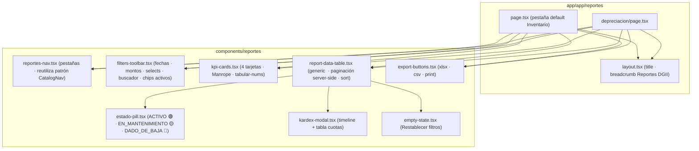
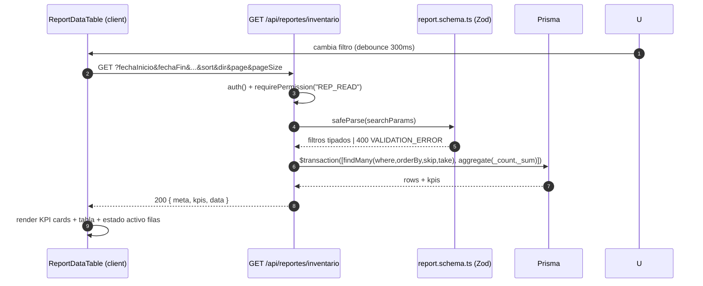
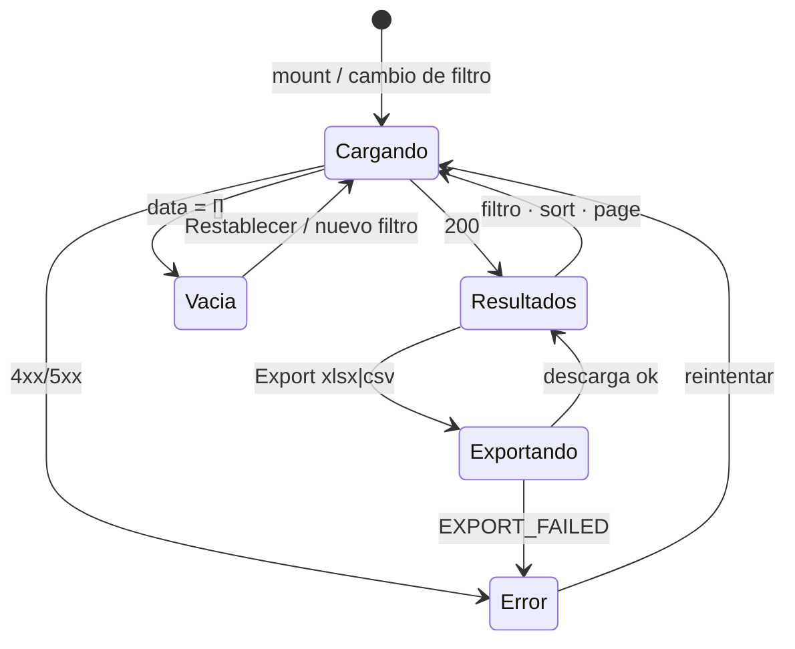

# Design: Consultas y Reportes (Sub-módulo 04)

> 📋 Generated by `solution-designer` · 2026-10-15
> ✅ Approved by: JeremyJS · 2026-10-15
> ⚠️ **MANDATORY QUALITY GATE (Hard Gate 12)**: Technical design MUST explicitly specify DDL schemas with exact SQL data types, foreign keys, and constraints; REST endpoint contracts with real JSON request and response payloads (including RFC 7807 error structures); and renderable Mermaid diagrams. Superficial summaries, placeholders ('TODO', 'TBD'), or truncated lists are strictly prohibited.

## Traceability
- **Work Item**: Sub-módulo 04 (Consultas y Reportes — pendiente de asignación de AB# en ADO)
- **Parent**: Sistema de Gestión de Activos Fijos & Contabilización DGII (UNAPEC — Integraciones I, Prof. Juan P. Valdez)
- **Branch**: `feature/activos-fijos-04-consultas-reportes`
- **Requirements**: [requirements.md](./requirements.md)
- **Test Plan**: *(pendiente)*
- **Test Cases**: *(pendiente)*

## Technology Decisions

| Capa | Tecnología | Justificación |
|------|-----------|---------------|
| **Framework** | Next.js 16.4.0 (App Router, Turbopack) — existente | Ya provisto y certificado por Sub-00/01; Route Handlers cubren endpoints GET de solo lectura sin backend adicional. |
| **Auth / RBAC** | NextAuth v5 (`auth()` en server components + `proxy.ts` en edge) — existente | El permiso `REP_READ` ya forma parte de la matriz RBAC de 16 permisos sembrada; el dual-check (edge + route handler) reusa el patrón de `/api/catalogos/*`. |
| **ORM / DB** | Prisma 6.19 + PostgreSQL 16 (Neon cloud) — existente | Filtros AND-componibles y agregados KPI se expresan con `prisma.$transaction([prisma.activoFijo.findMany, prisma.activoFijo.aggregate])`. |
| **Exportación Excel** | `exceljs` 4.4.0 — ya instalada en Sub-01 | Se extiende `lib/services/export.service.ts` (ya con `generateExcelBuffer` + BOM CSV) añadiendo formato moneda `RD$`, fila de totales y tono institucional. |
| **Exportación CSV** | UTF-8 con BOM (`\uFEFF`) — patrón `generateCsvString` existente | Reutiliza `escapeCsvValue` que ya gestiona comas/comillas/saltos. |
| **UI** | React 19 + Tailwind 4 + componentes `shadcn/ui` del repo — existentes | Reutiliza `CatalogDataTable` (Sub-01) como base para la tabla de reportes y la paleta de `DESIGN.md`. |
| **Impresión** | CSS `@media print` (pure CSS, sin librería PDF) | El alcance define "vista de impresión limpia"; la generación formal de PDF queda Out of Scope (requirements.md). |
| **BOM / Encoding** | Node Buffer UTF-8 en route handlers | Garantiza acentos y `RD$` sin mojibake (NFR-REP-004). |

## Architecture

### System Overview
```mermaid
graph TD
    subgraph Browser["Navegador (REP_READ)"]
        PAGE["/reportes · Pestañas Inventario / Depreciación"]
        KPI["KPI Cards (Σ filtrado)"]
        TB["ReportDataTable (paginación · sort · debounce 300ms)"]
        MODAL["Modal Kardex del Activo"]
        PRINT["Vista @media print"]
    end

    subgraph Edge["Edge Proxy (Next 16)"]
        PROXY["proxy.ts · auth() · gate REP_READ"]
    end

    subgraph API["Route Handlers /api/reportes (GET-only)"]
        RINV["GET /api/reportes/inventario"]
        RDEP["GET /api/reportes/depreciacion"]
        RKDX["GET /api/reportes/activos/[id]/kardex"]
        REXP["GET /api/reportes/export"]
    end

    subgraph Services["lib/services · lib/validators"]
        RSVC["report.service.ts (filtros Zod → Prisma WHERE)"]
        ESVC["export.service.ts (extensión RD$ + totales)"]
    end

    subgraph DB[("PostgreSQL 16 — Neon")]
        AF[("activos_fijos · Sub-02 *")]
        HC[("historial_custodia · Sub-02 *")]
        DM[("depreciaciones_mensual · Sub-03 *")]
        CAT[("departamentos · tipos_activos · empleados (Sub-01 ✅)")]
        BX[("bitacora_exportaciones · Sub-04")]
    end

    PAGE & TB & KPI --> PROXY --> RINV & RDEP
    MODAL --> RKDX
    PAGE --> REXP
    RINV --> RSVC --> AF & CAT
    RDEP --> RSVC --> DM & AF
    RKDX --> RSVC --> AF & HC & DM
    REXP --> RSVC & ESVC --> AF & DM
    REXP -. INSERT log .-> BX
```
> \* `activos_fijos` y `historial_custodia` son tablas **REALES de Sub-02** (implementadas, commit `e254113`) — este módulo solo las lee. `depreciaciones_mensual` es contrato provisional de Sub-03. `bitacora_exportaciones` es propia de Sub-04.

### Component Diagram (Frontend)


### Server-Side Data Flow (Detalle)


## Deployment
- **Pattern**: `fullstack-nextjs-monorepo` (existente) — App único en `app/` con Route Handlers y SSR.
- **App**: Desarrollo local (`pnpm dev`, http://localhost:3000) — misma estrategia certificada en Sub-00/01.
- **Infra**: PostgreSQL 16 gestionado en **Neon** (pooler `...-pooler.c-14.us-east-1.aws.neon.tech/neondb`) — compartido por el equipo vía `.env.example`.
- **CI/CD**: Sin pipeline formal en el repo (QA manual + suites Vitest/Playwright como en Sub-00/01). No se introduce infra nueva en este sub-módulo.
- **Justification**: El sub-módulo es de solo lectura y no añade servicios externos; reproducir la plataforma existente minimiza riesgo y variación entre PCs del equipo.
- **Discarded**: (1) `cron`/jobs para snapshots de reportes — innecesario frente a consultas en vivo; (2) generación PDF con `puppeteer`/`react-pdf` — fuera de alcance por la ficha (solo print CSS); (3) Redis/OLAP para agregados — Postgres con índices cubre p95 < 1.5 s con ~1,000 activos.

### Environments
| Environment | URL | Deploy trigger |
|-------------|-----|----------------|
| Desarrollo local | http://localhost:3000 | `pnpm dev` (manual, cada integrante) |
| Base compartida | Neon `neondb` | `pnpm prisma migrate deploy` (al fusionar a `dev`) |

## Database Schema

> ✅ **ACTUALIZACIÓN 2026-10-21 (post certificación Sub-02, commit `e254113`):** las tablas `activos_fijos` y `historial_custodia` **ya existen en el schema real** con los modelos `ActivoFijo` y `HistorialCustodia` de Sub-02, junto con `historial_bajas` (model `HistorialBaja`). Este sub-módulo las **lee tal cual** (NO las recrea ni muta). El único DDL nuevo de Sub-04 es: (a) la tabla `depreciaciones_mensual` como contrato provisional de lectura de Sub-03, y (b) `bitacora_exportaciones` (propia). Además se añaden 2 índices de consulta (fecha de adquisición y costo) sobre `activos_fijos` — aditivos y seguros, sin tocar columnas existentes.

### Tabla: `activos_fijos` *(REAL — dominio Sub-02, implementado ✅ — solo lectura)*
| Columna | Tipo (schema real) | Constraints | Nota para Sub-04 |
|---------|--------------------|-------------|-------------------|
| `id` | `VARCHAR(36)` | PK (uuid app-generated) | Id para kardex |
| `codigo` | `VARCHAR(20)` | UNIQUE NOT NULL | Correlativo `ACT-YYYY-NNNN` |
| `descripcion` | `VARCHAR(255)` | NOT NULL | |
| `tipo_activo_id` / `departamento_id` / `empleado_id` | `VARCHAR(36)` | FK Restrict | Filtros de catálogo |
| `fecha_adquisicion` | `DATE` | NOT NULL | Filtro de rango |
| `costo_adquisicion` | `NUMERIC(14,2)` | NOT NULL | Filtro de montos |
| `valor_residual` / `depreciacion_acumulada` / `valor_en_libros` | `NUMERIC(14,2)` | DEFAULT 0.00 / NOT NULL | Cifras KPI |
| `estado` | `VARCHAR(20)` | DEFAULT 'ACTIVO' | ⚠️ Sin CHECK en schema real — el filtro expone valores presentes en base |
| `marca` / `modelo` / `numero_serie` / `ubicacion_fisica` / `color` | `VARCHAR` NULL | | Display + search por serial |
| Índices existentes | | `codigo`, `departamento_id`, `empleado_id`, `tipo_activo_id`, `estado`, `numero_serie` | Suficientes para FP |
| **Índices que añade Sub-04** | **Sub-04** | `fecha_adquisicion`, `costo_adquisicion` (B-Tree) | Optimiza los rangos del filtro multicriterio |

### Tabla: `historial_custodia` *(REAL — dominio Sub-02 ✅ — solo lectura)*
Campos reales usados por el Kardex: `activo_id`, `empleado_anterior_id`/`empleado_nuevo_id`, `departamento_anterior_id`/`departamento_nuevo_id`, `motivo VARCHAR(30)`, `justificacion TEXT`, `autorizado_por_id` (FK → usuarios), `created_at TIMESTAMPTZ`. Índice real existente: `(activo_id, created_at DESC)` — exactamente el patrón del Kardex.

### Tabla: `historial_bajas` *(REAL — dominio Sub-02 ✅ — solo lectura)*
Campos reales para la `bajaInfo` del Kardex: `activo_id` (UNIQUE), `motivo_baja VARCHAR(30)`, `justificacion TEXT`, `numero_acta VARCHAR(50)`, `fecha_baja DATE`, `valor_en_libros_al_baja NUMERIC(14,2)`, `autorizado_por_id`.

### Tabla: `depreciaciones_mensual` *(contrato provisional — dominio Sub-03, aún sin implementar)*
| Columna | Tipo | Constraints | Default | Descripción |
|---------|------|------------|---------|-------------|
| `id` | `VARCHAR(36)` | PK (uuid) | — | |
| `activo_id` | `VARCHAR(36)` | FK → `activos_fijos.id` (Restrict) | — | |
| `periodo_fiscal` | `CHAR(7)` | NOT NULL CHECK (`periodo_fiscal ~ '^\d{4}-(0[1-9]\|1[0-2])$'`) | — | Corte `YYYY-MM` |
| `cuota_mes` | `NUMERIC(14,2)` | NOT NULL | — | Depreciación aplicada en el mes |
| `depreciacion_acumulada_post` | `NUMERIC(14,2)` | NOT NULL | — | Acumulado histórico hasta el corte |
| `valor_en_libros_post` | `NUMERIC(14,2)` | NOT NULL | — | Residual después del corte |
| `cuenta_compra` | `VARCHAR(20)` | NOT NULL | — | Snapshot del tipo de activo al procesar |
| `cuenta_depreciacion` | `VARCHAR(20)` | NOT NULL | — | Snapshot del tipo de activo al procesar |
| `created_at` | `TIMESTAMPTZ` | NOT NULL | `now()` | |
| UNIQUE | | (`activo_id`, `periodo_fiscal`) | | Una cuota por activo y mes |

### Tabla: `bitacora_exportaciones` *(✅ propiedad de este sub-módulo — NFR-REP-005)*
| Columna | Tipo | Constraints | Default | Descripción |
|---------|------|------------|---------|-------------|
| `id` | `UUID` | PK | `gen_random_uuid()` | |
| `usuario_id` | `UUID` | FK → `usuarios.id` | — | Emisor del reporte |
| `correo_usuario` | `VARCHAR(255)` | NOT NULL | — | Snapshot de identidad (auditoría corta) |
| `ip_address` | `VARCHAR(45)` | NOT NULL | — | IPv4/IPv6 del emisor |
| `user_agent` | `VARCHAR(400)` | | — | Cliente HTTP declarado |
| `formato` | `VARCHAR(10)` | NOT NULL CHECK (`formato IN ('XLSX','CSV')`) | — | Formato exportado |
| `reporte` | `VARCHAR(30)` | NOT NULL CHECK (`reporte IN ('INVENTARIO','DEPRECIACION')`) | — | Reporte origen |
| `filtros_aplicados` | `JSONB` | NOT NULL | `{}` | Query snapshot de filtros en ese momento |
| `filas_exportadas` | `INTEGER` | NOT NULL | — | Responsabilidad del corte de 10,000 |
| `created_at` | `TIMESTAMPTZ` | NOT NULL | `now()` | Timestamp UTC |

### Indexes
| Nombre | Tabla | Columnas | Tipo |
|--------|-------|----------|------|
| `idx_activos_fecha_adquis` | `activos_fijos` | `fecha_adquisicion` | B-Tree (aditivo de Sub-04 sobre la tabla REAL de Sub-02) |
| `idx_activos_costo` | `activos_fijos` | `costo_adquisicion` | B-Tree (aditivo de Sub-04 sobre la tabla REAL de Sub-02) |
| `idx_dep_periodo` | `depreciaciones_mensual` | `periodo_fiscal, activo_id` | B-Tree UNIQUE compuesto (⚠️ tabla provisional Sub-04) |
| `idx_bitacora_usuario_fecha` | `bitacora_exportaciones` | `usuario_id, created_at DESC` | B-Tree compuesto (Sub-04) |

## API Contracts
> Todos los endpoints: `auth()` obligatorio + `requirePermission('REP_READ')` (dual-check: proxy.ts + handler). Solo `GET` — cualquier otro método responde `405 Method Not Allowed` (Allow: GET). Errores en formato RFC 7807 `application/problem+json`.

### GET /api/reportes/inventario
- **Map to**: REQ-REP-001, REQ-REP-002, REQ-REP-003
- **Auth**: JWT vía cookie + permiso `REP_READ`
- **Request (Query — todos opcionales excepto page/pageSize)**:
```json
{
  "fechaInicio": "2026-01-01",
  "fechaFin": "2026-12-31",
  "montoMin": "50000",
  "montoMax": "800000",
  "departamentoId": "uuid",
  "tipoActivoId": "uuid",
  "custodio": "maria",            // nombre o cédula parcial
  "estados": [ACTUALIZADO: "ACTIVO", "EN_MANTENIMIENTO", "DADO_DE_BAJA"],
  "search": "ACT-2026-0042",       // código | descripción | serial
  "sort": "codigo | descripcion | costo | fecha",
  "dir": "asc | desc",
  "page": 1,
  "pageSize": 25                 // 10 | 25 | 50
}
```
- **Response 200**:
```json
{
  "meta": { "page": 1, "pageSize": 25, "total": 132, "totalPages": 6, "sort": "codigo", "dir": "asc" },
  "kpis": { "cantidadActivos": 132, "costoTotalAdquisicion": "8450000.00", "depreciacionAcumulada": "1250000.00", "valorEnLibrosTotal": "7200000.00" },
  "data": [
    {
      "id": "uuid", "codigo": "ACT-2026-0042", "descripcion": "Laptop, Proyector 4K", "numeroSerie": "DL-99887766",
      "fecha_adquisicion": "2026-03-14", "costo_adquisicion": "65000.00",
      "depreciacion_acumulada": "12000.00", "valor_en_libros": "53000.00",
      "estado": "ACTIVO",
      "tipo_activo": { "id": "uuid", "nombre": "Computadoras", "categoriaDgii": 1 },
      "departamento": { "id": "uuid", "nombre": "Tecnología" },
      "custodio": { "id": "uuid", "nombre": "María Rodríguez", "cedula": "001-1234567-8" }
    }
  ]
}
```
- **Errors**:
```json
// 400 VALIDATION_ERROR
{ "type": "https://activacore.unapec.edu.do/problems/validation", "title": "VALIDATION_ERROR", "status": 400, "detail": "Parámetros de consulta inválidos", "errors": { "filtroFecha": "La fecha final no puede ser anterior a la fecha inicial" } }
// 401 UNSPECIFIED AUTH / 403 FORBIDDEN  (cortesía con middleware Sub-00)
{ "title": "FORBIDDEN", "status": 403, "detail": "Acceso denegado. Permisos insuficientes." }
```
- **Invariantes**: KPIs calculados sobre el TOTAL del filtrado (no la página); las cifras viajan como **string** de 2 decimales (evita pérdida de precisión JS float).

### GET /api/reportes/depreciacion
- **Map to**: REQ-REP-004
- **Request (Query)**: `periodo=YYYY-MM` (obligatorio) · `cuentaCompra=` · `cuentaDepreciacion=` · `page`, `pageSize` (10|25|50)
- **Response 200**:
```json
{
  "meta": { "periodo": "2026-10", "page": 1, "pageSize": 25, "total": 88, "totalPages": 4 },
  "totales": { "cuotaTotalMes": "45000.00", "depreciacionAcumuladaTotal": "800000.00", "valorEnLibrosTotal": "3100000.00" },
  "data": [
    {
      "activo_id": "uuid", "codigo": "ACT-2026-0007", "descripcion": "Camioneta ford", "categoriaDgii": 2,
      "costo_original": "450000.00", "cuota_mes": "6250.00", "depreciacion_acumulada_historica": "112500.00",
      "valor_en_libros": "337500.00", "cuenta_compra": "1-01-04-0020", "cuenta_depreciacion": "1-01-04-0021"
    }
  ]
}
```
- **Errors**: 400 (periodo con formato inválido) · 404 **NO_DEVUELVE_NOT_FOUND por diseño**: período sin cierre → 200 con `data: []` + `meta.total: 0` + bandera `sinProceso: true` (la UI muestra "No existe depreciación procesada para el período YYYY-MM"). Razón: un período sin datos NO es error, es estado de negocio válido.
- **Garantía de solo lectura**: la query usa `SELECT` directo en `depreciaciones_mensual`; nunca invoca el motor de cálculo de Sub-03.

### GET /api/reportes/activos/[id]/kardex
- **Map to**: REQ-REP-005
- **Request**: Path params `id` (UUID del activo)
- **Response 200**:
```json
{
  "activo": { "id": "uuid", "codigo": "ACT-2026-0042", "descripcion": "Laptop, Proyector 4K", "estado": "ACTIVO", "bajaInfo": null },
  "timeline": [
    { "tipo": "ALTA_INICIAL", "fecha": "2026-03-14T09:00:00Z", "custodioN": "María Rodríguez", "deptoN": "Tecnología", "justificacion": "Alta inicial por compra LPU-2026-02", "usuario": "admin@unapec.edu.do" },
    { "tipo": "TRASLADO", "fecha": "2026-05-02T14:35:12Z", "custodioA": "María Rodríguez", "custodioN": "Juan Pérez", "deptoA": "Tecnología", "deptoN": "Contabilidad", "justificacion": "Reasignación por rotación de puesto de trabajo", "usuario": "operador@unapec.edu.do" }
  ],
  "cuotas": [
    { "periodo": "2026-04", "cuota_mes": "1000.00", "depreciacion_acumulada": "2000.00", "valor_en_libros": "63000.00" },
    { "periodo": "2026-05", "cuota_mes": "1000.00", "depreciacion_acumulada": "3000.00", "valor_en_libros": "62000.00" }
  ]
}
```
- **Errors**: `404 ASSET_NOT_FOUND` si el id no existe. Activos `DADO_DE_BAJA` retornan 200 con `bajaInfo: { motivoBaja, justificacion, numeroActa, fechaBaja, valorEnLibrosAlBaja }` (derivada de la tabla REAL `historial_bajas` de Sub-02; el banner visual 'ACTIVO DESINCORPORADO' lo dibuja la UI).
- **Inmutabilidad**: único método GET; la línea de tiempo se emite en orden cronológico descendente y cifras sin mutar (read-only literal).

### GET /api/reportes/export
- **Map to**: REQ-REP-006, REQ-REP-007, NFR-REP-005
- **Request (Query)**: `reporte=inventario|depreciacion` + el mismo set completo de filtros del reporte origen + `formato=xlsx|csv`
- **Response 200** (binario):
  - Header `Content-Disposition: attachment; filename="inventario-activos-2026-10-15.xlsx"` (o `.csv`)
  - `Content-Type`: `application/vnd.openxmlformats-officedocument.spreadsheetml.sheet` / `text/csv; charset=utf-8`
- **XLSX generado por**: función que extiende `generateExcelBuffer`:
  ```ts
  // pseudocódigo exacto de la extensión (nueva en export.service.ts)
  columnas financieras → columnStyle numFmt = '"RD$"#,##0.00' + alignment right + tabular-nums
  fila 1                → título institucional { font Manrope 700 14, fill pattern solid fgColor 'FF00539C', fontColor blanco }
  fila 2                → encabezados con fill FF00539C + negrita + autoFilter (autofilter de exceljs sobre la fila de encabezado)
  última fila           → totales con _sum de las mismas cifras ya verificadas vs KPI (las mismas strings, forenses precisión)
  ```
- **CSV generado por**: BOM `\uFEFF` + delimitador `,` + `escapeCsvValue` existente + footer de truncamiento si aplica.
- **Guard**: `MAX_EXPORT_ROWS = 10000`; si el filtrado excede, responde primero `200` con body JSON `{ avisoTruncamiento: true, totalFiltrado: 14382 }` cuando `?precheck=true` (la UI muestra el aviso ANTES (REQ-REP-007)), luego el binario truncado con footer informativo.
- **Errors**: 400 (filtros inválidos) · 403 · 500 `EXPORT_FAILED`
- **Efecto lateral (auditoría)**: INSERT en `bitacora_exportaciones` con usuario, IP (`x-forwarded-for`), user_agent, regex/formato del reporte, filtros JSONB, filas emitidas. Si el INSERT falla NO se cancela el envío del archivo (se loguea el error completo); la auditoría falla mejor que el negocio.
- **Print (REQ-REP-008)**: no es endpoint — es macro CSS `@media print` sobre las mismas data (ver sección UI).

## State Machine / Estados Visuales (UI)


## UI / UX & Frontend Design (Hard Gate 17 — mapping a DESIGN.md)

| Elemento | Token / patrón aplicado de `DESIGN.md` |
|----------|----------------------------------------|
| Fondo consola `/reportes` | Canvas `#F9F9FF` (dark `#111319`), sin líneas divisorias → separación por transiciones tonales (No-Line Rule) |
| Tarjetas KPI | Surface `#FFFFFF` rounded-2xl + Shadow difuso `0 1px 3px rgba(27,42,74,0.06)`; cifra en **Manrope 800 26px** (Display); label en **Inter 11px uppercase** (Overline) |
| Cifras RD$ y códigos | **JetBrains Mono** + `font-variant-numeric: tabular-nums` alineado derecha — ej. `RD$ 85,000.00`, `ACT-2026-0042` |
| Filtros toolbar | Surface Inset `#F2F3FF` rounded-2xl; selects 12px radius; Ghost Border `rgba(27,42,74,0.08)` |
| Pills de estado | ACTIVO → `#DCFCE7/#166534`; EN_MANTENIMIENTO → `#FEF3C7/#92400E`; DADO_DE_BAJA → `#FFDAD6/#93000A` (con dot indicator, altura 24px) |
| Botones CTA (Export) | Gradient `linear-gradient(135deg, #003D9B, #0052CC)` + `active:scale-[0.98]` — prohibidos flat buttons |
| Modal Kardex | Ventana rounded-3xl + `shadow-2xl`; timeline vertical con dot indicators centrados y texto justificación en Inter 13px |
| Breadcrumb | ConsoleBreadcrumb existente con entrada new `"Gestión de Activos" → "Reportes DGII"` (ya bosquejada en Sub-00) |
| Pestañas | `reportes-nav.tsx` con indicador activo de 4px vertical izquierda (patrón sidebar del shell) + texto Inter 600 |
| Print | `@media print { .no-print {display:none} }` sobre sidebar, topbar, toolbar, paginación, export-buttons, estado-tabs; membrete UNAPEC (Manrope) + filtros activos como texto plano sobre la línea 1 |
| Anti-clichés prohibidos | Sin badges decorativos tipo "ENTERPRISE READY" · sin iconos redundantes en inputs · sin cards flotantes centradas en vacío · sin bordes sólidos oscuros (`border-black`) |

### Estados especiales (Empty / Loading / Error / Print)
- **Loading**: skeleton shimmer sobre KPI cards y filas de tabla (8 placeholders), badge "Consultando…" en la toolbar.
- **Empty**: icono `FileSearch` + mensaje exacto del error-negocio ('No existe depreciación procesada para el período…') + botón 'Restablecer filtros' que limpia el querystring.
- **Error**: banner `(aria-live="polite")` rojo-sutil con RFC 7807 `detail` en español; la tabla anterior permanece si es solo fallo de KPIs.
- **Print**: watermark '(visto el 2026-10-15 14:32)' + usuario emisor encima de la tabla — requisito de 'actas de auditoría'.

## Architecture Updates
- `docs/modules/activos-fijos.md`: actualizar matriz de capacidades (estado Sub-04: In Progress), rutas (`/reportes` y sub-routes) y catálogo API Master con los 4 endpoints nuevos + tabla `bitacora_exportaciones` en el ERD consolidado + change log.
- `docs/architecture/database-architecture.md`: incorporar contrato provisional de las 3 tablas read-only y tabla de bitácora con su estrategia de índices.
- `app/prisma/seed.ts`: extender con dataset demo de activos/servicios (coherente con Assumption #1) marcado por comentario `ARCHIVO PROVISIONAL HASTA SUB-02/03`.
- `README.md`: branch `feature/activos-fijos-04-consultas-reportes` pasa de "Asignado" a "En desarrollo" con el integrante correspondiente.

## Approval
- [ ] Developer: _____ Date: _____

---
> 📍 Sub-módulo 04 · 🌿 `feature/activos-fijos-04-consultas-reportes` · Generated by SDD Standard
