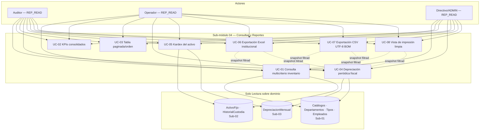
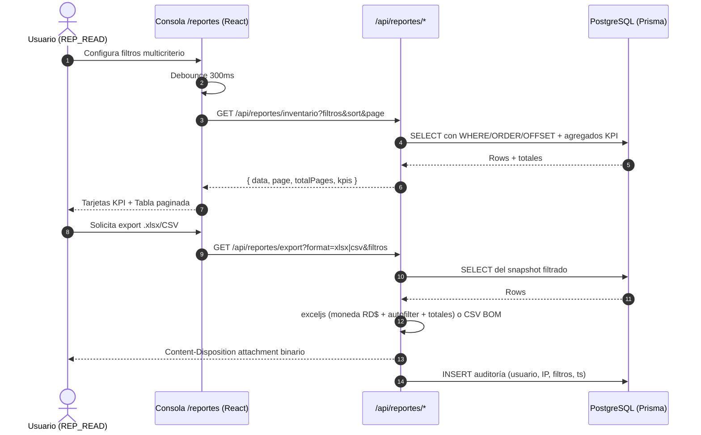
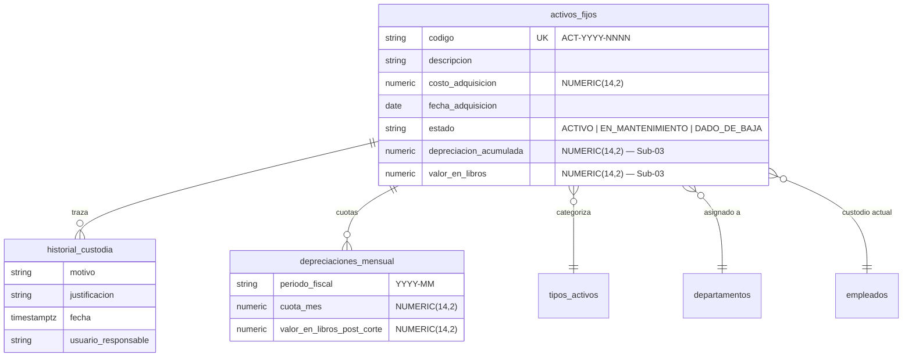

# Requirements: Consultas y Reportes (Reportes, Auditoría e Integración de Consulta Fiscal)

> 📋 Generated by `requirements-analyst` · 2026-10-15
> ✅ Approved by: JeremyJS · 2026-10-15
> ⚠️ **MANDATORY QUALITY GATE (Hard Gate 12)**: Every user story MUST be authored in formal EARS syntax with complete Given/When/Then acceptance criteria. Summarizing requirements with 'etc.', omitting calculation formulas, or generalizing validations is strictly prohibited. All numeric thresholds, formats, and error conditions must be explicitly detailed.

## Traceability
- **Work Item**: Sub-módulo 04 (Consultas y Reportes — pendiente de asignación de AB# en ADO)
- **Parent**: Sistema de Gestión de Activos Fijos & Contabilización DGII (UNAPEC — Proyecto Final Integraciones I, Prof. Juan P. Valdez)
- **Branch**: `feature/activos-fijos-04-consultas-reportes`
- **Design**: [design.md](./design.md) *(pendiente — se genera tras aprobación de este documento)*
- **Test Plan**: *(pendiente)*
- **Test Cases**: *(pendiente)*

## Overview
El sub-módulo de Consultas y Reportes constituye la capa analítica y de control fisicofinanciero del sistema ActivaCore. Provee a auditores, operadores y directivos una consola unificada en `/reportes` con consultas multicriterio sobre el parque de activos fijos institucionales, reportes de depreciación periódica y fiscal por período de corte, ficha histórica (kardex) con trazabilidad inmutable de custodios y movimientos, y un motor de exportación tabular formal (Excel `.xlsx` con formato de moneda dominicana y presentación institucional UNAPEC, CSV con UTF-8 BOM y vista de impresión limpia). El sub-módulo es de **solo lectura sobre dominio operativo** (almacén de activos y depreciaciones): nunca itera datos financieros del activo, garantizando que la fuente de verdad permanezca en Sub-02 (Gestión de Activos) y Sub-03 (Motor de Depreciación DGII).

## User Stories (EARS Notation)

### REQ-REP-001: Consulta Multicriterio de Inventario de Activos Fijos
**Type:** Event-Driven
**Rule:** WHEN un usuario con rol `ADMIN`, `OPERADOR` o `AUDITOR` y permiso `REP_READ` consulte la consola `/reportes`, the system SHALL exponer filtros combinables y acumulativos en tiempo real (rango de fecha de adquisición `fechaInicio`/`fechaFin`; rango de costo `montoMin`/`montoMax` en RD$; selector de Departamento desde el catálogo maestro; selector de Tipo de Activo con su categoría fiscal DGII; búsqueda de Empleado Custodio por coincidencia parcial de nombre o cédula; selector multi-estado del Activo: `ACTIVO`, `EN_MANTENIMIENTO`, `DADO_DE_BAJA`), aplicar la combinación sobre el resultado consolidado y re-filtrar client-side con debounce de 300 ms antes de invocar el endpoint paginado del servidor.
**Entities:** `ActivoFijo`, `Departamento`, `TipoActivo`, `Empleado`
**Error Handling:** Si el término de búsqueda de custodio no arroja coincidencias, el sistema muestra el estado vacío amigable con botón 'Restablecer filtros' sin producir excepción. Si los parámetros de filtro violan los schemas Zod (ej. `fechaFin < fechaInicio`, `montoMin > montoMax`), el endpoint responde `VALIDATION_ERROR` (HTTP 400) con el listado de campos inválidos en español.

**Acceptance Criteria:**
- [ ] Given una base catálogo con activos sembrados, When el usuario combina `Departamento = Tecnología` + `Estado = ACTIVO` + `montoMin = 10000`, Then the system retorna únicamente los activos que satisfacen las tres condiciones simultáneamente, con paginación exacta server-side.
- [ ] Given filtros con `fechaFin` anterior a `fechaInicio`, When la petición llega al endpoint, Then the system responde 400 `VALIDATION_ERROR` con el mensaje 'La fecha final no puede ser anterior a la fecha inicial' y la tabla no se refresca.
- [ ] Given el rango `montoMin = RD$ 50,000.00` y `montoMax = RD$ 80,000.00`, When se aplica la consulta, Then the system incluye los activos cuyo costo de adquisición esté en el rango cerrado `[50,000.00, 80,000.00]` (inclusivo en ambos extremos).
- [ ] Given que el usuario digita secuencialmente caracteres en el buscador de custodio, When el intervalo entre pulsaciones es menor a 300 ms, Then the system NO invoca la API por cada pulsación y consolida la búsqueda en una única llamada tras el debounce.
- [ ] Given un criterio que no coincide con ningún activo, When se completa la consulta, Then the system muestra el estado vacío con 'Restablecer filtros' y las tarjetas de KPI en RD$ 0.00 / 0 activos, sin excepción en consola.

**Priority:** Must
**Dependencies:** Sub-módulo 02 (entidades `ActivoFijo`, `HistorialCustodia`), Sub-módulo 01 (catálogos maestros — ✅ certificado)
**Tracker:** Sub-módulo 04

### REQ-REP-002: Tarjetas de KPIs Consolidados sobre Resultados Filtrados
**Type:** State-Driven
**Rule:** WHILE exista un conjunto de resultados activo derivado de los filtros del REQ-REP-001, the system SHALL presentar cuatro tarjetas de KPI calculadas sobre TODO el conjunto filtrado (no solo la página visualizada): (1) Cantidad total de activos, (2) Costo total de adquisición acumulado, (3) Depreciación acumulada a la fecha, y (4) Valor neto en libros consolidado calculado como `valorEnLibrosTotal = Σ(costosAdquisicion) − Σ(depreciacionesAcumuladas)`, formateadas en moneda dominicana `RD$ #,##0.00` con algoritmo de redondeo Half-Up a 2 decimales (`Math.round((val + Number.EPSILON) * 100) / 100`).
**Entities:** `ActivoFijo`
**Error Handling:** Si la agregación de KPIs falla por error de base de datos, el banner del consola muestra 'No fue posible calcular los indicadores' y la tabla de resultados permanece operativa; el sistema NO bloquea la consulta tabular por un fallo de agregación.

**Acceptance Criteria:**
- [ ] Given un filtrado con 3 activos de costos RD$ 100,000.00 + RD$ 250,000.00 + RD$ 50,000.00 y depreciaciones acumuladas RD$ 10,000.00 + RD$ 25,000.00 + RD$ 5,000.00, When se renderizan las tarjetas, Then the system muestra: 3 activos; costo total RD$ 400,000.00; depreciación acumulada RD$ 40,000.00; valor en libros RD$ 360,000.00 (verificación aritmética exacta, sin centavos fantasma por floating point).
- [ ] Given un filtro que reduce el conjunto a 1 activo, When cambian los filtros, Then las 4 tarjetas se recalculan de forma consistente con el conjunto filtrado en el mismo ciclo de render que la tabla.
- [ ] Given una pérdida puntual de conexión con la base al refrescar KPIs, When la agregación falla, Then la consola muestra el aviso de KPIs degradados y mantiene el último conjunto tabular renderizado.

**Priority:** Must
**Dependencies:** REQ-REP-001
**Tracker:** Sub-módulo 04

### REQ-REP-003: Tabla de Resultados con Paginación, Ordenamiento y Búsqueda
**Type:** Event-Driven
**Rule:** WHEN el usuario interactúe con la tabla de resultados del inventario, the system SHALL proveer: paginación server-side con tamaños de página {10, 25, 50}; ordenamiento ascendente/descendente por click en encabezado de las columnas código (`ACT-YYYY-NNNN`), descripción, costo de adquisición y fecha de adquisición; referencia visual de la columna y dirección ordenada (flecha ↑/↓); y barra de búsqueda instantánea por coincidencia parcial en código, descripción o número de serie, integrada al mismo pipeline de filtros multicriterio del REQ-REP-001.
**Entities:** `ActivoFijo`, `Departamento`, `TipoActivo`, `Empleado`
**Error Handling:** Si el número de página solicitado excede el total de páginas disponible (ej. eliminación concurrente de registros), el endpoint responde la última página válida con metadato `totalPages` recalculado, sin error 500.

**Acceptance Criteria:**
- [ ] Given un resultset de 47 activos con tamaño de página 25, When el usuario navega a la página 2, Then the system retorna exactamente los activos 26–47 (22 registros) con totalPages = 2.
- [ ] Given el encabezado 'Costo', When el usuario hace dos clicks, Then the system alterna el orden ascendente → descendente y la flecha del indicador refleja la dirección activa.
- [ ] Given dos sesiones simultáneas filtrando por distintos criterios, When cada sesión pagina por separado, Then el estado de paginación/filtros de una sesión NUNCA contamina a la otra.
- [ ] Given una búsqueda instantánea del código 'ACT-2026-00', When el usuario completa el término, Then los resultados se actualizan en < 500 ms p95 percibido (debounce incluido).

**Priority:** Must
**Dependencies:** REQ-REP-001, REQ-REP-002
**Tracker:** Sub-módulo 04

### REQ-REP-004: Reporte de Depreciación Periódica y Fiscal por Período
**Type:** Event-Driven
**Rule:** WHEN un usuario con `REP_READ` consulte la sección de depreciación periódica dentro de `/reportes`, the system SHALL exponer selectores de año y mes de corte fiscal (formato `YYYY-MM`, ej. `2026-10`), filtro opcional por Cuenta Contable de Compra y Cuenta Contable de Depreciación, y presentar el detalle **por activo** del período con cuatro columnas financieras obligatorias: costo original de adquisición, depreciación aplicada en el mes de corte, depreciación acumulada histórica hasta el corte y valor en libros residual, WHERE el cálculo proviene exclusivamente de la base del Motor de Depreciación Sub-03 (el sub-módulo de reportes NO recalcula cuotas, solo las consulta).
**Entities:** `ActivoFijo`, `DepreciacionMensual` (Sub-03), `TipoActivo`, `CatalogoCuentas` (Sub-01)
**Error Handling:** Si el período seleccionado no posee cierre de depreciación registrada, el sistema retorna el estado vacío con mensaje 'No existe depreciación procesada para el período {YYYY-MM}' sin datos inventados ni proyecciones. Si el filtro de cuenta contable no corresponde a una cuenta registrada, responde `VALIDATION_ERROR` (HTTP 400).

**Acceptance Criteria:**
- [ ] Given el período `2026-10` con depreciaciones procesadas del Sub-03, When se selecciona el mes de corte, Then the system lista cada activo procesado con su cuota mensual, acumulado histórico y valor en libros exactamente como fueron registrados por el motor (sin mutación ni recálculo).
- [ ] Given el período seleccionado `2025-03` (anterior a la puesta en marcha del motor), When se consulta, Then the system muestra 'No existe depreciación procesada para el período 2025-03' y ninguna fila.
- [ ] Given dos usuarios con `REP_READ` consultando simultáneamente el mismo período, When ambas respuestas llegan, Then los totales de depreciación aplicada del mes coinciden bit a bit (determinismo del reporte).

**Priority:** Must
**Dependencies:** Sub-módulo 03 (Motor de Depreciación y Contabilización DGII — pendiente de inicio), REQ-REP-001
**Tracker:** Sub-módulo 04

### REQ-REP-005: Ficha Histórica y Trazabilidad (Kardex del Activo)
**Type:** Optional
**Rule:** WHEN un usuario con `REP_READ` desee auditar el ciclo de vida de un activo específico desde cualquier fila de resultados, the system SHALL presentar un modal/detalle de Kardex con la línea de tiempo inmutable del bien: el evento de alta inicial, cada movimiento de `HistorialCustodia` (custodio anterior → nuevo custodio, departamento origen → destino, justificación, fecha/hora, usuario responsable) y la tabla histórica de cuotas de depreciación procesadas, ordenada cronológicamente descendente, WHERE ningún registro de la línea de tiempo pueda ser editado, reordenado o eliminado por el usuario (inmutabilidad de lectura).
**Entities:** `ActivoFijo`, `HistorialCustodia` (Sub-02), `DepreciacionMensual` (Sub-03), `Empleado`, `Departamento`, `Usuario`
**Error Handling:** Si el activo no existe, el sistema retorna `ASSET_NOT_FOUND` (HTTP 404). Si el activo está en estado `DADO_DE_BAJA`, el banner del Kardex muestra 'ACTIVO DESINCORPORADO — FUERA DE SERVICIO' junto a la fecha y motivo de baja.

**Acceptance Criteria:**
- [ ] Given un activo con 2 traslados de custodia y 5 cuotas de depreciación, When se abre el Kardex, Then the system muestra cronológicamente: alta inicial → traslado 1 → traslado 2 (descendente) y la grilla histórica de las 5 cuotas con su mes de corte correspondiente.
- [ ] Given el Kardex abierto, When el usuario intenta modificar/clic para editar algún evento histórico, Then the system no ofrece ninguna acción de mutación (todos los registros son de solo lectura).
- [ ] Given un activo desincorporado, When se abre su Kardex, Then the banner 'ACTIVO DESINCORPORADO' es visible antes que el resto del contenido.

**Priority:** Should
**Dependencies:** Sub-módulo 02 (`HistorialCustodia`), Sub-módulo 03 (`DepreciacionMensual`), REQ-REP-001
**Tracker:** Sub-módulo 04

### REQ-REP-006: Exportación Tabular a Excel Institucional (ExcelJS)
**Type:** Event-Driven
**Rule:** WHEN un usuario con `REP_READ` solicite la exportación de cualquier reporte (inventario filtrado o depreciación del período) a Excel `.xlsx`, the system SHALL compilar el archivo con librería `exceljs` aplicando: formato de moneda dominicana `RD$ #,##0.00` en todas las celdas financieras; encabezados de columna con fondo institucional azul UNAPEC (`#00539C`/paleta oficial de `DESIGN.md`) y tipografía en negrita; `autoFilter` automático en la fila de encabezados; y fila final de totales calculados bajo las mismas reglas de redondeo Half-Up del REQ-REP-002, entregando el binario vía header HTTP `Content-Disposition: attachment; filename="..."` con MIME `application/vnd.openxmlformats-officedocument.spreadsheetml.sheet`.
**Entities:** `ActivoFijo`, `DepreciacionMensual` (payload de export)
**Error Handling:** Si la exportación falla por filtrado vacío o error interno (ej. stream de memoria), el sistema preserva la sesión del usuario y muestra 'Exportación fallida — reintente' sin corromper el estado de la consulta en pantalla.

**Acceptance Criteria:**
- [ ] Given un resultado filtrado con 3 activos financieros, When se descarga el `.xlsx`, Then the system genera el archivo con encabezado azul institucional, celdas de costo/depreciación/valor con formato `RD$ #,##0.00`, y fila final de totales con la suma exacta de la tarjeta KPI.
- [ ] Given el `.xlsx` exportado, When se abre en Microsoft Excel, Then la cabecera activa `autoFilter` permite filtrar por cualquiera de las columnas sin manipulación adicional.
- [ ] Given la exportación exitosa, When el navegador recibe el response, Then el header `Content-Disposition` sugiere un filename legible y sin caracteres corruptos (ej. `inventario-activos-2026-10-15.xlsx`).

**Priority:** Must
**Dependencies:** REQ-REP-001, REQ-REP-002, REQ-REP-003, REQ-REP-004
**Tracker:** Sub-módulo 04

### REQ-REP-007: Exportación CSV con UTF-8 BOM
**Type:** Optional
**Rule:** WHEN un usuario con `REP_READ` solicite la exportación del reporte actual a CSV, the system SHALL emitir el archivo con codificación UTF-8 **con BOM** (`\uFEFF` prefijo del stream) para garantizar la apertura sin mojibake Microsoft Excel Windows, delimitador coma `,`, 0 adders de espapeado (`"`) en todo campo que contenga coma, comilla o salto de línea, conservando los mismos datos y precisión financiera (2 decimales Half-Up) del snapshot filtrado del REQ-REP-001 (y de la depreciación del REQ-REP-004), WHERE la exportación nunca exceda un máximo de 10,000 filas de activos en la respuesta actual, mostrando aviso previo si el dataset excede ese corte.
**Entities:** `ActivoFijo`, `DepreciacionMensual` (dto/csv)
**Error Handling:** Si el dataset excede 10,000 filas, el sistema advierte 'El dataset excede 10,000 registros — la exportación CSV se truncará al límite; refine filtros o utilice Excel' antes de emitir el archivo truncado con aviso de footer.

**Acceptance Criteria:**
- [ ] Given un stream CSV descargado, When se abre con `notepad` o `od -c` u `head -c3`, Then los primeros 3 bytes son `EF BB BF` (BOM UTF-8) y los acentos/caracteres españoles (á, é, í, ó, ú, ñ, RD$) se renderizan correctamente en Excel Windows.
- [ ] Given un registro cuyo campo descripción contiene una coma (ej. 'Laptop, Proyector'), When se genera el CSV, Then el campo queda encerrado en comillas dobles de forma que Excel lo interprete como una única celda.
- [ ] Given un dataset con más de 10,000 activos, When se solicita exportación CSV, Then el sistema advierte el límite ANTES de descargar y entrega el corte con footer de truncamiento.

**Priority:** Should
**Dependencies:** REQ-REP-001, REQ-REP-004
**Tracker:** Sub-módulo 04

### REQ-REP-008: Vista de Impresión Limpia (@media print)
**Type:** Optional
**Rule:** WHEN un usuario con `REP_READ` solicite 'Imprimir' sobre el reporte actual (inventario filtrado o hoja de depreciación), the system SHALL renderizar una vista de impresión limpia bajo reglas CSS `@media print` que oculta shell de navegación (sidebar, topbar, botones, paginación), conserva encabezado institucional UNAPEC (membrete, fecha y hora de emisión, usuario emisor y los filtros activos aplicados en texto plano), entrega una grilla sobria apta para hoja Carta/A4 lista para sábanas de inventario y actas de auditoría físicas.
**Entities:** Uint8 — capa de frontend (render print)
**Error Handling:** Si el usuario ejecuta la impresión antes de completar la carga de la tabla, el sistema espera el estado `loaded` de los datos antes de habilitar la acción (no se permite página en blanco o parcial).

**Acceptance Criteria:**
- [ ] Given el reporte/inventario renderizado, When el usuario presiona Ctrl+P o el botón 'Imprimir', Then la previsualización oculta sidebar, topbar, botones y paginación, y solo muestra el membrete, filtros activos, tabla y totales.
- [ ] Given la impresión de un inventario de 30 filas, When se visualiza Print Preview, Then el contenido se ajusta a hoja Carta/A4 sin cortes de columnas ni sangrías desalineadas.
- [ ] Given la impresión durante carga pendiente de datos, When el usuario dispara la acción antes de `loaded`, Then el sistema bloquea el disparo hasta que la data haya terminado de cargar, nunca impresa en blanco.

**Priority:** Should
**Dependencies:** REQ-REP-001, REQ-REP-004
**Tracker:** Sub-módulo 04

## Non-Functional Requirements

### NFR-REP-001: Autorización RBAC (Solo Lectura)
**Category:** Security
**Rule:** The system SHALL restringir todo endpoint del sub-módulo `/reportes` y `/api/reportes/*` a usuarios autenticados con la acción `REP_READ`, y SHALL restringir explícitamente cualquier herramienta HTTP distinta de `GET` sobre dichos endpoints (`POST`, `PUT`, `DELETE`, `PATCH` responden 405 Method Not Allowed), garantizando que la consola de reportes NUNCA pueda mutar estado del dominio financiero.
**Metric:** 100% de endpoints del sub-módulo protegidos con JWT + `REP_READ` vía `middleware/proxy.ts` y verificación dual en route handler; 0 endpoints adicionales no listados en design.md.
**Priority:** Must

### NFR-REP-002: Performance de Consultas y Render
**Category:** Performance
**Rule:** The system SHALL responder consultas de inventario filtradas (hasta 1,000 activos en el catálogo) en menos de 1.5 segundos p95 de extremo a extremo (servidor + render), y la exportación `.xlsx` de datasets hasta 10,000 filas en menos de 10 segundos p95.
**Metric:** p95 < 1.5 s (consulta filtrada); < 10 s (export xlsx 10k filas); primer render útil de la consola `/reportes` < 3 s p95.
**Priority:** Must

### NFR-REP-003: Exactitud Financiera y Redondeo
**Category:** Reliability
**Rule:** The system SHALL aplicar redondeo Symmetric Half-Up a 2 decimales (`Math.round((val + Number.EPSILON) * 100) / 100`) y SHALL usar `NUMERIC(14,2)` en toda cifra de dinero si persiste, garantizando consistencia bit a bit entre KPIs de pantalla, fila de totales de exportaciones y los datos fuente del Sub-03.
**Metric:** 0 discrepancias de centavos entre pantalla frente a exportación en pruebas E2E de comparación (suite de tests de verificación de totales).
**Priority:** Must

### NFR-REP-004: Codificación de Texto Internacionalización
**Category:** Reliability
**Rule:** The system SHALL emitir todos los archivos exportados (CSV) y respuestas de texto en UTF-8 con BOM donde aplique (CSV para Excel Windows), garantizando que caracteres del dominio español (á, é, í, ó, ú, ñ, ü, RD$) y el símbolo de moneda dominicana no presenten mojibake (`é`, `ú`) en el pipeline completo de exportación/download.
**Metric:** 0 mojibake en tests E2E de exportación de archivo CSV; 100% de campos con acentos preservados al decodificar Excel/Windows.
**Priority:** Must

### NFR-REP-005: Conversiones de Auditoría Read-Only
**Category:** Security
**Rule:** The system SHALL registrar (vía el mecanismo de auditoría del Sub-00) toda consulta de reporte que engendre exportación de datos financieros binarios (xlsx/csv) con el identificador del usuario autenticado, IP, timestamp y parámetros de filtros aplicados en ese momento, habilitando trazabilidad formal de quién descargó información patrimonial y con qué filtros.
**Metric:** 100% de eventos de exportación registrados con los 5 campos mínimos (usuario, IP, acción, recurso, timestamp UTC).
**Priority:** Must

### NFR-REP-006: Accesibilidad y UX en Consola
**Category:** Accessibility
**Rule:** The system SHALL cumplir WCAG 2.1 AA en el shell de `/reportes` (labels, roles ARIA en tabla/diálogos, navegación por teclado funcional en paginación, filtros y exportaciones), alineado con el Design System UNAPEC (`DESIGN.md`): umbral de contraste 4.5:1 en texto financiero, tipografía `Monospace` para códigos `ACT-YYYY-NNNN` y cifras en RD$.
**Metric:** Score axe-core sin errores de violación crítica; navegación completa por teclado del flujo filtro → tabla → export → print sin mouse.
**Priority:** Should

## Diagrams

### Use Case Diagram

### Supporting Diagram (Secuencia — Flujo de Consulta y Exportación)

### Diagrama Contextual de Datos (referencia AL dominio, sin mutar)

## Dependencies

| Feature | Capability needed | Status | Workaround |
|---------|------------------|--------|------------|
| Sub-módulo 00 (Auth & RBAC) | Sesión NextAuth v5, middleware, permiso `REP_READ`, auditoría de accesos | ✅ **Certificado** | Ninguna requerida |
| Sub-módulo 01 (Catálogos Base) | Catálogos de `Departamento`, `TipoActivo` (con cuentas y vida útil DGII), `Empleado` custodios | ✅ **Certificado** (commit `5817d8a`) | Ninguna requerida |
| Sub-módulo 02 (Gestión de Activos y Custodia) | Entidad `ActivoFijo`, códigos `ACT-YYYY-NNNN`, estados operarios, `HistorialCustodia`, `HistorialBaja` | ✅ **Certificado** (commit `e254113` — modelos reales en `schema.prisma` + 30 activos sembrados en `seed-activos.ts`) | Ninguna requerida |
| Sub-módulo 03 (Motor de Depreciación DGII) | Tabla/lógica `DepreciacionMensual`, períodos `YYYY-MM`, valor en libros post-corte | ❌ **Sin spec** (planned Sub-03) | Seed de cuotas de depreciación sintéticas coherentes con la fórmula de línea recta DGII para escenarios de aceptación (ver Assumptions) |

## Assumptions

| # | Assumption | Temporary stub | Replaced when |
|---|-----------|----------------|---------------|
| 1 | El contrato físico de Sub-02 ya está implementado REAL (commit `e254113`): `activos_fijos`, `historial_custodia` (con `empleado_anterior_id`/`empleado_nuevo_id`, `autorizado_por_id`) y `historial_bajas` (motivo, numero_acta, fecha_baja) según `schema.prisma`. El sub-módulo 04 lee estas tablas reales tal cual. | Ninguno | N/A — verificado contra código |
| 2 | El conjunto de estados de la Ficha es `ACTIVO`, `EN_MANTENIMIENTO`, `DADO_DE_BAJA`. El schema real de Sub-02 define `estado VARCHAR(20)` SIN CHECK (podrían existir otros valores como `VENDIDO` del REQ-ACT-005) — el filtro del Sub-04 expone los 3 de la Ficha y, vía endpoint, cualquier valor presente en la base para no ocultar registros. | Ninguno (contrato resuelto) | N/A — decisión funcional registrada aquí para design.md |
| 3 | La depreciación mostrada es la registrada por Sub-03 (aún sin implementar); el Sub-04 NO aplica la fórmula de cuota (`(costo−residual)/vida útil`) en vivo ni proyecta futuras depreciaciones. | Seed sintético de cuotas coherentes (T1.2) | Al implementar Sub-03 y su migración real |
| 4 | El límite de 10,000 filas por respuesta de exportación es techo operativo del snapshot y NO una restricción de negocio funcional (ajustable en design/tasks si ADO e infra lo confirman). | Guard tech en el endpoint | Confirmación del equipo en code-review |
| 5 | El color institucional UNAPEC para encabezados de exportación Excel es el token de `DESIGN.md` (azul institucional `#00539C` de referencia) — si `DESIGN.md` define otro token exacto, design.md tomará el que esté definido allí. | Token aproximado | Cotejo con `DESIGN.md` en la fase de design.md |

## Out of Scope
- **Integración con Web Service Contable UNAPEC (envío de asientos/comprobantes)** — corresponde al Sub-módulo 05 (`feature/activos-fijos-05-integracion-ws-contabilidad`).
- **Cálculo o mutación de depreciación** (corrida mensual, cierres, asientos débito/crédito) — dominio exclusivo del Sub-módulo 03.
- **Altas, ediciones, traslados y bajas de activos fijos** — dominio exclusivo del Sub-módulo 02; el Sub-04 es solo lectura.
- **Administración RBAC, gestión de roles/permisos o usuarios** — dominio del Sub-módulo 00.
- **Generación de documentos PDF formales** (actas de entrega/custodia) — se cubre únicamente la vista de impresión (`@media print`) y exportaciones tabulares.
- **Notificaciones automáticas (email/WhatsApp) de reportes** y cualquier scheduler de despacho por correo.
- **Business Intelligence grueso** (dashboards multi-ejercicio, comparativas inter-anuales, ML/latencias agregadas), que formen productos distintas de las consultas de inventario/depreciación definidas aquí.

## Approval
- [ ] Analyst: _____ Date: _____

---
> 📍 Sub-módulo 04 · 🌿 `feature/activos-fijos-04-consultas-reportes` · Generated by SDD Standard · Generated by `requirements-analyst` (SDD Plan Agent)
