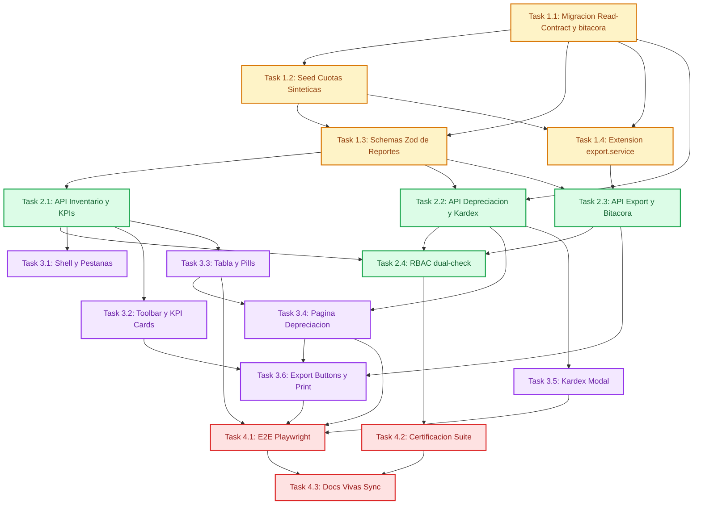

# Tasks: Consultas y Reportes (Sub-módulo 04)

> 📋 Generated by `task-planner` · 2026-10-15 · **Revisado 2026-10-21** (post certificación Sub-02 — tablas activos/custodia ahora REALES)
> ✅ Approved by: JeremyJS · 2026-10-21

## Traceability
- **Work Item**: Sub-módulo 04 (Consultas y Reportes — pendiente de asignación de AB# en ADO)
- **Branch**: `feature/activos-fijos-04-consultas-reportes`

## Metadata
- **Based on:** [design.md](./design.md) · [requirements.md](./requirements.md)
- **Total estimate:** ~20.5h (incluye buffer del 20% para contingencias)
- **Number of waves:** 4 (Wave 1 → Wave 4 · **Wave 0 OMITIDA por mandato del analista**: la infraestructura Next.js 16, Prisma, Tailwind y shadcn/ui YA EXISTE desde Sub-00/01)
- **Number of tasks:** 14 tareas atómicas
- **Sprint:** Sprint 2 (Activos Fijos UNAPEC · Integraciones I — Prof. Juan P. Valdez)
- **Assignee:** JeremyJS

## Estimation Rules
- Máximo **4 horas** por tarea; si una tarea excede 4h durante la ejecución, se descompone inmediatamente.
- Las estimaciones cubren implementación + pruebas unitarias integradas + revisión de código.
- **Buffer 20%** incluido en el total para contingencias.
- **Entorno de tests:** Vitest 5 requiere Node ≥ 22 (usa `styleText` de `node:util`). Esta máquina tiene Node 20, por lo que los comandos de verificación se ejecutan con `npx -y node@22 node_modules/vitest/vitest.mjs run <test>` (equivalente funcional a `pnpm test`).
- Toda la codificación se ejecuta en modo `sdd-build`: **una tarea a la vez** con verificación, checkoff en este documento y commit atómico por tarea (Hard Gate 18 — Anti-Batch Closing).

## Dependency Graph

---

## Wave 1: Foundation — Datos Provisionales + Servicios (~5.5h)

### Task 1.1: Migración de Read-Contract — `DepreciacionMensual` (provisional) + `BitacoraExportacion` + índices aditivos (~1.5h) [COMPLETED 2026-10-21]
- **Description:** Añadir en `app/prisma/schema.prisma`:
  - `DepreciacionMensual` como **contrato provisional de Sub-03** (marcado con comentario de gobernanza `// CONTRATO PROVISIONAL — dominio reclamado por Sub-03`), con los campos del design.md (`periodo_fiscal CHAR(7)` con CHECK de patrón, `NUMERIC(14,2)`, snapshot de cuentas contables, UNIQUE `(activo_id, periodo_fiscal)`).
  - `BitacoraExportacion` (propia de Sub-04, FK → usuarios, CHECKs de formato/reporte, JSONB de filtros).
  - 2 índices **aditivos sobre la tabla REAL `activos_fijos` de Sub-02** (NO se toca ninguna columna): `fecha_adquisicion` y `costo_adquisicion`.
- **Acceptance criteria:**
  - [x] `pnpm prisma migrate dev --name add_reportes_read_contract` aplica sin errores contra Neon (migración aditiva — no drop ni alter destructivo). **✅ migración `20261021225507_add_reportes_read_contract` aplicada 2026-10-21**
  - [x] `pnpm prisma validate` y `pnpm exec tsc --noEmit` pasan. **✅ verificado 2026-10-21**
  - [x] Los modelos `ActivoFijo`, `HistorialCustodia`, `HistorialBaja` de Sub-02 quedan intactos (diff de migración sin alter sobre ellos). **✅ solo CREATE TABLE/INDEX aditivos**
  - [x] Comentario de gobernanza en `DepreciacionMensual` indica que Sub-03 la reemplazará. **✅**
- **Dependencies:** None (rama `feature/activos-fijos-04-consultas-reportes` creada desde `origin/dev` @ e254113)
- **Files to create/modify:** `app/prisma/schema.prisma`, `app/prisma/migrations/*`

### Task 1.2: Seed de Cuotas de Depreciación (Sintético, determinista) sobre el Inventario Real (~1h) [COMPLETED 2026-10-21]
- **Description:** Los **activos ya existen** (31 activos reales + 2 bajas formales de `seed-activos.ts` de Sub-02 ✅). Extender el seeding para poblar SOLO `depreciaciones_mensual`: 6 cuotas por cada activo en estado `ACTIVO`/`EN_MANTENIMIENTO` (períodos deterministas 2025-11, 2025-12, 2026-04, 2026-05, 2026-09, 2026-10), con cifras derivadas de la fórmula línea recta DGII de cada `TipoActivo` real (`(costo − residual) / vida_util_meses`), y las columnas snapshot `cuenta_compra`/`cuenta_depreciacion` tomadas del tipo de activo real. NO re-crud activos ni custodias (pertenecen a Sub-02).
- **Acceptance criteria:**
  - [x] `pnpm prisma db seed` (o `tsx prisma/seed-activos.ts` extendido) ejecuta de forma idempotente. **✅ 2 corridas consecutivas = 174 cuotas ambas (29 elegibles × 6 períodos)**
  - [x] Cada cuota cumple: `valor_en_libros_post = costo − depreciacion_acumulada_post` a 2 decimales exactos, y `depreciacion_acumulada_post` = suma de cuotas previas. **✅ script de verificación: 0 inconsistencias en 174 filas**
  - [x] Los activos reales de Sub-02 quedan intactos tras el seed (no se insertan/reemplazan activos; solo se sincronizan `depreciacion_acumulada`/`valor_en_libros`). **✅ upsert-only + update de acumulados**
- **Dependencies:** Task 1.1
- **Files to create/modify:** `app/prisma/seed-activos.ts` (extensión) o `app/prisma/seed.ts`

### Task 1.3: Schemas Zod de Consulta de Reportes (~1h) [COMPLETED 2026-10-21]
- **Description:** Crear `app/lib/schemas/report.schema.ts` con `InventarioQuerySchema` (fechas ISO, montos como strings decimales, estados multi-select, sort whitelist `{codigo, descripcion, costo, fecha}`, `dir asc|desc`, pageSize `{10,25,50}`) y `DepreciacionQuerySchema` (regex `^\d{4}-(0[1-9]|1[0-2])$` para el período y cuentas contables validadas con `validarCuentaContable` de Sub-01) + refinamientos cruzados (`fechaFin >= fechaInicio`, `montoMax >= montoMin`). Tipos TS inferidos y exportados (`InventarioQuery`, `DepreciacionQuery`, `SortField`, `SortDir`).
- **Acceptance criteria:**
  - [x] Suite `app/tests/schemas/reports.test.ts` (≥ 20 casos): fechas cruzadas inválidas, montos invertidos, sort fuera de whitelist rechazado, pageSize fuera de rango, período `2026-13` inválido, cuenta contable con formato inválido. **✅ 29 tests, 29 passed**
  - [x] `pnpm test tests/schemas/reports` en verde con cobertura del archivo ≥ 95%. **✅ cobertura `report.schema.ts` = 100% (ejecutado con Node 22 aislado por restricción de Vitest 5)**
- **Dependencies:** Task 1.1
- **Files to create/modify:** `app/lib/schemas/report.schema.ts`, `app/lib/schemas/index.ts`, `app/tests/schemas/reports.test.ts`

### Task 1.4: Extensión del Export Service — Formato RD$ + Encabezado Institucional + Totales (~1h) [COMPLETED 2026-10-21]
- **Description:** Extender `app/lib/services/export.service.ts` (sin romper las funciones existentes de catálogos de Sub-01) con `buildInventarioXlsx`, `buildDepreciacionXlsx`, `buildInventarioCsv` y `buildDepreciacionCsv`: fila de título institucional azul UNAPEC (`FF00539C`, texto blanco), encabezados en negrita con `autoFilter`, `numFmt` `'"RD$"#,##0.00'` en celdas financieras, fila final de totales con precisión Half-Up, CSV con BOM + escape de comas y footer de truncamiento condicional.
- **Acceptance criteria:**
  - [x] Snapshot del buffer XLSX (re-parseado con exceljs) confirma: fill `FF00539C` en encabezados, `numFmt` en columnas costo/depreciación/valor, fila de totales con la suma exacta. **✅ fill institucional `FF002D62` (token real ya usado en Sub-01, coherente con DESIGN.md), `numFmt '"RD$"#,##0.00'`, totales exactos, autoFilter `A3:J3` verificado**
  - [x] CSV: primeros 3 bytes `EF BB BF`, campos con coma entrecomillados, footer de truncamiento solo si `truncated = true`. **✅ verificado con bytes y parseo de líneas**
  - [x] `pnpm test tests/services/export-reports` pasa sin romper los tests existentes de export.service de Sub-01. **✅ 15 nuevos + 8 existentes = 23/23 passed**
- **Dependencies:** None (paralela a T1.2/T1.3)
- **Files to create/modify:** `app/lib/services/export.service.ts`, `app/tests/services/export-reports.test.ts`

---

## Wave 2: Core Implementation — Endpoints de Consulta (~8h)

### Task 2.1: `GET /api/reportes/inventario` con Filtros AND + KPIs en una Respuesta (~3h)
- **Description:** Crear `app/lib/services/report.service.ts` con `consultarInventario(query)`: WHERE construido con AND componible en Prisma (fechas, montos, FKs de depto/tipo, custodio por nombre O cédula parcial, estados multi-select, `search` OR sobre codigo/descripcion/`numeroSerie` — campo real de Sub-02); de la misma transacción Prisma `$transaction([findMany(include tipo/depto/custodio), aggregate(_count, _sum)])` se matriculan filas + KPIs; orden por whitelist; paginación skip/take; respuesta JSON con la forma exacta del design.md (cifras numéricas como strings de 2 decimales). Handler en `app/app/api/reportes/inventario/route.ts` con `GET` + validación Zod + guard `REP_READ` reutilizando el patrón de Sub-01.
- **Acceptance criteria:**
  - [ ] `app/tests/api/reports-inventario.test.ts` (≥ 18 casos): combinación de filtros simple y múltiple, rango de montos cerrado inclusivo, paginación `page=2` sobre resultset de 47 con pageSize 25 (retorna 22), sort asc/desc por los 4 campos, clamp de página fuera de rango a la última válida, búsqueda parcial por custodio y por código.
  - [ ] KPIs calculados sobre el TOTAL del filtrado (no la página): caso aritmético exacto del REQ-REP-002 (3 activos → RD$ 400,000 / RD$ 40,000 / RD$ 360,000).
  - [ ] `fechaFin < fechaInicio` y `montoMin > montoMax` responden `400 VALIDATION_ERROR` RFC 7807 con `errors` en español.
  - [ ] `pnpm test tests/api/reports-inventario` verde y suite total Vitest sin regresiones.
- **Dependencies:** Task 1.1, T1.2, T1.3
- **Files to create/modify:** `app/lib/services/report.service.ts`, `app/app/api/reportes/inventario/route.ts`, `app/tests/api/reports-inventario.test.ts`

### Task 2.2: `GET /api/reportes/depreciacion` + `GET /api/reportes/activos/[id]/kardex` (~2.5h)
- **Description:** Depreciación: `report.service.ts` añade `consultarDepreciacion({ periodo, cuentaCompra, cuentaDepreciacion, page, pageSize })` — SELECT sobre `depreciaciones_mensual` + activo con filtros de cuenta, totales del período vía aggregate y bandera `sinProceso: true` con `data: []` si el período no tiene cuotas registradas. Kardex: `consultarKardex(activoId)` compone la timeline (alta inicial + traslados desde `historial_custodia` REAL en orden cronológico descendente) y las `cuotas` ordenadas por período descendente; `bajaInfo` poblada desde la tabla REAL `historial_bajas` cuando `estado = DADO_DE_BAJA`. Handlers en `app/app/api/reportes/depreciacion/route.ts` y `app/app/api/reportes/activos/[id]/kardex/route.ts` con `404 ASSET_NOT_FOUND` cuando el id no existe.
- **Acceptance criteria:**
  - [ ] `app/tests/api/reports-depreciacion.test.ts` (≥ 10 casos): período con datos, `sinProceso` para período vacío (nunca 404/500), filtro por cuenta contable (una y ambas), totales exactos del período.
  - [ ] `app/tests/api/reports-kardex.test.ts` (≥ 8 casos): timeline cronológica descendente exacta, cuotas descendentes, activo con 2 traslados completa su trayectoria, activo dado de baja incluye `bajaInfo` (la UI dibuja el banner), 404 con id inexistente, solo métodos GET.
  - [ ] `pnpm test tests/api/reports-depreciacion tests/api/reports-kardex` en verde.
- **Dependencies:** Task 1.1, T1.3, T2.1 (comparte service y patrón de handler)
- **Files to create/modify:** `app/lib/services/report.service.ts`, `app/app/api/reportes/depreciacion/route.ts`, `app/app/api/reportes/activos/[id]/kardex/route.ts`, `app/tests/api/reports-depreciacion.test.ts`, `app/tests/api/reports-kardex.test.ts`

### Task 2.3: `GET /api/reportes/export` — XLSX/CSV + Auditoría No-Bloqueante (~1.5h)
- **Description:** Handler `app/app/api/reportes/export/route.ts`: reutiliza el set completo de filtros del reporte origen (`reporte=inventario|depreciacion`) + `formato=xlsx|csv`. Con `?precheck=true` devuelve JSON `{ avisoTruncamiento, totalFiltrado }` cuando el resultado supera `MAX_EXPORT_ROWS = 10000` (la UI avisará antes de descargar — REQ-REP-007); caso normal devuelve el binario con `Content-Disposition` y Content-Type correcto. Genera un INSERT en `bitacora_exportaciones` con usuario, IP (`x-forwarded-for` → fallback `x-real-ip`), user_agent, filtros en JSONB y filas emitidas — pero si el INSERT falla, la descarga NO se cancela (catch + log interno).
- **Acceptance criteria:**
  - [ ] `app/tests/api/reports-export.test.ts` (≥ 10 casos): buffers correctos por reporte/formato, headers `Content-Disposition` con filename legible, `precheck` devuelve aviso con dataset reducido simulado, registro en bitácora con los filtros exactos aplicados, INSERT fallido no rompe la descarga (mock de fallo).
  - [ ] Caracteres con acentos y `RD$` sin mojibake en el CSV (verificación de bytes UTF-8/BOM).
  - [ ] `pnpm test tests/api/reports-export` en verde.
- **Dependencies:** Task 1.4, T2.1, T2.2
- **Files to create/modify:** `app/app/api/reportes/export/route.ts`, `app/lib/services/export.service.ts`, `app/tests/api/reports-export.test.ts`

### Task 2.4: Seguridad RBAC — Dual-check + GET-only sobre `/api/reportes/*` (~1h)
- **Description:** Añadir matcher de `proxy.ts` para `/api/reportes/:path*` con `requirePermission('REP_READ')` reutilizando el patrón de `/api/catalogos/*`; en cada handler un helper único `app/lib/guards/reportes-guard.ts` que verifica: 401 (sin sesión válida) → 403 (sin permiso) → 405 (`Allow: GET` para cualquier otro método). Queda prohibida cualquier mutación sobre el dominio de reportes (lectura pura).
- **Acceptance criteria:**
  - [ ] `app/tests/api/reports-security.test.ts` (≥ 6 casos): 401 sin sesión, 403 con sesión sin `REP_READ` (fixture de rol sin el permiso), 405 para POST/PUT/DELETE/PATCH en los 4 endpoints, 200 con rol ADMIN.
  - [ ] Ningún endpoint del sub-módulo registra éxito en POST/PUT/DELETE/PATCH — el test lo garantiza explícitamente.
  - [ ] `pnpm test tests/api/reports-security` en verde y suite total Vitest sin regresiones.
- **Dependencies:** Task 2.1, T2.2, T2.3
- **Files to create/modify:** `app/proxy.ts`, `app/lib/guards/reportes-guard.ts` (nuevo), handlers existentes (integración del guard), `app/tests/api/reports-security.test.ts`

---

## Wave 3: UI — Consola de Reportes `/reportes` (~6h)

### Task 3.1: Shell de la consola (`layout.tsx` + pestañas + breadcrumb) (~1h)
- **Description:** Crear `app/app/reportes/layout.tsx` (título, breadcrumb "Gestión de Activos → Reportes DGII"), `app/components/reportes/reportes-nav.tsx` (pestañas Inventario / Depreciación con indicador activo de 4px, tokens del DESIGN.md), `app/app/reportes/page.tsx` (vista de inventario por defecto) y `app/app/reportes/depreciacion/page.tsx` (placeholder listo para T3.4).
- **Acceptance criteria:**
  - [ ] Ambas rutas responden 200 autenticado con rol ADMIN y redirigen a `/login?callbackUrl=/reportes` sin sesión.
  - [ ] El shell respeta la No-Line Rule (separación tonal, sin bordes duros) y reutiliza los tokens del console shell.
  - [ ] `pnpm lint` limpio en los archivos nuevos.
- **Dependencies:** Task 2.1
- **Files to create/modify:** `app/app/reportes/layout.tsx`, `app/app/reportes/page.tsx`, `app/app/reportes/depreciacion/page.tsx`, `app/components/reportes/reportes-nav.tsx`, `app/components/layout/console-breadcrumb.tsx` (nueva entrada)

### Task 3.2: Toolbar de consulta + KPI cards (~1.5h)
- **Description:** `app/components/reportes/filters-toolbar.tsx`: inputs de fecha inicio/fin, monto min/max, selects de departamento/tipo (catálogos de Sub-01), búsqueda de custodio con debounce exacto de **300 ms**, selección multi-estado con chips removibles; el querystring del URL es la fuente de verdad del estado de filtros. `app/components/reportes/kpi-cards.tsx`: 4 tarjetas (Cantidad, Costo, Depreciación, Valor en libros) con Manrope 800 26px para la cifra, Inter 11px uppercase en el label, y JetBrains Mono + `tabular-nums` para RD$.
- **Acceptance criteria:**
  - [ ] El debounce es verificable en tests: al teclear en el buscador solo se dispara 1 request por ventana de 300 ms (no por pulsación).
  - [ ] KPIs con el caso del REQ-REP-002 renderizan RD$ con 2 decimales exactos.
  - [ ] Los filtros se reflejan en el URL y son repobables desde el querystring (compartir/limpiar estado funciona).
  - [ ] Accesible: labels reales, manejo de foco, navegación completa por teclado.
- **Dependencies:** Task 3.1, T2.1
- **Files to create/modify:** `app/components/reportes/filters-toolbar.tsx`, `app/components/reportes/kpi-cards.tsx`

### Task 3.3: Tabla de resultados server-side + pills + empty state (~1.5h)
- **Description:** `app/components/reportes/report-data-table.tsx` (genérico `<T>`): paginación server-side {10, 25, 50}, orden asc/desc con indicadores de dirección en las 4 columnas ordenables (código, descripción, costo, fecha), skeletons de loading, cifras en JetBrains Mono tabular-nums alineadas a la derecha, columna de estado con `estado-pill.tsx` (tokens verde/amarillo/rojo de DESIGN.md), `empty-state.tsx` con icono `FileSearch` + botón 'Restablecer filtros' que limpia el querystring; clamp de página sobre `meta.totalPages` en respuestas recortadas.
- **Acceptance criteria:**
  - [ ] Flujo: filtrar → paginar → ordenar → filtrar de nuevo reinicia a page=1 y no paginable fuera de rango.
  - [ ] El clamp de página funciona cuando el resultset se reduce entre consultas.
  - [ ] Estado vacío sin errores en consola, KPIs en cero y botón de reset visible.
  - [ ] La tabla respeta scroll horizontal fluido con el layout actual (sin desbordes a 1280px).
- **Dependencies:** Task 3.2, T2.1
- **Files to create/modify:** `app/components/reportes/report-data-table.tsx`, `app/components/reportes/estado-pill.tsx`, `app/components/reportes/empty-state.tsx`

### Task 3.4: Página Depreciación (período + cuentas + `sinProceso`) (~1h)
- **Description:** Implementar `app/app/reportes/depreciacion/page.tsx`: selector de período `YYYY-MM` y filtros de cuenta compra/depreciación (sugeridos desde el catálogo de tipos de activo de Sub-01), reutiliza la tabla server-side del T3.3 con fila de totales del período y el estado `sinProceso: true` mostrando 'No existe depreciación procesada para el período YYYY-MM'.
- **Acceptance criteria:**
  - [ ] Renderizado con data, sin data y filtro inválido funcionan sobre la misma pantalla sin cambios de layout.
  - [ ] Período predeterminado = mes actual si tiene datos; si no, último período con cuotas registradas.
  - [ ] Totales coinciden bit-a-bit con los del snapshot filtrado (fixture compartido con T2.2).
- **Dependencies:** Task 3.3, T2.2
- **Files to create/modify:** `app/app/reportes/depreciacion/page.tsx`, `app/components/reportes/*` (reutilizados)

### Task 3.5: Modal Kardex del Activo (~0.5h)
- **Description:** `app/components/reportes/kardex-modal.tsx`: dialog de shadcn/ui con rounded-3xl, timeline vertical inmutable (dot indicators, tipo `ALTA_INICIAL`/`TRASLADO`/`BAJA`, justificación, usuario responsable, custodios y departamentos origen/destino), grilla de cuotas con las columnas del reporte de depreciación, y banner 'ACTIVO DESINCORPORADO — FUERA DE SERVICIO' cuando `bajaInfo != null`; se abre desde el icono de detalle en cada fila del inventario.
- **Acceptance criteria:**
  - [ ] Apertura por teclado (Enter sobre fila) y cierre por ESC/overlay con focus trap correcto.
  - [ ] Activo inexistente (404) muestra el `detail` RFC 7807 sin romper el modal ni la tabla.
  - [ ] Ningún registro del timeline ofrece acción de mutación (lectura pura real).
- **Dependencies:** Task 3.3, T2.2
- **Files to create/modify:** `app/components/reportes/kardex-modal.tsx`

### Task 3.6: Botones de exportación + vista de impresión (`@media print`) (~0.5h)
- **Description:** `app/components/reportes/export-buttons.tsx`: flujo de 2 pasos — precheck `GET /api/reportes/export?precheck=true`; si `avisoTruncamiento` aplica, modal de aviso del corte (10,000) antes de descargar; botones 'Excel', 'CSV' e 'Imprimir'. CSS en `app/app/reportes/reportes-print.css` con `@media print` que oculta `.no-print` (sidebar, topbar, toolbar, paginación, botones, pestañas) y muestra membrete UNAPEC + usuario emisor + fecha/hora + filtros activos como texto plano.
- **Acceptance criteria:**
  - [ ] La descarga solo ocurre si el precheck no marca truncamiento (o el usuario lo acepta tras el aviso).
  - [ ] Ctrl+P / botón Imprimir: el preview nunca muestra sidebar, toolbar, botones ni paginación, y sí membrete + filtros + tabla.
  - [ ] La acción de impresión queda bloqueada hasta que los datos están cargados (nunca hoja en blanco).
- **Dependencies:** Task 3.2, T3.4, T2.3
- **Files to create/modify:** `app/components/reportes/export-buttons.tsx`, `app/app/reportes/reportes-print.css`

---

## Wave 4: Testing & Polish (~2h)

> ⚠️ **Role ownership:** unit tests integrados en cada tarea de las waves 1–3. Los E2E y la documentación final de certificación siguen el precedente del Sub-01 (sin QA asignado formalmente en el proyecto, se registran como tareas assignee JeremyJS).

### Task 4.1: E2E Playwright — Flujo completo de reportes (~1h)
- **Description:** Crear `app/e2e/reportes-smoke.spec.ts` con el patrón de `auth-smoke.spec.ts` / `catalogos-smoke.spec.ts`: login ADMIN → navegar `/reportes` → aplicar filtros → validar KPIs → paginar/ordenar → abrir Kardex → ir a Depreciación → exportar XLSX (download event) → validar vista de impresión vía CDP (`Page.printToPDF`).
- **Acceptance criteria:**
  - [ ] La suite completa pasa headless: `pnpm test:e2e`.
  - [ ] La exportación del test se descarga y se re-parsea con exceljs mostrando la fila de totales exacta.
  - [ ] Screenshot de regresión visual del shell `/reportes` almacenado como evidencia en `artifacts/`.
- **Dependencies:** Tasks 3.1–3.6, 2.4
- **Files to create/modify:** `app/e2e/reportes-smoke.spec.ts`, `app/artifacts/*` (evidencias)

### Task 4.2: Certificación de calidad — Suite completa + cobertura (~0.5h)
- **Description:** Ejecutar el círculo completo de calidad local y certificar el sub-módulo: `pnpm lint`, `pnpm test` (Vitest completo), `pnpm test:e2e` y `pnpm build` (type-check + build de producción Turbopack).
- **Acceptance criteria:**
  - [ ] Los 4 comandos pasan sin errores, con cobertura del sub-módulo ≥ 85% (umbral referencial de Sub-01: 94.16%).
  - [ ] Cero `console.error` inesperados durante la revisión del smoke test en dev.
  - [ ] Revisar que no queden artefactos de texto corrupto en código ni comentarios (Hard Gate 15).
- **Dependencies:** Task 4.1
- **Files to create/modify:** ninguno (evidencia registrada en el PR)

### Task 4.3: Sincronización de Documentación Viva (Hard Gate 16) (~0.5h)
- **Description:** Actualizar los documentos maestros: `docs/modules/activos-fijos.md` (matriz sub-04 → In Progress/Certificado según avance, rutas `/reportes` y las 4 APIs nuevas, ERD consolidado con `bitacora_exportaciones` y el contrato provisional, change log), `docs/architecture/database-architecture.md` (sección de cobertura read-only y bitácora con gobernanza), `README.md` (estado del branch). De los 3 diagramas maestros cambian: ERD (sí), Flowchart de componentes (sí), State Machine de sesión (no).
- **Acceptance criteria:**
  - [ ] `docs/modules/activos-fijos.md` incluye las 4 APIs nuevas + ERD actualizado + change log con commit.
  - [ ] `docs/architecture/database-architecture.md` documenta el contrato provisional con su marca de gobernanza (quién lo reemplaza).
  - [ ] Cero contradicciones entre docs (grep de nombres de tablas/APIs coherentes en los 3 archivos).
- **Dependencies:** Task 4.2
- **Files to create/modify:** `docs/modules/activos-fijos.md`, `docs/architecture/database-architecture.md`, `README.md`

---

## Implementation Order Summary
| Order | Task | Description | Est. | Depends On |
|-------|------|-------------|------|------------|
| 1 | 1.1 | Read-contract: `DepreciacionMensual` (provisional) + `BitacoraExportacion` + índices aditivos | ~1.5h | — |
| 2 | 1.2 | Seed de cuotas de depreciación (activos reales de Sub-02) | ~1h | 1.1 |
| 3 | 1.3 | Schemas Zod de reportes | ~1h | 1.1 |
| 4 | 1.4 | Extensión export.service (RD$ + totales) | ~1h | — (paralela) |
| 5 | 2.1 | GET /api/reportes/inventario + KPIs | ~3h | 1.1–1.3 |
| 6 | 2.2 | GET depreciacion + kardex | ~2.5h | 1.1, 1.3, 2.1 |
| 7 | 2.3 | GET /api/reportes/export + bitácora | ~1.5h | 1.4, 2.1, 2.2 |
| 8 | 2.4 | RBAC dual-check + GET-only | ~1h | 2.1–2.3 |
| 9 | 3.1 | Shell /reportes + pestañas | ~1h | 2.1 |
| 10 | 3.2 | filters-toolbar + kpi-cards | ~1.5h | 3.1, 2.1 |
| 11 | 3.3 | report-data-table + pills + empty | ~1.5h | 3.2, 2.1 |
| 12 | 3.4 | Página Depreciación | ~1h | 3.3, 2.2 |
| 13 | 3.5 | kardex-modal | ~0.5h | 3.3, 2.2 |
| 14 | 3.6 | export-buttons + @media print | ~0.5h | 3.2, 3.4, 2.3 |
| 15 | 4.1 | E2E Playwright /reportes | ~1h | 3.x, 2.4 |
| 16 | 4.2 | Certificación calidad (lint/tests/build) | ~0.5h | 4.1 |
| 17 | 4.3 | Docs vivas sync (Gate 16) | ~0.5h | 4.2 |

## Total Estimate: ~20.5h (incluye buffer 20%)

## Completion Checklist
- [ ] 14 tareas atómicas completadas, cada una con su commit `feat(reportes): Task X.X — ...` (con AB# cuando exista) y su checkbox `[x]` en este documento al cierre de la tarea (Hard Gate 18).
- [ ] `pnpm lint` + `pnpm test` + `pnpm test:e2e` + `pnpm build` en verde, cobertura del sub-módulo ≥ 85%.
- [ ] Los 4 endpoints GET responden con la forma exacta del design.md (snapshots del test suite verificados).
- [ ] Exportaciones xlsx/csv sin mojibake, con fila de totales idéntica a los KPIs y auditadas en `bitacora_exportaciones`.
- [ ] Cero endpoints de mutación en el sub-módulo (405 verificado para POST/PUT/DELETE/PATCH).
- [ ] `docs/modules/activos-fijos.md` sincronizado con ERD y catálogo API (Gate 16).
- [ ] `DepreciacionMensual` (provisional) lleva comentario de gobernanza (handoff a Sub-03 documentado) y el historial real de Sub-02 queda ileso.
- [ ] PR `feature/activos-fijos-04-consultas-reportes` → `dev` creado y vinculado al Work Item de ADO (cuando exista AB#).

---
> 📍 Sub-módulo 04 · 🌿 `feature/activos-fijos-04-consultas-reportes` · Generated by SDD Standard
