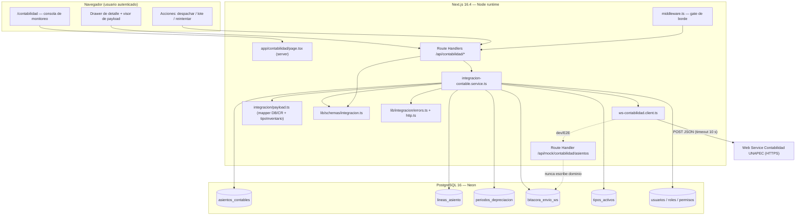
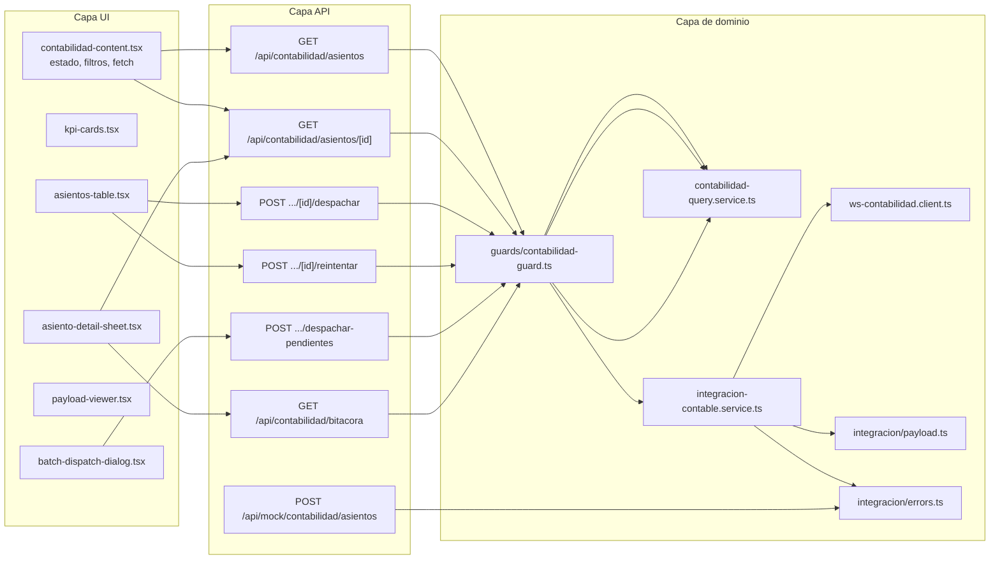
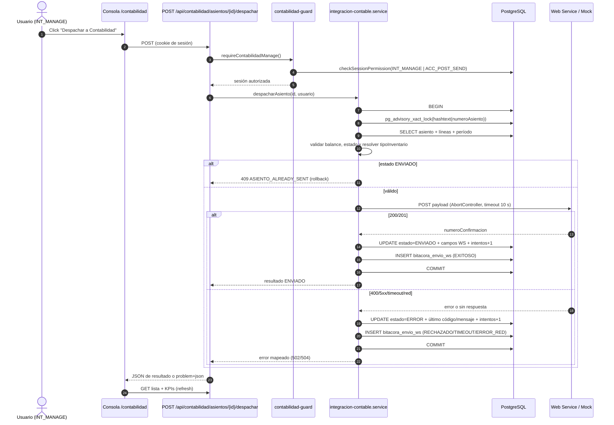
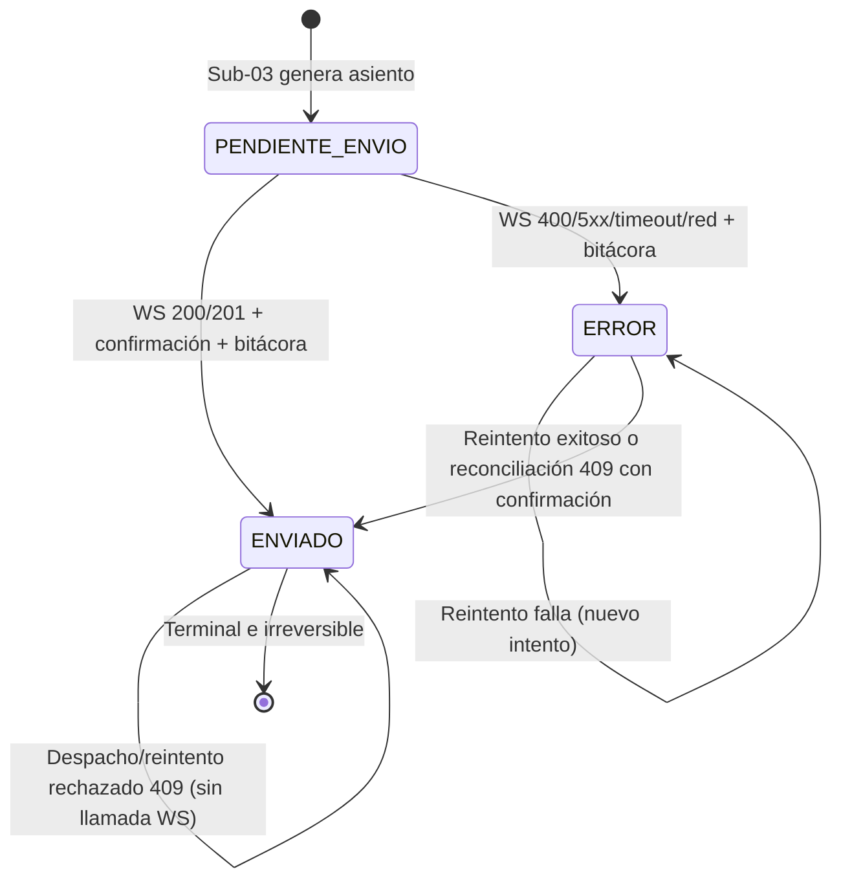

# Design: Integración Contable y Web Service Contabilidad (Sub-módulo 05)

> 📋 Generated by `solution-designer` · 2026-11-24
> ✅ Approved by: Alejandra · 2026-11-24
> ⚠️ **MANDATORY QUALITY GATE (Hard Gate 12)**: Technical design MUST explicitly specify DDL schemas with exact SQL data types, foreign keys, and constraints; REST endpoint contracts with real JSON request and response payloads (including RFC 7807 error structures); and renderable Mermaid diagrams. Superficial summaries, placeholders ('TODO', 'TBD'), or truncated lists are strictly prohibited.

## Traceability
- **Work Item**: Sub-módulo 05 (Integración Contable y Web Service Contabilidad — pendiente de asignación de AB# en ADO)
- **Parent**: Sistema de Gestión de Activos Fijos & Contabilización DGII (UNAPEC — Proyecto Final Integraciones I, Prof. Juan P. Valdez)
- **Branch**: `feature/activos-fijos-05-integracion-ws-contabilidad`
- **Requirements**: [requirements.md](./requirements.md) — aprobado (`a090d5f`)
- **Test Plan**: *(se deriva de la sección 12; se formaliza en tasks.md)*
- **Test Cases**: *(se derivan de la matriz REQ → prueba de la sección 12)*

## 1. Technology Decisions

| Capa | Decisión | Justificación |
|------|----------|---------------|
| Frontend | **Next.js 16.4 App Router** + React 19 + TypeScript estricto | Stack existente del proyecto; server components para el shell y client components para la consola interactiva. `Suspense` obligatorio por `cacheComponents`. |
| Backend | **Route Handlers** (`app/api/contabilidad/**`) sobre Node.js runtime | Permiten Prisma, `fetch` saliente y transacciones; no se usa Edge por el cliente HTTP y el pool de PostgreSQL. |
| Base de datos | **PostgreSQL 16 (Neon)** + **Prisma ORM 6.19** | Modelo relacional ya existente (`asientos_contables`, `lineas_asiento`, `periodos_depreciacion`); migración aditiva. |
| Validación | **Zod** (request, response del WS, query params y payload del mock) | Ya usado en Sub-03/Sub-04; permite errores deterministas y contratos compartidos cliente/servidor. |
| Cliente HTTP | **`fetch` nativo + `AbortController`** | Evita dependencias nuevas; timeout cancelable y compatible con Node 20/22 del proyecto. |
| UI | **Tailwind 4 + componentes propios** (sin shadcn/ui), `lucide-react` | Replica el patrón de Catálogos Base y Reportes; no se instalan librerías nuevas. |
| Pruebas | **Vitest 5** (unitarias/API) + **Playwright** (E2E) | Stack vigente; Vitest requiere Node ≥ 22 (se ejecuta con `node@22` en esta máquina). |
| Observabilidad | Logs estructurados + `correlationId` por intento | Trazabilidad end-to-end sin exponer credenciales ni payloads sensibles en consola de producción. |

### Descartado
- **axios / undici manual**: `fetch` cubre timeout y headers; no se agrega dependencia.
- **Cola/worker asíncrono**: el volumen mensual (≤ 1 asiento por período, ≤ 25 por lote) no lo justifica y la Ficha exige operación desde consola.
- **Estado transitorio `ENVIANDO`**: el CHECK de Sub-03 admite solo tres estados; se usa lock asesor de PostgreSQL por `numeroAsiento`.
- **Persistir el payload solo en `asientos_contables`**: se perdería el historial de intentos exigido por REQ-INT-008.

## 2. Architecture

### 2.1 System Overview


### 2.2 Component Diagram


### 2.3 Flujo de despacho y auditoría


### 2.4 Límites de módulo y archivos
```
app/
├─ app/
│  ├─ contabilidad/
│  │  └─ page.tsx                         # shell server + Suspense + guard de página
│  └─ api/
│     ├─ contabilidad/
│     │  ├─ asientos/route.ts             # GET lista + KPIs
│     │  ├─ asientos/[id]/route.ts        # GET detalle
│     │  ├─ asientos/[id]/despachar/route.ts
│     │  ├─ asientos/[id]/reintentar/route.ts
│     │  ├─ asientos/despachar-pendientes/route.ts
│     │  └─ bitacora/route.ts             # GET historial (ACC_LOG_READ)
│     └─ mock/contabilidad/asientos/route.ts
├─ components/contabilidad/
│  ├─ contabilidad-content.tsx
│  ├─ kpi-cards.tsx
│  ├─ asientos-table.tsx
│  ├─ asiento-detail-sheet.tsx
│  ├─ payload-viewer.tsx
│  ├─ batch-dispatch-dialog.tsx
│  └─ types.ts
├─ lib/
│  ├─ integracion/
│  │  ├─ payload.ts                       # mapper + resolución tipoInventario
│  │  ├─ errors.ts                        # IntegrationError + catálogo
│  │  └─ http.ts                          # RFC 7807 + serialización
│  ├─ guards/contabilidad-guard.ts
│  ├─ schemas/integracion.ts              # Zod request/response/mock/query
│  └─ services/
│     ├─ contabilidad-query.service.ts
│     ├─ integracion-contable.service.ts
│     └─ ws-contabilidad.client.ts
├─ prisma/
│  ├─ migrations/20261124000000_add_integracion_ws_contabilidad/migration.sql
│  └─ seed-integracion.ts
└─ tests/
   ├─ integracion/payload.test.ts
   ├─ integracion/ws-client.test.ts
   ├─ api/contabilidad.test.ts
   ├─ api/mock-contabilidad.test.ts
   └─ services/integracion-contable.test.ts
```

## 3. Deployment

- **Pattern**: fullstack-vercel (Next.js monolítico con API Routes y PostgreSQL gestionado).
- **App**: Vercel (Node.js runtime para `/api/contabilidad/*`; `maxDuration = 300` en el lote).
- **Infra**: Neon PostgreSQL 16 (pooler), variables de entorno de Vercel.
- **CI/CD**: GitHub Actions / Vercel Preview por PR; `prisma migrate deploy` en el pipeline de despliegue; seed manual en dev.
- **Justificación**: el proyecto ya opera en este patrón y el volumen de integración es bajo (asientos mensuales); no requiere worker ni cola.
- **Discarded**: worker/cola dedicada (complejidad operativa sin volumen); Edge runtime (no soporta Prisma ni transacciones interactivas de forma estable).

### Environments

| Environment | URL | Deploy trigger |
|-------------|-----|----------------|
| Development | `http://localhost:3000` | `pnpm dev` local |
| Preview | `https://<pr>.vercel.app` | Push a rama `feature/*` |
| Production | `https://activacore.unapec.edu.do` | Merge a `main` |

### Variables de entorno

| Variable | Obligatoria | Default | Descripción |
|----------|-------------|---------|-------------|
| `WS_CONTABILIDAD_URL` | Sí (prod) | Mock interno en dev | URL HTTPS completa del WS (`.../asientos`). |
| `WS_CONTABILIDAD_API_KEY` | Según WS | — | Token/API key; se envía en el header configurado. Nunca llega al cliente. |
| `WS_CONTABILIDAD_AUTH_HEADER` | No | `Authorization` | Header de autenticación saliente (`Authorization` o `x-api-key`). |
| `WS_CONTABILIDAD_TIMEOUT_MS` | No | `10000` | Timeout por intento; rango `1000–30000`. |
| `ENABLE_WS_MOCK` | No | `false` en prod | `true` habilita el mock fuera de desarrollo. |
| `APP_URL` | No | `http://localhost:3000` | Base para el fallback del mock en dev/E2E. |

## 4. Database Schema

### 4.1 Table: `asientos_contables` (ALTER — extensión Sub-05)

| Column | Type | Constraints | Default | Description |
|--------|------|-------------|---------|-------------|
| `transaccion_ws_id` | `VARCHAR(60)` | NULL | — | Número de confirmación contable institucional devuelto por el WS. |
| `codigo_respuesta_ws` | `VARCHAR(10)` | NULL | — | Último código HTTP/negocio confirmado (`200`, `201`, `409`). |
| `mensaje_respuesta_ws` | `VARCHAR(500)` | NULL | — | Último mensaje legible del WS (éxito o error). |
| `fecha_envio_ws` | `TIMESTAMPTZ` | NULL | — | Fecha/hora UTC del último intento de envío. |
| `intentos_envio` | `INTEGER` | NOT NULL, CHECK (`>= 0`) | `0` | Contador de intentos (individual + lote + reintento). |

> No se agrega ningún estado nuevo: el CHECK de Sub-03 (`PENDIENTE_ENVIO|ENVIADO|ERROR`) permanece intacto.

### 4.2 Table: `bitacora_envio_ws` (nueva, append-only)

| Column | Type | Constraints | Default | Description |
|--------|------|-------------|---------|-------------|
| `id` | `VARCHAR(36)` | PK | `uuid()` | Identificador del evento. |
| `asiento_id` | `VARCHAR(36)` | NOT NULL, FK → `asientos_contables(id)` `ON DELETE RESTRICT` | — | Asiento auditado. |
| `numero_asiento` | `VARCHAR(20)` | NOT NULL | — | Copia desnormalizada para consultas y evidencia. |
| `usuario_id` | `VARCHAR(36)` | NOT NULL, FK → `usuarios(id)` `ON DELETE RESTRICT` | — | Usuario responsable del intento. |
| `correo_usuario` | `VARCHAR(255)` | NOT NULL | — | Snapshot del correo al momento del intento. |
| `intento` | `INTEGER` | NOT NULL, CHECK (`> 0`) | — | Número secuencial por asiento (1..N). |
| `payload` | `JSONB` | NOT NULL | — | JSON exacto enviado al WS. |
| `endpoint` | `VARCHAR(500)` | NOT NULL | — | URL destino (sin credenciales). |
| `http_status` | `INTEGER` | NULL | — | Código HTTP recibido; `NULL` en timeout/red. |
| `respuesta` | `JSONB` | NULL | — | Cuerpo de respuesta normalizado (o `null`). |
| `mensaje` | `VARCHAR(1000)` | NULL | — | Mensaje legible de éxito/error. |
| `duracion_ms` | `INTEGER` | NOT NULL, CHECK (`>= 0`) | — | Duración del intento en milisegundos. |
| `resultado` | `VARCHAR(20)` | NOT NULL, CHECK (`IN ('EXITOSO','RECHAZADO','ERROR_RED','TIMEOUT','RECONCILIADO')`) | — | Resultado del intento. |
| `correlation_id` | `VARCHAR(64)` | NOT NULL | — | Identificador de correlación por solicitud. |
| `created_at` | `TIMESTAMPTZ` | NOT NULL | `now()` | Timestamp UTC del evento. |

### 4.3 Indexes

| Name | Columns | Type |
|------|---------|------|
| `bitacora_envio_ws_pkey` | `(id)` | Primary key |
| `bitacora_envio_ws_asiento_intento_key` | `(asiento_id, intento)` | Unique |
| `bitacora_envio_ws_asiento_created_idx` | `(asiento_id, created_at DESC)` | B-Tree |
| `bitacora_envio_ws_resultado_created_idx` | `(resultado, created_at DESC)` | B-Tree |
| `bitacora_envio_ws_correlation_idx` | `(correlation_id)` | B-Tree |
| `asientos_contables_estado_fecha_idx` | `(estado, fecha_contable DESC)` | B-Tree (nuevo, lista/KPIs) |

### 4.4 Prisma models

```prisma
model AsientoContable {
  id                  String    @id @default(uuid()) @db.VarChar(36)
  numeroAsiento       String    @unique @map("numero_asiento") @db.VarChar(20)
  periodoId           String    @unique @map("periodo_id") @db.VarChar(36)
  concepto            String    @db.VarChar(150)
  fechaContable       DateTime  @map("fecha_contable") @db.Date
  estado              String    @default("PENDIENTE_ENVIO") @db.VarChar(20)
  totalDebito         Decimal   @default(0.00) @map("total_debito") @db.Decimal(14, 2)
  totalCredito        Decimal   @default(0.00) @map("total_credito") @db.Decimal(14, 2)
  transaccionWsId     String?   @map("transaccion_ws_id") @db.VarChar(60)
  codigoRespuestaWs   String?   @map("codigo_respuesta_ws") @db.VarChar(10)
  mensajeRespuestaWs  String?   @map("mensaje_respuesta_ws") @db.VarChar(500)
  fechaEnvioWs        DateTime? @map("fecha_envio_ws") @db.Timestamptz
  intentosEnvio       Int       @default(0) @map("intentos_envio")
  createdAt           DateTime  @default(now()) @map("created_at") @db.Timestamptz
  updatedAt           DateTime  @updatedAt @map("updated_at") @db.Timestamptz

  periodo PeriodoDepreciacion @relation(fields: [periodoId], references: [id], onDelete: Restrict)
  lineas  LineaAsiento[]
  envios  BitacoraEnvioWS[]

  @@index([estado])
  @@index([estado, fechaContable(sort: Desc)])
  @@map("asientos_contables")
}

model BitacoraEnvioWS {
  id             String   @id @default(uuid()) @db.VarChar(36)
  asientoId      String   @map("asiento_id") @db.VarChar(36)
  numeroAsiento  String   @map("numero_asiento") @db.VarChar(20)
  usuarioId      String   @map("usuario_id") @db.VarChar(36)
  correoUsuario  String   @map("correo_usuario") @db.VarChar(255)
  intento        Int
  payload        Json
  endpoint       String   @db.VarChar(500)
  httpStatus     Int?     @map("http_status")
  respuesta      Json?
  mensaje        String?  @db.VarChar(1000)
  duracionMs     Int      @map("duracion_ms")
  resultado      String   @db.VarChar(20)
  correlationId  String   @map("correlation_id") @db.VarChar(64)
  createdAt      DateTime @default(now()) @map("created_at") @db.Timestamptz

  asiento AsientoContable @relation(fields: [asientoId], references: [id], onDelete: Restrict)
  usuario Usuario         @relation(fields: [usuarioId], references: [id], onDelete: Restrict)

  @@unique([asientoId, intento])
  @@index([asientoId, createdAt(sort: Desc)])
  @@index([resultado, createdAt(sort: Desc)])
  @@index([correlationId])
  @@map("bitacora_envio_ws")
}
```

En `Usuario` se agrega la relación inversa:

```prisma
enviosContabilidad BitacoraEnvioWS[]
```

### 4.5 Migration SQL (exacta)

```sql
-- 20261124000000_add_integracion_ws_contabilidad

ALTER TABLE "asientos_contables"
  ADD COLUMN "transaccion_ws_id" VARCHAR(60),
  ADD COLUMN "codigo_respuesta_ws" VARCHAR(10),
  ADD COLUMN "mensaje_respuesta_ws" VARCHAR(500),
  ADD COLUMN "fecha_envio_ws" TIMESTAMPTZ,
  ADD COLUMN "intentos_envio" INTEGER NOT NULL DEFAULT 0;

ALTER TABLE "asientos_contables"
  ADD CONSTRAINT "asientos_contables_intentos_envio_check" CHECK ("intentos_envio" >= 0);

CREATE INDEX "asientos_contables_estado_fecha_idx"
  ON "asientos_contables" ("estado", "fecha_contable" DESC);

CREATE TABLE "bitacora_envio_ws" (
  "id" VARCHAR(36) NOT NULL,
  "asiento_id" VARCHAR(36) NOT NULL,
  "numero_asiento" VARCHAR(20) NOT NULL,
  "usuario_id" VARCHAR(36) NOT NULL,
  "correo_usuario" VARCHAR(255) NOT NULL,
  "intento" INTEGER NOT NULL,
  "payload" JSONB NOT NULL,
  "endpoint" VARCHAR(500) NOT NULL,
  "http_status" INTEGER,
  "respuesta" JSONB,
  "mensaje" VARCHAR(1000),
  "duracion_ms" INTEGER NOT NULL,
  "resultado" VARCHAR(20) NOT NULL,
  "correlation_id" VARCHAR(64) NOT NULL,
  "created_at" TIMESTAMPTZ NOT NULL DEFAULT now(),
  CONSTRAINT "bitacora_envio_ws_pkey" PRIMARY KEY ("id"),
  CONSTRAINT "bitacora_envio_ws_intento_check" CHECK ("intento" > 0),
  CONSTRAINT "bitacora_envio_ws_duracion_check" CHECK ("duracion_ms" >= 0),
  CONSTRAINT "bitacora_envio_ws_resultado_check"
    CHECK ("resultado" IN ('EXITOSO','RECHAZADO','ERROR_RED','TIMEOUT','RECONCILIADO')),
  CONSTRAINT "bitacora_envio_ws_asiento_fk"
    FOREIGN KEY ("asiento_id") REFERENCES "asientos_contables"("id")
    ON DELETE RESTRICT ON UPDATE CASCADE,
  CONSTRAINT "bitacora_envio_ws_usuario_fk"
    FOREIGN KEY ("usuario_id") REFERENCES "usuarios"("id")
    ON DELETE RESTRICT ON UPDATE CASCADE
);

CREATE UNIQUE INDEX "bitacora_envio_ws_asiento_intento_key"
  ON "bitacora_envio_ws" ("asiento_id", "intento");
CREATE INDEX "bitacora_envio_ws_asiento_created_idx"
  ON "bitacora_envio_ws" ("asiento_id", "created_at" DESC);
CREATE INDEX "bitacora_envio_ws_resultado_created_idx"
  ON "bitacora_envio_ws" ("resultado", "created_at" DESC);
CREATE INDEX "bitacora_envio_ws_correlation_idx"
  ON "bitacora_envio_ws" ("correlation_id");

-- Append-only a nivel de base (defensa en profundidad).
CREATE OR REPLACE FUNCTION "prevent_bitacora_envio_ws_mutation"()
RETURNS trigger AS $$
BEGIN
  RAISE EXCEPTION 'bitacora_envio_ws es append-only: % no permitido', TG_OP;
END;
$$ LANGUAGE plpgsql;

CREATE TRIGGER "bitacora_envio_ws_no_update_delete"
  BEFORE UPDATE OR DELETE ON "bitacora_envio_ws"
  FOR EACH ROW EXECUTE FUNCTION "prevent_bitacora_envio_ws_mutation"();
```

### 4.6 RBAC — seed

En `app/prisma/seed.ts`:
- Agregar permiso `INT_MANAGE` (`modulo: "CONTABILIDAD"`, descripción "Despacho y reintento de asientos al WS Contabilidad").
- Asignarlo a `OPERADOR` (además del actual `ACC_POST_SEND`, que se conserva como alias legado).
- `ADMIN` lo recibe automáticamente (`permisosData.map`).
- `AUDITOR` conserva únicamente `ACC_LOG_READ`.

El guard acepta `INT_MANAGE` **o** `ACC_POST_SEND` para despacho/reintento/lote; la consulta de bitácora exige `ACC_LOG_READ` (ADMIN pasa por superadmin).

## 5. State Machine & Concurrency



### 5.1 Lock y transacción
```ts
await prisma.$transaction(
  async (tx) => {
    // Serializa despachos concurrentes del mismo asiento.
    await tx.$executeRaw`SELECT pg_advisory_xact_lock(hashtext(${numeroAsiento})::bigint)`;

    const asiento = await tx.asientoContable.findUnique({
      where: { numeroAsiento },
      include: { lineas: true, periodo: true },
    });
    if (!asiento) throw new IntegrationError("ASIENTO_NOT_FOUND");
    if (asiento.estado === "ENVIADO") throw new IntegrationError("ASIENTO_ALREADY_SENT");

    // ... validación de balance y payload ...
    const resultado = await enviarAlWs(payload); // fetch con AbortController

    const intento = asiento.intentosEnvio + 1;
    const actualizado = await tx.asientoContable.update({
      where: { id: asiento.id },
      data: {
        estado: resultado.ok ? "ENVIADO" : "ERROR",
        transaccionWsId: resultado.transaccionWsId ?? asiento.transaccionWsId,
        codigoRespuestaWs: resultado.codigo,
        mensajeRespuestaWs: resultado.mensaje,
        fechaEnvioWs: new Date(),
        intentosEnvio: intento,
      },
    });

    await tx.bitacoraEnvioWS.create({
      data: {
        asientoId: asiento.id,
        numeroAsiento,
        usuarioId: usuario.id,
        correoUsuario: usuario.correo,
        intento,
        payload,
        endpoint: WS_URL,
        httpStatus: resultado.httpStatus,
        respuesta: resultado.respuesta ?? null,
        mensaje: resultado.mensaje,
        duracionMs: resultado.duracionMs,
        resultado: resultado.ok ? "EXITOSO" : resultado.resultado,
        correlationId,
      },
    });

    return actualizado;
  },
  { timeout: TIMEOUT_MS + 5_000, maxWait: 5_000 }
);
```

**Trade-off documentado:** la transacción se mantiene abierta durante la llamada HTTP (máx. 10 s) para garantizar at-most-once y que el estado y la bitácora se confirmen juntos. El volumen es bajo (asientos mensuales) y el pool de Neon lo soporta. Alternativa descartada: liberar el lock antes del HTTP (permitiría doble envío) o introducir un estado/lease transitorio (requiere migración coordinada con Sub-03).

### 5.2 Matriz de transiciones

| Estado actual | Acción | Resultado | Código |
|---------------|--------|-----------|--------|
| `PENDIENTE_ENVIO` | Despachar + WS 200/201 | `ENVIADO` | 200 |
| `PENDIENTE_ENVIO` | Despachar + WS 400/5xx/timeout | `ERROR` | 502/504 |
| `PENDIENTE_ENVIO` | Reintentar | Rechazado | 409 `ASIENTO_NOT_RETRYABLE` |
| `ENVIADO` | Despachar/Reintentar | Sin llamada WS | 409 `ASIENTO_ALREADY_SENT` |
| `ERROR` | Reintentar + WS 200/201 | `ENVIADO` | 200 |
| `ERROR` | Reintentar + fallo | `ERROR` (nuevo intento) | 502/504 |
| `ERROR` | Despachar | Rechazado (usar reintentar) | 409 `ASIENTO_NOT_RETRYABLE` |

## 6. API Contracts

Convenciones: todas las respuestas de error usan `Content-Type: application/problem+json` y el cuerpo RFC 7807 con `code`. Los `Decimal` se serializan como string de 2 decimales. Las rutas con `[id]` reciben `params: Promise<{ id: string }>` (Next 16) y hacen `const { id } = await params`.

### 6.1 GET `/api/contabilidad/asientos`
- **Request**: query `?page=1&pageSize=10&estado=TODOS&periodo=2026-10&sort=fecha&dir=desc`
  - `page` entero ≥ 1 (default 1); `pageSize` ∈ `{10,25,50}` (default 10); `estado` ∈ `{TODOS,PENDIENTE_ENVIO,ENVIADO,ERROR}` (default `TODOS`); `periodo` `^\d{4}-(0[1-9]|1[0-2])$` opcional; `sort` ∈ `{fecha,numero}` (default `fecha`); `dir` ∈ `{asc,desc}` (default `desc`).
- **Response 200**:
```json
{
  "data": [
    {
      "id": "8b1c0e6e-2f4a-4f7e-9d6b-3a1f2c9d8e01",
      "numeroAsiento": "DEP-202610-001",
      "concepto": "Depreciación 10/2026",
      "fechaContable": "2026-10-31",
      "estado": "PENDIENTE_ENVIO",
      "totalDebito": "47812.50",
      "totalCredito": "47812.50",
      "intentosEnvio": 0,
      "transaccionWsId": null,
      "periodo": { "anio": 2026, "mes": 10, "estado": "CERRADO" }
    }
  ],
  "kpis": { "total": 3, "pendientes": 1, "enviados": 1, "errores": 1 },
  "meta": { "page": 1, "pageSize": 10, "total": 3, "totalPages": 1 }
}
```
- **Auth**: sesión + (`INT_MANAGE` | `ACC_POST_SEND` | `ACC_LOG_READ`).
- **Errors**: 400 `VALIDATION_ERROR`; 401 `UNAUTHORIZED`; 403 `FORBIDDEN`.
- **Maps to**: REQ-INT-006.

### 6.2 GET `/api/contabilidad/asientos/{id}`
- **Request**: path `id` (UUID del asiento).
- **Response 200**:
```json
{
  "data": {
    "id": "8b1c0e6e-2f4a-4f7e-9d6b-3a1f2c9d8e01",
    "numeroAsiento": "DEP-202610-001",
    "concepto": "Depreciación 10/2026",
    "fechaContable": "2026-10-31",
    "estado": "PENDIENTE_ENVIO",
    "totalDebito": "47812.50",
    "totalCredito": "47812.50",
    "balance": "0.00",
    "intentosEnvio": 0,
    "transaccionWsId": null,
    "codigoRespuestaWs": null,
    "mensajeRespuestaWs": null,
    "fechaEnvioWs": null,
    "periodo": { "id": "…", "anio": 2026, "mes": 10, "estado": "CERRADO" },
    "lineas": [
      { "id": "…", "tipoInventario": "TPA-001", "cuentaContable": "6-30-01-0001", "tipoMovimiento": "DB", "monto": "47812.50", "descripcion": "Gasto por depreciación 10/2026" },
      { "id": "…", "tipoInventario": "TPA-001", "cuentaContable": "1-01-04-0011", "tipoMovimiento": "CR", "monto": "47812.50", "descripcion": "Depreciación acumulada 10/2026" }
    ],
    "ultimoIntento": null,
    "puedeDespachar": true,
    "puedeReintentar": false
  }
}
```
- **Auth**: sesión + (`INT_MANAGE` | `ACC_POST_SEND` | `ACC_LOG_READ`).
- **Errors**: 404 `ASIENTO_NOT_FOUND`; 401/403.
- **Maps to**: REQ-INT-007.

### 6.3 POST `/api/contabilidad/asientos/{id}/despachar`
- **Request**: sin body.
- **Response 200**:
```json
{
  "data": {
    "asientoId": "8b1c0e6e-2f4a-4f7e-9d6b-3a1f2c9d8e01",
    "numeroAsiento": "DEP-202610-001",
    "estado": "ENVIADO",
    "transaccionWsId": "WS-20261031-00042",
    "codigoRespuestaWs": "201",
    "fechaEnvioWs": "2026-10-31T14:05:12.000Z",
    "intento": 1,
    "duracionMs": 184
  }
}
```
- **Auth**: `INT_MANAGE` | `ACC_POST_SEND`.
- **Errors**: 404 `ASIENTO_NOT_FOUND`; 409 `ASIENTO_ALREADY_SENT`; 409 `ASIENTO_NOT_RETRYABLE`; 422 `ASIENTO_SIN_LINEAS`; 422 `ASIENTO_UNBALANCED`; 422 `TIPO_INVENTARIO_UNRESOLVED`; 502 `WS_REJECTED`/`WS_SERVER_ERROR`/`WS_INVALID_RESPONSE`/`WS_NETWORK_ERROR`; 504 `WS_TIMEOUT`; 500 `AUDIT_LOG_FAILED`. Todos dejan el asiento en `ERROR` (salvo 409/422 previos al envío).
- **Maps to**: REQ-INT-001, REQ-INT-002.

### 6.4 POST `/api/contabilidad/asientos/{id}/reintentar`
- **Request**: sin body.
- **Response 200**: mismo contrato que 6.3 con `intento = N+1`.
- **Auth**: `INT_MANAGE` | `ACC_POST_SEND`.
- **Errors**: 404; 409 `ASIENTO_NOT_RETRYABLE` (estado `PENDIENTE_ENVIO`); 409 `ASIENTO_ALREADY_SENT` (estado `ENVIADO`); 422 de payload; 502/504 del WS.
- **Maps to**: REQ-INT-003.

### 6.5 POST `/api/contabilidad/asientos/despachar-pendientes`
- **Request**:
```json
{ "periodo": "2026-10" }
```
  `periodo` opcional; si se omite, se procesan todos los pendientes (máx. 25).
- **Response 200**:
```json
{
  "data": {
    "total": 3,
    "enviados": 2,
    "errores": 1,
    "restantes": 0,
    "resultados": [
      { "asientoId": "…", "numeroAsiento": "DEP-202610-001", "estado": "ENVIADO", "transaccionWsId": "WS-20261031-00042" },
      { "asientoId": "…", "numeroAsiento": "DEP-202610-002", "estado": "ENVIADO", "transaccionWsId": "WS-20261031-00043" },
      { "asientoId": "…", "numeroAsiento": "DEP-202610-003", "estado": "ERROR", "codigo": "WS_SERVER_ERROR", "mensaje": "HTTP 500" }
    ]
  }
}
```
- **Auth**: `INT_MANAGE` | `ACC_POST_SEND`.
- **Errors**: 400 `VALIDATION_ERROR`; 500 `BATCH_START_FAILED` (solo si falla antes de iniciar). Fallos individuales NO abortan el lote.
- **Maps to**: REQ-INT-004.

### 6.6 GET `/api/contabilidad/bitacora`
- **Request**: query `?asientoId={uuid}&page=1&pageSize=20` (`pageSize` ∈ `{10,20,50}`).
- **Response 200**:
```json
{
  "data": [
    {
      "id": "…",
      "asientoId": "…",
      "numeroAsiento": "DEP-202610-003",
      "usuario": { "id": "…", "correo": "admin@unapec.edu.do" },
      "intento": 2,
      "payload": { "numeroAsiento": "DEP-202610-003", "lineas": [] },
      "endpoint": "https://contabilidad.unapec.edu.do/api/asientos",
      "httpStatus": 201,
      "respuesta": { "numeroConfirmacion": "WS-20261031-00043" },
      "mensaje": "Asiento registrado",
      "duracionMs": 231,
      "resultado": "EXITOSO",
      "correlationId": "…",
      "createdAt": "2026-10-31T14:07:44.000Z"
    }
  ],
  "meta": { "page": 1, "pageSize": 20, "total": 2, "totalPages": 1 }
}
```
- **Auth**: `ACC_LOG_READ` (ADMIN por superadmin). Un usuario con solo `INT_MANAGE` recibe 403.
- **Errors**: 400/401/403/404.
- **Maps to**: REQ-INT-008.

### 6.7 POST `/api/mock/contabilidad/asientos`
- **Request**: payload del WS (sección 7) + headers opcionales `x-mock-scenario: 400|409|500`, `x-mock-delay-ms: 0..30000`.
- **Response 201**:
```json
{
  "numeroAsiento": "DEP-202610-001",
  "numeroConfirmacion": "WS-20261031-00042",
  "codigoRespuesta": "201",
  "mensaje": "Asiento registrado en Contabilidad General",
  "fechaRecepcion": "2026-10-31T14:05:12.000Z"
}
```
- **Response 409** (duplicado): `{ "codigo": "ASIENTO_ALREADY_SENT", "numeroAsiento": "…", "numeroConfirmacion": "WS-…" }`.
- **Response 400**: `{ "codigo": "VALIDATION_ERROR", "errores": [{ "path": "lineas.0.cuentaContable", "message": "Formato inválido" }] }`.
- **Response 500**: `{ "codigo": "WS_SERVER_ERROR", "mensaje": "Falla simulada del servidor contable" }`.
- **Auth**: sin sesión (llamada servidor→servidor), pero **404 en producción** salvo `ENABLE_WS_MOCK=true`. En dev/test, el middleware exime `/api/mock/**`.
- **Maps to**: REQ-INT-005.

### 6.8 Catálogo de errores RFC 7807

| `code` | HTTP | Significado |
|--------|------|-------------|
| `VALIDATION_ERROR` | 400 | Query/body/Zod inválido. |
| `UNAUTHORIZED` | 401 | Sin sesión. |
| `FORBIDDEN` | 403 | Sin permiso requerido. |
| `ASIENTO_NOT_FOUND` | 404 | Asiento inexistente. |
| `METHOD_NOT_ALLOWED` | 405 | Método no permitido en la ruta. |
| `ASIENTO_ALREADY_SENT` | 409 | Asiento ya `ENVIADO`. |
| `ASIENTO_NOT_RETRYABLE` | 409 | Reintento/despacho sobre estado incorrecto. |
| `ASIENTO_SIN_LINEAS` | 422 | Asiento sin líneas persistidas. |
| `ASIENTO_UNBALANCED` | 422 | `Σ DB ≠ Σ CR` o totales distintos. |
| `TIPO_INVENTARIO_UNRESOLVED` | 422 | No se pudo resolver `tipoInventario` de forma única. |
| `WS_TIMEOUT` | 504 | Timeout del WS. |
| `WS_NETWORK_ERROR` | 502 | Error de red/DNS/TLS. |
| `WS_REJECTED` | 502 | WS respondió 400. |
| `WS_SERVER_ERROR` | 502 | WS respondió 5xx. |
| `WS_DUPLICATE_UNCONFIRMED` | 502 | WS 409 sin confirmación válida. |
| `WS_INVALID_RESPONSE` | 502 | Respuesta del WS no cumple Zod. |
| `WS_CONFIG_ERROR` | 500 | `WS_CONTABILIDAD_URL` ausente o sin HTTPS en producción. |
| `AUDIT_LOG_FAILED` | 500 | Falló la inserción de bitácora; transacción revertida. |
| `BATCH_START_FAILED` | 500 | Falló el lote antes de iniciar. |
| `INVALID_MOCK_SCENARIO` | 400 | Header de simulación inválido (mock). |

## 7. Web Service Payload Contract

### 7.1 Payload (Zod `AsientoPayloadSchema`)

```json
{
  "numeroAsiento": "DEP-202610-001",
  "concepto": "Depreciación 10/2026",
  "fechaAsiento": "2026-10-31",
  "estado": "PENDIENTE_ENVIO",
  "lineas": [
    { "tipoInventario": "TPA-001", "cuentaContable": "6-30-01-0001", "tipoMovimiento": "DB", "monto": "47812.50", "descripcion": "Gasto por depreciación 10/2026" },
    { "tipoInventario": "TPA-001", "cuentaContable": "1-01-04-0011", "tipoMovimiento": "CR", "monto": "47812.50", "descripcion": "Depreciación acumulada 10/2026" }
  ],
  "totalDebito": "47812.50",
  "totalCredito": "47812.50"
}
```

Validaciones Zod:
- `numeroAsiento`: `^DEP-\d{6}-\d{3}$`.
- `fechaAsiento`: `^\d{4}-\d{2}-\d{2}$` y fecha válida.
- `estado`: literal `"PENDIENTE_ENVIO"`.
- `lineas`: mínimo 1; `cuentaContable` `^[1-9]-\d{2}-\d{2}-\d{4}$`; `tipoMovimiento` `enum(["DB","CR"])`; `monto` `^\d+\.\d{2}$`.
- `totalDebito`/`totalCredito`: `^\d+\.\d{2}$`; iguales entre sí y a la suma de líneas.
- El payload se construye con `Decimal.toFixed(2)`; nunca se envían números flotantes.

### 7.2 Mapeo interno → wire

| Origen interno | Destino wire | Regla |
|----------------|--------------|-------|
| `AsientoContable.numeroAsiento` | `numeroAsiento` | Sin cambios. |
| `AsientoContable.concepto` | `concepto` | Texto persistido por Sub-03. |
| `AsientoContable.fechaContable` | `fechaAsiento` | `YYYY-MM-DD` en `America/Santo_Domingo` ya almacenada como `date`. |
| `AsientoContable.estado` | `estado` | `"PENDIENTE_ENVIO"` antes del envío. |
| `LineaAsiento.tipoMovimiento` | `lineas[].tipoMovimiento` | `DEBITO → DB`, `CREDITO → CR`. |
| `LineaAsiento.cuentaContable` | `lineas[].cuentaContable` | Sin cambios. |
| `LineaAsiento.monto` | `lineas[].monto` | `Decimal.toFixed(2)` string. |
| `TipoActivo.codigo` | `lineas[].tipoInventario` | Resolución por cuentas (7.3). |
| `AsientoContable.totalDebito/Credito` | `totalDebito/totalCredito` | String 2 decimales. |

### 7.3 Resolución determinista de `tipoInventario` (sin migrar `lineas_asiento`)

1. Cargar todos los `TipoActivo` y construir:
   - `porCuentaDepreciacion: Map<cuentaContableDepreciacion, TipoActivo>`.
   - `porPar: Map<"cuentaGasto|cuentaDepreciacion", TipoActivo>` usando `resolverCuentaGasto(tipo)` (incluye defaults por método).
2. Si hay cuentas de depreciación duplicadas entre tipos → `TIPO_INVENTARIO_UNRESOLVED` (no hay ambigüedad aceptable).
3. Para cada línea `CR`: resolver por `porCuentaDepreciacion`; si no existe → `TIPO_INVENTARIO_UNRESOLVED`.
4. Para cada línea `DB`: candidatas = líneas `CR` con el mismo `monto` cuyo tipo resuelto tenga `cuentaGasto` igual a la cuenta de la línea `DB`. Si exactamente 1 → asignar; si 0 o >1 → `TIPO_INVENTARIO_UNRESOLVED`.
5. Ordenar las líneas del payload por `tipoInventario` asc, luego `DB` antes de `CR`, luego `cuentaContable` asc (determinismo byte a byte).
6. Los importes se validan con `Decimal` y `halfUp` a 2 decimales; nunca se recalcula la cuota.

> Esta decisión evita modificar el write-path de Sub-03. Si en el futuro un tipo comparte cuenta de depreciación con otro, el despacho se bloquea con 422 y se resuelve agregando `tipo_activo_id` a `lineas_asiento` en una migración coordinada.

## 8. HTTP Client & Error Mapping

```ts
// lib/services/ws-contabilidad.client.ts
export interface WsDispatchResult {
  ok: boolean;
  httpStatus: number | null;
  codigo: string;
  mensaje: string;
  transaccionWsId?: string;
  respuesta?: unknown;
  resultado: "EXITOSO" | "RECHAZADO" | "ERROR_RED" | "TIMEOUT" | "RECONCILIADO";
  duracionMs: number;
}
```

- URL: `WS_CONTABILIDAD_URL`; en dev/E2E fallback `${APP_URL}/api/mock/contabilidad/asientos`.
- Header `x-correlation-id` con UUID v4; header de auth según `WS_CONTABILIDAD_AUTH_HEADER` (valor `Bearer ${API_KEY}` o `${API_KEY}` para `x-api-key`).
- `AbortController` + `setTimeout(timeoutMs)`; `clearTimeout` en `finally`.
- Mapeo:
  - `AbortError` → `WS_TIMEOUT` (504), `httpStatus=null`, `resultado=TIMEOUT`.
  - `fetch` rechaza (DNS/TLS/red) → `WS_NETWORK_ERROR` (502), `ERROR_RED`.
  - `400` → `WS_REJECTED` (502), `RECHAZADO`, mensaje del body.
  - `409` con `numeroConfirmacion` válido → `RECONCILIADO` (éxito), persistir confirmación.
  - `409` sin confirmación → `WS_DUPLICATE_UNCONFIRMED` (502), `RECHAZADO`.
  - `5xx` → `WS_SERVER_ERROR` (502), `RECHAZADO`.
  - `2xx` con body inválido Zod → `WS_INVALID_RESPONSE` (502).
  - `200/201` válido → `EXITOSO`.
- Los headers de autenticación se enmascaran (`***`) en logs y nunca se incluyen en `bitacora_envio_ws.endpoint` ni en `payload`.

## 9. Mock Simulator

- **Ruta**: `POST /api/mock/contabilidad/asientos`.
- **Estado**: `Map<string, { numeroConfirmacion: string; fechaRecepcion: string }>` a nivel de módulo; se reinicia con el proceso (suficiente para demo/E2E).
- **Correlativo**: `WS-YYYYMMDD-NNNNN`, secuencia en memoria por día.
- **Escenarios**:
  - Sin header: valida Zod y responde `201`; si `numeroAsiento` ya existe → `409` con la confirmación original.
  - `x-mock-scenario: 400` → `400 VALIDATION_ERROR` (cuerpo con un error de ejemplo).
  - `x-mock-scenario: 409` → `409 ASIENTO_ALREADY_SENT` (confirmación sintética).
  - `x-mock-scenario: 500` → `500 WS_SERVER_ERROR`.
  - `x-mock-delay-ms: N` → espera `N` ms (0–30000); si supera el timeout del cliente, este aborta.
- **Producción**: si `NODE_ENV === "production"` y `ENABLE_WS_MOCK !== "true"` → `404 NOT_FOUND` y no procesa.
- **Middleware**: eximir `/api/mock/**` de la sesión solo cuando el mock está habilitado; en producción deshabilitado responde 404 antes de cualquier lógica.
- **No persiste** en `asientos_contables` ni `bitacora_envio_ws`; no altera el dominio.

## 10. UI Design — `/contabilidad`

### 10.1 Composición
- `app/app/contabilidad/page.tsx` (server): valida sesión y permisos (`INT_MANAGE | ACC_POST_SEND | ACC_LOG_READ`); si no, `redirect("/?error=forbidden")`. Renderiza `<Suspense fallback={<ContabilidadSkeleton />}>` con `ContabilidadContent` (client).
- `ContabilidadContent`:
  - Estado desde URL (`useSearchParams`): `estado`, `periodo`, `page`, `pageSize`, `sort`, `dir`.
  - Fetch `GET /api/contabilidad/asientos` con `AbortController`; `loading`, `error`, `data`.
  - Barra superior: título "Integración Contable", subtítulo, botón "Despachar Pendientes en Lote" (solo `INT_MANAGE` y `kpis.pendientes > 0`).
  - 4 tarjetas KPI: Total, Pendientes, Enviados, Con error (colores ámbar/verde/rojo; `aria-live="polite"`).
  - Filtros: select Estado (`TODOS`, `PENDIENTE_ENVIO`, `ENVIADO`, `ERROR`), input `month` Período, select Tamaño (10/25/50), botón "Restablecer".
  - Tabla: N° Asiento (mono), Concepto, Período, Fecha contable, Estado (pill), Débito, Crédito, Intentos, Acciones (`Ver`, `Despachar`, `Reintentar` según estado/permiso).
  - Paginación server-side con Anterior/Siguiente y "Mostrando X–Y de Z".
  - Empty state: "No hay asientos contables para los filtros seleccionados" + Restablecer.
- `AsientoDetailSheet` (drawer derecho):
  - Cabecera: número, concepto, período, fecha, estado, intentos.
  - Totales Débito/Crédito y **Balance** (`Σ DB − Σ CR`) con badge verde `RD$ 0.00` o rojo con diferencia.
  - Tabla de líneas: Tipo inventario, Cuenta, Movimiento (badge DB/CR), Monto, Descripción.
  - Panel de integración: última confirmación/código/mensaje/fecha; botón "Ver payload" (abre `PayloadViewer`), y "Ver bitácora completa" solo con `ACC_LOG_READ`.
  - Botones de acción según estado y permiso; deshabilitados si balance ≠ 0.
  - Accesibilidad: `role="dialog"`, `aria-modal`, focus trap, `Escape`, overlay, scroll lock, retorno de foco al botón origen.
- `PayloadViewer`: `<pre>` con JSON formateado, botón "Copiar", sin edición; `max-h` con scroll; `aria-label`.
- `BatchDispatchDialog`: confirma cantidad de pendientes del período, advierte que es irreversible; al confirmar muestra resumen (enviados/errores/restantes) y refresca.
- Toasts: éxito (`role="status"`), error (`role="alert"`); mensajes específicos para 409/502/504.

### 10.2 Navegación y permisos
- Agregar item `Contabilidad` (`href: "/contabilidad"`, icono `Landmark`) en `app-sidebar.tsx` con `permisos: ["INT_MANAGE","ACC_POST_SEND","ACC_LOG_READ"]`.
- Filtrar items por permisos de la sesión (misma fuente que el resto del shell); sin permiso → oculto.
- Breadcrumb: `Contabilidad` → `Integración WS`.
- El AUDITOR ve la consola y el detalle/bitácora, sin botones de acción.

### 10.3 Formato y estilo
- Replicar el patrón de `catalogos`/`reportes`: `ConsoleShell`, contenedor `max-w-7xl`, tarjetas `rounded-xl bg-white shadow-2xs`, tipografía `font-display`, códigos en `font-mono`.
- Moneda: `RD$ #,##0.00` con Half-Up a 2 decimales (helper local `formatRD` en `components/contabilidad/types.ts`).
- Pills: `PENDIENTE_ENVIO` ámbar, `ENVIADO` verde, `ERROR` rojo; contraste ≥ 4.5:1.
- No se usa shadcn/ui ni componentes de otras páginas; se crean componentes propios del sub-módulo.

## 11. Security & RBAC

| Ruta | Método | Permiso |
|------|--------|---------|
| `/contabilidad` | GET (página) | `INT_MANAGE` \| `ACC_POST_SEND` \| `ACC_LOG_READ` |
| `/api/contabilidad/asientos` | GET | `INT_MANAGE` \| `ACC_POST_SEND` \| `ACC_LOG_READ` |
| `/api/contabilidad/asientos/[id]` | GET | `INT_MANAGE` \| `ACC_POST_SEND` \| `ACC_LOG_READ` |
| `/api/contabilidad/asientos/[id]/despachar` | POST | `INT_MANAGE` \| `ACC_POST_SEND` |
| `/api/contabilidad/asientos/[id]/reintentar` | POST | `INT_MANAGE` \| `ACC_POST_SEND` |
| `/api/contabilidad/asientos/despachar-pendientes` | POST | `INT_MANAGE` \| `ACC_POST_SEND` |
| `/api/contabilidad/bitacora` | GET | `ACC_LOG_READ` |
| `/api/mock/contabilidad/asientos` | POST | Sin sesión (mock habilitado; 404 en prod) |

- **Dual-check**: `middleware.ts` (borde) + `contabilidad-guard.ts` en cada handler + guard de página.
- **Middleware**: reemplazar el bloque legado que usa `DEP_EXECUTE`/`ACC_DISPATCH` (permisos inexistentes) por la regla de `/api/contabilidad` con `INT_MANAGE`/`ACC_POST_SEND`; eximir `/api/mock/**` solo si el mock está habilitado.
- **Secretos**: `WS_CONTABILIDAD_API_KEY` solo en servidor; no se serializa en respuestas ni bitácora; `endpoint` se guarda sin query string sensible.
- **CSRF**: mutaciones por `POST` con sesión NextAuth y `same-origin`; no se aceptan formularios cross-site.
- **TLS**: en producción `WS_CONTABILIDAD_URL` debe iniciar con `https://`; el cliente lanza `WS_CONFIG_ERROR` (500) si no.
- **Auditoría**: bitácora append-only con trigger; usuario y correo snapshot.

## 12. Test Strategy

### 12.1 Unitarias (Vitest)
| Archivo | Cobertura |
|---------|-----------|
| `tests/integracion/payload.test.ts` | Mapeo DB/CR, strings 2 decimales, totales, orden determinista, `tipoInventario` único/ambiguo → 422. |
| `tests/integracion/ws-client.test.ts` | Timeout (AbortController), 400/409/500, red, respuesta inválida, reconciliación 409, headers de auth enmascarados. |
| `tests/services/integracion-contable.test.ts` | Transiciones, 409 ENVIADO, reintento solo ERROR, lote parcial, lock/rollback lógico, bitácora transaccional. |
| `tests/api/mock-contabilidad.test.ts` | 201, duplicado 409, escenarios 400/500, delay, 404 en producción, Zod. |

### 12.2 API (Vitest + Prisma mock)
| Caso | REQ |
|------|-----|
| Lista + KPIs con/sin filtros, paginación y orden | REQ-INT-006 |
| Detalle, balance, `puedeDespachar/Reintentar`, 404 | REQ-INT-007 |
| Despacho exitoso, 409, 422 sin líneas/desbalanceado, 502/504 | REQ-INT-001/002 |
| Reintento exitoso/fallido y 409 | REQ-INT-003 |
| Lote parcial, `restantes`, lote vacío | REQ-INT-004 |
| RBAC: ADMIN, OPERADOR (`INT_MANAGE`/`ACC_POST_SEND`), AUDITOR (`ACC_LOG_READ`), sin permiso | REQ-INT-009 |
| Bitácora: 403 sin `ACC_LOG_READ`, orden cronológico, payload exacto | REQ-INT-008 |

### 12.3 E2E (Playwright)
- `app/e2e/contabilidad-smoke.spec.ts`:
  1. Login ADMIN → `/contabilidad` → KPIs y tabla visibles; filtro por estado/período; paginación.
  2. Abrir detalle de un asiento `PENDIENTE_ENVIO` → balance `RD$ 0.00` → "Despachar" → estado `ENVIADO` y confirmación visible.
  3. Abrir asiento `ERROR` (seed) → "Reintentar" → `ENVIADO`.
  4. "Despachar Pendientes en Lote" → resumen y refresco de KPIs.
  5. Ver payload/bitácora (ADMIN) → JSON exacto y respuesta.
  6. Login AUDITOR → consola y bitácora visibles, botones de acción ausentes; POST directo → 403.
- `seed-integracion.ts` (idempotente): asegura 3 asientos representativos (`PENDIENTE_ENVIO`, `ERROR`, `ENVIADO`) y un evento de bitácora para el `ERROR`; usa el período/asientos de `seed-depreciacion.ts` si existen. Además garantiza el usuario `auditor@unapec.edu.do` / `Auditor2026!` con rol `AUDITOR` (solo si no existe) para las pruebas de solo lectura.

### 12.4 Cobertura y calidad
- Objetivo: **≥ 85% statements** en `lib/integracion/**`, `lib/services/{integracion-contable,ws-contabilidad,contabilidad-query}.service.ts` y `app/api/contabilidad/**`.
- `pnpm lint` scoped a los archivos nuevos/modificados (la deuda global de Sub-01/02 está fuera de alcance).
- `pnpm build` debe pasar; `/contabilidad` se prerenderiza como shell parcial con `Suspense` (Next 16 `cacheComponents`).
- Cero `console.error` inesperados en el smoke de `/contabilidad`.

## 13. Architecture Updates

| Documento | Cambio |
|-----------|--------|
| `docs/architecture/database-architecture.md` | Nuevas columnas de `asientos_contables`, tabla `bitacora_envio_ws`, índices y trigger append-only; diagrama ER actualizado. |
| `docs/architecture/system-overview.md` | Componente de integración WS, flujo consola → servicio → WS/mock, variables de entorno. |
| `docs/modules/activos-fijos.md` | Estado del Sub-05, rutas `/contabilidad`, permisos `INT_MANAGE`/`ACC_LOG_READ`, bitácora y mock. |
| `README.md` | Tabla de sub-módulos: Sub-05 en progreso/certificado; comandos de seed y variables. |
| `.env.example` (si existe) | `WS_CONTABILIDAD_URL`, `WS_CONTABILIDAD_API_KEY`, `WS_CONTABILIDAD_TIMEOUT_MS`, `ENABLE_WS_MOCK`. |

## 14. Risks & Mitigations

| Riesgo | Impacto | Mitigación |
|--------|---------|------------|
| Transacción abierta durante HTTP (≤ 10 s) | Consumo de conexión del pool | Volumen bajo; `timeout` acotado; monitorear pool; alternativa futura: lease/cola. |
| `tipoInventario` ambiguo por cuentas compartidas | Bloqueo de despacho | 422 explícito; validación previa; migración futura de `tipo_activo_id` si ocurre. |
| WS real con contrato distinto | Fallo de integración | Zod + adaptador `transaccionWsId`; el mock replica el contrato de la Ficha; pruebas de contrato. |
| Middleware legado con permisos inexistentes | Ruta sin protección correcta | Reemplazar bloque de `/api/contabilidad`; tests de RBAC 401/403. |
| Mock en memoria se reinicia | Duplicados en E2E tras restart | Seed idempotente; el mock real/WS debe deduplicar por `numeroAsiento`. |
| Lote de 25 × 10 s | Request largo | `maxDuration=300`; resumen parcial; `restantes` para continuar. |
| Trigger append-only bloquea limpieza de tests | Fallos en setup | Tests usan `TRUNCATE`/transacción; nunca `DELETE` de bitácora. |

## 15. Requirements Coverage Matrix

| REQ | Secciones de diseño | Pruebas |
|-----|---------------------|---------|
| REQ-INT-001 | 5, 6.3, 7, 8 | Payload + API + E2E despacho |
| REQ-INT-002 | 5, 6.3, 6.4 | Unit transiciones + API 409 + E2E |
| REQ-INT-003 | 5, 6.4 | Unit reintento + API + E2E |
| REQ-INT-004 | 6.5 | Unit lote + API parcial + E2E |
| REQ-INT-005 | 6.7, 9 | Unit mock + API escenarios |
| REQ-INT-006 | 6.1, 10 | API lista/KPIs + E2E consola |
| REQ-INT-007 | 6.2, 10.1 | API detalle + E2E drawer/balance |
| REQ-INT-008 | 4.2, 5.1, 6.6 | Unit bitácora + API + E2E visor |
| REQ-INT-009 | 4.6, 11 | API RBAC matrix + E2E auditor |
| NFR-INT-001/002 | 3, 8, 11 | Config/TLS/timeout tests |
| NFR-INT-003 | 6.1, 6.5, 10 | Performance smoke |
| NFR-INT-004/005 | 4.2, 5.1, 7 | Bitácora + exactitud Decimal |

## Approval
- [x] Developer: Alejandra · 2026-11-24

---
> 📍 Sub-módulo 05 · 🌿 `feature/activos-fijos-05-integracion-ws-contabilidad` · Generated by SDD Standard · Generated by `solution-designer` (SDD Plan Agent)
