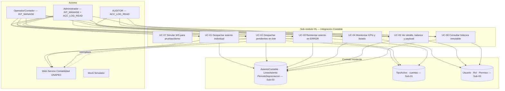
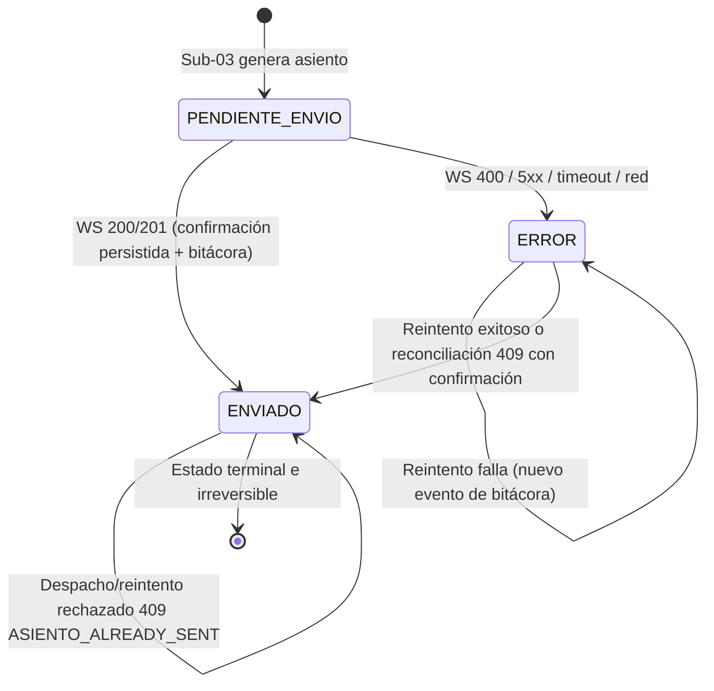
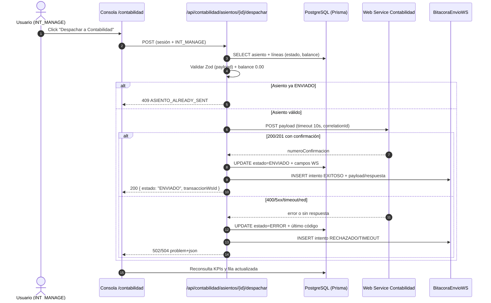

# Requirements: Integración Contable y Web Service Contabilidad (Sub-módulo 05)

> 📋 Generated by `requirements-analyst` · 2026-11-24
> ✅ Approved by: Alejandra · 2026-11-24
> ⚠️ **MANDATORY QUALITY GATE (Hard Gate 12)**: Every user story MUST be authored in formal EARS syntax with complete Given/When/Then acceptance criteria. Summarizing requirements with 'etc.', omitting calculation formulas, or generalizing validations is strictly prohibited. All numeric thresholds, formats, and error conditions must be explicitly detailed.

## Traceability
- **Work Item**: Sub-módulo 05 (Integración Contable y Web Service Contabilidad — pendiente de asignación de AB# en ADO)
- **Parent**: Sistema de Gestión de Activos Fijos & Contabilización DGII (UNAPEC — Proyecto Final Integraciones I, Prof. Juan P. Valdez)
- **Branch**: `feature/activos-fijos-05-integracion-ws-contabilidad`
- **Design**: [design.md](./design.md) *(pendiente — se genera tras aprobación de este documento)*
- **Test Plan**: *(pendiente)*
- **Test Cases**: *(pendiente)*

## Overview
El sub-módulo de Integración Contable cierra el ciclo financiero de ActivaCore: toma los asientos contables consolidados que el Motor de Depreciación (Sub-03) genera en estado `PENDIENTE_ENVIO` y los despacha de forma determinista, idempotente y auditable al Sistema de Contabilidad General de UNAPEC mediante un Web Service HTTP/JSON. Incluye un **simulador interno** del Web Service para demostración y pruebas sin dependencia externa, una **consola de monitoreo** en `/contabilidad` con métricas, filtros, detalle de débitos/créditos, visor de payload y bitácora técnica, y un modelo de **trazabilidad inmutable** de cada intento de comunicación. El sub-módulo no recalcula ni modifica importes: consume el asiento y sus líneas tal como fueron persistidos por Sub-03, y solo muta el estado de despacho (`PENDIENTE_ENVIO → ENVIADO | ERROR`).

## User Stories (EARS Notation)

### REQ-INT-001: Despacho Individual Determinista del Asiento al Web Service
**Type:** Event-Driven
**Rule:** WHEN un usuario autenticado con permiso `INT_MANAGE` ejecute "Despachar a Contabilidad" sobre un asiento en estado `PENDIENTE_ENVIO`, the system SHALL validar el asiento (existencia, al menos una línea, `Σ débitos = Σ créditos` con diferencia exacta `RD$ 0.00`), ensamblar el payload JSON con los ocho datos obligatorios de la Ficha y enviarlo por HTTPS al endpoint configurado del Web Service de Contabilidad con timeout configurable `WS_CONTABILIDAD_TIMEOUT_MS` (valor por defecto `10000` ms, rango admitido `1000–30000` ms), validando la petición y la respuesta con esquemas Zod; WHERE la respuesta sea HTTP `200` o `201`, the system SHALL persistir en el asiento `estado = "ENVIADO"`, `transaccionWsId` (número de confirmación contable institucional), `codigoRespuestaWs = "200|201"`, `mensajeRespuestaWs` y `fechaEnvioWs` (UTC), y WHERE la respuesta sea HTTP `400`, HTTP `5xx`, error de red o timeout, the system SHALL persistir `estado = "ERROR"` conservando el asiento y sus líneas intactos para reintento.
**Entities:** `AsientoContable`, `LineaAsiento`, `PeriodoDepreciacion`, `TipoActivo`, `Usuario`, `BitacoraEnvioWS` (nueva)
**Error Handling:** Toda falla responde RFC 7807 `application/problem+json`. Catálogo mínimo: `ASIENTO_NOT_FOUND` (404), `ASIENTO_SIN_LINEAS` (422), `ASIENTO_UNBALANCED` (422, con `totalDebito`, `totalCredito` y `diferencia` en el detalle), `ASIENTO_ALREADY_SENT` (409, ver REQ-INT-002), `WS_TIMEOUT` (504), `WS_NETWORK_ERROR` (502), `WS_REJECTED` (502, HTTP 400 del WS), `WS_SERVER_ERROR` (502, HTTP 5xx del WS), `VALIDATION_ERROR` (400, payload de salida inválido detectado por Zod **antes** de invocar el WS). Una falla del WS NUNCA deja el asiento en un estado intermedio ni altera `totalDebito`/`totalCredito`.

**Contrato mínimo del payload (orden y tipos obligatorios):**
```json
{
  "numeroAsiento": "DEP-202610-001",
  "concepto": "Depreciación 10/2026",
  "fechaAsiento": "2026-10-31",
  "estado": "PENDIENTE_ENVIO",
  "lineas": [
    {
      "tipoInventario": "TPA-001",
      "cuentaContable": "6-01-02-0001",
      "tipoMovimiento": "DB",
      "monto": "47812.50",
      "descripcion": "Depreciación 10/2026 — TPA-001"
    },
    {
      "tipoInventario": "TPA-001",
      "cuentaContable": "1-02-01-0003",
      "tipoMovimiento": "CR",
      "monto": "47812.50",
      "descripcion": "Depreciación 10/2026 — TPA-001"
    }
  ],
  "totalDebito": "47812.50",
  "totalCredito": "47812.50"
}
```
Reglas del contrato: `numeroAsiento` conserva el formato `^DEP-\d{6}-\d{3}$`; `fechaAsiento` es `YYYY-MM-DD`; `cuentaContable` cumple `^[1-9]-\d{2}-\d{2}-\d{4}$`; `tipoMovimiento` en el wire es exclusivamente `DB` (débito/gasto) o `CR` (crédito/depreciación acumulada), mapeado desde los valores internos `DEBITO`/`CREDITO`; `monto`, `totalDebito` y `totalCredito` se serializan como **string decimal de exactamente 2 posiciones** (`^\d+\.\d{2}$`) para evitar pérdida por punto flotante; `estado` refleja el estado previo al envío (`PENDIENTE_ENVIO`).

**Acceptance Criteria:**
- [ ] Given un asiento `DEP-202610-001` en `PENDIENTE_ENVIO` con 2 líneas (1 `DEBITO` y 1 `CREDITO` por `RD$ 47,812.50`, balance cero), When un usuario con `INT_MANAGE` lo despacha y el WS responde `201` con `numeroConfirmacion = "WS-20261031-00042"`, Then the system persiste `estado = "ENVIADO"`, `transaccionWsId = "WS-20261031-00042"`, `codigoRespuestaWs = "201"` y `fechaEnvioWs` en UTC, y la UI refleja el cambio sin recargar la página completa.
- [ ] Given el mismo asiento, When se inspecciona el JSON enviado, Then `tipoMovimiento` contiene `"DB"`/`"CR"` (nunca `"DEBITO"`/`"CREDITO"`), `monto` es `"47812.50"` y `totalDebito` = `totalCredito` = `"47812.50"`.
- [ ] Given un asiento cuyas líneas suman débitos `100.00` y créditos `99.99`, When se intenta despachar, Then the system responde 422 `ASIENTO_UNBALANCED`, NO invoca al Web Service y el asiento permanece `PENDIENTE_ENVIO`.
- [ ] Given que el Web Service no responde dentro de `WS_CONTABILIDAD_TIMEOUT_MS = 10000`, When expira el timeout, Then the system persiste `estado = "ERROR"` con código `WS_TIMEOUT`, libera la interfaz y registra el intento fallido en la bitácora con `httpStatus = null`.
- [ ] Given que el Web Service responde `400` con `{"codigo":"VALIDATION_ERROR","errores":[...]}`, When el cliente recibe la respuesta, Then el asiento pasa a `ERROR`, se conserva el mensaje del WS en `mensajeRespuestaWs` y la UI muestra el motivo sin perder el detalle del asiento.
- [ ] Given un asiento sin líneas persistidas, When se intenta despachar, Then the system responde 422 `ASIENTO_SIN_LINEAS` y no realiza ninguna llamada HTTP saliente.

**Priority:** Must
**Dependencies:** Sub-03 (modelos `AsientoContable`, `LineaAsiento`, `PeriodoDepreciacion`), Sub-01 (`TipoActivo` y cuentas contables), REQ-INT-005 (mock para pruebas), REQ-INT-008
**Tracker:** Sub-módulo 05

### REQ-INT-002: Idempotencia, No Duplicidad e Irreversibilidad del Estado ENVIADO
**Type:** State-Driven
**Rule:** WHILE un asiento se encuentre en estado `ENVIADO`, the system SHALL rechazar cualquier nuevo despacho o reintento con HTTP `409 Conflict` y código `ASIENTO_ALREADY_SENT`, sin invocar al Web Service; y WHEN dos solicitudes concurrentes intenten despachar el mismo asiento en `PENDIENTE_ENVIO`, the system SHALL garantizar que el Web Service registre **una sola** confirmación contable para el `numeroAsiento` (clave de idempotencia determinista e inmutable), de modo que a lo sumo una solicitud obtenga `201` y las demás reciban `409 ASIENTO_ALREADY_SENT` o la reconciliación de la confirmación existente. El estado `ENVIADO` es **terminal e irreversible**: ningún endpoint del sub-módulo permite editar el asiento, revertirlo a `PENDIENTE_ENVIO`, borrarlo ni reenviarlo.
**Entities:** `AsientoContable`, `BitacoraEnvioWS`, `LineaAsiento`
**Error Handling:** Si el Web Service responde `409` con `codigo = "ASIENTO_ALREADY_SENT"` y un `numeroConfirmacion` válido para el mismo `numeroAsiento`, el sistema SHALL reconciliar el estado local a `ENVIADO` con esa confirmación (idempotencia tolerante); si el `409` no incluye confirmación, el asiento pasa a `ERROR` con código `WS_DUPLICATE_UNCONFIRMED` y el conflicto queda en bitácora. Cualquier método HTTP distinto de `POST` sobre las rutas de despacho responde `405 Method Not Allowed`.

**Acceptance Criteria:**
- [ ] Given un asiento `ENVIADO`, When se invoca de nuevo el despacho (individual o lote), Then the system responde 409 `ASIENTO_ALREADY_SENT`, NO realiza petición HTTP al WS y el estado/confirmación originales permanecen inalterados.
- [ ] Given dos operadores que despachan el mismo asiento `PENDIENTE_ENVIO` simultáneamente, When ambas solicitudes finalizan, Then existe una única confirmación contable y una sola transición a `ENVIADO`; la solicitud perdedora recibe 409 o la misma confirmación, nunca un segundo registro.
- [ ] Given que el WS responde 409 con `numeroConfirmacion = "WS-20261031-00042"` para un asiento local en `ERROR` por un intento previo incierto, When se procesa la respuesta, Then the system reconcilia a `ENVIADO` con esa confirmación y registra el evento en la bitácora con resultado `RECONCILIADO`.
- [ ] Given un asiento `ENVIADO`, When se consultan las rutas del sub-módulo, Then no existe operación disponible que permita editar líneas, montos, fecha contable, estado o eliminar el asiento (solo lectura).
- [ ] Given una petición `PUT`, `PATCH` o `DELETE` a `/api/contabilidad/asientos/{id}/despachar`, When llega al route handler, Then the system responde 405 sin efectos secundarios.

**Priority:** Must
**Dependencies:** REQ-INT-001, REQ-INT-005
**Tracker:** Sub-módulo 05

### REQ-INT-003: Reintento Manual de Asientos en ERROR
**Type:** Event-Driven
**Rule:** WHEN un usuario con `INT_MANAGE` ejecute "Reintentar Envío" sobre un asiento en estado `ERROR`, the system SHALL reenviar el **mismo** `numeroAsiento` y el **mismo** snapshot de líneas, cuentas, tipos de movimiento y montos persistidos (sin recalcular ni alterar importes), incrementar el contador de intentos y registrar un nuevo evento en la bitácora; WHERE el Web Service confirme con `200/201`, the system SHALL transicionar a `ENVIADO` y persistir la nueva confirmación; WHERE vuelva a fallar, the system SHALL mantener `estado = "ERROR"` actualizando `codigoRespuestaWs`, `mensajeRespuestaWs` y la fecha del último intento.
**Entities:** `AsientoContable`, `LineaAsiento`, `BitacoraEnvioWS`, `Usuario`
**Error Handling:** Si el asiento está en `PENDIENTE_ENVIO` o `ENVIADO`, el reintento responde `409 ASIENTO_NOT_RETRYABLE` (para `ENVIADO` prevalece `ASIENTO_ALREADY_SENT` del REQ-INT-002). El sistema NO ejecuta reintentos automáticos en segundo plano: cada reintento es una acción humana explícita y auditada. Un reintento fallido nunca duplica líneas ni crea un segundo asiento.

**Acceptance Criteria:**
- [ ] Given un asiento en `ERROR` por HTTP 500, When el usuario reintenta y el WS responde `201`, Then el asiento pasa a `ENVIADO`, `intentosEnvio` se incrementa y la bitácora contiene 2 intentos (el fallido y el exitoso) con el mismo payload.
- [ ] Given un asiento en `PENDIENTE_ENVIO`, When se invoca el reintento, Then the system responde 409 `ASIENTO_NOT_RETRYABLE` y no llama al WS.
- [ ] Given un asiento en `ERROR`, When se comparan los montos del payload del reintento con los del intento original, Then son idénticos byte a byte en sus strings decimales y el `numeroAsiento` no cambia.
- [ ] Given un reintento que vuelve a fallar por timeout, When finaliza, Then el asiento permanece `ERROR`, `fechaEnvioWs` refleja el último intento y la UI muestra el nuevo mensaje sin ocultar el historial previo.

**Priority:** Must
**Dependencies:** REQ-INT-001, REQ-INT-002, REQ-INT-008
**Tracker:** Sub-módulo 05

### REQ-INT-004: Despacho en Lote de Asientos Pendientes
**Type:** Event-Driven
**Rule:** WHEN un usuario con `INT_MANAGE` ejecute "Despachar Pendientes en Lote", the system SHALL seleccionar los asientos en estado `PENDIENTE_ENVIO` que cumplan el filtro de período contable vigente en la consola, procesarlos **secuencialmente** con un máximo de `25` asientos por invocación (ordenados por `fechaContable` ascendente y `numeroAsiento` ascendente), aplicar a cada uno las mismas validaciones y el mismo contrato del REQ-INT-001, y devolver un resumen `{ total, enviados, errores, restantes, resultados[] }`; WHERE un asiento individual falle, the system SHALL continuar con el siguiente sin abortar el lote (resultado parcial), y WHERE existan más de 25 pendientes, the system SHALL procesar los primeros 25 y reportar `restantes > 0` para una nueva invocación.
**Entities:** `AsientoContable`, `LineaAsiento`, `BitacoraEnvioWS`, `PeriodoDepreciacion`, `Usuario`
**Error Handling:** Si no existen asientos `PENDIENTE_ENVIO` en el filtro, responde `200` con `{ total: 0, enviados: 0, errores: 0, restantes: 0, resultados: [] }` sin invocar al WS. Los asientos en `ENVIADO` o `ERROR` nunca se incluyen en el lote (los `ERROR` se reintentan solo por REQ-INT-003). Un fallo global de base de datos antes de iniciar responde 500 `BATCH_START_FAILED` sin marcar asientos; un fallo de base de datos durante el lote se registra por asiento y el resto continúa.

**Acceptance Criteria:**
- [ ] Given 3 asientos `PENDIENTE_ENVIO` del período `2026-10` (2 confirmados por el WS y 1 con HTTP 500), When se ejecuta el lote, Then el resumen reporta `total=3`, `enviados=2`, `errores=1`, `restantes=0`, y los estados finales son `ENVIADO`, `ENVIADO` y `ERROR` respectivamente.
- [ ] Given 30 asientos `PENDIENTE_ENVIO` del mismo período, When se ejecuta una invocación de lote, Then se procesan exactamente 25 y el resumen reporta `restantes=5`; una segunda invocación procesa los 5 restantes.
- [ ] Given un lote donde el segundo asiento agota el timeout de 10 s, When finaliza, Then el primero y el tercero se despachan igualmente y el resumen identifica al segundo como `ERROR` con `WS_TIMEOUT`.
- [ ] Given que no hay pendientes, When se pulsa el botón de lote, Then la acción responde 200 con total 0, no se emite ninguna petición al Web Service y la UI informa "No hay asientos pendientes por despachar".
- [ ] Given que un asiento ya fue despachado por otro operador entre la selección y el procesamiento, When el lote llega a ese asiento, Then se omite/registra como `ASIENTO_ALREADY_SENT` sin duplicar la confirmación ni abortar el lote.

**Priority:** Must
**Dependencies:** REQ-INT-001, REQ-INT-002, REQ-INT-008
**Tracker:** Sub-módulo 05

### REQ-INT-005: Simulador Interno del Web Service de Contabilidad (Mock)
**Type:** Event-Driven
**Rule:** The system SHALL exponer un simulador HTTP `POST /api/mock/contabilidad/asientos` que valide el payload con Zod y replique el contrato del Web Service institucional: WHERE el payload sea válido y el `numeroAsiento` no haya sido registrado, responde `201 Created` con `{ numeroAsiento, numeroConfirmacion, codigoRespuesta: "201", mensaje, fechaRecepcion }`; WHERE el mismo `numeroAsiento` ya fue confirmado, responde `409 Conflict` con `codigo = "ASIENTO_ALREADY_SENT"` y la confirmación original; WHERE se solicite un escenario de falla determinista mediante el header `x-mock-scenario: 400|409|500`, responde el código y cuerpo correspondientes; y WHERE se solicite latencia artificial con `x-mock-delay-ms` (entero `0–30000`), retrasa la respuesta ese tiempo para probar timeouts. El simulador SHALL estar disponible en desarrollo, pruebas y demostración, y SHALL responder `404 NOT_FOUND` en producción salvo que la variable `ENABLE_WS_MOCK=true` esté explícitamente habilitada.
**Entities:** `AsientoContable` (payload entrante, sin persistencia de dominio), `BitacoraEnvioWS` (del cliente), registro en memoria del mock
**Error Handling:** Payload inválido responde 400 `VALIDATION_ERROR` con el listado de campos y rutas Zod en español; `x-mock-scenario` fuera del catálogo responde 400 `INVALID_MOCK_SCENARIO`; el mock NUNCA escribe en las tablas de asientos/líneas ni altera el estado local del asiento. La confirmación del mock sigue el formato `WS-YYYYMMDD-NNNNN` (correlativo por proceso).

**Acceptance Criteria:**
- [ ] Given un payload válido con `numeroAsiento = "DEP-202610-001"`, When se invoca el mock sin escenario de falla, Then responde 201 con `codigoRespuesta = "201"` y `numeroConfirmacion` que cumple `^WS-\d{8}-\d{5}$`.
- [ ] Given el mismo `numeroAsiento` enviado dos veces, When llega la segunda petición, Then el mock responde 409 `ASIENTO_ALREADY_SENT` con la misma `numeroConfirmacion` y no crea un segundo registro.
- [ ] Given el header `x-mock-scenario: 500`, When se invoca el mock, Then responde 500 con cuerpo JSON `{ codigo: "WS_SERVER_ERROR", mensaje }` y el cliente marca el asiento en `ERROR` con `WS_SERVER_ERROR`.
- [ ] Given el header `x-mock-delay-ms: 11000` y un cliente con timeout de 10000 ms, When se despacha, Then el cliente aborta por timeout, registra `WS_TIMEOUT` y el asiento queda `ERROR` aunque el mock complete después.
- [ ] Given el entorno de producción sin `ENABLE_WS_MOCK=true`, When se invoca `/api/mock/contabilidad/asientos`, Then responde 404 y no procesa el payload.

**Priority:** Must
**Dependencies:** REQ-INT-001
**Tracker:** Sub-módulo 05

### REQ-INT-006: Consola de Monitoreo y Operación `/contabilidad`
**Type:** Event-Driven
**Rule:** WHEN un usuario con `INT_MANAGE` o `ACC_LOG_READ` acceda a la ruta `/contabilidad`, the system SHALL presentar: (1) cuatro tarjetas KPI calculadas sobre el universo filtrado por período contable (independientes del filtro de estado): total de asientos generados, pendientes de envío, enviados satisfactoriamente y con error de transmisión; (2) un listado paginado server-side de asientos con tamaños de página `{10, 25, 50}`, filtros por `estado` (`TODOS`, `PENDIENTE_ENVIO`, `ENVIADO`, `ERROR`) y por período `YYYY-MM`, y ordenamiento por `numeroAsiento` y `fechaContable` en ambas direcciones (por defecto `fechaContable` descendente); y (3) las acciones operativas visibles según permiso y estado (despachar individual, despachar pendientes en lote, reintentar). La entrada de menú "Contabilidad" SHALL mostrarse solo a usuarios con alguno de los dos permisos.
**Entities:** `AsientoContable`, `PeriodoDepreciacion`, `LineaAsiento`, `Usuario`
**Error Handling:** Sin asientos para el filtro, muestra el estado vacío "No hay asientos contables para los filtros seleccionados" con botón "Restablecer filtros" sin excepción. Si la consulta de KPIs falla pero la lista responde, la consola muestra KPIs en estado degradado (`—`) y mantiene la tabla operativa. Un período con formato inválido responde `VALIDATION_ERROR` (400). El filtro de estado no altera los KPIs; el filtro de período sí afecta KPIs y lista de forma consistente.

**Acceptance Criteria:**
- [ ] Given 3 asientos del período `2026-10` (1 `PENDIENTE_ENVIO`, 1 `ENVIADO`, 1 `ERROR`) y 2 asientos de `2026-09`, When se abre `/contabilidad` con período `2026-10`, Then los KPIs muestran `3`, `1`, `1`, `1` y la lista muestra 3 filas.
- [ ] Given el filtro de estado `ERROR` activo sobre el período `2026-10`, When se aplica, Then la lista muestra 1 fila y los KPIs permanecen `3/1/1/1` (el filtro de estado no reduce el universo de KPIs).
- [ ] Given 47 asientos que cumplen el filtro y tamaño de página 25, When se navega a la página 2, Then se muestran exactamente 22 filas y el total de páginas es 2.
- [ ] Given el encabezado "Fecha contable", When se hace click, Then el orden alterna ascendente/descendente y el indicador visual refleja la dirección activa.
- [ ] Given un usuario `AUDITOR` con solo `ACC_LOG_READ`, When abre `/contabilidad`, Then ve KPIs, lista y detalle, pero los botones "Despachar", "Despachar Pendientes" y "Reintentar" no están presentes ni habilitados.
- [ ] Given un usuario sin `INT_MANAGE` ni `ACC_LOG_READ`, When navega a `/contabilidad`, Then recibe 403 y no se renderiza información contable.

**Priority:** Must
**Dependencies:** REQ-INT-009, Sub-03 (asientos y períodos)
**Tracker:** Sub-módulo 05

### REQ-INT-007: Detalle del Asiento, Balance Cuadrado y Visor de Payload/Respuesta
**Type:** Event-Driven
**Rule:** WHEN un usuario con `INT_MANAGE` o `ACC_LOG_READ` abra el detalle de un asiento (modal o drawer), the system SHALL mostrar: cabecera (`numeroAsiento`, `concepto`, `fechaContable`, `estado`, período `YYYY-MM`), grilla de líneas con `tipoInventario`, `cuentaContable`, `tipoMovimiento` (badge `DB`/`CR`), `monto` en `RD$ #,##0.00` y `descripcion`; totales `totalDebito` y `totalCredito`; indicador de balance calculado como `Σ líneas DB − Σ líneas CR` con el mismo algoritmo Half-Up a 2 decimales (`Math.round((val + Number.EPSILON) * 100) / 100`), que SHALL ser `RD$ 0.00` para habilitar el despacho; y un panel de integración con la **última** respuesta del WS (`transaccionWsId`, `codigoRespuestaWs`, `mensajeRespuestaWs`, `fechaEnvioWs`, intentos) y el **payload JSON exacto** enviado en el último intento, en modo solo lectura con acción de copiar.
**Entities:** `AsientoContable`, `LineaAsiento`, `PeriodoDepreciacion`, `BitacoraEnvioWS`, `TipoActivo`
**Error Handling:** Si el asiento no existe responde 404 `ASIENTO_NOT_FOUND`. Si el balance es distinto de `RD$ 0.00`, el indicador se muestra en rojo con la diferencia y el botón de despacho se deshabilita con el aviso "Asiento descuadrado: no puede enviarse". Si no existe bitácora (nunca despachado), el panel muestra "Sin intentos de envío registrados". El visor de payload nunca permite edición ni reenvío de un JSON modificado.

**Acceptance Criteria:**
- [ ] Given un asiento con 3 pares de líneas (3 `DEBITO` + 3 `CREDITO`) por `RD$ 47,812.50`, When se abre el detalle, Then se listan 6 líneas con badges `DB`/`CR`, y el indicador muestra `Balance: RD$ 0.00` habilitando el despacho.
- [ ] Given un asiento con débitos `100.00` y créditos `99.99`, When se abre el detalle, Then el balance muestra `RD$ 0.01` en rojo, el botón de despacho está deshabilitado y ningún endpoint permite forzar el envío.
- [ ] Given un asiento `ENVIADO`, When se abre el visor, Then se muestra `transaccionWsId`, código `201`, fecha UTC y el JSON exacto enviado, sin botones de edición.
- [ ] Given un asiento `ERROR`, When se abre el visor, Then se muestra el último código/mensaje de error y el payload del intento fallido, junto con el número de intentos acumulados.
- [ ] Given un asiento nunca despachado, When se abre el detalle, Then el panel de integración indica "Sin intentos de envío registrados" y el botón "Despachar a Contabilidad" está habilitado (si el usuario tiene `INT_MANAGE` y el balance es cero).

**Priority:** Must
**Dependencies:** REQ-INT-001, REQ-INT-008, REQ-INT-009
**Tracker:** Sub-módulo 05

### REQ-INT-008: Bitácora Inmutable de Intentos de Comunicación WS
**Type:** Ubiquitous
**Rule:** The system SHALL registrar de forma **inmutable** un evento por cada intento de comunicación con el Web Service (individual, lote, reintento o reconciliación), con los campos mínimos: identificador del evento, `asientoId`, `numeroAsiento`, usuario responsable (`usuarioId` y correo), timestamp UTC en ISO-8601, número de intento, payload JSON exacto enviado, URL del endpoint, código HTTP recibido (o `null` si hubo timeout/error de red), cuerpo/mensaje de respuesta, duración en milisegundos, resultado (`EXITOSO`, `RECHAZADO`, `ERROR_RED`, `TIMEOUT`, `RECONCILIADO`) y `correlationId` de la solicitud. La aplicación SHALL NOT exponer endpoints que actualicen o eliminen eventos de la bitácora, y SHALL NOT ejecutar `UPDATE`/`DELETE` sobre la tabla desde el código de negocio.
**Entities:** `BitacoraEnvioWS` (nueva), `AsientoContable`, `Usuario`
**Error Handling:** Si el registro en bitácora falla dentro de una transición de estado, la transición completa se aborta y responde 500 `AUDIT_LOG_FAILED` (nunca se marca `ENVIADO` sin evidencia). Las lecturas de bitácora están protegidas por `ACC_LOG_READ`; un usuario sin ese permiso recibe 403 al solicitar el historial completo.

**Acceptance Criteria:**
- [ ] Given un despacho exitoso, When se consulta la bitácora del asiento, Then existe exactamente 1 evento con payload idéntico al enviado, `httpStatus = 201`, resultado `EXITOSO`, usuario responsable y timestamp UTC.
- [ ] Given un asiento con 1 intento fallido y 1 reintento exitoso, When se consulta la bitácora, Then existen 2 eventos ordenados cronológicamente con `intento = 1` y `intento = 2`, ambos con su propio payload y respuesta.
- [ ] Given un timeout de red, When se registra el evento, Then `httpStatus = null`, resultado `TIMEOUT`, duración ≥ `WS_CONTABILIDAD_TIMEOUT_MS` y mensaje que identifica el timeout.
- [ ] Given cualquier endpoint del sub-módulo, When se intenta `PUT`/`PATCH`/`DELETE` sobre un evento de bitácora, Then responde 405/404 y el evento permanece inalterado.
- [ ] Given una falla simulada de inserción de bitácora durante un despacho exitoso del WS, When se procesa la transacción, Then el asiento NO cambia a `ENVIADO` y la API responde 500 `AUDIT_LOG_FAILED`.

**Priority:** Must
**Dependencies:** REQ-INT-001, REQ-INT-009
**Tracker:** Sub-módulo 05

### REQ-INT-009: Control de Acceso RBAC y Separación de Funciones
**Type:** Ubiquitous
**Rule:** The system SHALL exigir autenticación en el 100% de las rutas del sub-módulo y autorizar servidor-side (verificación dual en `proxy.ts` y en cada route handler): `INT_MANAGE` para despachar individualmente, despachar en lote y reintentar; `ACC_LOG_READ` para consultar el historial completo de bitácora; y cualquiera de los dos permisos para acceder a la consola `/contabilidad`, KPIs, listado y detalle del asiento. El rol `ADMIN` conserva ambos permisos por su asignación total del seed; el rol `AUDITOR` es **solo lectura** (sin acciones de despacho). La UI SHALL ocultar o deshabilitar las acciones no autorizadas, sin sustituir la validación del servidor.
**Entities:** `Usuario`, `Rol`, `Permiso`, `RolPermiso`, `BitacoraEnvioWS`
**Error Handling:** Sin sesión válida responde `401 UNAUTHORIZED`; con sesión pero sin permiso responde `403 FORBIDDEN` con el permiso faltante en el detalle RFC 7807. Un intento de despacho no autorizado NO registra evento en bitácora como si hubiera ocurrido (puede registrarse el intento denegado en la auditoría general del Sub-00, nunca como comunicación WS).

**Acceptance Criteria:**
- [ ] Given un usuario `OPERADOR` con `INT_MANAGE` (equivalente al `ACC_POST_SEND` vigente del seed), When despacha un asiento, Then recibe 200/201 y la transición se aplica; When solicita el historial completo de bitácora sin `ACC_LOG_READ`, Then recibe 403.
- [ ] Given un usuario `AUDITOR` con `ACC_LOG_READ`, When consulta `/contabilidad` y el detalle/bitácora, Then recibe 200; When invoca cualquier endpoint de despacho o reintento, Then recibe 403 y ningún asiento cambia de estado.
- [ ] Given un usuario `ADMIN`, When opera la consola, Then puede despachar, reintentar, ejecutar lotes y consultar bitácora (ambos permisos).
- [ ] Given una petición sin cookie de sesión, When invoca cualquier ruta `/api/contabilidad/*`, Then recibe 401 y no se ejecuta ninguna llamada al Web Service.
- [ ] Given un usuario sin ninguno de los dos permisos, When navega a `/contabilidad`, Then la entrada de menú no se muestra y el acceso directo responde 403.

**Priority:** Must
**Dependencies:** Sub-00 (Auth & RBAC)
**Tracker:** Sub-módulo 05

## Non-Functional Requirements

### NFR-INT-001: Seguridad del Canal y Manejo de Credenciales
**Category:** Security
**Rule:** The system SHALL comunicarse con el Web Service de Contabilidad exclusivamente por HTTPS/TLS 1.2 o superior en producción, manteniendo las credenciales (`WS_CONTABILIDAD_URL`, `WS_CONTABILIDAD_API_KEY` o token equivalente) **solo en el servidor** (variables de entorno) y nunca en el bundle del cliente, en logs de aplicación ni en el payload de bitácora; los headers de autenticación se enmascaran en cualquier traza. El simulador interno SHALL estar deshabilitado en producción salvo bandera explícita.
**Metric:** 0 secretos en respuestas al cliente o en `BitacoraEnvioWS`; 100% de llamadas salientes con esquema `https://` en producción; mock responde 404 en producción por defecto.
**Priority:** Must

### NFR-INT-002: Confiabilidad, Timeout y At-Most-Once
**Category:** Reliability
**Rule:** The system SHALL aplicar un timeout configurable por intento (`WS_CONTABILIDAD_TIMEOUT_MS`, default `10000`, rango `1000–30000`) y SHALL garantizar **at-most-once** en el registro contable mediante la clave idempotente `numeroAsiento`; no SHALL ejecutar reintentos automáticos ocultos (cada reintento es una acción humana auditada) ni dejar transiciones de estado parciales: el estado del asiento y su evento de bitácora se confirman en la misma unidad lógica.
**Metric:** 0 asientos `ENVIADO` sin evento de bitácora; 0 confirmaciones duplicadas en 100 despachos concurrentes del mismo asiento; 100% de timeouts registrados como `ERROR` en ≤ 1 s tras el vencimiento.
**Priority:** Must

### NFR-INT-003: Performance de Consola y Operaciones
**Category:** Performance
**Rule:** The system SHALL responder la consulta paginada de asientos (hasta 10,000 asientos históricos) en menos de `1.5 s p95`, el detalle de un asiento con sus líneas y último intento en menos de `1.0 s p95`, y un lote de 25 asientos en menos de `60 s p95` con latencia del WS ≤ `200 ms` por asiento; el timeout por asiento acota el peor caso individual a `10 s`.
**Metric:** p95 < 1.5 s (lista), < 1.0 s (detalle), < 60 s (lote de 25 con WS normal); primer render útil de `/contabilidad` < 3 s p95.
**Priority:** Must

### NFR-INT-004: Auditabilidad e Inmutabilidad de la Bitácora
**Category:** Reliability
**Rule:** The system SHALL conservar el 100% de los intentos de comunicación durante al menos 12 meses, con timestamp en UTC, payload íntegro, código HTTP, mensaje de respuesta y usuario responsable; la bitácora es append-only a nivel de aplicación y no admite modificación ni borrado desde la UI/API.
**Metric:** 100% de intentos con los 10 campos mínimos; 0 endpoints de mutación sobre bitácora; retención ≥ 365 días.
**Priority:** Must

### NFR-INT-005: Exactitud Financiera y Cuadre Contable
**Category:** Reliability
**Rule:** The system SHALL preservar `NUMERIC(14,2)` y el redondeo Half-Up a 2 decimales en todos los montos, serializar montos como strings decimales de 2 posiciones y verificar `totalDebito = totalCredito` y `Σ líneas DB = Σ líneas CR` antes de cualquier despacho, sin recalcular importes del Sub-03.
**Metric:** 0 discrepancias de centavos entre asiento persistido, payload enviado y confirmación; 100% de asientos descuadrados bloqueados con 422.
**Priority:** Must

### NFR-INT-006: Accesibilidad y UX Operativa
**Category:** Accessibility
**Rule:** The system SHALL cumplir WCAG 2.1 AA en `/contabilidad` (roles ARIA en tablas y drawer, foco atrapado y cierre con `Escape`, navegación completa por teclado, `aria-live` para el resultado de despacho/lote), con contraste ≥ 4.5:1 y confirmación explícita antes de un despacho en lote.
**Metric:** 0 violaciones críticas en axe-core; flujo despacho individual y lote completable sin mouse; resultado anunciado por lector de pantalla.
**Priority:** Should

## Diagrams

### Use Case Diagram


### Supporting Diagram — Máquina de Estados del Asiento


### Supporting Diagram — Secuencia de Despacho y Auditoría


## Dependencies

| Feature | Capability needed | Status | Workaround |
|---------|------------------|--------|------------|
| Sub-módulo 00 (Auth & RBAC) | Sesión NextAuth v5, guards server-side, permisos `ACC_LOG_READ` y equivalente de despacho | ⚠️ **Parcial** — `ACC_LOG_READ` y `ACC_POST_SEND` ya existen en `seed.ts`; `INT_MANAGE` (nombre de la Ficha) debe registrarse/aliasarse | Usar `ACC_POST_SEND` como alias operativo mientras design define el registro de `INT_MANAGE` |
| Sub-módulo 01 (Catálogos Base) | `TipoActivo` con `cuentaContableCompra`, `cuentaContableDepreciacion`, `cuentaContableGastoDepreciacion` y formato `X-XX-XX-XXXX` | ✅ **Certificado** (modelo real en `schema.prisma`) | Ninguno |
| Sub-módulo 03 (Motor de Depreciación DGII) | `PeriodoDepreciacion`, `AsientoContable`, `LineaAsiento`, asiento consolidado en `PENDIENTE_ENVIO`, totales cuadrados y concepto/fecha contable | ⚠️ **Especificado y modelado** — tablas y campos presentes; la entrega de asientos por corrida/cierre está en implementación | Seed de asientos de prueba para E2E mientras Sub-03 no esté certificado |
| Sub-módulo 04 (Consultas y Reportes) | Ninguna — el Sub-05 no consume reportes ni exportaciones | ✅ **Certificado** | Ninguno |
| Web Service Contabilidad UNAPEC | Endpoint HTTP/JSON con confirmación institucional | ❌ **No disponible** | Mock interno `/api/mock/contabilidad/asientos` (REQ-INT-005) |

## Assumptions

| # | Assumption | Temporary stub | Replaced when |
|---|-----------|----------------|---------------|
| 1 | **Permiso de despacho:** la Ficha exige `INT_MANAGE`; el seed actual ya define `ACC_POST_SEND` ("Envío de asientos contables a WS Contabilidad") y lo asigna a `OPERADOR`. Se implementará `INT_MANAGE` como código canónico (registrado en seed/migración y asignado a `ADMIN` y `OPERADOR`) manteniendo `ACC_POST_SEND` como alias durante la transición. | Alias `ACC_POST_SEND` en pruebas hasta registrar `INT_MANAGE` | Decisión de design + actualización de `seed.ts` en la migración del Sub-05 |
| 2 | **Tipo de inventario:** la Ficha menciona "Cat 1, Cat 2, Cat 3 o clasificador contable"; el modelo actual no posee un campo de categoría DGII, solo `TipoActivo.codigo` (`TPA-001`…). El payload usará `TipoActivo.codigo` como `tipoInventario` en la v1. | `tipoInventario = TPA-00N` | Si la universidad exige `CAT-1|CAT-2|CAT-3`, design agrega el mapeo/campo DGII |
| 3 | **Tipo de movimiento en el wire:** `LineaAsiento.tipoMovimiento` interno usa `DEBITO|CREDITO` (CHECK de Sub-03); el contrato WS exige `DB|CR`. El adaptador del cliente mapea `DEBITO→DB` y `CREDITO→CR`; el valor interno nunca se envía. | Mapeo en el serializer del cliente | N/A — decisión de contrato |
| 4 | **`tipoInventario` por línea:** `LineaAsiento` no almacena `tipoActivoId`; las líneas se agrupan por par de cuentas del `TipoActivo`. El Sub-05 derivará el tipo por la cuenta (`cuentaContableGastoDepreciacion`/`cuentaContableDepreciacion`) o, si design lo requiere, agregará `tipo_activo_id`/`tipo_inventario` a `lineas_asiento` en su migración. | Derivación determinista por cuentas | Migración del Sub-05 si la derivación no es biyectiva |
| 5 | **Mock con idempotencia en memoria:** el simulador recuerda los `numeroAsiento` confirmados en memoria del proceso; al reiniciar, el registro se limpia. Es suficiente para demo/E2E y no sustituye la idempotencia del WS real. | `Map<string, confirmacion>` en el mock | Integración con el WS real o persistencia del mock si se requiere entre reinicios |
| 6 | **Estados persistidos:** el CHECK de Sub-03 solo admite `PENDIENTE_ENVIO|ENVIADO|ERROR`; no se agrega un estado transitorio `ENVIANDO`. La exclusión de despachos concurrentes se resuelve con la clave idempotente `numeroAsiento` y el manejo del 409. | Idempotencia por `numeroAsiento` | Si design adopta un lock/estado transitorio, requiere migración coordinada con Sub-03 |
| 7 | **Contrato de confirmación:** el mock devuelve `numeroConfirmacion` con formato `WS-YYYYMMDD-NNNNN`; el WS real puede usar otro nombre/formato. El adaptador del cliente normaliza la respuesta al campo `transaccionWsId`. | Confirmación sintética del mock | Contrato oficial del WS institucional |
| 8 | **Autenticación saliente:** el WS institucional aceptará un token/API key configurado por variable de entorno; la Ficha no define el esquema exacto. Design decidirá header (`Authorization: Bearer` o `x-api-key`) y el mock lo aceptará de forma laxa en dev. | Header configurable, sin validación estricta en mock | Documentación/credenciales del WS UNAPEC |
| 9 | **Límite de lote:** 25 asientos por invocación es una guarda operativa para acotar latencia y timeouts, no una restricción de negocio de la Ficha. | Constante de servicio | Ajuste en design/code-review con métricas |
| 10 | **Moneda y precisión:** todos los montos están en RD$ y se transportan como string decimal de 2 posiciones; el WS real podría exigir número JSON. El adaptador convierte si el contrato oficial lo requiere. | Strings decimales | Contrato oficial del WS |

## Out of Scope
- **Cálculo, recálculo o cierre de depreciación** (corrida mensual, cuotas, períodos) — dominio exclusivo del Sub-03; el Sub-05 solo despacha el asiento ya generado.
- **Alta, edición, traslado o baja de activos fijos** — dominio del Sub-02.
- **Administración de catálogos, tipos de activo, cuentas contables o usuarios/roles** — dominios de Sub-01 y Sub-00.
- **Implementación, hospedaje o credenciales del Web Service real de la universidad** — el Sub-05 implementa el cliente y el adaptador; el mock cubre desarrollo/demo.
- **Reversión, anulación o contra-asiento de asientos ya `ENVIADO`** — el estado es terminal; una corrección contable requeriría un nuevo asiento de Sub-03 y un nuevo despacho.
- **Programación automática (cron/cola/worker) de despachos o reintentos en segundo plano** — los despachos y reintentos son acciones humanas auditadas.
- **Envío de otros documentos contables** (facturas, notas de crédito, comprobantes DGII, nómina) distintos del asiento de depreciación.
- **Reportes, exportaciones y vistas de impresión** — corresponden al Sub-04.
- **Notificaciones por correo/WhatsApp** del resultado de los despachos.
- **Conciliación bancaria, mayor general o contabilidad completa** — el alcance se limita al despacho del asiento de depreciación.

## Approval
- [x] Analyst: Alejandra · 2026-11-24

---
> 📍 Sub-módulo 05 · 🌿 `feature/activos-fijos-05-integracion-ws-contabilidad` · Generated by SDD Standard · Generated by `requirements-analyst` (SDD Plan Agent)
