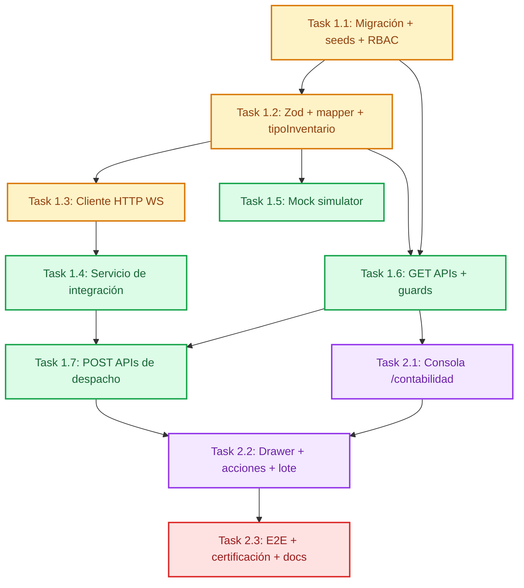

# Tasks: Integración Contable y Web Service Contabilidad (Sub-módulo 05)

> 📋 Generated by `task-planner` · 2026-11-24
> ✅ Approved by: Alejandra · 2026-11-24
> ⚠️ **Wave 0 OMITIDA por mandato del analista:** la aplicación Next.js 16.4, Prisma 6, PostgreSQL/Neon, Tailwind 4, autenticación RBAC y los modelos de Sub-03 ya existen en `app/`.

## Traceability
- **Work Item**: Sub-módulo 05 (Integración Contable y Web Service Contabilidad — pendiente de asignación de AB# en ADO)
- **Branch**: `feature/activos-fijos-05-integracion-ws-contabilidad`
- **Requirements**: [requirements.md](./requirements.md) — aprobado (`a090d5f`)
- **Design**: [design.md](./design.md) — aprobado (`aab82e9`)

## Metadata
- **Based on:** [design.md](./design.md) · [requirements.md](./requirements.md)
- **Total estimate:** ~36h (30h base + 20% de buffer)
- **Number of waves:** 2 (Wave 1 → Wave 2 · **Wave 0 omitida**)
- **Number of tasks:** 10 tareas atómicas
- **Sprint:** TBD — leer de ADO o confirmar con el Lead (no fabricar)
- **Assignee:** TBD — confirmar con el Lead (no auto-asignar)

## Task Progress
> Actualizado 2026-11-24 tras completar Task 1.3.

| Ámbito | Total | Completadas | Restantes | Avance |
|--------|-------|-------------|-----------|--------|
| **Sub-módulo 05** | **10** | **3** | **7** | **30%** |
| Wave 1 — Servicios y Endpoints | 7 | 3 (1.1–1.3) | 4 (1.4–1.7) | 43% |
| Wave 2 — Consola UI y Certificación | 3 | 0 | 3 (2.1–2.3) | 0% |

**Tareas restantes:** `1.4` Servicio de integración · `1.5` Mock simulator · `1.6` APIs GET + guards · `1.7` APIs POST · `2.1` Consola UI · `2.2` Drawer/acciones/lote · `2.3` E2E + certificación + docs.

**Esfuerzo restante estimado:** ~27h (22.5h base + 4.5h de buffer restante).

## Estimation Rules
- Máximo **4 horas** por tarea; si una tarea excede 4h durante la ejecución, se descompone inmediatamente.
- Las estimaciones incluyen implementación + pruebas unitarias + revisión.
- **Buffer 20%** incluido en el total.
- **Entorno de tests:** Vitest 5 requiere Node ≥ 22 (`node:util.styleText`). Esta máquina tiene Node 20; ejecutar con `npx -y node@22 node_modules/vitest/vitest.mjs run <ruta>`.
- **Una tarea a la vez:** propuesta → aprobación → código → lint/tests → checkoff en este documento → commit atómico (Hard Gate 18).
- **Push:** el usuario autorizó subir los cambios **al cerrar el Wave 1** y al cierre final del sub-módulo.
- **Commits:** `feat(integracion-ws): Task X.Y …` / `test(...)` / `docs(...)` según corresponda. Sin AB# asignado aún; se usa `Sub-módulo 05` en la trazabilidad.

## Dependency Graph

---

## Wave 1: Servicios y Endpoints del WS (~18.5h)

### Task 1.1: Migración Prisma, modelos WS, trigger append-only y seeds RBAC/demo (~2.5h) [COMPLETED 2026-11-24]
- **Description:** Implementar exactamente el DDL de `design.md` §4:
  - Extender `AsientoContable` con `transaccionWsId`, `codigoRespuestaWs`, `mensajeRespuestaWs`, `fechaEnvioWs`, `intentosEnvio` (default 0).
  - Crear `BitacoraEnvioWS` (`bitacora_envio_ws`) con FK a asiento/usuario, `payload JSONB`, `respuesta JSONB`, `resultado` con CHECK, `correlationId`, índices y trigger `append-only` (UPDATE/DELETE bloqueados).
  - Agregar índice `(estado, fecha_contable DESC)` en `asientos_contables`.
  - En `seed.ts`: registrar permiso `INT_MANAGE` (módulo CONTABILIDAD) y asignarlo a `ADMIN` y `OPERADOR`, conservando `ACC_POST_SEND` como alias y `ACC_LOG_READ` para `AUDITOR`.
  - Crear `seed-integracion.ts` idempotente: garantiza un usuario `auditor@unapec.edu.do` / `Auditor2026!` con rol `AUDITOR` (si no existe), 3 asientos representativos (`PENDIENTE_ENVIO`, `ERROR`, `ENVIADO`) y un evento de bitácora para el `ERROR`.
- **Acceptance criteria:**
  - [x] `pnpm prisma validate` y `pnpm prisma generate` pasan. **✅ schema válido; cliente Prisma 6.19.3 regenerado.**
  - [x] La migración `20261124000000_add_integracion_ws_contabilidad` aplica sin errores (aditiva; no altera estados ni CHECK de Sub-03). **✅ aplicada con `prisma migrate deploy` (sin shadow DB/reset sobre Neon); `migrate status` = "Database schema is up to date!".**
  - [x] El trigger impide `UPDATE`/`DELETE` en `bitacora_envio_ws` e `INSERT` funciona; `TRUNCATE` sigue disponible para setup de tests. **✅ UPDATE → "bitacora_envio_ws es append-only: UPDATE no permitido"; DELETE → "… DELETE no permitido"; el seed insertó 1 evento.**
  - [x] El seed es idempotente: 2 corridas consecutivas dejan los mismos 3 asientos, 1 log y 1 auditor (sin duplicados). **✅ corrida 1: 3 asientos + 1 log; corrida 2: 3 asientos + 0 logs nuevos; total 3 asientos (1 PENDIENTE_ENVIO, 1 ERROR, 1 ENVIADO), 1 bitácora y auditor ACTIVO.**
  - [x] `INT_MANAGE` existe en `permisos` y está asignado a `ADMIN`/`OPERADOR`; `ACC_POST_SEND` y `ACC_LOG_READ` se conservan. **✅ seed reporta 17 permisos; `INT_MANAGE` (módulo CONTABILIDAD) asignado a OPERADOR; `ACC_POST_SEND`/`ACC_LOG_READ` intactos.**
- **Dependencies:** None
- **Files to create/modify:** `app/prisma/schema.prisma`, `app/prisma/migrations/20261124000000_add_integracion_ws_contabilidad/migration.sql`, `app/prisma/seed.ts`, `app/prisma/seed-integracion.ts`

### Task 1.2: Schemas Zod, mapper de payload y resolución `tipoInventario` (~2.5h) [COMPLETED 2026-11-24]
- **Description:** Crear `app/lib/schemas/integracion.ts` con `AsientoPayloadSchema`, `WsResponseSchema`, `ListAsientosQuerySchema`, `BitacoraQuerySchema`, `BatchDispatchSchema` y `MockHeadersSchema`. Crear `app/lib/integracion/payload.ts` con:
  - Mapeo `DEBITO → DB`, `CREDITO → CR`.
  - Serialización de `Decimal` a string de 2 decimales (Half-Up).
  - Validación de balance (`Σ DB = Σ CR`, totales iguales).
  - Resolución determinista de `tipoInventario` por cuentas (`porCuentaDepreciacion`, `porPar`), con `TIPO_INVENTARIO_UNRESOLVED` si hay ambigüedad.
  - Orden determinista: `tipoInventario`, luego `DB` antes de `CR`, luego `cuentaContable`.
- **Acceptance criteria:**
  - [x] El mapper produce exactamente el JSON de `design.md` §7.1 (strings `"47812.50"`, `DB/CR`, `tipoInventario`). **✅ test de payload canónico con `"1000.00"`, `DB/CR` y `TPA-001`; `fechaAsiento` `YYYY-MM-DD`.**
  - [x] Asiento desbalanceado → 422 `ASIENTO_UNBALANCED`; sin líneas → 422 `ASIENTO_SIN_LINEAS`. **✅ validación de balance movida antes de resolver tipos; ambos códigos cubiertos por tests.**
  - [x] Cuenta de depreciación duplicada o línea DB sin par único → 422 `TIPO_INVENTARIO_UNRESOLVED`. **✅ tests de cuenta duplicada y de dos tipos con cuenta de gasto compartida/monto igual.**
  - [x] Dos ejecuciones sobre el mismo asiento generan payload idéntico byte a byte. **✅ comparación `JSON.stringify` en test de determinismo.**
  - [x] Tests unitarios en `app/tests/integracion/payload.test.ts` (≥ 95% statements del archivo). **✅ 35 tests verdes (payload + schemas); cobertura: `payload.ts` 95.65% stmts / 91.11% branches; `schemas/integracion.ts` 96.29% stmts; global 95.41% stmts.**
- **Dependencies:** Task 1.1
- **Files to create/modify:** `app/lib/schemas/integracion.ts`, `app/lib/schemas/index.ts`, `app/lib/integracion/errors.ts`, `app/lib/integracion/payload.ts`, `app/tests/integracion/payload.test.ts`, `app/tests/schemas/integracion.test.ts`

### Task 1.3: Cliente HTTP del Web Service (timeout, errores y reconciliación) (~2.5h) [COMPLETED 2026-11-24]
- **Description:** Crear `app/lib/services/ws-contabilidad.client.ts`:
  - `fetch` + `AbortController` con `WS_CONTABILIDAD_TIMEOUT_MS` (default 10 000, rango 1 000–30 000).
  - Header `x-correlation-id` (UUID v4) y header de autenticación configurable (`WS_CONTABILIDAD_AUTH_HEADER`, `WS_CONTABILIDAD_API_KEY`).
  - Validación de request/response con Zod.
  - Mapeo de resultados: 200/201 → `EXITOSO`; 400 → `WS_REJECTED`; 409 con confirmación → `RECONCILIADO`; 409 sin confirmación → `WS_DUPLICATE_UNCONFIRMED`; 5xx → `WS_SERVER_ERROR`; timeout → `WS_TIMEOUT`; red → `WS_NETWORK_ERROR`; body inválido → `WS_INVALID_RESPONSE`.
  - `WS_CONFIG_ERROR` si falta la URL o no es HTTPS en producción.
  - Nunca loguear ni persistir el token; `endpoint` sin query sensible.
- **Acceptance criteria:**
  - [x] Timeout de 10 s aborta la petición y retorna `WS_TIMEOUT` con `httpStatus=null`. **✅ test con fake timers + `AbortController`: aborta a los 1000 ms y retorna `WS_TIMEOUT`/`TIMEOUT` con `httpStatus=null`.**
  - [x] 201 válido retorna `transaccionWsId`; 409 con `numeroConfirmacion` retorna `RECONCILIADO`. **✅ ambos casos cubiertos.**
  - [x] 400/500/red/respuesta inválida mapean al código correcto sin lanzar excepción no controlada. **✅ `WS_REJECTED`, `WS_SERVER_ERROR`, `WS_NETWORK_ERROR`, `WS_INVALID_RESPONSE` y 4xx genérico cubiertos.**
  - [x] El header de autenticación no aparece en logs ni en el resultado serializado. **✅ se verifica `Authorization: Bearer …` en la petición y que el token NO aparece en `JSON.stringify(resultado)`; soporta `x-api-key` sin prefijo.**
  - [x] Tests en `app/tests/integracion/ws-client.test.ts` con `fetch` stub (sin red real). **✅ 27 tests verdes; cobertura 98.24% stmts / 100% líneas (http.ts 100%, cliente 97.43%).**
- **Dependencies:** Task 1.2
- **Files to create/modify:** `app/lib/services/ws-contabilidad.client.ts`, `app/lib/integracion/errors.ts`, `app/lib/integracion/http.ts`, `app/tests/integracion/ws-client.test.ts`

### Task 1.4: Servicio de integración contable (despacho, reintento, lote y lock) (~4h)
- **Description:** Crear `app/lib/services/integracion-contable.service.ts`:
  - Despacho individual: validar asiento/líneas/balance, resolver tipo, construir payload, enviar, actualizar estado + campos WS + `intentosEnvio`, insertar bitácora en la misma transacción.
  - Reintento: solo `ERROR`; mismo `numeroAsiento` y snapshot; nuevo intento.
  - Lote: pendientes del período, secuencial, máximo 25, resultado parcial con `restantes`.
  - Concurrencia: `pg_advisory_xact_lock(hashtext(numeroAsiento)::bigint)` + relectura de estado; transacción con `timeout = WS_TIMEOUT + 5000`, `maxWait = 5000`.
  - Rollback si falla la bitácora (`AUDIT_LOG_FAILED`); reconciliación 409.
- **Acceptance criteria:**
  - [ ] `PENDIENTE_ENVIO + 201 → ENVIADO` con confirmación, intento 1 y bitácora `EXITOSO`.
  - [ ] `PENDIENTE_ENVIO + 500/timeout → ERROR` con bitácora `RECHAZADO`/`TIMEOUT` e intento 1.
  - [ ] `ENVIADO` → 409 `ASIENTO_ALREADY_SENT` sin llamada al WS.
  - [ ] `ERROR + 201 → ENVIADO` con intento 2 y 2 eventos de bitácora.
  - [ ] Dos despachos concurrentes del mismo asiento generan una sola confirmación y una sola transición a `ENVIADO`.
  - [ ] Lote de 3 (2 ok, 1 error) → `{total:3, enviados:2, errores:1, restantes:0}`; 30 pendientes → 25 procesados y `restantes:5`.
  - [ ] Falla simulada de inserción de bitácora → rollback y 500 `AUDIT_LOG_FAILED` (sin `ENVIADO`).
  - [ ] Tests en `app/tests/services/integracion-contable.test.ts`.
- **Dependencies:** Task 1.2, Task 1.3
- **Files to create/modify:** `app/lib/services/integracion-contable.service.ts`, `app/tests/services/integracion-contable.test.ts`

### Task 1.5: Mock simulator del Web Service (~1.5h)
- **Description:** Crear `app/app/api/mock/contabilidad/asientos/route.ts`:
  - Validar payload con Zod; `201` con `numeroConfirmacion` `WS-YYYYMMDD-NNNNN`.
  - Duplicado por `numeroAsiento` → `409 ASIENTO_ALREADY_SENT` con la confirmación original.
  - Headers `x-mock-scenario: 400|409|500` y `x-mock-delay-ms: 0..30000`.
  - `404` en producción salvo `ENABLE_WS_MOCK=true`; sin sesión (servidor→servidor) y exento en middleware.
  - Sin escrituras en `asientos_contables` ni `bitacora_envio_ws`.
- **Acceptance criteria:**
  - [ ] Payload válido → 201 con `codigoRespuesta="201"` y confirmación con formato correcto.
  - [ ] Segundo envío del mismo `numeroAsiento` → 409 con la misma confirmación.
  - [ ] Escenarios 400/500 y delay funcionan; `x-mock-delay-ms: 11000` provoca timeout en el cliente.
  - [ ] Producción sin bandera → 404; desarrollo → disponible.
  - [ ] Tests en `app/tests/api/mock-contabilidad.test.ts`.
- **Dependencies:** Task 1.2
- **Files to create/modify:** `app/app/api/mock/contabilidad/asientos/route.ts`, `app/tests/api/mock-contabilidad.test.ts`

### Task 1.6: APIs GET (lista + KPIs, detalle, bitácora), guards y middleware (~3h)
- **Description:** Implementar:
  - `app/lib/services/contabilidad-query.service.ts`: lista paginada con filtros `estado`/`periodo`, orden `fecha|numero`, KPIs sobre el universo del período; detalle con líneas, `tipoInventario`, balance y último intento; bitácora paginada.
  - `app/lib/guards/contabilidad-guard.ts`: `requireContabilidadRead` (`INT_MANAGE` | `ACC_POST_SEND` | `ACC_LOG_READ`), `requireContabilidadManage` (`INT_MANAGE` | `ACC_POST_SEND`), `requireContabilidadLog` (`ACC_LOG_READ`).
  - Rutas `GET /api/contabilidad/asientos`, `GET /api/contabilidad/asientos/[id]`, `GET /api/contabilidad/bitacora`.
  - Corregir `app/middleware.ts`: bloque de `/api/contabilidad` con `INT_MANAGE`/`ACC_POST_SEND` (reemplaza `DEP_EXECUTE`/`ACC_DISPATCH` inexistentes) y exención de `/api/mock/**` solo con mock habilitado.
- **Acceptance criteria:**
  - [ ] Lista responde `data`, `kpis` y `meta` exactos; KPIs no cambian con el filtro de estado, sí con `periodo`.
  - [ ] Detalle devuelve líneas con `DB/CR`, `tipoInventario`, `balance` y `puedeDespachar/puedeReintentar`; 404 si no existe.
  - [ ] Bitácora exige `ACC_LOG_READ`; un usuario solo `INT_MANAGE` recibe 403.
  - [ ] Sin sesión → 401; sin permiso → 403; método no soportado → 405.
  - [ ] Tests en `app/tests/api/contabilidad.test.ts` (lista, detalle, bitácora, RBAC).
- **Dependencies:** Task 1.1, Task 1.2
- **Files to create/modify:** `app/lib/services/contabilidad-query.service.ts`, `app/lib/guards/contabilidad-guard.ts`, `app/app/api/contabilidad/asientos/route.ts`, `app/app/api/contabilidad/asientos/[id]/route.ts`, `app/app/api/contabilidad/bitacora/route.ts`, `app/middleware.ts`, `app/tests/api/contabilidad.test.ts`

### Task 1.7: APIs POST de despacho, reintento y lote (~2.5h)
- **Description:** Implementar:
  - `POST /api/contabilidad/asientos/[id]/despachar`
  - `POST /api/contabilidad/asientos/[id]/reintentar`
  - `POST /api/contabilidad/asientos/despachar-pendientes`
  - Respuestas RFC 7807 (`application/problem+json`) con el catálogo de `design.md` §6.8.
  - `maxDuration = 300` en la ruta de lote; `runtime = "nodejs"` en todas.
- **Acceptance criteria:**
  - [ ] Despacho exitoso → 200 con `estado`, `transaccionWsId`, `intento`, `duracionMs`.
  - [ ] 409 `ASIENTO_ALREADY_SENT`, 409 `ASIENTO_NOT_RETRYABLE`, 422 `ASIENTO_UNBALANCED`, 502/504 del WS se mapean correctamente.
  - [ ] Lote devuelve resumen y no aborta por fallo individual; lote vacío → `{total:0}` sin llamadas al WS.
  - [ ] Todas las rutas validan sesión + permiso server-side (dual-check) y responden 401/403.
  - [ ] Tests en `app/tests/api/contabilidad.test.ts` (mutaciones, errores, lote, RBAC).
- **Dependencies:** Task 1.4, Task 1.6
- **Files to create/modify:** `app/app/api/contabilidad/asientos/[id]/despachar/route.ts`, `app/app/api/contabilidad/asientos/[id]/reintentar/route.ts`, `app/app/api/contabilidad/asientos/despachar-pendientes/route.ts`, `app/tests/api/contabilidad.test.ts`

> 🔖 **Cierre de Wave 1:** tras aprobar Task 1.7, ejecutar la suite completa, lint scoped y **push autorizado** de la rama (`git push origin feature/activos-fijos-05-integracion-ws-contabilidad`).

---

## Wave 2: Consola UI y Certificación (~11.5h)

### Task 2.1: Consola `/contabilidad` — shell, KPIs, filtros y tabla (~3.5h)
- **Description:** Crear:
  - `app/app/contabilidad/page.tsx` (server, guard de permisos, `Suspense`).
  - `app/components/contabilidad/contabilidad-content.tsx` (estado URL, fetch, loading/error/empty).
  - `kpi-cards.tsx`, `asientos-table.tsx`, `types.ts`.
  - Item "Contabilidad" en `app-sidebar.tsx` y breadcrumb, filtrado por permisos.
  - Filtros estado/período, tamaño 10/25/50, orden por fecha/número, paginación server-side.
- **Acceptance criteria:**
  - [ ] `/contabilidad` muestra 4 KPIs y la tabla con datos reales del API.
  - [ ] Filtros actualizan URL, lista y KPIs correctamente; "Restablecer" limpia todo.
  - [ ] Paginación server-side exacta; empty state y skeleton visibles.
  - [ ] El item de menú solo aparece con `INT_MANAGE`/`ACC_POST_SEND`/`ACC_LOG_READ`.
  - [ ] Sin `console.error` inesperados; diseño consistente con Catálogos/Reportes.
- **Dependencies:** Task 1.6
- **Files to create/modify:** `app/app/contabilidad/page.tsx`, `app/components/contabilidad/contabilidad-content.tsx`, `app/components/contabilidad/kpi-cards.tsx`, `app/components/contabilidad/asientos-table.tsx`, `app/components/contabilidad/types.ts`, `app/components/layout/app-sidebar.tsx`, `app/components/layout/console-breadcrumb.tsx`

### Task 2.2: Drawer de detalle, visor de payload/bitácora y acciones operativas (~4h)
- **Description:** Crear:
  - `asiento-detail-sheet.tsx`: cabecera, líneas DB/CR, balance, panel de integración, acciones.
  - `payload-viewer.tsx`: JSON formateado, copiar, solo lectura.
  - `batch-dispatch-dialog.tsx`: confirmación con conteo, resumen de resultados.
  - Toasts accesibles; refresco de KPIs/lista tras cada acción.
  - Reglas de visibilidad: `INT_MANAGE`/`ACC_POST_SEND` para acciones; `ACC_LOG_READ` para historial completo.
- **Acceptance criteria:**
  - [ ] Drawer con focus trap, `Escape`, overlay y retorno de foco; balance `RD$ 0.00` en verde y diferencia en rojo.
  - [ ] Despachar/reintentar actualizan estado y KPIs sin recargar la página; 409/502/504 muestran mensaje específico.
  - [ ] Lote pide confirmación, muestra resumen (`enviados/errores/restantes`) y refresca.
  - [ ] AUDITOR ve detalle y bitácora, pero ningún botón de acción.
  - [ ] Payload viewer muestra el JSON exacto y permite copiar; sin edición.
- **Dependencies:** Task 2.1, Task 1.7
- **Files to create/modify:** `app/components/contabilidad/asiento-detail-sheet.tsx`, `app/components/contabilidad/payload-viewer.tsx`, `app/components/contabilidad/batch-dispatch-dialog.tsx`, `app/components/contabilidad/contabilidad-content.tsx`

### Task 2.3: E2E Playwright, certificación y documentación viva (~4h)
- **Description:** Crear `app/e2e/contabilidad-smoke.spec.ts` con los flujos de `design.md` §12.3; ejecutar lint scoped, suite Vitest completa, suite E2E completa, cobertura del sub-módulo y build; actualizar documentación viva.
- **Acceptance criteria:**
  - [ ] E2E: login ADMIN → consola/KPIs/filtros/paginación; detalle + despacho; reintento de `ERROR`; lote; visor de payload/bitácora; login AUDITOR read-only (403 en POST).
  - [ ] `pnpm test:e2e` completo pasa headless (los E2E preexistentes incluidos).
  - [ ] Cobertura del sub-módulo ≥ 85% statements (servicios, schemas, guards y rutas).
  - [ ] `pnpm lint` scoped a archivos nuevos/modificados en verde; `pnpm build` exit 0.
  - [ ] Sin `console.error` inesperados ni texto corrupto (U+FFFD) en archivos del Sub-05.
  - [ ] `docs/architecture/database-architecture.md`, `docs/architecture/system-overview.md`, `docs/modules/activos-fijos.md`, `README.md` actualizados con tabla, rutas, permisos y variables.
  - [ ] Change log del sub-módulo registrado en este documento.
- **Dependencies:** Task 2.2
- **Files to create/modify:** `app/e2e/contabilidad-smoke.spec.ts`, `docs/architecture/database-architecture.md`, `docs/architecture/system-overview.md`, `docs/modules/activos-fijos.md`, `README.md`

---

## Implementation Order Summary

| Order | Task | Description | Est. | Depends On |
|-------|------|-------------|------|------------|
| 1 | 1.1 | Migración + modelos WS + trigger + seeds RBAC/demo | ~2.5h | — |
| 2 | 1.2 | Zod + mapper + resolución `tipoInventario` | ~2.5h | 1.1 |
| 3 | 1.3 | Cliente HTTP del WS | ~2.5h | 1.2 |
| 4 | 1.4 | Servicio de integración (despacho/reintento/lote/lock) | ~4h | 1.2, 1.3 |
| 5 | 1.5 | Mock simulator | ~1.5h | 1.2 |
| 6 | 1.6 | APIs GET + guards + middleware | ~3h | 1.1, 1.2 |
| 7 | 1.7 | APIs POST de despacho/reintento/lote | ~2.5h | 1.4, 1.6 |
| 8 | 2.1 | Consola `/contabilidad` (shell/KPIs/filtros/tabla) | ~3.5h | 1.6 |
| 9 | 2.2 | Drawer + payload/bitácora + acciones + lote | ~4h | 2.1, 1.7 |
| 10 | 2.3 | E2E + certificación + docs | ~4h | 2.2 |

## Total Estimate: ~36h (30h base + 20% buffer)

## Completion Checklist
- [ ] Las 10 tareas completadas y checkeadas en este documento
- [ ] `pnpm test` (Vitest con Node 22) en verde
- [ ] `pnpm test:e2e` completo en verde
- [ ] Cobertura del sub-módulo ≥ 85% statements
- [ ] `pnpm lint` scoped del Sub-05 en verde y `pnpm build` exit 0
- [ ] Bitácora append-only verificada (UPDATE/DELETE bloqueados)
- [ ] RBAC verificado: ADMIN, OPERADOR (`INT_MANAGE`/`ACC_POST_SEND`), AUDITOR (`ACC_LOG_READ`)
- [ ] Documentación viva actualizada y change log registrado
- [ ] Push de cierre de Wave 1 y push final realizados con aprobación

## Change Log

| Fecha | Cambio | Commit |
|-------|--------|--------|
| 2026-11-24 | Creación de `tasks.md` — 10 tareas, Wave 1 (servicios/endpoints) y Wave 2 (UI/certificación), sin Wave 0. | `cd2074e` |
| 2026-11-24 | Task 1.1 completada — migración `20261124000000_add_integracion_ws_contabilidad`, campos WS, `bitacora_envio_ws` append-only con trigger, `INT_MANAGE` y `seed-integracion.ts` idempotente (3 asientos + auditor). | `d417065` |
| 2026-11-24 | Task 1.2 completada — schemas Zod del wire/query, catálogo `IntegrationError`, mapper `DEBITO→DB/CREDITO→CR`, montos string 2 decimales y resolución determinista de `tipoInventario`; 35 tests verdes, 95.41% cobertura. | `9187a9b` |
| 2026-11-24 | Añadido tablero de progreso: 2/10 tareas completadas, 8 restantes (~30h estimadas). | `—` |
| 2026-11-24 | Task 1.3 completada — cliente HTTP del WS con `AbortController`, timeout configurable, auth enmascarada, mapeo 200/201/400/409/5xx/red y reconciliación 409; 27 tests verdes, 98.24% cobertura. | `dc04fcf` |

---
> 📍 Sub-módulo 05 · 🌿 `feature/activos-fijos-05-integracion-ws-contabilidad` · Generated by SDD Standard · Generated by `task-planner` (SDD Plan Agent)
